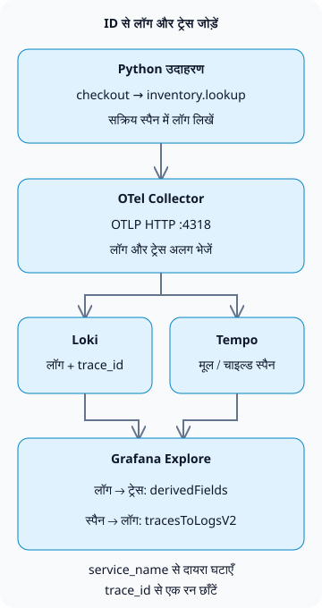

---
{
  "state": "draft",
  "language": "hi",
  "translationKey": "2026-11-02-grafana-lgtm-log-trace",
  "title": "Grafana LGTM में लॉग और ट्रेस कैसे जोड़ें? trace_id से Loki और Tempo के बीच जाएँ",
  "description": "OpenTelemetry से लॉग और स्पैन इकट्ठा करके Grafana में Loki और Tempo जोड़ें। Docker और Python के स्थानीय उदाहरण में देखें कि ID गायब हो या क्वेरी खाली लौटे तो क्या जाँचें।",
  "sourcePath": "src/content/posts/en/2026-11-02-grafana-lgtm-log-trace.md",
  "sourceSha256": "ea19472a99523fa3e56c758e753b8333671691c4efd6f1dec67f9e59c3eaf558"
}
---

**Grafana LGTM में लॉग को ट्रेस से जोड़ने के लिए एक ही `trace_id` के साथ लॉग और स्पैन भेजें और Grafana में Loki व Tempo दोनों डेटा सोर्स कॉन्फ़िगर करें।** तब किसी त्रुटि के लॉग से उसके निष्पादन का रास्ता खोल सकते हैं और स्पैन से वापस संबंधित लॉग पर आ सकते हैं।

LGTM में Loki लॉग के लिए, Grafana क्वेरी और विज़ुअलाइज़ेशन के लिए, Tempo ट्रेस के लिए और Mimir मेट्रिक के लिए है। यहाँ लॉग और ट्रेस के बीच संबंध देखेंगे। संचालन की व्यापक प्रक्रिया के लिए [AI एजेंट के साथ संचालन](/en/posts/2026-10-31-ai-agent-operations/) देखें।

## किन पहचानकर्ताओं का मिलना ज़रूरी है?

ट्रेस पूरे एक निष्पादन को दर्शाता है। स्पैन उसके अलग-अलग ऑपरेशन दिखाते हैं। उदाहरण में मूल `checkout` स्पैन और उसके चाइल्ड `inventory.lookup` का ट्रेस ID एक है, लेकिन स्पैन ID अलग हैं। सक्रिय स्पैन के भीतर लॉग लिखने पर लॉग रिकॉर्ड में उस स्पैन का कॉन्टेक्स्ट आ सकता है। अलग सेवाओं के बीच संबंध जोड़ने के लिए कॉन्टेक्स्ट आगे भेजना भी ज़रूरी है, जैसे HTTP के `traceparent` हेडर से। [OpenTelemetry में कॉन्टेक्स्ट आगे भेजना](https://opentelemetry.io/docs/concepts/context-propagation/)



दोनों स्टोर के बीच कड़ी Grafana की क्वेरी बनाती है। Loki लॉग को Tempo तक नहीं पहुँचाता और Grafana गायब ट्रेस नहीं बनाता। यह उदाहरण एक ही प्रक्रिया में स्वयं स्पैन बनाता है। इसमें HTTP सर्वर, सेवाओं के बीच कॉल या इन्वेंट्री डेटाबेस लागू नहीं किए गए हैं।

## स्थानीय संग्रह परिवेश तैयार करें

Docker और Python वर्चुअल एनवायरनमेंट की सुविधा वाली मशीन पर एक खाली डायरेक्टरी में नीचे की चार फ़ाइलें बनाएँ। जाँच में **Python 3.13.0, OpenTelemetry Python 1.45.2 और `grafana/otel-lgtm` 0.39.0** इस्तेमाल हुए। इमेज में Grafana 13.3.0, Loki 3.7.9, Tempo 3.1.1 और Collector 0.164.0 हैं।

[आधिकारिक Docker LGTM इमेज](https://grafana.com/docs/opentelemetry/docker-lgtm/) विकास, डेमो और टेस्ट के लिए है। मेट्रिक का बैकएंड Prometheus है। यहाँ प्रोडक्शन Mimir क्लस्टर तैयार नहीं किया जाता। लॉग और ट्रेस के लिए इमेज में मौजूद Collector, Loki, Tempo और Grafana इस्तेमाल करेंगे।

### `compose.yaml`

```yaml
services:
  lgtm:
    image: grafana/otel-lgtm:0.39.0@sha256:4c8056c9c05fcb3c8fd93800e85334bfd79b4d0271b47a54a121a64af41fe1fe
    ports:
      - '127.0.0.1:13000:3000'
      - '127.0.0.1:14318:4318'
    environment:
      GF_AUTH_ANONYMOUS_ENABLED: 'true'
      GF_AUTH_ANONYMOUS_ORG_ROLE: Editor
    volumes:
      - ./datasources.yaml:/otel-lgtm/grafana/conf/provisioning/datasources/grafana-datasources.yaml:ro
```

यह स्थानीय अभ्यास है। अनाम उपयोगकर्ताओं को Explore के लिए Editor अनुमति मिलती है और Grafana व OTLP होस्ट के `127.0.0.1` पर बाइंड होते हैं। प्रोडक्शन में प्रमाणीकरण, TLS और पहुँच की पाबंदियाँ चाहिए। होस्ट पर Python पोर्ट `14318` इस्तेमाल करता है। कंटेनर के भीतर Collector का पोर्ट `4318` है। डेटा सोर्स के URL Grafana के कंटेनर के अंदर का लूपबैक इस्तेमाल करते हैं। Loki और Tempo अलग कंटेनर में हों तो सेवा के DNS नाम दें।

### `datasources.yaml`

```yaml
apiVersion: 1
datasources:
  - name: Tempo
    type: tempo
    uid: tempo
    url: http://127.0.0.1:3200
    jsonData:
      tracesToLogsV2:
        datasourceUid: loki
        spanStartTimeShift: '-2s'
        spanEndTimeShift: '2s'
        tags:
          - key: service.name
            value: service_name
        customQuery: true
        query: '{$${__tags}} | trace_id = "$${__trace.traceId}"'
  - name: Loki
    type: loki
    uid: loki
    url: http://127.0.0.1:3100
    jsonData:
      derivedFields:
        - name: trace_id
          matcherType: label
          matcherRegex: '^trace_id$'
          datasourceUid: tempo
          url: '$${__value.raw}'
          urlDisplayLabel: View trace
```

`tracesToLogsV2` स्पैन से लॉग की क्वेरी बनाता है और `derivedFields` लॉग से Tempo का लिंक बनाता है। `service.name` को Loki के `service_name` से मिलाएँ और फिर ट्रेस ID से फ़िल्टर करें। `customQuery` चालू होने पर यह फ़िल्टर क्वेरी में स्पष्ट रूप से लिखा जाता है। [Grafana में दोनों दिशाओं की सेटिंग](https://grafana.com/docs/grafana/latest/datasources/tempo/configure-tempo-data-source/configure-trace-to-logs/)

`$${...}` **Grafana की प्रोविज़निंग फ़ाइल** में वेरिएबल सुरक्षित रखता है। अलग से माउंट की गई इस फ़ाइल की स्ट्रिंग में Compose वेरिएबल नहीं बदलता। Grafana के UI में सीधे मान भरते समय `${...}` इस्तेमाल करें। यहाँ [आधिकारिक इमेज की डेटा सोर्स सेटिंग](https://github.com/grafana/docker-otel-lgtm/blob/v0.39.0/docker/grafana-datasources.yaml) से केवल लॉग और ट्रेस जोड़ने की सेटिंग रखी गई है।

OTLP से आए डेटा में `trace_id` को Loki के संरचित मेटाडेटा में खोजते हैं। यह लॉग बॉडी का JSON फ़ील्ड नहीं है, इसलिए उदाहरण में `| json` नहीं चाहिए। Grafana का `matcherType: label` तय करता है कि फ़ील्ड कैसे ढूँढ़ना है। इससे ट्रेस ID, Loki का इंडेक्स लेबल नहीं बनता। [Loki में OTLP डेटा के भंडारण के नियम](https://grafana.com/docs/loki/latest/send-data/otel/)

### `requirements.txt`

```text
opentelemetry-sdk==1.45.2
opentelemetry-exporter-otlp-proto-http==1.45.2
```

### `demo.py`

```python
import logging

from opentelemetry import trace
from opentelemetry.exporter.otlp.proto.http._log_exporter import OTLPLogExporter
from opentelemetry.exporter.otlp.proto.http.trace_exporter import OTLPSpanExporter
from opentelemetry.sdk._logs import LoggerProvider, LoggingHandler
from opentelemetry.sdk._logs.export import BatchLogRecordProcessor
from opentelemetry.sdk.resources import Resource
from opentelemetry.sdk.trace import TracerProvider
from opentelemetry.sdk.trace.export import BatchSpanProcessor
from opentelemetry.sdk.trace.sampling import ALWAYS_ON
from opentelemetry.trace import Status, StatusCode

resource = Resource.create({"service.name": "checkout-demo"})
traces = TracerProvider(resource=resource, sampler=ALWAYS_ON)
traces.add_span_processor(BatchSpanProcessor(OTLPSpanExporter(
    endpoint="http://127.0.0.1:14318/v1/traces")))
trace.set_tracer_provider(traces)
logs = LoggerProvider(resource=resource)
logs.add_log_record_processor(BatchLogRecordProcessor(OTLPLogExporter(
    endpoint="http://127.0.0.1:14318/v1/logs")))
handler = LoggingHandler(logger_provider=logs)
logger = logging.getLogger("checkout-demo")
logger.setLevel(logging.INFO)
logger.propagate = False
logger.addHandler(handler)
tracer = trace.get_tracer("checkout-demo")

try:
    with tracer.start_as_current_span("checkout") as checkout:
        trace_id = f"{checkout.get_span_context().trace_id:032x}"
        logger.info("checkout_started")
        with tracer.start_as_current_span("inventory.lookup") as inventory:
            logger.error("inventory_unavailable")
            inventory.set_status(Status(StatusCode.ERROR, "demo failure"))
        checkout.set_status(Status(StatusCode.ERROR, "inventory unavailable"))
    assert logs.force_flush(timeout_millis=10000), "log flush timed out"
    assert traces.force_flush(timeout_millis=10000), "trace flush timed out"
    print(f"trace_id={trace_id}")
finally:
    logger.removeHandler(handler)
    logs.shutdown()
    traces.shutdown()
```

`inventory_unavailable` जानबूझकर लिखा गया त्रुटि संदेश है। इससे इन्वेंट्री सेवा की वास्तविक विफलता नहीं दोहराई गई और न सेवा का प्रदर्शन मापा गया। उदाहरण दोनों स्पैन का स्टेटस स्पष्ट रूप से त्रुटि सेट करता है। `LoggingHandler` और OTLP एक्सपोर्टर सक्रिय स्पैन के पहचानकर्ता लॉग में पहुँचाते हैं। [Python इंस्ट्रुमेंटेशन](https://opentelemetry.io/docs/languages/python/instrumentation/)

उदाहरण में SDK का वही संस्करण तय किया गया है जिस पर जाँच हुई। [Python समर्थन की स्थिति](https://opentelemetry.io/docs/languages/python/) में लॉग की श्रेणी Development है। संस्करण बदलने पर लॉग API और एक्सपोर्टर की संगतता फिर जाँचें। अभ्यास में `ALWAYS_ON` हर स्पैन रिकॉर्ड करता है। यह प्रोडक्शन के लिए अनुशंसित सैंपलिंग नीति नहीं है।

## मिले हुए ट्रेस ID से दोनों स्टोर में खोजें

चारों फ़ाइलों वाली डायरेक्टरी में ये कमांड चलाएँ। पहली बार Docker Hub और PyPI से डाउनलोड होगा। कमांड Unix शैली के शेल के लिए हैं।

```sh
docker compose -p blog-lgtm-lab up -d --wait --wait-timeout 180
python3 -m venv .venv
.venv/bin/python -m pip install -r requirements.txt
.venv/bin/python demo.py
```

कंटेनर की स्थिति स्वस्थ होने के बाद Python चलाएँ। इमेज डाउनलोड होने और Grafana शुरू होने में समय लग सकता है। तैयार होने से पहले निर्यात विफल हो सकता है। `force_flush()` निर्यात की प्रोसेसिंग पूरी होने की प्रतीक्षा करता है। स्टोर में डेटा पहुँचने की अंतिम पुष्टि क्वेरी से करें।

नीचे अभ्यास के दौरान मिला ट्रेस ID है। हर रन नया ID बनाता है। आगे की क्वेरी में **अपने रन का ID** दें।

```text
trace_id=b95b8ec2e8c6fa5a608f197d1cfe3691
```

1. `http://127.0.0.1:13000` खोलें, **Explore → Loki** चुनें और समय सीमा पिछला एक घंटा रखें।
2. इस LogQL एक्सप्रेशन से दोनों लॉग खोजें।

```text
{service_name="checkout-demo"} | trace_id = "b95b8ec2e8c6fa5a608f197d1cfe3691"
```

3. `inventory_unavailable` खोलें और `trace_id` के लिए **View trace** चुनें। Tempo में `checkout` के नीचे `inventory.lookup` ढूँढ़ें।
4. Tempo पैनल में **Related logs** से Loki पर लौटें। संस्करण के अनुसार यह स्पैन का **Logs for this span** लिंक हो सकता है। क्वेरी `span_id` पर फ़िल्टर नहीं करती। सेवा और समय सीमा मेल खाने पर ट्रेस के दोनों लॉग दिख सकते हैं।

स्थानीय क्वेरी में **दो लॉग और दो स्पैन** मिले। मूल और चाइल्ड स्पैन का संबंध और लॉग के स्पैन ID भी मेल खाते थे। Loki के series API में न `trace_id` और न `span_id` इंडेक्स लेबल था। ऐसा ट्रेस ID देने पर जो मौजूद नहीं था, कोई लॉग नहीं मिला। ब्राउज़र में भी त्रुटि लॉग से Tempo और वहाँ से संबंधित Loki लॉग पर वापस जाना जाँचा गया। ये परिणाम एक ही प्रक्रिया में डेटा इकट्ठा करने और उसका संबंध खोजने के हैं। प्रोडक्शन लोड या रिकवरी नहीं जाँची गई।

## लिंक खुलने पर डेटा न मिले तो क्या जाँचें?

| लक्षण | पहले क्या जाँचें | अगला कदम |
| --- | --- | --- |
| लॉग में ट्रेस ID नहीं है | क्या सक्रिय स्पैन के भीतर लॉग लिखा था? | थ्रेड, कोरूटीन और असिंक्रोनस सीमाओं पर कॉन्टेक्स्ट आगे जाना जाँचें |
| Loki क्वेरी चलती है लेकिन Tempo लिंक नहीं दिखता | `derivedFields` का फ़ील्ड नाम और Tempo UID | मैचर को वास्तविक `trace_id` फ़ील्ड से मिलाएँ |
| स्पैन में लॉग का लिंक नहीं है | `service.name` और डेटा सोर्स में टैग की मैपिंग | Loki के `service_name` मान से मिलाएँ |
| लिंक की लॉग क्वेरी खाली लौटती है | समय सीमा, सेवा और ट्रेस ID | LogQL सीधे चलाएँ। डेटा पहुँचने की देरी और घड़ियों का अंतर जाँचें |
| लॉग हैं लेकिन ट्रेस नहीं मिलता | ट्रेस एक्सपोर्टर, सैंपलिंग और Tempo में डेटा रखने की अवधि | Collector के निर्यात की त्रुटियाँ और डेटा प्रतिधारण की नीति जाँचें |

प्रोडक्शन में `trace_id`, `user_id` और ऑर्डर नंबर को इंडेक्स लेबल न बनाएँ। अलग-अलग मान Loki की स्ट्रीम की संख्या बढ़ाते हैं। सेवा और परिवेश जैसे सीमित मानों से खोज का दायरा घटाएँ और फिर लॉग बॉडी या संरचित मेटाडेटा में ID फ़िल्टर करें। [Loki में कार्डिनैलिटी](https://grafana.com/docs/loki/latest/get-started/labels/cardinality/)

लॉग या ट्रेस न मिलना सेवा के स्वस्थ होने का प्रमाण नहीं है। सैंपलिंग में ट्रेस छूट सकता है, डेटा रखने की अवधि अलग हो सकती है या Collector से निर्यात में देरी हो सकती है। लॉग बॉडी और baggage में टोकन या निजी डेटा न रखें। प्रोडक्शन में इस्तेमाल से पहले संग्रह विफल होने के अलर्ट, डेटा रखने की अवधि और संवेदनशील जानकारी हटाने के नियम तय करें।

अभ्यास के बाद कंटेनर और उससे जुड़े अनाम वॉल्यूम हटाएँ। इस उदाहरण का डेटा सहेजकर नहीं रखा जाता।

```sh
docker compose -p blog-lgtm-lab down -v
```
