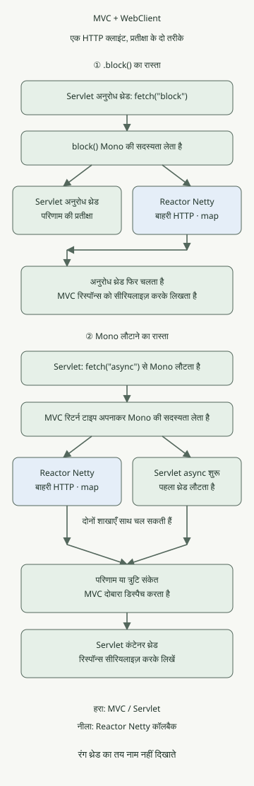

---
{
  "state": "draft",
  "language": "hi",
  "translationKey": "2026-11-09-spring-mvc-webclient-execution",
  "title": "Spring MVC में WebClient के साथ .block() और Mono का थ्रेड पर क्या असर पड़ता है?",
  "description": "Tomcat के उदाहरण से देखें कि Spring MVC और Reactor Netty किस चरण को सँभालते हैं। WebClient पर .block() कॉल करने, Mono लौटाने और वर्चुअल थ्रेड चालू करने की तुलना करें।",
  "sourcePath": "src/content/posts/en/2026-11-09-spring-mvc-webclient-execution.md",
  "sourceSha256": "6f81dd9e98a391f7b05ca1d0fef8c01ca8288550531caf852ae518c60843dba8"
}
---

**Spring MVC में WebClient नॉन-ब्लॉकिंग HTTP संचार कर सकता है, लेकिन कंट्रोलर में `.block()` कॉल करने पर MVC का अनुरोध थ्रेड परिणाम के लिए प्रतीक्षा करता है।** `Mono` लौटाने पर MVC उसे Servlet की असिंक्रोनस प्रोसेसिंग से जोड़ता है और शुरुआती अनुरोध थ्रेड को मुक्त कर सकता है। क्लाइंट की ओर से HTTP कॉल करना और सर्वर पर अनुरोध सँभालना अलग काम हैं।

यहाँ **Tomcat पर Spring MVC और Reactor Netty के साथ WebClient** इस्तेमाल हुए हैं। दूसरे HTTP कनेक्टर में थ्रेड के नाम और संसाधन अलग हो सकते हैं। उदाहरण Spring Boot 3.5.16, JDK 21 और Gradle 8.14.3 पर चलाया गया। इसमें Boot के हर मौजूदा संस्करण की जाँच नहीं हुई है।

## क्या WebClient जोड़ने पर सर्वर WebFlux इस्तेमाल करने लगता है?

सर्वर पर MVC और बाहर कॉल करने वाले WebClient की भूमिकाएँ अलग हैं। यहाँ Tomcat और `DispatcherServlet` आने वाले अनुरोध सँभालते हैं, जबकि WebClient का Reactor Netty कनेक्टर बाहर जाने वाले HTTP अनुरोध सँभालता है।

Boot 3.5 में `spring-boot-starter-web` और `spring-boot-starter-webflux` दोनों जोड़ने पर डिफ़ॉल्ट रूप से MVC चुना जाता है। इससे ऐप WebClient के लिए WebFlux स्टार्टर जोड़ सकता है। यदि ऐप का प्रकार स्पष्ट रूप से बदला गया है या सर्वर का कॉन्फ़िगरेशन अलग है तो चयन अलग से जाँचें। [Boot में MVC और WebFlux का चयन](https://docs.spring.io/spring-boot/3.5/reference/web/reactive.html#web.reactive.webflux)

## `.block()` कॉल करने और `Mono` लौटाने के रास्ते कहाँ अलग होते हैं?



हरे रंग में Servlet और MVC की ज़िम्मेदारियाँ हैं और नीले में Reactor Netty की। असिंक्रोनस रास्ते की दोनों शाखाएँ समय में एक-दूसरे से ओवरलैप कर सकती हैं। बाहरी रिस्पॉन्स शुरुआती अनुरोध थ्रेड के लौटने से पहले भी आ सकता है। चित्र में सफलता के संकेत दिखाए हैं। कोड में MVC की त्रुटि हैंडलिंग से पहले त्रुटि संकेतों को HTTP स्टेटस कोड में बदला जाता है।

| चरण | `.block()` के बाद मान लौटाना | `Mono` लौटाना |
| --- | --- | --- |
| सदस्यता | `.block()` सदस्यता लेता है | MVC लौटाए गए प्रकार की सदस्यता लेता है |
| बाहर गए HTTP अनुरोध की प्रतीक्षा | अनुरोध थ्रेड प्रतीक्षा करता है | Servlet की असिंक्रोनस प्रोसेसिंग शुरुआती अनुरोध थ्रेड मुक्त कर सकती है |
| रिस्पॉन्स बॉडी मिलने पर | क्लाइंट कॉलबैक परिणाम देता है और प्रतीक्षा समाप्त होती है | परिणाम का संकेत MVC की असिंक्रोनस प्रोसेसिंग को मिलता है |
| अंतिम HTTP रिस्पॉन्स | MVC लौटाए गए मान को सीरियलाइज़ करके लिखता है | MVC फिर डिस्पैच करके मान को सीरियलाइज़ करता और लिखता है |

`retrieve().bodyToMono(...)` अनुरोध की पाइपलाइन तैयार करता है। नीचे की WebClient पाइपलाइन HTTP अनुरोध शुरू करने से पहले सदस्यता चाहती है। दोबारा सदस्यता लेने पर एक और अनुरोध जा सकता है। इसलिए पहले `.block()` से पढ़कर फिर वही पाइपलाइन लौटाने वाले कोड पर ध्यान दें।

MVC एक मान देने वाले `Mono` को `DeferredResult` की तरह सँभालता है। परिणाम तैयार होने पर वह रिस्पॉन्स पूरा करने के लिए Servlet कंटेनर को फिर डिस्पैच करता है। पूल वही थ्रेड फिर इस्तेमाल कर सकता है, इसलिए दोबारा डिस्पैच होने पर अलग थ्रेड मिलना ज़रूरी नहीं है। जब तक रिस्पॉन्स खुला है तब तक कनेक्शन और असिंक्रोनस अनुरोध के संसाधन भी रहते हैं। `Mono` लौटाने से Servlet रिस्पॉन्स लिखने का पूरा काम नॉन-ब्लॉकिंग नहीं हो जाता। यहाँ एक मान वाला JSON लौटता है। स्ट्रीमिंग और SSE अलग मामले हैं। [MVC में असिंक्रोनस प्रोसेसिंग और रिएक्टिव रिटर्न टाइप](https://docs.spring.io/spring-framework/reference/6.2/web/webmvc/mvc-ann-async.html)

## एक ही बाहरी API को दो तरीकों से कॉल करें

नीचे की फ़ाइलें एक प्रोजेक्ट में सहेजें। प्रोजेक्ट Boot Gradle प्लगइन की जगह `application` प्लगइन इस्तेमाल करता है और Java टूलचेन 21 पर तय करता है। स्थानीय जाँच Azul JDK 21.0.1 पर हुई थी। यह पुराना पैच संस्करण नए प्रोडक्शन परिवेश के लिए सिफ़ारिश नहीं है।

### `settings.gradle`

```groovy
rootProject.name = 'mvc-webclient-execution'
```

### `build.gradle`

```groovy
plugins {
    id 'java'
    id 'application'
}
repositories { mavenCentral() }
java { toolchain { languageVersion = JavaLanguageVersion.of(21) } }
dependencies {
    implementation platform('org.springframework.boot:spring-boot-dependencies:3.5.16')
    implementation 'org.springframework.boot:spring-boot-starter-web'
    implementation 'org.springframework.boot:spring-boot-starter-webflux'
    testImplementation 'org.springframework.boot:spring-boot-starter-test'
    testRuntimeOnly 'org.junit.platform:junit-platform-launcher'
}
application { mainClass = 'example.DemoApplication' }
test {
    useJUnitPlatform()
    systemProperty 'demo.virtual', providers.gradleProperty('virtual').getOrElse('false')
}
```

### `src/main/resources/application.yml`

```yaml
upstream:
  base-url: http://127.0.0.1:9091
  timeout: 3s
spring:
  mvc:
    async:
      request-timeout: 5s
```

`WebClient` को बीन के रूप में फिर इस्तेमाल किया जाता है और इसमें Reactor Netty कनेक्टर स्पष्ट रूप से चुना गया है। उदाहरण में `HttpClient.create()` डिफ़ॉल्ट साझा इवेंट लूप और कनेक्शन पूल इस्तेमाल करता है। हर बाहरी अनुरोध के लिए अलग Netty थ्रेड नहीं बनता। `callbackThread` उस थ्रेड का नाम है जो रिस्पॉन्स बॉडी बनने के बाद `map` चलाता है। अंतिम Servlet रिस्पॉन्स कोई दूसरा थ्रेड भी लिख सकता है। यहाँ `publishOn` जैसा शेड्यूलर बदलाव नहीं जोड़ा गया है। [WebClient के कनेक्टर और साझा संसाधन](https://docs.spring.io/spring-framework/reference/6.2/web/webflux-webclient/client-builder.html)

### `src/main/java/example/DemoApplication.java`

```java
package example;

import java.time.Duration;
import java.util.concurrent.TimeoutException;

import org.springframework.beans.factory.annotation.Value;
import org.springframework.boot.SpringApplication;
import org.springframework.boot.autoconfigure.SpringBootApplication;
import org.springframework.context.annotation.Bean;
import org.springframework.http.HttpStatus;
import org.springframework.http.client.reactive.ReactorClientHttpConnector;
import org.springframework.web.bind.annotation.GetMapping;
import org.springframework.web.bind.annotation.RestController;
import org.springframework.web.reactive.function.client.WebClient;
import org.springframework.web.reactive.function.client.WebClientResponseException;
import org.springframework.web.server.ResponseStatusException;

import reactor.core.publisher.Mono;
import reactor.core.scheduler.Schedulers;
import reactor.netty.http.client.HttpClient;

@SpringBootApplication
public class DemoApplication {
    public static void main(String[] args) {
        SpringApplication.run(DemoApplication.class, args);
    }

    @Bean
    WebClient upstreamClient(WebClient.Builder builder,
                             @Value("${upstream.base-url}") String baseUrl) {
        return builder.baseUrl(baseUrl)
                .clientConnector(new ReactorClientHttpConnector(HttpClient.create()))
                .build();
    }

    public record Observation(String mode, String requestThread, boolean requestVirtual,
                              String callbackThread, boolean callbackVirtual, boolean callbackNonBlocking,
                              String value) {}

    @RestController
    static class DemoController {
        private final WebClient client;
        private final Duration deadline;

        DemoController(WebClient client, @Value("${upstream.timeout}") Duration deadline) {
            this.client = client;
            this.deadline = deadline;
        }

        private Mono<Observation> fetch(String mode) {
            Thread request = Thread.currentThread();
            String name = request.getName();
            boolean virtual = request.isVirtual();
            return client.get().uri("/value").retrieve().bodyToMono(String.class)
                    .timeout(deadline)
                    .map(value -> new Observation(mode, name, virtual,
                            Thread.currentThread().getName(), Thread.currentThread().isVirtual(),
                            Schedulers.isInNonBlockingThread(), value))
                    .onErrorMap(WebClientResponseException.class, error ->
                            new ResponseStatusException(HttpStatus.BAD_GATEWAY,
                                    "upstream HTTP error", error))
                    .onErrorMap(TimeoutException.class, error ->
                            new ResponseStatusException(HttpStatus.GATEWAY_TIMEOUT,
                                    "upstream deadline", error));
        }

        @GetMapping("/block")
        Observation blocking() {
            return fetch("block").block();
        }

        @GetMapping("/async")
        Mono<Observation> asynchronous() {
            return fetch("async");
        }
    }
}
```

`/block` तुलना के लिए है। जो कंट्रोलर असिंक्रोनस परिणाम लौटा सकता है, वह `/async` की तरह परिणामी `Mono` लौटा सकता है ताकि MVC सदस्यता ले। खुद `.subscribe()` कॉल करके पहले ही जवाब देने से बाहरी कॉल का परिणाम और त्रुटि मूल HTTP अनुरोध से अलग हो जाते हैं। [सिंक्रोनस WebClient और कंट्रोलर से लौटने वाले मान](https://docs.spring.io/spring-framework/reference/web/webflux-webclient/client-synchronous.html)

उदाहरण का तीन सेकंड का `timeout` सदस्यता और मान मिलने के बीच का समय सीमित करता है। इससे पूल में कनेक्शन मिलने, कनेक्शन बनने या हर रीड की समय सीमा अलग से सेट नहीं होती। HTTP त्रुटि पर 502 और पाइपलाइन टाइमआउट पर 504 मिलता है। कनेक्शन विफलता, खाली बॉडी और व्यावसायिक त्रुटियों का व्यवहार अलग तय करें। `retrieve()` डिफ़ॉल्ट रूप से HTTP 4xx और 5xx को त्रुटि मानता है। [retrieve में त्रुटियाँ सँभालना](https://docs.spring.io/spring-framework/reference/6.2/web/webflux-webclient/client-retrieve.html)

### स्थानीय मशीन पर चलाएँ

बाहरी सेवा की जगह स्थानीय Python 3 HTTP सर्वर चलाएँ। `/value` से 0.2 सेकंड बाद `hello` मिलता है। यह देरी व्यवहार देखने के लिए तय की गई है, प्रदर्शन मापने के लिए नहीं।

### `upstream.py`

```python
from http.server import BaseHTTPRequestHandler, ThreadingHTTPServer
from time import sleep


class Handler(BaseHTTPRequestHandler):
    def do_GET(self):
        if self.path != '/value':
            self.send_error(404)
            return
        sleep(0.2)
        body = b'hello'
        self.send_response(200)
        self.send_header('Content-Type', 'text/plain; charset=utf-8')
        self.send_header('Content-Length', str(len(body)))
        self.end_headers()
        self.wfile.write(body)


ThreadingHTTPServer(('127.0.0.1', 9091), Handler).serve_forever()
```

पहले टर्मिनल में सर्वर चलाएँ।

```sh
python3 upstream.py
```

दूसरे टर्मिनल में JDK 21 चुनें और Gradle 8.14.3 से ऐप चलाएँ।

```sh
gradle run
```

तीसरे टर्मिनल से दोनों रास्तों पर अनुरोध भेजें।

```sh
curl --fail --show-error --silent http://127.0.0.1:8080/block
curl --fail --show-error --silent http://127.0.0.1:8080/async
```

दोनों रास्ते JSON में `hello` लौटाते हैं। साधारण अनुरोध थ्रेड के साथ `requestVirtual=false` देखा गया। उदाहरण के Netty कॉलबैक में `callbackVirtual=false` और `callbackNonBlocking=true` मिले। हर रन में थ्रेड के नाम और नंबर अलग हो सकते हैं। केवल JSON में `mode` देखकर साबित नहीं होता कि प्रतीक्षा के दौरान अनुरोध थ्रेड मुक्त हुआ था।

## वर्चुअल थ्रेड चालू करने पर क्या बदलता है?

पहले वाला ऐप बंद करें और वही कोड वर्चुअल थ्रेड की सेटिंग के साथ फिर चलाएँ।

```sh
gradle run --args='--spring.threads.virtual.enabled=true'
```

इस सेटिंग से दोनों रास्तों पर `requestVirtual` का मान `true` हुआ। `.block()` वाले रास्ते पर कॉल करने वाला वर्चुअल थ्रेड अब भी परिणाम की प्रतीक्षा करता है। सामान्यतः उसे पार्क किया जा सकता है, इसलिए ज़रूरी नहीं कि कैरियर प्लेटफ़ॉर्म थ्रेड पूरी अवधि व्यस्त रहे। पिनिंग और अपने JDK में उसके व्यवहार की अलग जाँच करें। [JDK 21 में वर्चुअल थ्रेड शेड्यूलिंग और पिनिंग](https://docs.oracle.com/en/java/javase/21/core/virtual-threads.html) **वर्चुअल थ्रेड चालू करने पर भी इस उदाहरण का Reactor Netty कॉलबैक वर्चुअल थ्रेड पर नहीं चला।** [Boot में वर्चुअल थ्रेड कॉन्फ़िगरेशन](https://docs.spring.io/spring-boot/3.5/reference/features/spring-application.html#features.spring-application.virtual-threads)

वर्चुअल थ्रेड से बाहरी सेवा की क्षमता, HTTP कनेक्शन की संख्या या DB कनेक्शन की संख्या नहीं बढ़ती। इकट्ठा होने वाले अनुरोधों की अलग सीमा तय करें, जैसा कि [DB सेमाफ़ोर और प्रवेश नियंत्रण](/ko/posts/2026-11-03-virtual-threads-db-semaphore/) में दिखाया गया है।

## क्या कॉलबैक में JDBC कॉल कर सकते हैं?

MVC से WebClient कॉल करने का अर्थ यह नहीं कि आगे का `map` भी MVC अनुरोध थ्रेड पर चलेगा। इस उदाहरण के `map` में JDBC क्वेरी या लंबी फ़ाइल रीड रखने पर Netty का इवेंट लूप ब्लॉक हो सकता है। इसी तरह हर `Mono` को अलग थ्रेड नहीं मिलता। ऑपरेटर का निष्पादन सदस्यता, संकेत और शेड्यूलर के बदलाव पर निर्भर है। [Reactor में थ्रेड और शेड्यूलर](https://projectreactor.io/docs/core/release/reference/coreFeatures/schedulers.html)

जहाँ कई सिंक्रोनस ऑपरेशन हों, वहाँ दो तरीकों की तुलना करें। MVC की सिंक्रोनस कॉल में संसाधनों की सीमा तय कर सकते हैं या असिंक्रोनस चेन बनाए रखते हुए ब्लॉकिंग काम अलग एक्ज़ीक्यूटर पर चला सकते हैं। साधारण सिंक्रोनस HTTP कॉल के लिए [RestClient और WebClient का चयन](/ko/posts/2026-10-31-webclient-restclient-comparison/) भी देखें। केवल शेड्यूलर बदलने से DB या डाउनस्ट्रीम सेवा का ओवरलोड हल नहीं होता।

## वास्तव में क्या जाँचा गया?

[सत्यापन टेस्ट](https://github.com/youdozi/youdozi.github.io/blob/main/.pipeline/drafts/2026-11-09-spring-mvc-webclient-execution/src/test/java/example/ExecutionTest.java) रैंडम पोर्ट पर **वास्तविक Tomcat और स्थानीय HTTP सर्वर** के साथ चले। कुल सोलह जाँचें सफल रहीं, आठ साधारण अनुरोध थ्रेड के साथ और आठ वर्चुअल थ्रेड के साथ।

- दोनों स्टार्टर मौजूद होने पर Servlet कॉन्टेक्स्ट, Tomcat और DispatcherServlet का चयन
- पाइपलाइन बनाते समय कोई अनुरोध न जाना और सदस्यता व दोबारा सदस्यता पर अनुरोध जाना
- बाहरी रिस्पॉन्स रोककर रखने पर `.block()` में अनुरोध थ्रेड का प्रतीक्षा करना और `Mono` लौटाने पर Servlet की असिंक्रोनस प्रोसेसिंग शुरू होना
- अनुरोध थ्रेड वर्चुअल हैं या नहीं और रिस्पॉन्स कॉलबैक नॉन-ब्लॉकिंग या वर्चुअल हैं या नहीं
- दोनों रास्तों पर HTTP त्रुटि को 502 और पाइपलाइन टाइमआउट को 504 में बदलना

खुद टेस्ट चलाने के लिए ऊपर लिंक किया सत्यापन कोड `src/test/java/example/ExecutionTest.java` में सहेजकर चलाएँ।

```sh
gradle clean test
gradle test -Pvirtual=true --rerun-tasks
```

टेस्ट लैच से रिस्पॉन्स रोककर उस दौरान का स्टेट देखते हैं। कम रनटाइम देखकर असिंक्रोनस व्यवहार का अनुमान नहीं लगाते। इनमें थ्रूपुट की तुलना, वास्तविक बाहरी सेवा, DB या TLS, क्लाइंट का कनेक्शन टूटना या दूरस्थ सेवा पर लागू बदलावों का रद्द होना नहीं जाँचा गया। खास तौर पर पाइपलाइन रद्द होने से दूरस्थ सर्वर का काम रुकने या ट्रांज़ैक्शन का रोलबैक होने की गारंटी नहीं मिलती।
