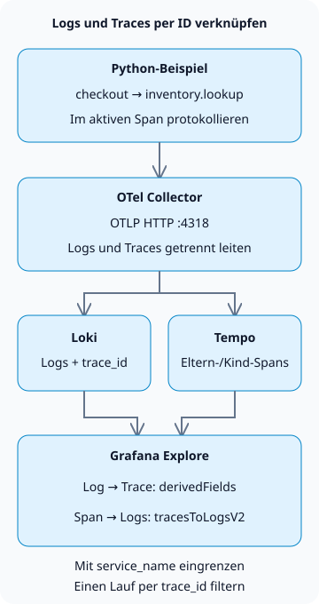

**Um Logs und Traces in Grafana LGTM zu korrelieren, geben Sie Logs und Spans mit derselben `trace_id` aus und konfigurieren dann die Datenquellen Loki und Tempo in Grafana.** So können Sie den Ausführungspfad hinter einem Fehlerlog öffnen und von einem Span zu den zugehörigen Logs zurückkehren.

LGTM steht für Loki (Logs), Grafana (Abfragen und Visualisierung), Tempo (Traces) und Mimir (Metriken). Dieses Tutorial konzentriert sich auf die Korrelation von Logs und Traces. Den umfassenderen Betriebsablauf beschreibt [Betrieb von KI-Agenten](/en/posts/2026-10-31-ai-agent-operations/).

## Welche Kennungen müssen übereinstimmen?

Ein Trace steht für eine Ausführung; Spans stehen für deren einzelne Operationen. Im Beispiel haben der übergeordnete Span `checkout` und der untergeordnete Span `inventory.lookup` dieselbe Trace-ID, aber unterschiedliche Span-IDs. Durch Logging innerhalb eines aktiven Spans kann der Logdatensatz dessen Kontext mitführen. Die Korrelation zwischen getrennten Diensten erfordert zusätzlich Kontextpropagierung, etwa über den HTTP-Header `traceparent`. [Kontextpropagierung mit OpenTelemetry](https://opentelemetry.io/docs/concepts/context-propagation/)



Die Verbindung zwischen den Datenspeichern ist eine Abfragefunktion von Grafana. Loki leitet keine Logs an Tempo weiter, und Grafana erzeugt keine fehlenden Traces. Dieses Beispiel erstellt manuelle Spans in einem Prozess. Es implementiert weder einen HTTP-Server noch Aufrufe zwischen Diensten oder eine Bestandsdatenbank.

## Eine lokale Erfassungsumgebung aufbauen

Erstellen Sie die folgenden vier Dateien in einem leeren Verzeichnis in einer Umgebung mit Docker und Unterstützung für virtuelle Python-Umgebungen. Die getestete Kombination ist **Python 3.13.0, OpenTelemetry Python 1.45.2 und `grafana/otel-lgtm` 0.39.0**. Das Image enthält Grafana 13.3.0, Loki 3.7.9, Tempo 3.1.1 und Collector 0.164.0.

Das [offizielle Docker-LGTM-Image](https://grafana.com/docs/opentelemetry/docker-lgtm/) ist für Entwicklung, Demonstrationen und Tests vorgesehen. Sein Metrik-Backend ist Prometheus; dieses Tutorial richtet keinen Mimir-Cluster für den Produktivbetrieb ein. Für Logs und Traces verwenden wir den enthaltenen Collector sowie Loki, Tempo und Grafana.

### `compose.yaml`

```yaml
services:
  lgtm:
    image: grafana/otel-lgtm:0.39.0@sha256:4c8056c9c05fcb3c8fd93800e85334bfd79b4d0271b47a54a121a64af41fe1fe
    ports:
      - '127.0.0.1:13000:3000'
      - '127.0.0.1:14318:4318'
    environment:
      GF_AUTH_ANONYMOUS_ENABLED: 'true'
      GF_AUTH_ANONYMOUS_ORG_ROLE: Editor
    volumes:
      - ./datasources.yaml:/otel-lgtm/grafana/conf/provisioning/datasources/grafana-datasources.yaml:ro
```

Dies ist eine lokale Übungsumgebung. Anonyme Benutzer erhalten Editor-Berechtigungen für Explore, und Grafana und OTLP werden an `127.0.0.1` des Hosts gebunden. Der Produktivbetrieb erfordert Authentifizierung, TLS und Zugriffsbeschränkungen. Python auf dem Host verwendet Port `14318`; der Collector im Container verwendet `4318`. Die URLs der Datenquellen verwenden Loopback innerhalb des Grafana-Containers. Verwenden Sie stattdessen die DNS-Namen der Dienste, wenn Loki und Tempo in getrennten Containern laufen.

### `datasources.yaml`

```yaml
apiVersion: 1
datasources:
  - name: Tempo
    type: tempo
    uid: tempo
    url: http://127.0.0.1:3200
    jsonData:
      tracesToLogsV2:
        datasourceUid: loki
        spanStartTimeShift: '-2s'
        spanEndTimeShift: '2s'
        tags:
          - key: service.name
            value: service_name
        customQuery: true
        query: '{$${__tags}} | trace_id = "$${__trace.traceId}"'
  - name: Loki
    type: loki
    uid: loki
    url: http://127.0.0.1:3100
    jsonData:
      derivedFields:
        - name: trace_id
          matcherType: label
          matcherRegex: '^trace_id$'
          datasourceUid: tempo
          url: '$${__value.raw}'
          urlDisplayLabel: View trace
```

`tracesToLogsV2` erstellt die Abfrage vom Span zu den Logs; `derivedFields` erstellt den Link vom Log zu Tempo. Ordnen Sie `service.name` dem Loki-Feld `service_name` zu und filtern Sie dann nach der Trace-ID. Bei aktiviertem `customQuery` enthält die Abfrage diesen Filter ausdrücklich. Beide Richtungen beschreiben die [Korrelationseinstellungen von Grafana](https://grafana.com/docs/grafana/latest/datasources/tempo/configure-tempo-data-source/configure-trace-to-logs/).

`$${...}` erhält Variablen in einer **Provisionierungsdatei für Grafana**. Diese separat eingebundene Datei unterliegt nicht der Zeichenketteninterpolation von Compose. Verwenden Sie `${...}`, wenn Sie die Werte direkt in der Grafana-Oberfläche eingeben. Diese Konfiguration beschränkt die [Datenquelleneinstellungen des offiziellen Images](https://github.com/grafana/docker-otel-lgtm/blob/v0.39.0/docker/grafana-datasources.yaml) auf die Korrelation von Logs und Traces.

Bei der OTLP-Aufnahme wird `trace_id` als strukturiertes Metadatum in Loki abgefragt, nicht als JSON-Feld im Logtext. Daher benötigt dieses Beispiel kein `| json`. Grafanas Einstellung `matcherType: label` legt fest, wie das Feld gefunden wird; sie macht die Trace-ID nicht zu einem Loki-Indexlabel. [Regeln für die OTLP-Speicherung in Loki](https://grafana.com/docs/loki/latest/send-data/otel/)

### `requirements.txt`

```text
opentelemetry-sdk==1.45.2
opentelemetry-exporter-otlp-proto-http==1.45.2
```

### `demo.py`

```python
import logging

from opentelemetry import trace
from opentelemetry.exporter.otlp.proto.http._log_exporter import OTLPLogExporter
from opentelemetry.exporter.otlp.proto.http.trace_exporter import OTLPSpanExporter
from opentelemetry.sdk._logs import LoggerProvider, LoggingHandler
from opentelemetry.sdk._logs.export import BatchLogRecordProcessor
from opentelemetry.sdk.resources import Resource
from opentelemetry.sdk.trace import TracerProvider
from opentelemetry.sdk.trace.export import BatchSpanProcessor
from opentelemetry.sdk.trace.sampling import ALWAYS_ON
from opentelemetry.trace import Status, StatusCode

resource = Resource.create({"service.name": "checkout-demo"})
traces = TracerProvider(resource=resource, sampler=ALWAYS_ON)
traces.add_span_processor(BatchSpanProcessor(OTLPSpanExporter(
    endpoint="http://127.0.0.1:14318/v1/traces")))
trace.set_tracer_provider(traces)
logs = LoggerProvider(resource=resource)
logs.add_log_record_processor(BatchLogRecordProcessor(OTLPLogExporter(
    endpoint="http://127.0.0.1:14318/v1/logs")))
handler = LoggingHandler(logger_provider=logs)
logger = logging.getLogger("checkout-demo")
logger.setLevel(logging.INFO)
logger.propagate = False
logger.addHandler(handler)
tracer = trace.get_tracer("checkout-demo")

try:
    with tracer.start_as_current_span("checkout") as checkout:
        trace_id = f"{checkout.get_span_context().trace_id:032x}"
        logger.info("checkout_started")
        with tracer.start_as_current_span("inventory.lookup") as inventory:
            logger.error("inventory_unavailable")
            inventory.set_status(Status(StatusCode.ERROR, "demo failure"))
        checkout.set_status(Status(StatusCode.ERROR, "inventory unavailable"))
    assert logs.force_flush(timeout_millis=10000), "log flush timed out"
    assert traces.force_flush(timeout_millis=10000), "trace flush timed out"
    print(f"trace_id={trace_id}")
finally:
    logger.removeHandler(handler)
    logs.shutdown()
    traces.shutdown()
```

`inventory_unavailable` ist eine absichtlich erzeugte Fehlermeldung. Sie bildet keinen tatsächlichen Ausfall der Bestandsverwaltung nach und misst keine Performance des Dienstes. Das Beispiel kennzeichnet beide Spans ausdrücklich als Fehler. `LoggingHandler` und der OTLP-Exporter übertragen die Kennungen des aktiven Spans in die Logs. [Python-Instrumentierung](https://opentelemetry.io/docs/languages/python/instrumentation/)

Das Beispiel legt die getestete SDK-Version fest. Logs sind im [Python-Unterstützungsstatus](https://opentelemetry.io/docs/languages/python/) als Development eingestuft. Prüfen Sie deshalb bei Upgrades erneut die Kompatibilität von Log-API und Exporter. `ALWAYS_ON` zeichnet zu Lernzwecken jeden Span des Beispiels auf; dies ist keine empfohlene Sampling-Richtlinie für den Produktivbetrieb.

## Beide Datenspeicher mit der ausgegebenen Trace-ID abfragen

Führen Sie diese Befehle im Verzeichnis mit den vier Dateien aus. Beim ersten Durchlauf werden Inhalte von Docker Hub und PyPI heruntergeladen. Die Befehle verwenden eine Shell im Unix-Stil.

```sh
docker compose -p blog-lgtm-lab up -d --wait --wait-timeout 180
python3 -m venv .venv
.venv/bin/python -m pip install -r requirements.txt
.venv/bin/python demo.py
```

Starten Sie Python, nachdem der Container den Status „healthy“ erreicht hat. Das Herunterladen des Images und die Initialisierung von Grafana können Zeit benötigen. Ein Export vor Erreichen der Betriebsbereitschaft kann fehlschlagen. `force_flush()` wartet auf die Exportverarbeitung; es ist kein abschließender Nachweis dafür, dass die Daten in den Datenspeichern vorhanden sind.

Dies ist die während der Übung ausgegebene Trace-ID. Jeder Durchlauf erzeugt eine neue ID. Setzen Sie daher in der folgenden Abfrage **Ihre eigene Ausgabe** ein.

```text
trace_id=b95b8ec2e8c6fa5a608f197d1cfe3691
```

1. Öffnen Sie `http://127.0.0.1:13000`, wählen Sie **Explore → Loki** und stellen Sie den Zeitraum auf die letzte Stunde ein.
2. Fragen Sie die beiden Logs mit diesem LogQL-Ausdruck ab.

```text
{service_name="checkout-demo"} | trace_id = "b95b8ec2e8c6fa5a608f197d1cfe3691"
```

3. Klappen Sie `inventory_unavailable` auf und folgen Sie **View trace** für `trace_id`. Suchen Sie in Tempo nach `inventory.lookup` unter `checkout`.
4. Verwenden Sie **Related logs** im Tempo-Panel, um zu Loki zurückzukehren. Je nach Version erscheint dies als Link **Logs for this span** eines Spans. Diese Abfrage filtert nicht nach `span_id`. Daher können beide Logs des Traces erscheinen, wenn Zeitraum und Dienst übereinstimmen.

Lokale Abfragen lieferten **zwei Logs und zwei Spans**, mit übereinstimmenden Eltern-Kind-Beziehungen und Span-IDs in den Logs. Die Serien-API von Loki enthielt weder `trace_id` noch `span_id` als Indexlabels, und eine nicht vorhandene Trace-ID lieferte keine Logs. Auch die Browserprüfungen folgten dem Fehlerlog zu Tempo und zurück zu den zugehörigen Loki-Logs. Diese Ergebnisse decken ein Beispiel für Erfassung und Korrelation in einem einzelnen Prozess ab, jedoch keine Produktionslast oder Wiederherstellung.

## Wenn ein Link keine Daten liefert

| Symptom | Zuerst prüfen | Nächster Schritt |
| --- | --- | --- |
| Logs haben keine Trace-ID | Wurde innerhalb eines aktiven Spans protokolliert? | Propagierung über Thread-, Coroutine- und asynchrone Grenzen hinweg prüfen |
| Die Loki-Abfrage funktioniert, aber es erscheint kein Tempo-Link | Feldname in `derivedFields` und Tempo-UID | Matcher auf das tatsächliche Feld `trace_id` abstimmen |
| Ein Span hat keinen Link zu Logs | `service.name` und Tag-Zuordnung der Datenquelle | Mit Lokis Wert für `service_name` abgleichen |
| Die verlinkte Logabfrage liefert null Einträge | Zeitraum, Dienst und Trace-ID | LogQL direkt ausführen; Aufnahmeverzögerung und Zeitabweichungen prüfen |
| Logs sind vorhanden, aber der Trace lässt sich nicht abfragen | Trace-Exporter, Sampling und Aufbewahrung in Tempo | Exportfehler des Collectors und Aufbewahrungsrichtlinien untersuchen |

Verwenden Sie `trace_id`, `user_id` und Bestellnummern im Produktivbetrieb nicht als Indexlabels. Unterschiedliche Werte vervielfachen die Loki-Streams. Grenzen Sie anhand von Werten mit beschränkter Ausprägungszahl wie Dienst und Umgebung ein und filtern Sie dann IDs aus dem Logtext oder den strukturierten Metadaten. [Kardinalität in Loki](https://grafana.com/docs/loki/latest/get-started/labels/cardinality/)

Dass Logs oder ein Trace nicht gefunden werden, belegt keinen fehlerfreien Zustand. Sampling kann einen Trace entfernt haben, Aufbewahrungszeiträume können voneinander abweichen oder Collector-Exporte können sich verzögern. Halten Sie Tokens und personenbezogene Daten aus Logtexten und Baggage fern und richten Sie vor dem Produktivbetrieb Warnungen bei Erfassungsfehlern, Aufbewahrung und die Unkenntlichmachung sensibler Daten ein.

Entfernen Sie nach der Übung den Container und die angehängten anonymen Volumes. Dieses Beispiel bewahrt seine Daten nicht auf.

```sh
docker compose -p blog-lgtm-lab down -v
```
