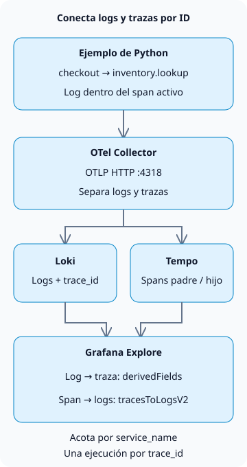

**Para correlacionar logs y trazas en Grafana LGTM, emite logs y spans con el mismo `trace_id` y configura los dos orígenes de datos, Loki y Tempo, en Grafana.** Así podrás abrir la ruta de ejecución que hay detrás de un log de error y volver desde un span a sus logs relacionados.

LGTM significa Loki (logs), Grafana (consultas y visualización), Tempo (trazas) y Mimir (métricas). Este tutorial se centra en la correlación entre logs y trazas. Para conocer el flujo operativo más amplio, consulta [Operación de agentes de IA](/en/posts/2026-10-31-ai-agent-operations/).

## ¿Qué identificadores deben coincidir?

Una traza representa una ejecución; los spans representan sus operaciones individuales. El span padre `checkout` y el span hijo `inventory.lookup` del ejemplo comparten un ID de traza, pero tienen ID de span diferentes. Registrar logs dentro de un span activo permite que el registro lleve el contexto de ese span. Correlacionar servicios separados también requiere propagar el contexto, por ejemplo mediante la cabecera HTTP `traceparent`. [Propagación de contexto de OpenTelemetry](https://opentelemetry.io/docs/concepts/context-propagation/)



La conexión entre los almacenes es una función de consulta de Grafana. Loki no reenvía logs a Tempo y Grafana no crea trazas ausentes. Este ejemplo crea spans manuales en un solo proceso. No implementa un servidor HTTP, llamadas entre servicios ni una base de datos de inventario.

## Prepara un entorno local de recopilación

Crea los siguientes cuatro archivos en un directorio vacío, en un entorno compatible con Docker y los entornos virtuales de Python. La combinación probada es **Python 3.13.0, OpenTelemetry Python 1.45.2 y `grafana/otel-lgtm` 0.39.0**. La imagen contiene Grafana 13.3.0, Loki 3.7.9, Tempo 3.1.1 y Collector 0.164.0.

La [imagen oficial de Docker LGTM](https://grafana.com/docs/opentelemetry/docker-lgtm/) está pensada para desarrollo, demostraciones y pruebas. Su backend de métricas es Prometheus; este tutorial no aprovisiona un clúster de Mimir para producción. Usamos Collector, Loki, Tempo y Grafana, incluidos en la imagen, para los logs y las trazas.

### `compose.yaml`

```yaml
services:
  lgtm:
    image: grafana/otel-lgtm:0.39.0@sha256:4c8056c9c05fcb3c8fd93800e85334bfd79b4d0271b47a54a121a64af41fe1fe
    ports:
      - '127.0.0.1:13000:3000'
      - '127.0.0.1:14318:4318'
    environment:
      GF_AUTH_ANONYMOUS_ENABLED: 'true'
      GF_AUTH_ANONYMOUS_ORG_ROLE: Editor
    volumes:
      - ./datasources.yaml:/otel-lgtm/grafana/conf/provisioning/datasources/grafana-datasources.yaml:ro
```

Este es un laboratorio local. Los usuarios anónimos reciben permisos Editor para Explore, y Grafana y OTLP se vinculan a `127.0.0.1` del host. La producción requiere autenticación, TLS y restricciones de acceso. Python en el host usa el puerto `14318`; Collector dentro del contenedor usa `4318`. Las URL de los orígenes de datos usan la interfaz de bucle local dentro del contenedor de Grafana. Usa los nombres DNS de los servicios cuando Loki y Tempo se ejecuten en contenedores separados.

### `datasources.yaml`

```yaml
apiVersion: 1
datasources:
  - name: Tempo
    type: tempo
    uid: tempo
    url: http://127.0.0.1:3200
    jsonData:
      tracesToLogsV2:
        datasourceUid: loki
        spanStartTimeShift: '-2s'
        spanEndTimeShift: '2s'
        tags:
          - key: service.name
            value: service_name
        customQuery: true
        query: '{$${__tags}} | trace_id = "$${__trace.traceId}"'
  - name: Loki
    type: loki
    uid: loki
    url: http://127.0.0.1:3100
    jsonData:
      derivedFields:
        - name: trace_id
          matcherType: label
          matcherRegex: '^trace_id$'
          datasourceUid: tempo
          url: '$${__value.raw}'
          urlDisplayLabel: View trace
```

`tracesToLogsV2` construye la consulta del span a los logs; `derivedFields` crea el enlace del log a Tempo. Asocia `service.name` con `service_name` de Loki y después filtra por ID de traza. Con `customQuery` habilitado, la consulta incluye ese filtro de forma explícita. Consulta los [ajustes de correlación de Grafana](https://grafana.com/docs/grafana/latest/datasources/tempo/configure-tempo-data-source/configure-trace-to-logs/) para ambas direcciones.

`$${...}` conserva las variables en un **archivo de aprovisionamiento de Grafana**. Este archivo, montado por separado, no está sujeto a la interpolación de cadenas de Compose. Usa `${...}` al introducir los valores directamente en la interfaz de Grafana. Esta configuración limita los [ajustes de los orígenes de datos de la imagen oficial](https://github.com/grafana/docker-otel-lgtm/blob/v0.39.0/docker/grafana-datasources.yaml) a la correlación entre logs y trazas.

En la ingesta mediante OTLP, `trace_id` se consulta como metadato estructurado de Loki y no como un campo JSON en el cuerpo del log, por lo que este ejemplo no necesita `| json`. El ajuste `matcherType: label` de Grafana selecciona cómo encontrar el campo; no convierte el ID de traza en una etiqueta de índice de Loki. [Reglas de almacenamiento OTLP de Loki](https://grafana.com/docs/loki/latest/send-data/otel/)

### `requirements.txt`

```text
opentelemetry-sdk==1.45.2
opentelemetry-exporter-otlp-proto-http==1.45.2
```

### `demo.py`

```python
import logging

from opentelemetry import trace
from opentelemetry.exporter.otlp.proto.http._log_exporter import OTLPLogExporter
from opentelemetry.exporter.otlp.proto.http.trace_exporter import OTLPSpanExporter
from opentelemetry.sdk._logs import LoggerProvider, LoggingHandler
from opentelemetry.sdk._logs.export import BatchLogRecordProcessor
from opentelemetry.sdk.resources import Resource
from opentelemetry.sdk.trace import TracerProvider
from opentelemetry.sdk.trace.export import BatchSpanProcessor
from opentelemetry.sdk.trace.sampling import ALWAYS_ON
from opentelemetry.trace import Status, StatusCode

resource = Resource.create({"service.name": "checkout-demo"})
traces = TracerProvider(resource=resource, sampler=ALWAYS_ON)
traces.add_span_processor(BatchSpanProcessor(OTLPSpanExporter(
    endpoint="http://127.0.0.1:14318/v1/traces")))
trace.set_tracer_provider(traces)
logs = LoggerProvider(resource=resource)
logs.add_log_record_processor(BatchLogRecordProcessor(OTLPLogExporter(
    endpoint="http://127.0.0.1:14318/v1/logs")))
handler = LoggingHandler(logger_provider=logs)
logger = logging.getLogger("checkout-demo")
logger.setLevel(logging.INFO)
logger.propagate = False
logger.addHandler(handler)
tracer = trace.get_tracer("checkout-demo")

try:
    with tracer.start_as_current_span("checkout") as checkout:
        trace_id = f"{checkout.get_span_context().trace_id:032x}"
        logger.info("checkout_started")
        with tracer.start_as_current_span("inventory.lookup") as inventory:
            logger.error("inventory_unavailable")
            inventory.set_status(Status(StatusCode.ERROR, "demo failure"))
        checkout.set_status(Status(StatusCode.ERROR, "inventory unavailable"))
    assert logs.force_flush(timeout_millis=10000), "log flush timed out"
    assert traces.force_flush(timeout_millis=10000), "trace flush timed out"
    print(f"trace_id={trace_id}")
finally:
    logger.removeHandler(handler)
    logs.shutdown()
    traces.shutdown()
```

`inventory_unavailable` es un mensaje de error deliberado. No reproduce una caída real del inventario ni mide el rendimiento del servicio. El ejemplo marca explícitamente ambos spans como errores. `LoggingHandler` y el exportador OTLP incorporan los identificadores del span activo a los logs. [Instrumentación de Python](https://opentelemetry.io/docs/languages/python/instrumentation/)

El ejemplo fija la versión del SDK que se probó. Los logs están clasificados como Development en el [estado de soporte de Python](https://opentelemetry.io/docs/languages/python/), así que vuelve a comprobar la compatibilidad de la API de logs y del exportador al actualizar. `ALWAYS_ON` registra todos los spans del ejemplo con fines de aprendizaje; no es una política de muestreo recomendada para producción.

## Consulta ambos almacenes con el ID de traza emitido

Ejecuta estos comandos en el directorio que contiene los cuatro archivos. La primera ejecución descarga desde Docker Hub y PyPI. Los comandos usan una shell de estilo Unix.

```sh
docker compose -p blog-lgtm-lab up -d --wait --wait-timeout 180
python3 -m venv .venv
.venv/bin/python -m pip install -r requirements.txt
.venv/bin/python demo.py
```

Ejecuta Python después de que el contenedor alcance el estado healthy. Las descargas de la imagen y la inicialización de Grafana pueden tardar. Exportar antes de que el entorno esté listo puede fallar. `force_flush()` espera a que se procese la exportación; no es una prueba definitiva de que los datos existan en los almacenes.

Este es el ID de traza emitido durante la práctica. Cada ejecución genera un ID nuevo, así que sustituye el valor de la consulta siguiente por **tu propia salida**.

```text
trace_id=b95b8ec2e8c6fa5a608f197d1cfe3691
```

1. Abre `http://127.0.0.1:13000`, selecciona **Explore → Loki** y establece el intervalo en la última hora.
2. Consulta los dos logs con esta expresión LogQL.

```text
{service_name="checkout-demo"} | trace_id = "b95b8ec2e8c6fa5a608f197d1cfe3691"
```

3. Expande `inventory_unavailable` y sigue **View trace** para `trace_id`. En Tempo, localiza `inventory.lookup` debajo de `checkout`.
4. Usa **Related logs** en el panel de Tempo para volver a Loki. Según la versión, aparece como el enlace **Logs for this span** de un span. Esta consulta no filtra por `span_id`, por lo que pueden aparecer ambos logs de la traza si coinciden el intervalo de tiempo y el servicio.

Las consultas locales devolvieron **dos logs y dos spans**, con relaciones padre-hijo e ID de span en los logs coincidentes. La API de series de Loki no contenía ni `trace_id` ni `span_id` como etiquetas de índice, y un ID de traza inexistente no devolvió logs. Las comprobaciones en el navegador también siguieron el log de error hasta Tempo y volvieron a los logs relacionados de Loki. Estos resultados cubren un ejemplo de recopilación y correlación en un solo proceso, no la carga de producción ni la recuperación.

## Cuando un enlace no devuelve datos

| Síntoma | Primera comprobación | Siguiente acción |
| --- | --- | --- |
| Los logs no tienen ID de traza | ¿Se registraron dentro de un span activo? | Comprueba la propagación entre hilos, corrutinas y límites asíncronos |
| La consulta de Loki funciona, pero no aparece el enlace a Tempo | Nombre del campo de `derivedFields` y UID de Tempo | Ajusta el criterio de coincidencia al campo real `trace_id` |
| Un span no tiene enlace a los logs | `service.name` y asignación de etiquetas del origen de datos | Alinéalos con el valor `service_name` de Loki |
| La consulta de logs del enlace devuelve cero entradas | Intervalo de tiempo, servicio e ID de traza | Ejecuta LogQL directamente; comprueba el retraso de ingesta y el desfase de los relojes |
| Hay logs, pero no se puede consultar la traza | Exportador de trazas, muestreo y retención de Tempo | Inspecciona los errores de exportación de Collector y las políticas de retención |

Mantén `trace_id`, `user_id` y los números de pedido fuera de las etiquetas de índice de producción. Los valores distintos multiplican los flujos de Loki. Acota primero con valores de un conjunto limitado, como el servicio y el entorno, y después filtra los ID del cuerpo o de los metadatos estructurados. [Cardinalidad de Loki](https://grafana.com/docs/loki/latest/get-started/labels/cardinality/)

No encontrar logs o una traza no demuestra que el sistema esté en buen estado. El muestreo puede haber eliminado una traza, los períodos de retención pueden diferir o las exportaciones de Collector pueden retrasarse. Mantén los tokens y los datos personales fuera del cuerpo de los logs y de baggage, y establece alertas de fallos de recopilación, retención y ocultación de datos sensibles antes de usarlo en producción.

Después de la práctica, elimina su contenedor y los volúmenes anónimos conectados. Este ejemplo no conserva sus datos.

```sh
docker compose -p blog-lgtm-lab down -v
```
