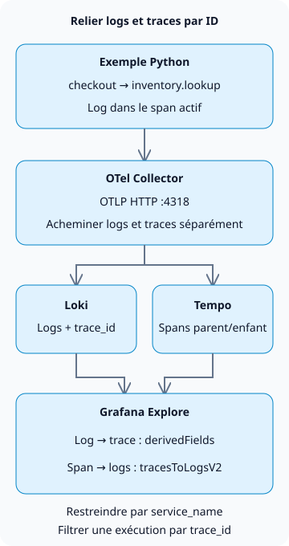

**Pour corréler les logs et les traces dans Grafana LGTM, émettez des logs et des spans avec le même `trace_id`, puis configurez les sources de données Loki et Tempo dans Grafana.** Vous pouvez ainsi ouvrir le chemin d’exécution à l’origine d’un log d’erreur et revenir d’un span aux logs associés.

LGTM désigne Loki (logs), Grafana (requêtes et visualisation), Tempo (traces) et Mimir (métriques). Ce tutoriel porte sur la corrélation entre logs et traces. Pour le déroulement plus large des opérations, consultez [Exploitation des agents d’IA](/en/posts/2026-10-31-ai-agent-operations/).

## Quels identifiants doivent correspondre ?

Une trace représente une exécution ; les spans représentent ses différentes opérations. Dans l’exemple, le span parent `checkout` et le span enfant `inventory.lookup` partagent un identifiant de trace, mais leurs identifiants de span sont différents. Émettre un log à l’intérieur d’un span actif permet à l’enregistrement de log de porter le contexte de ce span. La corrélation entre services distincts nécessite aussi la propagation du contexte, par exemple via l’en-tête HTTP `traceparent`. [Propagation du contexte avec OpenTelemetry](https://opentelemetry.io/docs/concepts/context-propagation/)



Le lien entre les stockages est une fonctionnalité de requête de Grafana. Loki ne transmet pas de logs à Tempo et Grafana ne crée pas les traces manquantes. Cet exemple crée des spans manuels dans un seul processus. Il n’implémente ni serveur HTTP, ni appels entre services, ni base de données de stocks.

## Créer un environnement local de collecte

Créez les quatre fichiers suivants dans un répertoire vide, dans un environnement disposant de Docker et de la prise en charge des environnements virtuels Python. La combinaison testée est **Python 3.13.0, OpenTelemetry Python 1.45.2 et `grafana/otel-lgtm` 0.39.0**. L’image contient Grafana 13.3.0, Loki 3.7.9, Tempo 3.1.1 et Collector 0.164.0.

L’[image officielle Docker LGTM](https://grafana.com/docs/opentelemetry/docker-lgtm/) est destinée au développement, aux démonstrations et aux tests. Son backend de métriques est Prometheus ; ce tutoriel ne provisionne pas de cluster Mimir de production. Nous utilisons le Collector, Loki, Tempo et Grafana inclus pour les logs et les traces.

### `compose.yaml`

```yaml
services:
  lgtm:
    image: grafana/otel-lgtm:0.39.0@sha256:4c8056c9c05fcb3c8fd93800e85334bfd79b4d0271b47a54a121a64af41fe1fe
    ports:
      - '127.0.0.1:13000:3000'
      - '127.0.0.1:14318:4318'
    environment:
      GF_AUTH_ANONYMOUS_ENABLED: 'true'
      GF_AUTH_ANONYMOUS_ORG_ROLE: Editor
    volumes:
      - ./datasources.yaml:/otel-lgtm/grafana/conf/provisioning/datasources/grafana-datasources.yaml:ro
```

Il s’agit d’un environnement d’exercice local. Les utilisateurs anonymes reçoivent les droits Editor pour Explore, et Grafana et OTLP sont liés à l’adresse `127.0.0.1` de l’hôte. La production exige une authentification, TLS et des restrictions d’accès. Python sur l’hôte utilise le port `14318` ; le Collector du conteneur utilise `4318`. Les URL des sources de données utilisent l’interface de bouclage à l’intérieur du conteneur Grafana. Utilisez plutôt les noms DNS des services lorsque Loki et Tempo s’exécutent dans des conteneurs distincts.

### `datasources.yaml`

```yaml
apiVersion: 1
datasources:
  - name: Tempo
    type: tempo
    uid: tempo
    url: http://127.0.0.1:3200
    jsonData:
      tracesToLogsV2:
        datasourceUid: loki
        spanStartTimeShift: '-2s'
        spanEndTimeShift: '2s'
        tags:
          - key: service.name
            value: service_name
        customQuery: true
        query: '{$${__tags}} | trace_id = "$${__trace.traceId}"'
  - name: Loki
    type: loki
    uid: loki
    url: http://127.0.0.1:3100
    jsonData:
      derivedFields:
        - name: trace_id
          matcherType: label
          matcherRegex: '^trace_id$'
          datasourceUid: tempo
          url: '$${__value.raw}'
          urlDisplayLabel: View trace
```

`tracesToLogsV2` construit la requête d’un span vers les logs ; `derivedFields` construit le lien d’un log vers Tempo. Associez `service.name` à `service_name` dans Loki, puis filtrez par identifiant de trace. Avec `customQuery` activé, la requête inclut explicitement ce filtre. Consultez les [paramètres de corrélation de Grafana](https://grafana.com/docs/grafana/latest/datasources/tempo/configure-tempo-data-source/configure-trace-to-logs/) pour les deux directions.

`$${...}` préserve les variables dans un **fichier de provisioning Grafana**. Ce fichier monté séparément n’est pas soumis à l’interpolation de chaînes de Compose. Utilisez `${...}` lorsque vous saisissez directement les valeurs dans l’interface de Grafana. Cette configuration limite les [paramètres des sources de données de l’image officielle](https://github.com/grafana/docker-otel-lgtm/blob/v0.39.0/docker/grafana-datasources.yaml) à la corrélation entre logs et traces.

Pour l’ingestion OTLP, `trace_id` est interrogé comme une métadonnée structurée de Loki et non comme un champ JSON du corps du log ; cet exemple n’a donc pas besoin de `| json`. Le paramètre `matcherType: label` de Grafana choisit la façon de trouver le champ ; il ne transforme pas l’identifiant de trace en label d’index Loki. [Règles de stockage OTLP de Loki](https://grafana.com/docs/loki/latest/send-data/otel/)

### `requirements.txt`

```text
opentelemetry-sdk==1.45.2
opentelemetry-exporter-otlp-proto-http==1.45.2
```

### `demo.py`

```python
import logging

from opentelemetry import trace
from opentelemetry.exporter.otlp.proto.http._log_exporter import OTLPLogExporter
from opentelemetry.exporter.otlp.proto.http.trace_exporter import OTLPSpanExporter
from opentelemetry.sdk._logs import LoggerProvider, LoggingHandler
from opentelemetry.sdk._logs.export import BatchLogRecordProcessor
from opentelemetry.sdk.resources import Resource
from opentelemetry.sdk.trace import TracerProvider
from opentelemetry.sdk.trace.export import BatchSpanProcessor
from opentelemetry.sdk.trace.sampling import ALWAYS_ON
from opentelemetry.trace import Status, StatusCode

resource = Resource.create({"service.name": "checkout-demo"})
traces = TracerProvider(resource=resource, sampler=ALWAYS_ON)
traces.add_span_processor(BatchSpanProcessor(OTLPSpanExporter(
    endpoint="http://127.0.0.1:14318/v1/traces")))
trace.set_tracer_provider(traces)
logs = LoggerProvider(resource=resource)
logs.add_log_record_processor(BatchLogRecordProcessor(OTLPLogExporter(
    endpoint="http://127.0.0.1:14318/v1/logs")))
handler = LoggingHandler(logger_provider=logs)
logger = logging.getLogger("checkout-demo")
logger.setLevel(logging.INFO)
logger.propagate = False
logger.addHandler(handler)
tracer = trace.get_tracer("checkout-demo")

try:
    with tracer.start_as_current_span("checkout") as checkout:
        trace_id = f"{checkout.get_span_context().trace_id:032x}"
        logger.info("checkout_started")
        with tracer.start_as_current_span("inventory.lookup") as inventory:
            logger.error("inventory_unavailable")
            inventory.set_status(Status(StatusCode.ERROR, "demo failure"))
        checkout.set_status(Status(StatusCode.ERROR, "inventory unavailable"))
    assert logs.force_flush(timeout_millis=10000), "log flush timed out"
    assert traces.force_flush(timeout_millis=10000), "trace flush timed out"
    print(f"trace_id={trace_id}")
finally:
    logger.removeHandler(handler)
    logs.shutdown()
    traces.shutdown()
```

`inventory_unavailable` est un message d’erreur délibéré. Il ne reproduit pas une panne réelle de gestion des stocks et ne mesure pas les performances du service. L’exemple marque explicitement les deux spans comme étant en erreur. `LoggingHandler` et l’exportateur OTLP transmettent les identifiants du span actif aux logs. [Instrumentation Python](https://opentelemetry.io/docs/languages/python/instrumentation/)

L’exemple fixe la version testée du SDK. Les logs sont classés Development dans l’[état de prise en charge de Python](https://opentelemetry.io/docs/languages/python/) ; vérifiez donc à nouveau la compatibilité de l’API de logs et de l’exportateur lors des mises à niveau. `ALWAYS_ON` enregistre chaque span de l’exemple à des fins d’apprentissage ; ce n’est pas une politique d’échantillonnage recommandée en production.

## Interroger les deux stockages avec l’identifiant de trace émis

Exécutez ces commandes dans le répertoire contenant les quatre fichiers. La première exécution télécharge des éléments depuis Docker Hub et PyPI. Les commandes utilisent un shell de type Unix.

```sh
docker compose -p blog-lgtm-lab up -d --wait --wait-timeout 180
python3 -m venv .venv
.venv/bin/python -m pip install -r requirements.txt
.venv/bin/python demo.py
```

Exécutez Python une fois que le conteneur a atteint l’état « healthy ». Le téléchargement de l’image et l’initialisation de Grafana peuvent prendre du temps. Un export effectué avant que l’environnement soit prêt peut échouer. `force_flush()` attend le traitement de l’export ; il ne constitue pas une preuve définitive que les données existent dans les stockages.

Voici l’identifiant de trace émis pendant l’exercice. Chaque exécution génère un nouvel identifiant ; remplacez donc celui de la requête ci-dessous par **votre propre sortie**.

```text
trace_id=b95b8ec2e8c6fa5a608f197d1cfe3691
```

1. Ouvrez `http://127.0.0.1:13000`, sélectionnez **Explore → Loki** et réglez la plage sur la dernière heure.
2. Interrogez les deux logs avec cette expression LogQL.

```text
{service_name="checkout-demo"} | trace_id = "b95b8ec2e8c6fa5a608f197d1cfe3691"
```

3. Dépliez `inventory_unavailable` et suivez **View trace** pour `trace_id`. Dans Tempo, repérez `inventory.lookup` sous `checkout`.
4. Utilisez **Related logs** dans le panneau Tempo pour revenir à Loki. Selon la version, cette fonction apparaît sous la forme du lien **Logs for this span** d’un span. Cette requête ne filtre pas par `span_id` ; les deux logs de la trace peuvent donc apparaître lorsque la plage temporelle et le service correspondent.

Les requêtes locales ont renvoyé **deux logs et deux spans**, avec des relations parent-enfant et des identifiants de span des logs concordants. L’API des séries de Loki ne contenait ni `trace_id` ni `span_id` comme labels d’index, et un identifiant de trace inexistant n’a renvoyé aucun log. Les vérifications dans le navigateur ont aussi suivi le log d’erreur vers Tempo, puis sont revenues aux logs Loki associés. Ces résultats couvrent un exemple de collecte et de corrélation dans un seul processus, sans validation de la charge en production ni de la reprise.

## Lorsqu’un lien ne renvoie aucune donnée

| Symptôme | Première vérification | Action suivante |
| --- | --- | --- |
| Les logs n’ont pas d’identifiant de trace | Le log a-t-il été émis à l’intérieur d’un span actif ? | Vérifier la propagation aux frontières des threads, des coroutines et des opérations asynchrones |
| La requête Loki fonctionne, mais aucun lien Tempo n’apparaît | Nom du champ dans `derivedFields` et UID de Tempo | Adapter le matcher au champ réel `trace_id` |
| Un span n’a pas de lien vers les logs | `service.name` et correspondance des tags de la source de données | Aligner sur la valeur `service_name` de Loki |
| La requête de logs liée ne renvoie aucune entrée | Plage temporelle, service et identifiant de trace | Exécuter directement LogQL ; vérifier le retard d’ingestion et le décalage des horloges |
| Les logs existent, mais la trace ne peut pas être interrogée | Exportateur de traces, échantillonnage et rétention de Tempo | Examiner les erreurs d’export du Collector et les politiques de rétention |

N’utilisez pas `trace_id`, `user_id` ni les numéros de commande dans les labels d’index de production. Les valeurs distinctes multiplient les flux Loki. Restreignez la recherche avec des valeurs dont le nombre de possibilités est borné, comme le service et l’environnement, puis filtrez les identifiants à partir du corps du log ou des métadonnées structurées. [Cardinalité de Loki](https://grafana.com/docs/loki/latest/get-started/labels/cardinality/)

Ne pas trouver de logs ou de trace ne prouve pas que le système fonctionne correctement. L’échantillonnage peut avoir supprimé une trace, les durées de rétention peuvent différer ou les exports du Collector peuvent être retardés. N’incluez pas de jetons ni de données personnelles dans les corps de logs et le baggage, et mettez en place des alertes d’échec de collecte, la rétention et le masquage des données sensibles avant toute utilisation en production.

Après l’exercice, supprimez le conteneur et les volumes anonymes qui lui sont attachés. Cet exemple ne conserve pas ses données.

```sh
docker compose -p blog-lgtm-lab down -v
```
