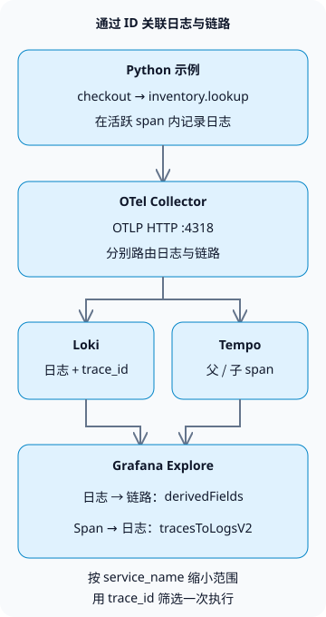

**要在 Grafana LGTM 中关联日志与链路，请输出具有相同 `trace_id` 的日志和 span，然后在 Grafana 中配置 Loki 和 Tempo 两个数据源。** 这样便能从错误日志打开对应的执行路径，并从 span 返回相关日志。

LGTM 分别代表 Loki（日志）、Grafana（查询与可视化）、Tempo（链路）和 Mimir（指标）。本教程重点介绍日志与链路的关联。更完整的运维流程请参阅 [AI 智能体运维](/en/posts/2026-10-31-ai-agent-operations/)。

## 哪些标识符应该一致？

一条链路代表一次执行；span 代表其中的各个操作。示例中的父 span `checkout` 和子 span `inventory.lookup` 具有相同的链路 ID，但 span ID 不同。在活跃 span 内记录日志，可以让日志记录携带该 span 的上下文。关联不同服务还需要传播上下文，例如通过 HTTP `traceparent` 请求头。[OpenTelemetry 上下文传播](https://opentelemetry.io/docs/concepts/context-propagation/)



存储系统之间的关联由 Grafana 的查询功能实现。Loki 不会把日志转发给 Tempo，Grafana 也不会创建缺失的链路。本示例在单个进程中手动创建 span，不实现 HTTP 服务器、跨服务调用或库存数据库。

## 搭建本地采集环境

在支持 Docker 和 Python 虚拟环境的环境中，新建一个空目录，并创建以下四个文件。经过测试的组合是 **Python 3.13.0、OpenTelemetry Python 1.45.2 和 `grafana/otel-lgtm` 0.39.0**。镜像包含 Grafana 13.3.0、Loki 3.7.9、Tempo 3.1.1 和 Collector 0.164.0。

[官方 Docker LGTM 镜像](https://grafana.com/docs/opentelemetry/docker-lgtm/)用于开发、演示和测试。其指标后端是 Prometheus；本教程不会部署生产用 Mimir 集群。日志与链路处理使用镜像内置的 Collector、Loki、Tempo 和 Grafana。

### `compose.yaml`

```yaml
services:
  lgtm:
    image: grafana/otel-lgtm:0.39.0@sha256:4c8056c9c05fcb3c8fd93800e85334bfd79b4d0271b47a54a121a64af41fe1fe
    ports:
      - '127.0.0.1:13000:3000'
      - '127.0.0.1:14318:4318'
    environment:
      GF_AUTH_ANONYMOUS_ENABLED: 'true'
      GF_AUTH_ANONYMOUS_ORG_ROLE: Editor
    volumes:
      - ./datasources.yaml:/otel-lgtm/grafana/conf/provisioning/datasources/grafana-datasources.yaml:ro
```

这是一个本地实验环境。匿名用户会获得用于 Explore 的 Editor 权限，Grafana 和 OTLP 绑定到宿主机的 `127.0.0.1`。生产环境需要身份认证、TLS 和访问限制。宿主机上的 Python 使用端口 `14318`，容器内的 Collector 使用 `4318`。数据源 URL 使用 Grafana 容器内部的回环地址。如果 Loki 和 Tempo 分别运行在不同容器中，应改用服务 DNS 名称。

### `datasources.yaml`

```yaml
apiVersion: 1
datasources:
  - name: Tempo
    type: tempo
    uid: tempo
    url: http://127.0.0.1:3200
    jsonData:
      tracesToLogsV2:
        datasourceUid: loki
        spanStartTimeShift: '-2s'
        spanEndTimeShift: '2s'
        tags:
          - key: service.name
            value: service_name
        customQuery: true
        query: '{$${__tags}} | trace_id = "$${__trace.traceId}"'
  - name: Loki
    type: loki
    uid: loki
    url: http://127.0.0.1:3100
    jsonData:
      derivedFields:
        - name: trace_id
          matcherType: label
          matcherRegex: '^trace_id$'
          datasourceUid: tempo
          url: '$${__value.raw}'
          urlDisplayLabel: View trace
```

`tracesToLogsV2` 构建从 span 到日志的查询；`derivedFields` 构建从日志到 Tempo 的链接。将 `service.name` 映射到 Loki 的 `service_name`，然后按链路 ID 过滤。启用 `customQuery` 后，查询中会显式包含该过滤条件。两个方向的设置请参阅 [Grafana 关联设置](https://grafana.com/docs/grafana/latest/datasources/tempo/configure-tempo-data-source/configure-trace-to-logs/)。

`$${...}` 用于在 **Grafana provisioning 文件**中保留变量。这个单独挂载的文件不受 Compose 字符串插值影响。如果直接在 Grafana 界面中输入值，请使用 `${...}`。本配置将[官方镜像的数据源设置](https://github.com/grafana/docker-otel-lgtm/blob/v0.39.0/docker/grafana-datasources.yaml)缩减为日志与链路关联所需的部分。

通过 OTLP 接收数据时，`trace_id` 是作为 Loki 结构化元数据查询的，而不是日志正文中的 JSON 字段，因此本示例不需要 `| json`。Grafana 的 `matcherType: label` 决定如何查找字段，并不会将链路 ID 提升为 Loki 索引标签。[Loki OTLP 存储规则](https://grafana.com/docs/loki/latest/send-data/otel/)

### `requirements.txt`

```text
opentelemetry-sdk==1.45.2
opentelemetry-exporter-otlp-proto-http==1.45.2
```

### `demo.py`

```python
import logging

from opentelemetry import trace
from opentelemetry.exporter.otlp.proto.http._log_exporter import OTLPLogExporter
from opentelemetry.exporter.otlp.proto.http.trace_exporter import OTLPSpanExporter
from opentelemetry.sdk._logs import LoggerProvider, LoggingHandler
from opentelemetry.sdk._logs.export import BatchLogRecordProcessor
from opentelemetry.sdk.resources import Resource
from opentelemetry.sdk.trace import TracerProvider
from opentelemetry.sdk.trace.export import BatchSpanProcessor
from opentelemetry.sdk.trace.sampling import ALWAYS_ON
from opentelemetry.trace import Status, StatusCode

resource = Resource.create({"service.name": "checkout-demo"})
traces = TracerProvider(resource=resource, sampler=ALWAYS_ON)
traces.add_span_processor(BatchSpanProcessor(OTLPSpanExporter(
    endpoint="http://127.0.0.1:14318/v1/traces")))
trace.set_tracer_provider(traces)
logs = LoggerProvider(resource=resource)
logs.add_log_record_processor(BatchLogRecordProcessor(OTLPLogExporter(
    endpoint="http://127.0.0.1:14318/v1/logs")))
handler = LoggingHandler(logger_provider=logs)
logger = logging.getLogger("checkout-demo")
logger.setLevel(logging.INFO)
logger.propagate = False
logger.addHandler(handler)
tracer = trace.get_tracer("checkout-demo")

try:
    with tracer.start_as_current_span("checkout") as checkout:
        trace_id = f"{checkout.get_span_context().trace_id:032x}"
        logger.info("checkout_started")
        with tracer.start_as_current_span("inventory.lookup") as inventory:
            logger.error("inventory_unavailable")
            inventory.set_status(Status(StatusCode.ERROR, "demo failure"))
        checkout.set_status(Status(StatusCode.ERROR, "inventory unavailable"))
    assert logs.force_flush(timeout_millis=10000), "log flush timed out"
    assert traces.force_flush(timeout_millis=10000), "trace flush timed out"
    print(f"trace_id={trace_id}")
finally:
    logger.removeHandler(handler)
    logs.shutdown()
    traces.shutdown()
```

`inventory_unavailable` 是刻意生成的错误消息。它不会复现真实的库存服务故障，也不衡量服务性能。示例显式地将两个 span 都标记为错误。`LoggingHandler` 和 OTLP 导出器将活跃 span 的标识符带入日志。[Python 插桩](https://opentelemetry.io/docs/languages/python/instrumentation/)

示例固定了经过测试的 SDK 版本。在 [Python 支持状态](https://opentelemetry.io/docs/languages/python/)中，日志被列为 Development，因此升级时需要重新检查日志 API 与导出器的兼容性。`ALWAYS_ON` 会记录示例中的每个 span 以便学习；这并非推荐的生产采样策略。

## 使用输出的链路 ID 查询两个存储系统

在包含这四个文件的目录中执行以下命令。首次运行会从 Docker Hub 和 PyPI 下载内容。命令使用 Unix 风格的 shell。

```sh
docker compose -p blog-lgtm-lab up -d --wait --wait-timeout 180
python3 -m venv .venv
.venv/bin/python -m pip install -r requirements.txt
.venv/bin/python demo.py
```

容器进入健康状态后再运行 Python。下载镜像和初始化 Grafana 可能需要一些时间。就绪之前导出数据可能失败。`force_flush()` 等待导出处理完成；它并不是数据已经存入存储系统的最终证据。

以下是实验中输出的链路 ID。每次运行都会生成新 ID，因此请在下面的查询中替换为**你自己的输出**。

```text
trace_id=b95b8ec2e8c6fa5a608f197d1cfe3691
```

1. 打开 `http://127.0.0.1:13000`，选择 **Explore → Loki**，将时间范围设为最近一小时。
2. 使用以下 LogQL 表达式查询这两条日志。

```text
{service_name="checkout-demo"} | trace_id = "b95b8ec2e8c6fa5a608f197d1cfe3691"
```

3. 展开 `inventory_unavailable`，点击 `trace_id` 对应的 **View trace**。在 Tempo 中找到 `inventory.lookup`，它位于 `checkout` 下。
4. 使用 Tempo 面板中的 **Related logs** 返回 Loki。根据版本不同，它也可能显示为 span 的 **Logs for this span** 链接。该查询不按 `span_id` 过滤，因此在时间范围和服务匹配时，这条链路中的两条日志都可能出现。

本地查询返回了**两条日志和两个 span**，父子关系和日志的 span ID 均匹配。Loki series API 返回的索引标签既不包含 `trace_id`，也不包含 `span_id`；查询一个不存在的链路 ID 时没有返回日志。浏览器检查还验证了从错误日志进入 Tempo，再返回相关 Loki 日志的跳转。这些结果仅涵盖单进程采集与关联示例，不涵盖生产负载或恢复。

## 链接没有返回数据时

| 现象 | 首先检查 | 下一步操作 |
| --- | --- | --- |
| 日志没有链路 ID | 是否在活跃 span 内记录日志？ | 检查线程、协程和异步边界之间的上下文传播 |
| Loki 查询正常，但没有 Tempo 链接 | `derivedFields` 字段名称和 Tempo UID | 让匹配器与实际的 `trace_id` 字段一致 |
| span 没有日志链接 | `service.name` 和数据源标签映射 | 与 Loki 的 `service_name` 值对齐 |
| 链接中的日志查询返回零条记录 | 时间范围、服务和链路 ID | 直接运行 LogQL；检查摄取延迟和时钟偏差 |
| 日志存在，但无法查询链路 | 链路导出器、采样和 Tempo 保留期限 | 检查 Collector 导出错误和保留策略 |

不要将 `trace_id`、`user_id` 和订单号放入生产环境的索引标签。不同取值会使 Loki 流的数量成倍增加。先通过服务、环境等取值有限的字段缩小范围，再从正文或结构化元数据中过滤 ID。[Loki 基数](https://grafana.com/docs/loki/latest/get-started/labels/cardinality/)

找不到日志或链路，并不能证明系统健康。链路可能已被采样丢弃，各类数据的保留期限可能不同，Collector 导出也可能存在延迟。不要在日志正文和 baggage 中放入令牌和个人数据，并在用于生产之前建立采集失败告警、保留策略和脱敏机制。

实验结束后，删除其容器和挂载的匿名卷。本示例不会保留数据。

```sh
docker compose -p blog-lgtm-lab down -v
```
