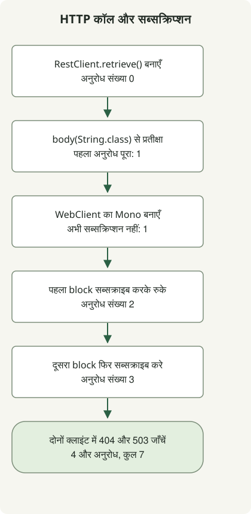

---
{
  "state": "draft",
  "language": "hi",
  "translationKey": "2026-10-31-webclient-restclient-comparison",
  "title": "WebClient या RestClient: सिंक्रोनस, रिएक्टिव और स्ट्रीमिंग कॉल के लिए चुनाव",
  "description": "Spring के WebClient और RestClient में अनुरोध भेजने का समय, ब्लॉकिंग, त्रुटियाँ और वर्चुअल थ्रेड का उपयोग समझें। स्थानीय HTTP उदाहरण में हर सब्सक्रिप्शन पर अनुरोध और 404/503 का व्यवहार जाँचें।",
  "sourcePath": "src/content/posts/en/2026-10-31-webclient-restclient-comparison.md",
  "sourceSha256": "66635549fdfb330bbeabd658046b28dcb1566bef58dbf033b35e22e387806d15"
}
---
**यदि सिंक्रोनस सेवा को आगे बढ़ने से पहले एक HTTP जवाब चाहिए तो RestClient से शुरू करें। रिएक्टिव कॉल जोड़ने या स्ट्रीमिंग के लिए WebClient पर विचार करें।** दोनों में मेथड की शृंखला से अनुरोध बना सकते हैं, लेकिन [RestClient सिंक्रोनस है और WebClient नॉन-ब्लॉकिंग रिएक्टिव क्लाइंट है](https://docs.spring.io/spring-framework/reference/integration/rest-clients.html)। चुनाव अनुरोधों की संख्या के बजाय ऐप के निष्पादन मॉडल के अनुसार करें।


RestClient Spring Framework 6.1 में आया। WebClient संस्करण 5.0 से उपलब्ध है। पहले जाँचें कि आपका Framework चुना हुआ क्लाइंट समर्थित करता है। Boot प्रोजेक्ट अपग्रेड करते समय Boot द्वारा प्रबंधित संगत संस्करण साथ रखें। नीचे का उदाहरण Framework 7.0.10 पर चलता है।

## किस ज़रूरत के लिए कौन सा क्लाइंट चुनें?

| आधार | RestClient | WebClient |
| --- | --- | --- |
| परिणाम | बॉडी निकालने जैसी अंतिम क्रिया जवाब की प्रतीक्षा करके मान लौटाती है | Mono या Flux परिणाम दर्शाता है। सब्सक्रिप्शन अनुरोध शुरू करता है |
| उपयुक्त उपयोग | Spring MVC या बैच कार्यों में क्रमिक, सिंक्रोनस कोड | WebFlux, रिएक्टिव कॉल जोड़ना और SSE जैसी स्ट्रीमिंग |
| त्रुटि कैसे मिलती है | डिफ़ॉल्ट retrieve में 4xx और 5xx पर RestClientResponseException उठता है | डिफ़ॉल्ट retrieve में 4xx और 5xx पर WebClientResponseException त्रुटि सिग्नल बनता है |
| अतिरिक्त जटिलता | पारंपरिक कॉल स्टैक में क्रम समझना आसान है | ऑपरेटर, सब्सक्रिप्शन, रद्दीकरण और कॉन्टेक्स्ट का प्रसार समझना पड़ता है |
| समवर्ती कॉल की सीमा | एक्ज़ीक्यूटर या वर्चुअल थ्रेड की समवर्ती सीमा अलग बनाएँ | flatMap जैसे ऑपरेटर की समवर्ती सीमा तथा कनेक्शन और प्रतीक्षा का बजट अलग तय करें |

तालिका उन सामान्य API कॉल से शुरू होती है जिनका पूरा जवाब मेमोरी में इकट्ठा होता है। RestClient में निचले स्तर पर जवाब सँभालकर बाइट स्ट्रीम भी पढ़ सकते हैं। रिएक्टिव एलिमेंट स्ट्रीम और माँग नियंत्रण के लिए WebClient सहज विकल्प है। WebClient इस्तेमाल करने के लिए सर्वर को WebFlux में बदलना ज़रूरी नहीं है। Spring MVC भी रिएक्टिव रिटर्न प्रकार लेता है। [Spring की HTTP क्लाइंट गाइड](https://spring.io/blog/2025/09/30/the-state-of-http-clients-in-spring/) भी सामान्य सिंक्रोनस कॉल और रिएक्टिव या स्ट्रीमिंग ज़रूरतों को इसी तरह अलग करती है।

वर्चुअल थ्रेड वाली सिंक्रोनस सेवा RestClient का क्रमिक कोड बनाए रख सकती है। वर्चुअल थ्रेड उसके API को नॉन-ब्लॉकिंग नहीं बनाते और न ही डाउनस्ट्रीम क्षमता या कनेक्शन सीमा बढ़ाते हैं। [वर्चुअल थ्रेड का दायरा](/en/posts/2026-10-31-virtual-threads-jdk21-jdk25/) और [निर्भर सेवाओं की क्षमता सीमाएँ](/en/posts/2026-10-31-jdk-10k-rps-architecture/) साथ देखें।

## एक जैसे HTTP जवाबों से निष्पादन का समय समझें



आरेख main मेथड की प्रमुख जाँचें दिखाता है। स्थानीय सर्वर शुरू करना, क्लाइंट कॉन्फ़िगरेशन और सफ़ाई इसमें नहीं दिखाए गए हैं। **RestClient में सिर्फ़ retrieve() बुलाने से अनुरोध नहीं जाता।** यहाँ body(String.class) अनुरोध भेजकर परिणाम की प्रतीक्षा करता है। WebClient का डिफ़ॉल्ट अनुरोध Mono सब्सक्रिप्शन पर चलता है। कैश या शेयर करने वाला ऑपरेटर लगाए बिना इसी Mono को दो बार सब्सक्राइब करने पर दो अनुरोध जाते हैं।

यह स्वतंत्र कंसोल उदाहरण Spring Framework 7.0.10, Reactor Core 3.8.8, JDK 17 और Gradle 8.4 के साथ चलाया गया। यह Spring Boot ऐप नहीं है। डिफ़ॉल्ट कनेक्टर चयन के अंतर से बचने के लिए दोनों क्लाइंट स्पष्ट रूप से JDK HttpClient इस्तेमाल करते हैं। Boot प्रोजेक्ट में इस BOM से संस्करण बदलने के बजाय अपने Boot संस्करण की प्रबंधित डिपेंडेंसी अपनाएँ।

### `settings.gradle`

```groovy
rootProject.name = 'http-client-comparison'
```

### `build.gradle`

```groovy
plugins { id 'application' }
repositories { mavenCentral() }
dependencies {
    implementation platform('org.springframework:spring-framework-bom:7.0.10')
    implementation 'org.springframework:spring-webflux'
}
java {
    sourceCompatibility = JavaVersion.VERSION_17
    targetCompatibility = JavaVersion.VERSION_17
}
application { mainClass = 'ClientComparison' }
```

### `src/main/java/ClientComparison.java`

```java
import com.sun.net.httpserver.HttpServer;
import java.net.InetSocketAddress;
import java.net.http.HttpClient;
import java.nio.charset.StandardCharsets;
import java.time.Duration;
import java.util.concurrent.atomic.AtomicInteger;
import org.springframework.http.client.JdkClientHttpRequestFactory;
import org.springframework.http.client.reactive.JdkClientHttpConnector;
import org.springframework.web.client.RestClient;
import org.springframework.web.client.RestClientResponseException;
import org.springframework.web.reactive.function.client.WebClient;
import org.springframework.web.reactive.function.client.WebClientResponseException;
import reactor.core.publisher.Mono;

public class ClientComparison {
    static void check(boolean condition) {
        if (!condition) throw new AssertionError("HTTP contract failed");
    }
    public static void main(String[] args) throws Exception {
        var requests = new AtomicInteger();
        var server = HttpServer.create(new InetSocketAddress("127.0.0.1", 0), 0);
        server.createContext("/", exchange -> {
            requests.incrementAndGet();
            String path = exchange.getRequestURI().getPath();
            int status = path.equals("/missing") ? 404 : path.equals("/unavailable") ? 503 : 200;
            byte[] body = (status == 200 ? "hello" : "error").getBytes(StandardCharsets.UTF_8);
            exchange.getResponseHeaders().set("Content-Type", "text/plain;charset=UTF-8");
            exchange.sendResponseHeaders(status, body.length);
            try (var output = exchange.getResponseBody()) { output.write(body); }
        });
        server.start();
        try {
            String base = "http://127.0.0.1:" + server.getAddress().getPort();
            var jdk = HttpClient.newBuilder().connectTimeout(Duration.ofSeconds(2)).build();
            var factory = new JdkClientHttpRequestFactory(jdk);
            factory.setReadTimeout(Duration.ofSeconds(2));
            var connector = new JdkClientHttpConnector(jdk);
            connector.setReadTimeout(Duration.ofSeconds(2));
            var rest = RestClient.builder().baseUrl(base).requestFactory(factory).build();
            var web = WebClient.builder().baseUrl(base).clientConnector(connector).build();

            var response = rest.get().uri("/hello").retrieve();
            check(requests.get() == 0);
            System.out.println("before-rest-terminal=" + requests.get());
            String sync = response.body(String.class);
            check("hello".equals(sync) && requests.get() == 1);
            System.out.println("rest=" + sync);

            Mono<String> pending = web.get().uri("/hello").retrieve().bodyToMono(String.class);
            check(requests.get() == 1);
            System.out.println("before-subscribe=" + requests.get());
            String first = pending.block(Duration.ofSeconds(5));
            check("hello".equals(first) && requests.get() == 2);
            System.out.println("web=" + first);
            System.out.println("after-first-subscribe=" + requests.get());
            String second = pending.block(Duration.ofSeconds(5));
            check("hello".equals(second) && requests.get() == 3);
            System.out.println("web-again=" + second);
            System.out.println("after-second-subscribe=" + requests.get());

            for (int status : new int[]{404, 503}) {
                String path = status == 404 ? "/missing" : "/unavailable";
                try {
                    rest.get().uri(path).retrieve().body(String.class);
                    throw new AssertionError("RestClient should fail");
                } catch (RestClientResponseException error) {
                    check(error.getStatusCode().value() == status);
                    System.out.println("rest-" + status + "=" + error.getStatusCode().value());
                }
                try {
                    web.get().uri(path).retrieve().bodyToMono(String.class).block(Duration.ofSeconds(5));
                    throw new AssertionError("WebClient should fail");
                } catch (WebClientResponseException error) {
                    check(error.getStatusCode().value() == status);
                    System.out.println("web-" + status + "=" + error.getStatusCode().value());
                }
            }
            check(requests.get() == 7);
            System.out.println("requests=" + requests.get());
        } finally { server.stop(0); }
    }
}
```

### चलाएँ और परिणाम जाँचें

```sh
gradle --no-daemon --console=plain -q clean run
```

डिपेंडेंसी पहली बार डाउनलोड करने के लिए नेटवर्क चाहिए। रनटाइम HTTP अनुरोध केवल 127.0.0.1 पर अस्थायी पोर्ट वाले सर्वर पर जाते हैं। नीचे उस परिवेश में ऐप का दर्ज मानक आउटपुट है। Gradle या लॉगिंग लाइब्रेरी अलग निदान संदेश दे सकती है।

```text
before-rest-terminal=0
rest=hello
before-subscribe=1
web=hello
after-first-subscribe=2
web-again=hello
after-second-subscribe=3
rest-404=404
web-404=404
rest-503=503
web-503=503
requests=7
```

गिनती 0 से 1 होने का अर्थ है कि RestClient की अंतिम क्रिया ने पहला अनुरोध पूरा किया। Mono बनाते ही गिनती अब भी 1 है। हर block सब्सक्राइब करता है और गिनती पहले 2 और फिर 3 होती है। अगले चार अनुरोध 404 और 503 का व्यवहार जाँचते हैं, जिससे कुल 7 अनुरोध होते हैं। ये संख्याएँ निष्पादन और त्रुटि अनुबंध जाँचती हैं। इनसे थ्रूपुट, लेटेंसी या इवेंट लूप के प्रदर्शन की तुलना नहीं की गई।

## क्या block लगाने से दोनों एक जैसा व्यवहार करते हैं?

WebClient में block लगाने पर **कॉलर परिणाम की प्रतीक्षा करता है**। इससे नीचे का ट्रांसपोर्ट कार्यान्वयन RestClient जैसा नहीं बनता। [सिंक्रोनस इस्तेमाल के दस्तावेज़](https://docs.spring.io/spring-framework/reference/web/webflux-webclient/client-synchronous.html) के अनुसार रिएक्टिव कंट्रोलर से Mono या Flux लौटाएँ और फ़्रेमवर्क को सब्सक्राइब करने दें। ऊपर block केवल व्यवहार देखने वाले कंसोल main में है। इवेंट लूप पर RestClient बुलाने या block से प्रतीक्षा करने पर उसका प्रोसेसिंग थ्रेड व्यस्त रह सकता है या नॉन-ब्लॉकिंग थ्रेड पर ब्लॉकिंग की मनाही वाला अपवाद उठ सकता है।

यदि ऐप पहले से WebClient के फ़िल्टर, प्रमाणीकरण और इंस्ट्रुमेंटेशन इस्तेमाल करता है, तो केवल सिंक्रोनस कॉल होने के कारण तुरंत क्लाइंट बदलने की ज़रूरत नहीं है। नई सिंक्रोनस कॉल के लिए रिएक्टिव डिपेंडेंसी और सब्सक्रिप्शन सँभालने के खर्च की तुलना मौजूदा कॉन्फ़िगरेशन बनाए रखने से करें। कई दूरस्थ कॉल जोड़ते समय असीमित सब्सक्रिप्शन से बचें। [WebFlux का रिएक्टिव माँग नियंत्रण](https://docs.spring.io/spring-framework/reference/web/webflux/new-framework.html) उत्पादन और खपत की दर का समन्वय करता है। इससे डाउनस्ट्रीम सेवा की RPS या कनेक्शन सीमा अपने आप लागू नहीं होती।

## प्रोडक्शन से पहले क्या जाँचें?

दोनों क्लाइंट में कनेक्शन बनाने, जवाब पढ़ने और पूरी कॉल की समयसीमा के साथ त्रुटि स्टेटस की नीति चाहिए। उदाहरण में कनेक्शन के लिए 2 सेकंड, पढ़ने के लिए 2 सेकंड और block की प्रतीक्षा के लिए 5 सेकंड हैं। ये उदाहरण दोहराने की सेटिंग हैं। इन टाइमआउट का अर्थ समान नहीं है और ये प्रोडक्शन के सुझाए मान नहीं हैं। हर रीड टाइमआउट का दायरा [रिक्वेस्ट फ़ैक्टरी](https://docs.spring.io/spring-framework/docs/7.0.10/javadoc-api/org/springframework/http/client/JdkClientHttpRequestFactory.html) और [रिएक्टिव कनेक्टर](https://docs.spring.io/spring-framework/docs/7.0.10/javadoc-api/org/springframework/http/client/reactive/JdkClientHttpConnector.html) के दस्तावेज़ में देखें। यहाँ के तेज़ स्थानीय जवाब टाइमआउट, TLS या रद्दीकरण के प्रसार की जाँच नहीं करते।

उदाहरण दोनों क्लाइंट में 4xx और 5xx जवाबों पर retrieve का डिफ़ॉल्ट व्यवहार जाँचता है। स्टेटस नीति स्पष्ट करने के लिए onStatus इस्तेमाल करें। यह न मानें कि निचले स्तर के exchange API, retrieve की डिफ़ॉल्ट स्टेटस नीति लागू करते हैं। आगे [WebClient में जवाब सँभालने](/en/posts/2023-09-19-springboot-test-webclient/) और [टाइमआउट व सीमित पुनःप्रयास](/en/posts/2026-10-30-webclient-timeout-retry/) के उदाहरण देखें। इडेम्पोटेंसी, प्रयासों की संख्या और कुल समय के अनुसार पुनःप्रयास सीमित रखें। खाली बॉडी, बड़े जवाब और कनेक्शन विफलता अलग जाँचें।

मौजूदा RestTemplate कोड का माइग्रेशन अलग विषय है। Spring Framework 7.0 RestClient सुझाता है और RestTemplate को deprecated घोषित करता है। WebClient deprecated नहीं है। क्लाइंट चुनने के बाद वास्तविक अनुरोधों के मिश्रण पर प्रमाणीकरण, इंस्ट्रुमेंटेशन और कनेक्शन सेटिंग जाँचें।
