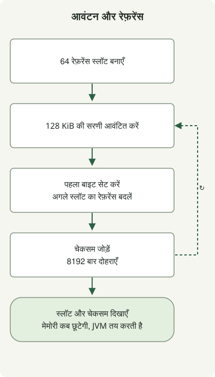

---
{
  "state": "draft",
  "language": "hi",
  "translationKey": "2026-11-03-jdk-gc-evolution",
  "title": "JDK में गार्बेज कलेक्शन: JDK 27 से 1.4 तक G1, ZGC, Shenandoah और CMS",
  "description": "JDK 27 और 28 EA से पीछे चलते हुए देखें कि HotSpot में कौन से कलेक्टर आए, डिफ़ॉल्ट बने या हटे। एक ही आवंटन प्रोग्राम से GC लॉग पढ़ें और कलेक्टरों की तुलना करें।",
  "sourcePath": "src/content/posts/en/2026-11-03-jdk-gc-evolution.md",
  "sourceSha256": "01667d7b4b2824ee749cd29f79a08f74627c3725ff551aa08ed090d48f9fd693"
}
---

**आज के HotSpot में पहले G1 का व्यवहार मापें। लेटेंसी की शर्तें कड़ी हों तो ZGC या Shenandoah से तुलना करें और थ्रूपुट सबसे अहम हो तो Parallel GC पर विचार करें।** पुरानी JVM सेटिंग कॉपी करने से पहले अपने JDK वितरण में उपलब्ध कलेक्टर और उसका डिफ़ॉल्ट जाँचें।

इस लेख की संदर्भ तिथि **2026-11-03** है। उस दिन [JDK 27](https://jdk.java.net/27/) नवीनतम आम तौर पर उपलब्ध फ़ीचर रिलीज़ था और [JDK 28 अर्ली ऐक्सेस में था](https://jdk.java.net/28/)। लेख का दायरा **OpenJDK HotSpot** है। Oracle के LTS संस्करण 8, 11, 17, 21 और 25 परिनियोजन के आम विकल्प हैं, लेकिन समर्थन की अवधि और अपडेट की शर्तें वितरक पर निर्भर करती हैं। [Oracle का समर्थन रोडमैप](https://www.oracle.com/java/technologies/java-se-support-roadmap.html)

## नवीनतम JDK से पुराने संस्करणों तक

| JDK | GC में प्रमुख बदलाव | मौजूदा परिनियोजन में क्या जाँचें |
| --- | --- | --- |
| **28 EA** | Shenandoah का जेनरेशनल मोड डिफ़ॉल्ट बनाने वाला [JEP 535](https://openjdk.org/jeps/535) Targeted स्थिति में है | इसे GA रिलीज़ में उपलब्ध बदलाव न मानें। इससे Shenandoah पूरी JVM का डिफ़ॉल्ट कलेक्टर भी नहीं बनता |
| **27** | [JEP 523](https://openjdk.org/jeps/523) CPU की संख्या और मेमोरी के आकार से स्वतंत्र रूप से G1 को डिफ़ॉल्ट चुनता है | छोटे परिवेश में पहले Serial चुनने वाली सेवाओं का डिफ़ॉल्ट फिर जाँचें |
| **26** | [JEP 522](https://openjdk.org/jeps/522) थ्रूपुट बढ़ाने के लिए G1 में सिंक्रोनाइज़ेशन का खर्च घटाता है | अपस्ट्रीम सुधार से आपकी सेवा में उतने ही प्रतिशत लाभ की पुष्टि नहीं होती |
| **25** | [JEP 521](https://openjdk.org/jeps/521) जेनरेशनल Shenandoah को प्रायोगिक स्थिति से उत्पाद फ़ीचर बनाता है | मोड उपलब्ध होना और उसका डिफ़ॉल्ट रूप से चुना जाना अलग बदलाव हैं |
| **24 / 23** | 24 में नॉन-जेनरेशनल ZGC हटता है ([JEP 490](https://openjdk.org/jeps/490))। 23 में ZGC चुनने पर जेनरेशनल मोड डिफ़ॉल्ट होता है ([JEP 474](https://openjdk.org/jeps/474))। 24 में प्रायोगिक जेनरेशनल Shenandoah भी आता है ([JEP 404](https://openjdk.org/jeps/404)) | ZGC के भीतर का डिफ़ॉल्ट बदलने से JVM का डिफ़ॉल्ट कलेक्टर नहीं बदलता |
| **21 / 17 / 15** | 21 में जेनरेशनल ZGC आता है ([JEP 439](https://openjdk.org/jeps/439))। ZGC और Shenandoah संस्करण 15 में उत्पाद फ़ीचर बनते हैं ([JEP 377](https://openjdk.org/jeps/377), [379](https://openjdk.org/jeps/379)), इसलिए 17 में भी दोनों उत्पाद फ़ीचर हैं | 21 में जेनरेशनल ZGC स्पष्ट रूप से चुनें। प्लेटफ़ॉर्म और वितरण में उपलब्धता अलग जाँचें |
| **14 / 12 / 11** | 14 में CMS हटता है ([JEP 363](https://openjdk.org/jeps/363))। 12 में प्रायोगिक Shenandoah जुड़ता है ([JEP 189](https://openjdk.org/jeps/189))। 11 में प्रायोगिक ZGC और Epsilon आते हैं ([JEP 333](https://openjdk.org/jeps/333), [318](https://openjdk.org/jeps/318)) | पहले की प्रायोगिक स्थिति और आज की उत्पाद स्थिति में अंतर रखें। शुरुआत में सभी प्लेटफ़ॉर्म समर्थित नहीं थे |
| **9** | सर्वर कॉन्फ़िगरेशन में G1 डिफ़ॉल्ट बनता है ([JEP 248](https://openjdk.org/jeps/248)), CMS को अप्रचलित घोषित किया जाता है ([JEP 291](https://openjdk.org/jeps/291)) और एकीकृत GC लॉगिंग आती है ([JEP 271](https://openjdk.org/jeps/271)) | JDK 8 के लॉग पार्सर और विकल्प ज्यों के त्यों न ले जाएँ |
| **8** | सर्वर-क्लास मशीनों में थ्रूपुट के लिए Parallel डिफ़ॉल्ट है। G1 और CMS विकल्प हैं। PermGen हटता है ([JEP 122](https://openjdk.org/jeps/122)) | हर परिवेश में Parallel डिफ़ॉल्ट नहीं था। नए परिनियोजन में PermGen के फ़्लैग न ले जाएँ |
| **7u4 / 6 / 5 / 1.4.1** | G1 को Oracle JDK में 7u4 से समर्थन मिला। समानांतर पूर्ण कलेक्शन 5u6 में आया और 6 में सुधरा। 1.4.1 के दस्तावेज़ समानांतर यंग कलेक्शन और समवर्ती ओल्ड कलेक्शन बताते हैं | शुरुआती Parallel यंग कलेक्शन को बाद के समानांतर ओल्ड कलेक्शन से अलग समझें |

JDK 8 के डिफ़ॉल्ट उसके [एर्गोनॉमिक्स गाइड](https://docs.oracle.com/javase/8/docs/technotes/guides/vm/gctuning/ergonomics.html) के संदर्भ में पढ़ें। पुराने बदलावों के लिए [G1 समर्थन का इतिहास](https://docs.oracle.com/javase/8/docs/technotes/guides/vm/G1.html), [Parallel Compaction का विवरण](https://docs.oracle.com/javase/8/docs/technotes/guides/vm/par-compaction-6.html) और [JDK 1.4.1 पर GC का लेख](https://www.oracle.com/technical-resources/articles/java/garbagecollection-in-java-applications-using-jdk141.html) देखें। पुराने हीप आकार और पॉज़ लक्ष्य उस दौर की सलाह हैं। उन्हें वर्तमान परिनियोजन का डिफ़ॉल्ट न मानें।

तालिका में चुनिंदा अहम बदलाव हैं। इसमें हर अपडेट का सुधार शामिल नहीं है और लेख के लिए हर ऐतिहासिक रिलीज़ चलाया भी नहीं गया।

## कलेक्टर चुनने से पहले तीन अंतर समझें

GC उन ऑब्जेक्ट की मेमोरी वापस लेता है **जिन तक GC roots से पहुँचा नहीं जा सकता**। चल रहे थ्रेड के रेफ़रेंस ऐसे roots का एक उदाहरण हैं। ऐप को ज़रूरत न रहने पर भी कैश या ग्लोबल कलेक्शन किसी ऑब्जेक्ट का रेफ़रेंस बनाए रख सकता है। जेनरेशनल कलेक्शन इस अवलोकन का लाभ लेता है कि बहुत से ऑब्जेक्ट जल्दी अनुपयोगी हो जाते हैं जबकि कुछ लंबे समय तक रहते हैं। इसलिए नए और पुराने ऑब्जेक्ट अलग ढंग से सँभाले जाते हैं। [HotSpot में GC का कार्यान्वयन](https://docs.oracle.com/en/java/javase/27/gctuning/garbage-collector-implementation.html)

**समानांतर (parallel)** में कई GC थ्रेड मिलकर काम करते हैं। **समवर्ती (concurrent)** में GC का कुछ काम ऐप के चलते समय होता है। ये अलग गुण हैं। **स्टॉप-द-वर्ल्ड (STW)** चरण में ऐप का निष्पादन रुकता है। समवर्ती कलेक्टर में भी छोटे विराम या आवंटन के दौरान रुकावट आ सकती है। समवर्ती काम अनुरोध की लेटेंसी समाप्त नहीं करता।

मार्किंग से जीवित ऑब्जेक्ट पहचाने जाते हैं। स्वीपिंग खाली की जा सकने वाली जगह फिर इस्तेमाल के लिए उपलब्ध कराती है। कॉम्पैक्शन जीवित ऑब्जेक्ट खिसकाकर खाली जगह एक साथ करता है। इवैक्यूएशन चुने हुए रीजन से बचे ऑब्जेक्ट दूसरी जगह कॉपी करता है। अलग कलेक्टर पीढ़ियों और रीजन के लिए इन क्रियाओं को समानांतर या समवर्ती ढंग से अलग-अलग जोड़ते हैं।

| कलेक्टर | मुख्य तरीका | तुलना में क्या देखें |
| --- | --- | --- |
| Serial | एक GC थ्रेड। समन्वय का कम खर्च छोटे कार्यों में उपयुक्त हो सकता है | छोटा हीप या सीमित CPU होने पर भी थ्रूपुट और पॉज़ मापें |
| Parallel | कई कलेक्शन थ्रेड, थ्रूपुट को प्राथमिकता | बैच पूरा होने का समय और स्वीकार्य पॉज़ देखें |
| G1 | रीजन, समवर्ती मार्किंग और पॉज़ के दौरान इवैक्यूएशन | सामान्य सर्वर की तुलना का आधार। पॉज़ लक्ष्य रियल-टाइम गारंटी नहीं है |
| ZGC | छोटे पॉज़ के लिए ऑब्जेक्ट खिसकाने और रेफ़रेंस सँभालने का अधिकांश काम समवर्ती | अतिरिक्त CPU और हीप की गुंजाइश, आवंटन दर और ऐप लेटेंसी साथ देखें |
| Shenandoah | समवर्ती स्थानांतरण वाला कम-पॉज़ कलेक्टर। जेनरेशनल मोड की स्थिति रिलीज़ पर निर्भर है | पहले वितरण में उपलब्धता और चुना हुआ मोड जाँचें |
| CMS / Epsilon | CMS पुराना समवर्ती मार्क-स्वीप कलेक्टर है। प्रायोगिक Epsilon मेमोरी वापस नहीं लेता | नवीनतम JDK में CMS उपलब्ध नहीं है। Epsilon सामान्य सेवा के GC का विकल्प नहीं है |

Serial और Parallel के लिए [वर्तमान कलेक्टर चयन गाइड](https://docs.oracle.com/en/java/javase/27/gctuning/available-collectors.html) से शुरू करें। [G1 ट्यूनिंग गाइड](https://docs.oracle.com/en/java/javase/27/gctuning/garbage-first-garbage-collector-tuning.html) में G1 का व्यवहार और पॉज़ लक्ष्य हैं। [पुराने CMS दस्तावेज़](https://docs.oracle.com/en/java/javase/13/gctuning/concurrent-mark-sweep-cms-collector.html) समवर्ती चरण और फ़्रैगमेंटेशन की बाधाएँ बताते हैं। [JEP 318](https://openjdk.org/jeps/318) के अनुसार Epsilon मेमोरी वापस नहीं लेता।

## कलेक्टर के साथ जेनरेशनल मोड भी जाँचें

JDK 21 में ZGC के लिए `-XX:+UseZGC -XX:+ZGenerational` जेनरेशनल मोड चुनता है। 23 में `-XX:+UseZGC` का डिफ़ॉल्ट जेनरेशनल है। 24 में नॉन-जेनरेशनल कार्यान्वयन हट जाता है। किसी फ़्लैग को अप्रचलित करना, फ़्लैग हटाना और कार्यान्वयन हटाना अलग चरण हैं। इस प्रयोग के JDK 27 ने `-XX:+ZGenerational` अस्वीकार किया, इसलिए उसे वर्तमान कॉन्फ़िगरेशन में न जोड़ें। [वर्तमान ZGC गाइड](https://docs.oracle.com/en/java/javase/27/gctuning/z-garbage-collector.html)

Shenandoah अलग जाँचें। संस्करण 25 में उपलब्ध जेनरेशनल उत्पाद मोड को `-XX:+UseShenandoahGC -XX:ShenandoahGCMode=generational` से चुनते हैं। **27 में सिर्फ़ Shenandoah चुनना जेनरेशनल मोड चुने जाने की पुष्टि नहीं करता।** JEP 535 का लक्ष्य 28 है और संदर्भ तिथि पर इसकी स्थिति Targeted है। बिल्ड विकल्पों और बैकपोर्ट से वितरण में उपलब्ध कलेक्टर बदल सकते हैं। वास्तविक एक्ज़ीक्यूटेबल जाँचें।

## एक ही आवंटन प्रोग्राम के लॉग पढ़ें

यह **एक थ्रेड वाला प्रयोग** ऑब्जेक्ट का जीवनकाल और GC लॉग दिखाता है। यह 8192 बार 128 KiB की सरणी आवंटित करता है। सरणियों का कुल पेलोड 1 GiB है और 64 स्लॉट में बारी-बारी से रेफ़रेंस बदलते हैं। अंत में 8 MiB पेलोड बचता है। सरणी हेडर, रेफ़रेंस और JVM की अन्य मेमोरी इसके अतिरिक्त हैं। यह प्रोडक्शन लोड या GC बेंचमार्क नहीं है।



आरेख कोड में आवंटन और रेफ़रेंस बदलने का क्रम दिखाता है। जिन ऑब्जेक्ट तक पहुँचा नहीं जा सकता उनकी मेमोरी कब वापस मिलेगी, यह JVM तय करती है। कोड `System.gc()` नहीं बुलाता। यह न मानें कि हर बदला हुआ ऑब्जेक्ट तुरंत हटता है।

### `GcProbe.java`

```java
import java.lang.management.GarbageCollectorMXBean;
import java.lang.management.ManagementFactory;

public final class GcProbe {
    private static volatile byte[][] retained;
    private static volatile long checksum;

    public static void main(String[] args) {
        System.out.println("runtime=" + System.getProperty("java.runtime.version"));
        for (GarbageCollectorMXBean gc : ManagementFactory.getGarbageCollectorMXBeans()) {
            System.out.println("collector=" + gc.getName());
        }
        retained = new byte[64][];
        for (int i = 0; i < 8192; i++) {
            byte[] block = new byte[128 * 1024];
            block[0] = (byte) i;
            retained[i % retained.length] = block;
            checksum += block[0] & 0xff;
        }
        System.out.println("iterations=8192 retainedSlots=" + retained.length
                + " checksum=" + checksum);
    }
}
```

`retained` के ज़रिए सरणियों तक बाहर से पहुँचा जा सकता है। इस छोटे प्रोग्राम से किसी प्रोडक्शन सेवा के ऑब्जेक्ट जीवनकाल का वितरण या उसकी अड़चन तय नहीं होती।

### JDK 27 में चार कलेक्टर चुनकर लॉग देखें

कमांड Unix शैली के शेल के लिए हैं। `GC_JDK` में अपनी **JDK होम डायरेक्टरी** रखें, Java फ़ाइल नई कार्य डायरेक्टरी में सहेजें और वहीं कमांड चलाएँ। बाहरी लाइब्रेरी या नेटवर्क अनुरोध नहीं चाहिए। हर रन में अधिकतम हीप 128 MiB है और घूमने वाली लॉग फ़ाइलों का आकार सीमित है।

```sh
GC_JDK="/path/to/jdk-27"
"$GC_JDK/bin/java" -version
mkdir -p out logs
"$GC_JDK/bin/javac" -d out GcProbe.java
for gc in G1 Parallel Serial Z; do
  "$GC_JDK/bin/java" "-XX:+Use${gc}GC" -Xms128m -Xmx128m \
    '-Xlog:gc*,safepoint:file=logs/gc-%p.log:time,uptime,level,tags:filecount=3,filesize=5M' \
    -cp out GcProbe
done
```

`%p` की जगह JVM का PID आता है, जिससे अलग रन के लॉग पहचाने जाते हैं। जाँचें कि चारों रन नीचे दी गई पंक्ति से समाप्त होते हैं। उससे पहले का रनटाइम और कलेक्टर आउटपुट चुने गए JDK और कलेक्टर पर निर्भर है।

```text
iterations=8192 retainedSlots=64 checksum=1044480
```

प्रयोग **macOS arm64, Zulu 8u392-b08 और Temurin 21.0.13+9, 25.0.5+8 तथा 27.0.1.0.2+1** पर चला। संग्रहित संस्करण ऐतिहासिक व्यवहार दिखाते हैं। इन्हें वर्तमान सुरक्षा अपडेटों के संयोजन की सिफ़ारिश न समझें। नीचे वास्तव में चलाए गए कॉन्फ़िगरेशन हैं।

| JDK | जाँचे गए रन |
| --- | --- |
| 8 | डिफ़ॉल्ट Parallel, स्पष्ट रूप से चुने G1 और CMS। रन पूरे हुए और पुरानी शैली के GC लॉग मिले |
| 21 | नॉन-जेनरेशनल और स्पष्ट रूप से चुना जेनरेशनल ZGC। रन पूरे हुए और लॉग मिले |
| 25 | ZGC फ़्लैग से चुना जेनरेशनल ZGC। रन पूरा हुआ और लॉग मिले |
| 27 | Serial, Parallel, G1, ZGC, नॉन-जेनरेशनल Shenandoah और स्पष्ट रूप से चुना जेनरेशनल Shenandoah। रन पूरे हुए और लॉग मिले |

सभी **12 कॉन्फ़िगरेशन** में एक ही चेकसम और GC लॉग मिले। अलग JDK के कार्यान्वयन, ऑप्टिमाइज़ेशन और सुरक्षा संबंधी अंतर नियंत्रित नहीं थे। इसलिए लगे समय या GC की संख्या से कलेक्टरों की रैंकिंग नहीं कर सकते। 28 EA और 1.4.1–7, 9–20, 22–24 तथा 26 के बदलाव ऊपर दिए आधिकारिक स्रोतों से जाँचे गए।

### लॉग की एक पंक्ति क्या बताती है?

यह G1 की एक वास्तविक घटना है जो JDK 27 में दर्ज हुई। केवल टाइमस्टैम्प और टैग हटाए गए हैं।

```text
GC(0) Pause Young (Normal) (G1 Evacuation Pause) 47M->10M(128M) 1.468ms
```

`47M->10M` इस GC के पहले और बाद हीप का इस्तेमाल है। `(128M)` उस समय हीप की क्षमता है। कोष्ठक का मान हर स्थिति में अधिकतम हीप नहीं होता। इस प्रयोग में `-Xms` और `-Xmx` बराबर हैं। `1.468ms` इस घटना का पॉज़ है। इससे सेवा का p99 या GC का कुल CPU खर्च नहीं मिलता। अकेली पंक्ति से मेमोरी लीक को नकारना या पॉज़ समय की गारंटी देना संभव नहीं।

### JDK 8 में लॉगिंग विकल्प भी अलग हैं

JDK 9 की एकीकृत लॉगिंग के विकल्प 8 पर ज्यों के त्यों न लगाएँ। क्लास फ़ाइल संस्करण में असंगति से बचने के लिए उसी JDK के कंपाइलर से स्रोत दोबारा कंपाइल करें।

```sh
GC_JDK="/path/to/jdk-8"
mkdir -p out8 logs
"$GC_JDK/bin/javac" -d out8 GcProbe.java
"$GC_JDK/bin/java" -Xms128m -Xmx128m -XX:+UseConcMarkSweepGC \
  -XX:+PrintGCDetails -XX:+PrintGCDateStamps -Xloggc:logs/jdk8-cms.log \
  -cp out8 GcProbe
```

JDK 27 ने `-XX:+UseConcMarkSweepGC` भी अस्वीकार किया। समर्थन, अप्रचलन और हटाने के चरण रिलीज़ के अनुसार बदलते हैं। अपग्रेड पर स्टार्टअप संदेश और एग्ज़िट स्टेटस जाँचें।

डिफ़ॉल्ट कलेक्टर का चयन नीचे के तरीके से जाँचें। इससे **नई JVM** को एक CPU दिखाई देता है। चलती सेवा का CPU आवंटन नहीं बदलता।

```sh
GC_JDK="/path/to/jdk-27"
"$GC_JDK/bin/java" -XX:ActiveProcessorCount=1 -Xms128m -Xmx128m \
  -XX:+PrintCommandLineFlags -version
```

समान स्थिति में Temurin 21 ने `UseSerialGC` और Temurin 27 ने `UseG1GC` दिखाया। स्पष्ट रूप से कलेक्टर चुनना डिफ़ॉल्ट चयन पर वरीयता लेता है। JVM को दिखाई देने वाले CPU और मेमोरी मायने रखते हैं। केवल होस्ट के विनिर्देशों से कंटेनर का चयन तय नहीं होता।

## प्रोडक्शन में तुलना के लिए क्या मापें?

मौजूदा सेवा का JDK, वितरण, फ़्लैग और वर्कलोड पहले दर्ज करें। समान अनुरोध पैटर्न और CPU/मेमोरी बजट में **ऐप थ्रूपुट, p95/p99, त्रुटियाँ, RSS, हीप इस्तेमाल, आवंटन दर, GC पॉज़ और समवर्ती GC का CPU खर्च** साथ देखें। GC और ऐप थ्रेड के बीच CPU के लिए प्रतिस्पर्धा बढ़े तो छोटे पॉज़ के बावजूद ऐप लेटेंसी बिगड़ सकती है।

G1 में किसी दूसरे कलेक्टर से यंग जेनरेशन का आकार लेकर स्थिर करने के बजाय डिफ़ॉल्ट के साथ आधार मापें। फिर ज़रूरत हो तो कुल हीप और पॉज़ लक्ष्य बदलें। ZGC को समवर्ती कलेक्शन के दौरान जीवित ऑब्जेक्ट और नए आवंटन के लिए पर्याप्त अतिरिक्त जगह चाहिए। `-Xmx` प्रोसेस का RSS या पूरे कंटेनर की मेमोरी सीमा नहीं है। मेटास्पेस, थ्रेड स्टैक और डायरेक्ट बफ़र का बजट भी रखें।

यदि पहुँच योग्य ऑब्जेक्ट बढ़ते जाएँ तो पहले बचे रेफ़रेंस, कैश की सीमा और अनुरोधों का जीवनकाल देखें। कलेक्टर बदलने से पहुँच योग्य ऑब्जेक्ट अपने आप नहीं हटते। सेवा के साक्ष्य को [LGTM में लॉग और ट्रेस जोड़ने की प्रक्रिया](/en/posts/2026-11-02-grafana-lgtm-log-trace/) से मिलाएँ। अनुरोध में देरी और GC घटना का एक समय होना कारण का प्रमाण नहीं है।
