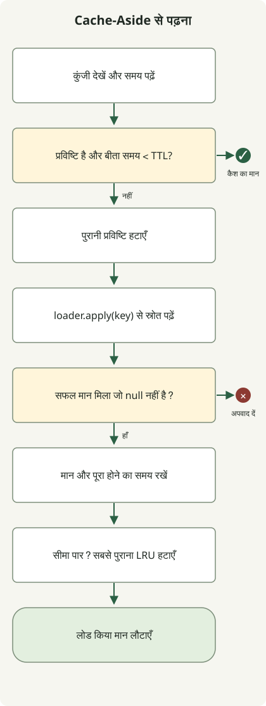

---
{
  "state": "draft",
  "language": "hi",
  "translationKey": "2026-10-31-cache-aside",
  "title": "API में Cache-Aside: कुंजी, TTL, अमान्यकरण और विफलता में डेटाबेस की सुरक्षा",
  "description": "Java में Cache-Aside चलाकर देखें कि कुंजी, समाप्ति और क्षमता की सीमा रीड को कैसे बदलती हैं। एक साथ कई कैश मिस या कैश विफल होने पर मूल डेटाबेस का लोड सीमित करना सीखें।",
  "sourcePath": "src/content/posts/en/2026-10-31-cache-aside.md",
  "sourceSha256": "2c4422c55f14e7b5452f8b286bf5d6f986617fe624e229b7bd74462afe525ad9"
}
---

**कैशिंग पहले मिले परिणाम का दोबारा उपयोग करके मूल स्रोत से पढ़ने और गणना का खर्च घटाती है।** पहले तय करें कि कौन से अनुरोध एक परिणाम साझा कर सकते हैं, उसे कब तक इस्तेमाल करना है और स्रोत बदलने पर उसे कैसे ताज़ा करना है। हिट दर ऊँची हो फिर भी दूसरे उपयोगकर्ता का डेटा लौटाना या पुरानी कीमत पर खरीद पक्की करना गलत है।

यह लेख रीड API में कैश लगाने वाले डेवलपर के लिए है। उत्पाद विवरण जैसे डेटा पर Cache-Aside समझेंगे, जिसमें थोड़ी देरी स्वीकार्य है, और Java में TTL व क्षमता की सीमा चलाकर देखेंगे। भुगतान या स्टॉक पक्का करने जैसे काम में मौजूदा स्थिति चाहिए। उन्हें इस रीड कैश से अलग रखें। विफलता के समय पुराना डेटा लौटाने की नीति के लिए [फ़ॉलबैक डिज़ाइन पर लेख](/ko/posts/2026-10-31-failure-fallback/) देखें।

## क्या और कहाँ कैश करें?

उन रास्तों से शुरू करें जहाँ बार-बार रीड होती है, मूल स्रोत तक पहुँचना महँगा है और थोड़े समय तक पुराना उत्तर स्वीकार्य है। एक ही बार काम आने वाले या हर उपयोगकर्ता के लिए लगभग पूरी तरह अलग डेटा को रखने और अमान्य करने का खर्च कैश हिट की बचत से अधिक हो सकता है।

| स्थान | कौन सा खर्च घट सकता है | साथ में क्या तय करें |
| --- | --- | --- |
| ब्राउज़र या CDN का HTTP कैश | नेटवर्क के चक्कर और API तक आने वाले अनुरोध | साझा करने की अनुमति, URL और `Vary`, `Cache-Control` |
| ऐप का स्थानीय कैश | रिमोट कैश के चक्कर, DB रीड, दोहराई जाने वाली गणना | हर प्रक्रिया की मेमोरी सीमा और रेप्लिका के मानों में अंतर |
| Redis जैसा साझा कैश | अलग रेप्लिका से मूल स्रोत की दोहराई जाने वाली रीड | नेटवर्क लेटेंसी, विफलता का व्यवहार, सीरियलाइज़ेशन और स्टोरेज क्षमता |

हर परत एक साथ लगाना ज़रूरी नहीं है। स्थानीय कैश तेज़ है, लेकिन हर रेप्लिका की अपनी प्रति होती है। साझा कैश डुप्लिकेट स्टोरेज घटा सकता है और नेटवर्क व संचालन की नई निर्भरता जोड़ता है। कई परतें हों तो अमान्यकरण भी हर परत तक पहुँचना चाहिए।

## Cache-Aside कैसे काम करता है?

ऐप पहले कैश देखता है। प्रविष्टि न मिले या समाप्त हो गई हो तो स्रोत से पढ़कर परिणाम कैश में रखता है। यही **Cache-Aside** है। लिखते समय आम तौर पर पहले स्रोत का बदलाव कमिट करते हैं और फिर संबंधित प्रविष्टि अमान्य करते हैं। कैश खो जाए तो भी मूल डेटा बचता है। जब कैश ही इकलौता रिकॉर्ड हो तब यह गुण नहीं रहता। [Microsoft का Cache-Aside विवरण](https://learn.microsoft.com/en-us/azure/architecture/patterns/cache-aside)

परिणाम बदलने वाले इनपुट कैश कुंजी में शामिल करें। `Key(tenant, product, language)` टेनेंट, उत्पाद और भाषा के अलग संयोजन के लिए अलग प्रविष्टि देता है। मुद्रा, उपयोगकर्ता की अनुमति या प्रस्तुति फ़ॉर्मैट का संस्करण भी उत्तर बदलता हो तो कुंजी या कैश का दायरा उसके अनुसार बाँटें। बिना विभाजक के स्ट्रिंग जोड़ने से टकराव हो सकता है। संरचित कुंजी या अस्पष्टता रहित एन्कोडिंग इस्तेमाल करें।

कुंजी में टेनेंट ID रखने भर से पहुँच की अनुमति सिद्ध नहीं होती। विश्वसनीय प्रमाणीकरण संदर्भ से टेनेंट तय करें और कैश पढ़ने से पहले अनुमति जाँचें। ऐक्सेस टोकन या पासवर्ड सीधे कुंजी या लॉग में न रखें।

**TTL तय करता है कि मान कितनी देर दोबारा इस्तेमाल हो सकता है। क्षमता तय करती है कि कितना डेटा रखा जा सकता है।** सिर्फ़ TTL हो तो समाप्ति से पहले प्रविष्टियाँ जमा होती रह सकती हैं। सिर्फ़ आकार सीमा हो तो पुराना मान हिट देता रह सकता है। प्रविष्टियों की संख्या और वास्तविक बाइट अलग माप हैं। बड़े उत्तरों के लिए ऑब्जेक्ट और सीरियलाइज़ किए गए डेटा का आकार देखें।

## Java में कुंजी का अलगाव, समाप्ति, अमान्यकरण और क्षमता जाँचें

यह छोटा उदाहरण टेनेंट के अनुसार उत्पाद विवरण के लिए **स्थानीय कैश का व्यवहार** दिखाता है। 5 सेकंड का TTL और अधिकतम 2 प्रविष्टियाँ असर देखने के लिए हैं। ये प्रोडक्शन सेटिंग की सलाह नहीं हैं। `LinkedHashMap` के ऐक्सेस क्रम से सबसे लंबे समय से इस्तेमाल न हुई प्रविष्टि पहले हटती है। [Java 21 दस्तावेज़](https://docs.oracle.com/en/java/javase/21/docs/api/java.base/java/util/LinkedHashMap.html)



चित्र `get()` दिखाता है। स्रोत का लोडर विफल हो तो अपवाद आगे जाता है और नया मान नहीं रखा जाता। `invalidate()` अलग ऑपरेशन है जिसे स्रोत बदलने के बाद बुलाते हैं।

इसे `CacheDemo.java` में सहेजकर JDK 21 या बाद के संस्करण में चलाएँ। कोई बाहरी सर्वर या लाइब्रेरी नहीं चाहिए।

```java
import java.time.Duration;
import java.util.LinkedHashMap;
import java.util.Objects;
import java.util.concurrent.atomic.AtomicInteger;
import java.util.concurrent.atomic.AtomicLong;
import java.util.function.Function;
import java.util.function.LongSupplier;

public class CacheDemo {
    record Key(String tenant, String product, String language) {}
    record Entry(String value, long loadedAt) {}

    static final class LocalCache {
        private final LinkedHashMap<Key, Entry> entries =
                new LinkedHashMap<>(16, 0.75f, true);
        private final LongSupplier ticker;
        private final long ttl = Duration.ofSeconds(5).toNanos();
        private final int maximumSize = 2;

        LocalCache(LongSupplier ticker) { this.ticker = ticker; }

        synchronized String get(Key key, Function<Key, String> loader) {
            Entry entry = entries.get(key);
            long now = ticker.getAsLong();
            if (entry != null && now - entry.loadedAt() < ttl) {
                return entry.value();
            }
            entries.remove(key);
            String value = Objects.requireNonNull(loader.apply(key));
            entries.put(key, new Entry(value, ticker.getAsLong()));
            if (entries.size() > maximumSize) {
                entries.remove(entries.keySet().iterator().next());
            }
            return value;
        }

        synchronized void invalidate(Key key) { entries.remove(key); }
    }

    static void expect(String actual, String expected) {
        if (!actual.equals(expected)) throw new AssertionError(actual);
        System.out.println(actual);
    }

    public static void main(String[] args) {
        AtomicLong clock = new AtomicLong();
        AtomicInteger loads = new AtomicInteger();
        LocalCache cache = new LocalCache(clock::get);
        Function<Key, String> loader = key ->
                key.tenant() + "/" + key.language() + "/v" + loads.incrementAndGet();
        Key ko = new Key("shop-a", "p1", "ko");
        Key en = new Key("shop-a", "p1", "en");
        Key other = new Key("shop-b", "p1", "ko");

        expect(cache.get(ko, loader), "shop-a/ko/v1");
        expect(cache.get(ko, loader), "shop-a/ko/v1");
        clock.set(Duration.ofSeconds(5).toNanos() - 1);
        expect(cache.get(ko, loader), "shop-a/ko/v1");
        clock.incrementAndGet();
        expect(cache.get(ko, loader), "shop-a/ko/v2");
        cache.invalidate(ko);
        expect(cache.get(ko, loader), "shop-a/ko/v3");
        expect(cache.get(en, loader), "shop-a/en/v4");
        expect(cache.get(ko, loader), "shop-a/ko/v3");
        expect(cache.get(other, loader), "shop-b/ko/v5");
        expect(cache.get(en, loader), "shop-a/en/v6");

        Key failing = new Key("shop-c", "p1", "ko");
        try {
            cache.get(failing, key -> { throw new IllegalStateException("origin"); });
            throw new AssertionError("Failure was swallowed");
        } catch (IllegalStateException expected) {
            expect(expected.getMessage(), "origin");
        }
        expect(cache.get(failing, loader), "shop-c/ko/v7");
    }
}
```

```sh
javac --release 21 CacheDemo.java
java CacheDemo
```

Zulu JDK `21.0.1+12-LTS` पर यह आउटपुट मिला।

```text
shop-a/ko/v1
shop-a/ko/v1
shop-a/ko/v1
shop-a/ko/v2
shop-a/ko/v3
shop-a/en/v4
shop-a/ko/v3
shop-b/ko/v5
shop-a/en/v6
origin
shop-c/ko/v7
```

एक कुंजी की पहली तीन रीड में स्रोत सिर्फ़ एक बार पढ़ा गया। समाप्ति से 1ns पहले वही मान मिलता है। ठीक 5 सेकंड पर वह फिर लोड होता है। अगले मामले स्पष्ट अमान्यकरण, भाषा और टेनेंट के आधार पर कुंजी का अलगाव और ऐक्सेस क्रम से निकासी जाँचते हैं। लोडर विफल होने के बाद सफल रीड भी शामिल है। `v1` जैसे मान टेस्ट लोडर की कॉल का क्रम दिखाते हैं, वास्तविक DB संस्करण नहीं।

समय को दोहराने योग्य बनाने के लिए सोने की जगह ऐसा मोनोटोनिक टाइमर है जिसे हाथ से आगे बढ़ाया जाता है। असली प्रक्रिया में बीता समय मापने के लिए `new LocalCache(System::nanoTime)` दे सकते हैं। समाप्त प्रविष्टि अगली पहुँच पर सँभाली जाती है। उसे पृष्ठभूमि में तुरंत नहीं हटाया जाता। सीमा प्रविष्टियों की गिनती पर है, बाइट पर नहीं।

कोड छोटा रखने के लिए लोडर भी `synchronized` दायरे में चलता है। एक इंस्टेंस पर अलग कुंजियों की कॉल भी क्रम से चलती हैं और धीमे लोडर की प्रतीक्षा में अनुरोधों की संख्या सीमित नहीं है। यह उच्च प्रदर्शन वाला प्रोडक्शन कैश नहीं है। नीचे बताए गए प्रति-कुंजी सिंगल-फ़्लाइट, स्रोत कॉल की सीमा, टाइमआउट या रेप्लिका के बीच अमान्यकरण का प्रसार इसमें लागू नहीं है। यहाँ क्रमवार परिदृश्य जाँचे गए हैं। समवर्ती लोड परीक्षण नहीं हुआ।

## क्या TTL और अमान्यकरण से नवीनतम मान की गारंटी है?

नहीं। यह उदाहरण TTL **तब से मापता है जब स्रोत की रीड पूरी होती है और मान कैश में रखा जाता है**। अगर स्रोत ख़ुद देर से अपडेट होने वाला रीड रेप्लिका या पुराना स्नैपशॉट है तो 5 सेकंड के TTL का अर्थ यह नहीं है कि स्रोत बदलने के 5 सेकंड के भीतर नया मान दिखेगा। रीड लेटेंसी, रेप्लिकेशन देरी और अमान्यकरण के प्रसार को अलग देखें।

कई रेप्लिका के साझा कैश में DB अपडेट के बाद प्रविष्टि मिटाने पर भी रेस संभव है। रीड A पुराना मान लेना शुरू करती है। राइट B नया मान कमिट करके कैश प्रविष्टि मिटाती है। फिर A देर से पूरी होकर पुराना मान वापस कैश में रख देती है। TTL उस मान का जीवन घटाता है पर रेस नहीं मिटाता।

नवीनतम स्थिति वाले रास्तों में स्रोत के ट्रांज़ैक्शन के भीतर फिर सत्यापन करें या, उदाहरण के लिए, डेटा संस्करण और सशर्त राइट से देर से आए मान को नए मान के ऊपर लिखने से रोकें। इवेंट से अमान्यकरण करते समय कमिट और डिलीवरी के बीच इवेंट खोना, दोहरना और देर होना सँभालें। एक बदलाव सूची, विवरण और समेकित आँकड़े जैसी कई कुंजियाँ बदलता हो तो उन सभी के लिए दायरा तय करें।

`expire-after-write` और `expire-after-access` में अंतर रखें। हर रीड पर अवधि बढ़ाने से अक्सर पढ़ा जाने वाला पुराना मान लंबे समय तक बच सकता है। अगर लक्ष्य रीड की संख्या चाहे जितनी हो, स्टोरेज के निश्चित समय बाद जाँच करना है, तो लिखने के समय से समाप्ति का विकल्प परखें। [Caffeine की समाप्ति और निकासी नीतियाँ](https://github.com/ben-manes/caffeine/wiki/Eviction)

## एक साथ समाप्ति हो या कैश विफल हो तो क्या होता है?

लोकप्रिय कुंजी समाप्त होते ही सभी अनुरोध स्रोत पर चले जाएँ तो **कैश स्टैम्पीड** हो सकता है। सिंगल-फ़्लाइट एक कुंजी की रीड को एक ही चल रहे ऑपरेशन में मिलाकर दोहराव घटाता है। स्रोत कॉल की समवर्ती संख्या और प्रतीक्षा अवधि भी सीमित करें। एक प्रक्रिया में दोहराव हटाने से सभी रेप्लिका में दोहराव नहीं हटता। Java में [Caffeine के एटॉमिक लुकअप और लोडिंग API](https://github.com/ben-manes/caffeine/wiki/Population) पर विचार कर सकते हैं, लेकिन इससे पूरी सेवा के स्रोत लोड की सीमा तय नहीं होती।

कई कुंजियों का TTL साथ समाप्त होता हो तो जिटर से समाप्ति के समय फैला सकते हैं। ताज़गी की सीमा 60 सेकंड हो तो अवधि को 60 सेकंड के भीतर ही फैलाएँ। एक ही लोकप्रिय कुंजी पर भीड़ का समाधान जिटर नहीं करता। पुराना मान लौटाते हुए उसे ताज़ा करने वाला stale-while-revalidate केवल उन रास्तों पर लगाएँ जो पुराना उत्तर स्वीकारते हैं। रिफ़्रेश लगातार विफल हो तो पुराना मान देने की अधिकतम उम्र अलग तय करें।

कैश विफल होने पर हर अनुरोध DB को भेजना भी जोखिम भरा है। उदाहरण के लिए, 10,000 RPS की रीड और 90% हिट दर पर मूल स्रोत को करीब 1,000 RPS मिलते हैं। सभी हिट खोने पर अनुरोधों का वितरण वही रहते हुए भी यह 10,000 RPS हो जाता है। यह गणना है, मापन नहीं। रीट्राई और रिफ़्रेश कॉल इसमें शामिल नहीं हैं।

यदि स्रोत इतना लोड नहीं उठा सकता तो कैश को बायपास करने वाले अनुरोध सीमित करें, स्वीकृत स्थानीय प्रतियाँ या सीमित कार्यक्षमता इस्तेमाल करें, या अतिरिक्त अनुरोध अस्वीकार करें। कैश मिस और कैश विफलता अलग मापें। बहाली में एक साथ बहुत सा डेटा फिर लोड करने पर सीमा लगाएँ। अनुपस्थित ID बार-बार माँगी जाती हो तो अल्पकालिक नेगेटिव कैशिंग मदद कर सकती है। स्रोत की विफलता को “डेटा नहीं है” के रूप में कैश न करें। नया डेटा पढ़ा जा सके इसलिए इस कैश का भी TTL और अमान्यकरण तय करें।

## HTTP कैश को ऐप के कैश से अलग समझें

ब्राउज़र और CDN के HTTP कैश में उत्तर के हेडर बताते हैं कि उसे फिर कैसे इस्तेमाल किया जा सकता है। यह JVM के भीतर रखे ऑब्जेक्ट के TTL से अलग परत है।

| निर्देश | अर्थ |
| --- | --- |
| `max-age=60` | उत्तर की उम्र 60 सेकंड से कम रहने तक वह ताज़ा है |
| `s-maxage=60` | साझा कैश में ताज़गी की अवधि तय करता है और वहाँ `max-age` व संबंधित सेटिंग पर प्राथमिकता लेता है |
| `private` | साझा कैश में रखने पर पाबंदी है। ब्राउज़र जैसे निजी कैश रख सकते हैं |
| `no-cache` | रख सकते हैं, लेकिन दोबारा इस्तेमाल करने से पहले स्रोत से सफल सत्यापन चाहिए |
| `no-store` | कैश को यह अनुरोध या उत्तर रखने से मना करता है। पहले से मौजूद प्रतियाँ मिटाने का आदेश नहीं है |

भाषा `Accept-Language` से चुनी जाती हो तो `Vary` और वास्तविक कैश कॉन्फ़िगरेशन में यह भेद होना चाहिए। अलग भाषा का URL अलग हो तो URL भी कुंजी का हिस्सा है। सामग्री न बदली हो तो `ETag` और सशर्त अनुरोध ट्रांसफ़र घटा सकते हैं, लेकिन स्रोत से सत्यापन का खर्च हमेशा नहीं हटता। `private` और `no-store` प्रमाणीकरण, प्राधिकरण या एन्क्रिप्शन की जगह नहीं लेते। [RFC 9111 में HTTP कैशिंग](https://www.rfc-editor.org/rfc/rfc9111.html)

शुरुआत एक रीड पथ से करें। सामान्य हिट के साथ TTL की सीमा, लिखने के तुरंत बाद रीड, अलग टेनेंट और भाषाओं में वही ID, अधिकतम क्षमता, समवर्ती मिस, कैश विफलता और बहाली जाँचें। प्रोडक्शन में हिट दर के साथ स्रोत कॉल की संख्या, लेटेंसी, विफलता दर, चल रहे लोड, निकासी, मेमोरी और अमान्यकरण की देरी देखें। लाभ का निर्णय तभी करें जब **उत्तर की शुद्धता और कैश के बिना स्रोत की लोड सहने की क्षमता** जाँच ली हो।
