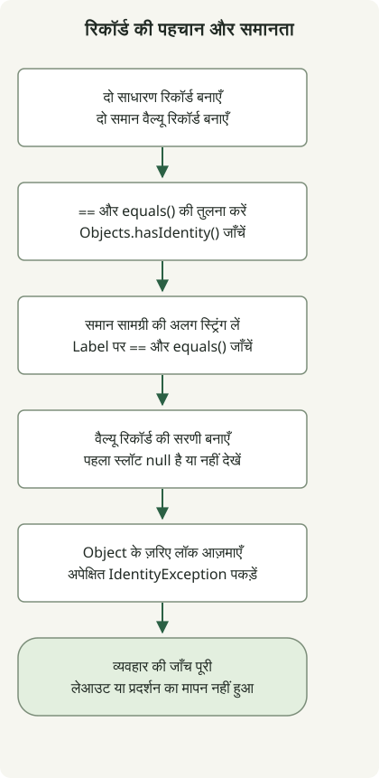

---
{
  "state": "draft",
  "language": "hi",
  "translationKey": "2026-10-31-project-valhalla-value-objects",
  "title": "Java Project Valhalla: वैल्यू ऑब्जेक्ट, रिकॉर्ड और JDK 28 का प्रीव्यू",
  "description": "JDK 28 EA पर रिकॉर्ड की पहचान, वैल्यू की समानता और मॉनिटर की पाबंदियाँ जाँचें। समझें कि JEP 401 कौन सा व्यवहार तय करता है और कौन से अनुकूलन JVM पर छोड़ता है।",
  "sourcePath": "src/content/posts/en/2026-10-31-project-valhalla-value-objects.md",
  "sourceSha256": "28f39aa8186282dfb536d7054cb1df94683ddf593d1c9adea3387d1cdea9e345"
}
---
**OpenJDK का Project Valhalla ऐसे डेटा के लिए वैल्यू ऑब्जेक्ट उपलब्ध कराता है जिसे अलग ऑब्जेक्ट पहचान की ज़रूरत नहीं होती। इससे JVM को डेटा रखने और आगे देने का तरीका चुनने की अधिक छूट मिलती है।** 2026-10-31 को [प्रोजेक्ट पृष्ठ](https://openjdk.org/projects/valhalla/) और [JEP 401](https://openjdk.org/jeps/401) पर जाँचने पर वैल्यू ऑब्जेक्ट का पहला प्रीव्यू JDK 28 में शामिल था। फ़ीचर अभी स्थायी नहीं है। नीचे का उदाहरण JDK 28 EA बिल्ड 21 पर चलाया गया।

## Java में रिकॉर्ड हैं तो वैल्यू क्लास क्यों चाहिए?

फ़ील्ड समान होने पर भी साधारण ऑब्जेक्ट की अपनी पहचान होती है। बदलते खाते या लॉक ऑब्जेक्ट के लिए यह अंतर ज़रूरी है। निर्देशांक `(3, 4)` के लिए सिर्फ़ मान ही काफ़ी हो सकता है।

[`record`](https://docs.oracle.com/en/java/javase/17/language/records.html) डेटा घटक घोषित करता है और उनके ऐक्सेसर, कंस्ट्रक्टर तथा `equals()` जैसी विधियाँ देता है। साधारण रिकॉर्ड में समान घटकों से अलग-अलग बनाए गए दो ऑब्जेक्ट को `==` अलग पहचानता है। `value` संशोधक एक अलग निर्णय व्यक्त करता है कि ऑब्जेक्ट की अपनी पहचान नहीं होगी। रिकॉर्ड के साथ इसे `value record` लिख सकते हैं।

| घोषणा | इस उदाहरण में अर्थ |
| --- | --- |
| `record IdentityPoint(int x, int y)` | समान घटक होने पर भी दो ऑब्जेक्ट अलग पहचाने जाते हैं |
| `value record ValuePoint(int x, int y)` | एक ही क्लास और समान फ़ील्ड स्थिति वाले इंस्टेंस पहचान के आधार पर अलग नहीं किए जा सकते |
| `value record Label(String text)` | अपनी पहचान नहीं है, फिर भी `==` और `equals()` अलग नतीजे दे सकते हैं |

वैल्यू क्लास के इंस्टेंस फ़ील्ड `final` होते हैं। इससे रेफ़रेंस किए गए ऑब्जेक्ट पूरी तरह अपरिवर्तनीय नहीं बन जाते। फ़ील्ड में रखा परिवर्तनशील कलेक्शन अपनी सामग्री बदल सकता है। वैल्यू ऑब्जेक्ट अब भी ऑब्जेक्ट रेफ़रेंस से इस्तेमाल होते हैं और प्रिमिटिव प्रकार नहीं बनते।

## JDK 28 का प्रीव्यू चलाएँ



चित्र नीचे के कोड का क्रम दिखाता है। `Label` में एक ही सामग्री वाले अलग-अलग `String` ऑब्जेक्ट हैं, ताकि रेफ़रेंस फ़ील्ड की तुलना का असर दिखे। अंत में प्रोग्राम जाँचता है कि वैल्यू ऑब्जेक्ट को `Object` चर में रखने पर भी वह वैध मॉनिटर नहीं बनता, और अपेक्षित अपवाद सँभालता है।

प्रयोग के लिए अलग डायरेक्टरी में `javac` और `java` को एक ही [JDK 28 EA](https://jdk.java.net/28/) बिल्ड से चलाएँ। डाउनलोड का आधिकारिक SHA-256 से मिलान करें और `java --version` से बिल्ड जाँचें। JDK 17 और 21 इस सिंटैक्स को कंपाइल नहीं कर सकते। कंपाइल और रन, दोनों समय प्रीव्यू फ़्लैग चाहिए।

### `ValhallaExample.java`

```java
import java.util.Objects;

public class ValhallaExample {
    record IdentityPoint(int x, int y) {}
    value record ValuePoint(int x, int y) {}
    value record Label(String text) {}

    public static void main(String[] args) {
        IdentityPoint a = new IdentityPoint(3, 4);
        IdentityPoint b = new IdentityPoint(3, 4);
        ValuePoint p = new ValuePoint(3, 4);
        ValuePoint q = new ValuePoint(3, 4);
        System.out.println("record == " + (a == b));
        System.out.println("record equals " + a.equals(b));
        System.out.println("value == " + (p == q));
        System.out.println("value equals " + p.equals(q));
        System.out.println("record identity " + Objects.hasIdentity(a));
        System.out.println("value identity " + Objects.hasIdentity(p));

        Label first = new Label(new String(new char[] {'x'}));
        Label second = new Label(new String(new char[] {'x'}));
        System.out.println("label == " + (first == second));
        System.out.println("label equals " + first.equals(second));

        ValuePoint[] points = new ValuePoint[1];
        System.out.println("array slot null " + (points[0] == null));
        Object monitor = p;
        try {
            synchronized (monitor) {
                throw new AssertionError("A value object must not be a monitor");
            }
        } catch (IdentityException expected) {
            System.out.println("monitor " + expected.getClass().getSimpleName());
        }
    }
}
```

```sh
javac --enable-preview --release 28 ValhallaExample.java
java --enable-preview ValhallaExample
```

macOS AArch64 पर OpenJDK `28-ea+21-1707` से यह आउटपुट मिला। कंपाइलर का प्रीव्यू संदेश इस मानक आउटपुट से अलग है।

```text
record == false
record equals true
value == true
value equals true
record identity true
value identity false
label == false
label equals true
array slot null true
monitor IdentityException
```

साधारण रिकॉर्ड पर `equals()` का नतीजा true और `==` का false है। वैल्यू रिकॉर्ड में सिर्फ़ पूर्णांक फ़ील्ड हैं, इसलिए उनकी स्थिति समान होने पर दोनों तुलनाएँ true देती हैं। [`Objects.hasIdentity()`](https://download.java.net/java/early_access/jdk28/docs/api/java.base/java/util/Objects.html#hasIdentity(java.lang.Object)) भी पहचान का यह अंतर दिखाता है।

## क्या वैल्यू ऑब्जेक्ट की तुलना == से करनी चाहिए?

अपने डोमेन के हिसाब से समानता जाँचने के लिए `equals()` इस्तेमाल करते रहें। वैल्यू ऑब्जेक्ट पर `==` एक ही वैल्यू क्लास में फ़ील्ड की स्थिति की तुलना करता है और रेफ़रेंस फ़ील्ड पर पुनरावर्ती ढंग से `==` लगाता है। पहचान वाले दो अलग ऑब्जेक्ट की सामग्री एक जैसी हो तब भी वे अलग पहचाने जाते हैं। प्रिमिटिव फ़ील्ड की तुलना बिट पैटर्न से होती है। इसका नतीजा फ़्लोटिंग-पॉइंट मानों की अर्थगत समानता से भिन्न हो सकता है। [JEP 401 के सटीक तुलना नियम](https://openjdk.org/jeps/401#Comparing-value-objects)

दोनों `Label` की स्ट्रिंग में सामग्री समान है, इसलिए रिकॉर्ड की जनित `equals()` विधि true देती है। लेकिन स्ट्रिंग अलग पहचान वाले ऑब्जेक्ट हैं, इसलिए `==` false देता है। `value` लगाने से हर रेफ़रेंस फ़ील्ड की तुलना उसकी सामग्री के आधार पर नहीं होती।

नई वैल्यू सरणी का स्लॉट `null` है। रनटाइम पर वैल्यू ऑब्जेक्ट को मॉनिटर बनाने की कोशिश `IdentityException` देती है। जिस अभिव्यक्ति का प्रकार स्पष्ट रूप से वैल्यू क्लास हो उस पर सीधे लॉक लगाने का प्रयास कंपाइल करते समय ही अस्वीकार हो सकता है। माइग्रेशन से पहले लॉक और पहचान पर आधारित कैश जैसी निर्भरताएँ जाँचें।

## क्या मेमोरी तुरंत घटती है या `List<int>` उपलब्ध हो जाता है?

पहचान हटने पर JVM **फ़्लैटनिंग** कर सकती है, यानी पॉइंटर की जगह फ़ील्ड की स्थिति से रेफ़रेंस को दर्शा सकती है। **स्केलराइज़ेशन** में वह मान के घटक अलग-अलग रजिस्टर आदि से दे सकती है। भाषा किसी ख़ास मेमोरी लेआउट, आवंटन हटने या गति बढ़ने की गारंटी नहीं देती। ऊपर का आउटपुट व्यवहार की जाँच करता है। इसमें हीप उपयोग या थ्रूपुट नहीं मापा गया।

Valhalla कई JDK रिलीज़ तक फैला है। [आधिकारिक रोडमैप](https://openjdk.org/projects/valhalla/) में वैल्यू ऑब्जेक्ट, null पर पाबंदी वाला स्टोरेज, सरणी में सुधार, प्रिमिटिव और क्लास का एकीकरण तथा जेनेरिक स्पेशलाइज़ेशन के लिए Parametric JVM अलग काम हैं। अकेले JEP 401 से `List<int>` पूरा नहीं होता, न ही हर सरणी के लिए सटी हुई मेमोरी की गारंटी मिलती है। साथ का [JEP 539](https://openjdk.org/jeps/539) फ़ील्ड के सख़्त आरंभीकरण के लिए JVM समर्थन देता है। यह Java स्रोत में मनचाहे फ़ील्ड पर लगाने के लिए `strict` संशोधक नहीं जोड़ता।

निर्देशांक या धनराशि जैसे छोटे प्रकारों से शुरुआत करें जिन्हें पहचान की ज़रूरत नहीं है। एक ही बिल्ड पर व्यवहार की तुलना करें। फ़्रेमवर्क, सीरियलाइज़ेशन और लॉक की निर्भरताएँ जाँचकर प्रतिनिधि कार्यभार में आवंटन, GC और थ्रूपुट मापें। प्रोडक्शन JDK चुनते समय इस प्रीव्यू को स्थायी और समर्थित फ़ीचर न मानें। स्थायी और प्रीव्यू फ़ीचर के अंतर के लिए [JDK फ़ीचर मार्गदर्शिका](/en/posts/2023-09-20-jdk-21-release/) देखें।
