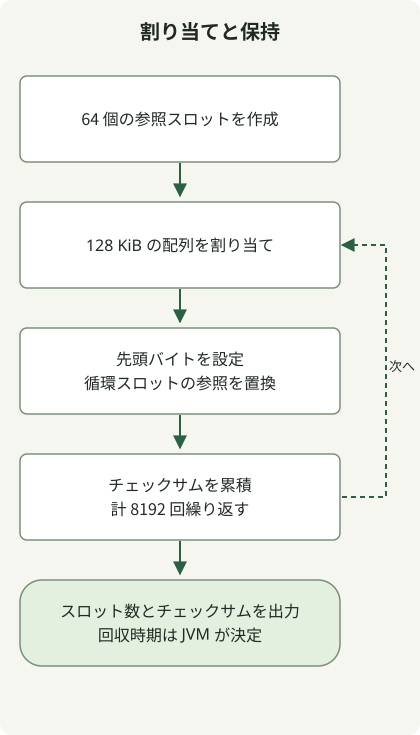

**現在の HotSpot では、測定に基づく G1 のベースラインを作り、厳しいレイテンシ目標には ZGC や Shenandoah を比較し、スループットを重視する場合は Parallel GC を検討します。** 古い JVM フラグをコピーする前に、実際の JDK ディストリビューションでどのコレクタがデフォルトか、どの実装が利用できるかを確認してください。

基準日は **2026-11-03** です。[JDK 27](https://jdk.java.net/27/) が最新の一般提供済み機能リリースであり、[JDK 28 は Early Access](https://jdk.java.net/28/) です。この記事の対象は **OpenJDK HotSpot** であり、すべての JVM 実装ではありません。Oracle の LTS 系列である 8、11、17、21、25 はよく使われるデプロイ先ですが、サポート期間や更新条件はディストリビュータによって異なります。[Oracle のサポートロードマップ](https://www.oracle.com/java/technologies/java-se-support-roadmap.html)

## 最新 JDK から過去のリリースへ

| JDK | GC の主な変更 | 既存環境で確認する点 |
| --- | --- | --- |
| **28 EA** | Shenandoah の世代別モードをデフォルトにする [JEP 535](https://openjdk.org/jeps/535) は Targeted の状態です | GA リリースで提供済みと見なさないでください。Shenandoah が JVM 全体のデフォルトコレクタになるわけではありません |
| **27** | [JEP 523](https://openjdk.org/jeps/523) により、CPU 数やメモリ容量にかかわらず G1 がデフォルトで選ばれます | 小規模環境で以前は Serial が選ばれていたサービスのデフォルトを再確認してください |
| **26** | [JEP 522](https://openjdk.org/jeps/522) は G1 の同期オーバーヘッドを減らしてスループットを改善します | 上流での改善が、自分のサービスでも同じ割合の向上をもたらすとは限りません |
| **25** | [JEP 521](https://openjdk.org/jeps/521) は世代別 Shenandoah を実験的機能から正式機能へ昇格させます | モードが利用できることと、そのモードがデフォルトで選ばれることは別の変更です |
| **24 / 23** | 24 は非世代別 ZGC を削除します（[JEP 490](https://openjdk.org/jeps/490)）。23 は ZGC を選ぶと世代別モードがデフォルトになります（[JEP 474](https://openjdk.org/jeps/474)）。24 は実験的な世代別 Shenandoah も導入します（[JEP 404](https://openjdk.org/jeps/404)） | ZGC 内部のデフォルトが変わっても、JVM のデフォルトコレクタが変わるわけではありません |
| **21 / 17 / 15** | 21 は世代別 ZGC を導入します（[JEP 439](https://openjdk.org/jeps/439)）。ZGC と Shenandoah は 15 で正式機能になるため（[JEP 377](https://openjdk.org/jeps/377)、[379](https://openjdk.org/jeps/379)）、17 でも正式機能です | 21 では世代別 ZGC を明示的に選択します。プラットフォームとディストリビューションでの利用可否をそれぞれ確認してください |
| **14 / 12 / 11** | 14 は CMS を削除します（[JEP 363](https://openjdk.org/jeps/363)）。12 は実験的な Shenandoah を追加し（[JEP 189](https://openjdk.org/jeps/189)）、11 は実験的な ZGC と Epsilon を導入します（[JEP 333](https://openjdk.org/jeps/333)、[318](https://openjdk.org/jeps/318)） | 過去の実験的な位置付けと現在の正式機能としての位置付けを区別してください。初期のサポートはすべてのプラットフォームを対象にしていませんでした |
| **9** | G1 がサーバー構成のデフォルトになります（[JEP 248](https://openjdk.org/jeps/248)）。CMS は非推奨となり（[JEP 291](https://openjdk.org/jeps/291)）、統一 GC ロギングが導入されます（[JEP 271](https://openjdk.org/jeps/271)） | JDK 8 のログパーサーやオプションをそのまま移行しないでください |
| **8** | Parallel がサーバークラスのマシンでスループットを重視するデフォルトであり、G1 と CMS も選択できます。PermGen は削除されます（[JEP 122](https://openjdk.org/jeps/122)） | すべての環境で Parallel がデフォルトだったわけではありません。PermGen のフラグを新しい環境へ持ち込まないでください |
| **7u4 / 6 / 5 / 1.4.1** | Oracle JDK における G1 のサポートは 7u4 からです。並列フル GC は 5u6 で導入され、6 で改善されます。1.4.1 のドキュメントでは、若い世代の並列回収と古い世代の並行回収が紹介されています | 初期の Parallel による若い世代の並列回収と、後から加わった古い世代の並列回収を区別してください |

JDK 8 のデフォルトは、[エルゴノミクスのガイド](https://docs.oracle.com/javase/8/docs/technotes/guides/vm/gctuning/ergonomics.html)の文脈で確認してください。それ以前の節目は、[G1 のサポート履歴](https://docs.oracle.com/javase/8/docs/technotes/guides/vm/G1.html)、[Parallel Compaction の説明](https://docs.oracle.com/javase/8/docs/technotes/guides/vm/par-compaction-6.html)、[JDK 1.4.1 の GC 記事](https://www.oracle.com/technical-resources/articles/java/garbagecollection-in-java-applications-using-jdk141.html)に記載されています。過去のヒープサイズの推奨値や停止時間の目標は、その当時のものであり、現在のデプロイのデフォルト値ではありません。

この表は重要な節目を選んだものです。すべての更新修正の一覧でも、この記事ですべての過去リリースを実行したという主張でもありません。

## コレクタ選択の前に区別したい三つの点

GC は、実行中のスレッドが保持する参照などの **GC ルートから到達できないオブジェクト**のメモリを回収します。アプリケーションが必要としなくなったオブジェクトでも、キャッシュやグローバルなコレクションが到達可能な状態に保つことがあります。世代別回収は、多くのオブジェクトがすぐに不要になる一方、一部は生き残るという観察を利用し、若いオブジェクトと古いオブジェクトを異なる方法で回収します。[HotSpot GC の実装](https://docs.oracle.com/en/java/javase/27/gctuning/garbage-collector-implementation.html)

**並列（parallel）** は複数の GC スレッドが協調して動くこと、**並行（concurrent）** は一部の GC 処理がアプリケーションの実行と重なることを意味します。両者は別の観点です。**Stop-the-world（STW）** フェーズではアプリケーションの実行を停止します。並行コレクタにも短い停止や割り当ての停滞は起こり得ます。並行処理によってリクエストのレイテンシがなくなるわけではありません。

マーキングは生存オブジェクトを特定し、スイープは回収可能な領域を再利用できる状態にします。コンパクションは生存オブジェクトを移動して空き領域をまとめ、退避は選択したリージョンの生存オブジェクトを別の場所へコピーします。コレクタによって、世代、リージョン、並列処理、並行処理におけるこれらの作業の組み合わせが異なります。

| コレクタ | 主な方式 | 比較時に見る条件 |
| --- | --- | --- |
| Serial | GC スレッドは一つで、調整のオーバーヘッドが小さいため小規模タスクに適する場合があります | 小さなヒープや CPU 制限下でも、スループットと停止時間を測定します |
| Parallel | 複数の回収スレッドでスループットを優先します | バッチ完了時間と許容できる停止時間を比較します |
| G1 | リージョン、並行マーキング、停止中の退避を使います | 一般的なサーバーのベースラインにできますが、停止時間の目標はリアルタイム保証ではありません |
| ZGC | 短い停止を目指し、再配置や参照処理の多くを並行して実行します | CPU とヒープの余裕、割り当て速度、アプリケーションのレイテンシを一緒に観測します |
| Shenandoah | 並行再配置を行う低停止時間のコレクタです。世代別モードの位置付けはリリースによって異なります | まずディストリビューションでの利用可否と選択中のモードを確認します |
| CMS / Epsilon | CMS は過去の並行マークスイープコレクタです。実験的な Epsilon はメモリを回収しません | 最新 JDK では CMS を利用できません。Epsilon は汎用サービスの GC の代替にはなりません |

Serial と Parallel は、[現在のコレクタ選択ガイド](https://docs.oracle.com/en/java/javase/27/gctuning/available-collectors.html)から確認してください。[G1 チューニングガイド](https://docs.oracle.com/en/java/javase/27/gctuning/garbage-first-garbage-collector-tuning.html)は G1 の挙動と停止時間の目標を説明しています。[過去の CMS ドキュメント](https://docs.oracle.com/en/java/javase/13/gctuning/concurrent-mark-sweep-cms-collector.html)は並行フェーズと断片化の制約を説明し、[JEP 318](https://openjdk.org/jeps/318)は Epsilon が回収を行わないことを規定しています。

## コレクタに加えて世代別モードも確認する

JDK 21 の ZGC では、`-XX:+UseZGC -XX:+ZGenerational` で世代別モードを選択します。23 では `-XX:+UseZGC` のデフォルトが世代別モードとなり、24 では非世代別の実装が削除されます。フラグの廃止扱いと削除は、実装の削除とは別の段階です。この実験の JDK 27 は `-XX:+ZGenerational` を拒否したため、現在の設定に追加しないでください。[現在の ZGC ガイド](https://docs.oracle.com/en/java/javase/27/gctuning/z-garbage-collector.html)

Shenandoah は別途確認してください。25 で導入された正式な世代別モードは、`-XX:+UseShenandoahGC -XX:ShenandoahGCMode=generational` で選択します。**27 で Shenandoah を選んだだけでは、世代別モードが選ばれたとは判断できません。** JEP 535 は 28 を対象としており、基準日時点では Targeted の状態です。ビルドオプションやバックポートによってディストリビューションが提供するコレクタは変わるため、実際の実行ファイルを確認してください。

## 同じ割り当てプログラムのログを読む

この**シングルスレッドの実験**は、オブジェクトの寿命と GC ログを示します。8192 個の 128 KiB の配列を、配列本体だけで合計 1 GiB 割り当てながら、64 個のスロットの参照を順に置き換えます。最後に保持される配列本体は 8 MiB で、配列ヘッダー、参照、JVM のメモリは別に必要です。本番負荷を実装したものでも、GC ベンチマークでもありません。



図はコード内の割り当てと参照の置き換えに対応しています。到達不能なオブジェクトをいつ回収するかは JVM が決めます。コードは `System.gc()` を呼び出しません。置き換えられたオブジェクトが毎回すぐに回収されるとは考えないでください。

### `GcProbe.java`

```java
import java.lang.management.GarbageCollectorMXBean;
import java.lang.management.ManagementFactory;

public final class GcProbe {
    private static volatile byte[][] retained;
    private static volatile long checksum;

    public static void main(String[] args) {
        System.out.println("runtime=" + System.getProperty("java.runtime.version"));
        for (GarbageCollectorMXBean gc : ManagementFactory.getGarbageCollectorMXBeans()) {
            System.out.println("collector=" + gc.getName());
        }
        retained = new byte[64][];
        for (int i = 0; i < 8192; i++) {
            byte[] block = new byte[128 * 1024];
            block[0] = (byte) i;
            retained[i % retained.length] = block;
            checksum += block[0] & 0xff;
        }
        System.out.println("iterations=8192 retainedSlots=" + retained.length
                + " checksum=" + checksum);
    }
}
```

配列は `retained` を通じて外部から到達可能な状態に保たれます。この小さなプログラムだけでは、本番サービスのオブジェクト寿命の分布やボトルネックは分かりません。

### JDK 27 で四つのコレクタを選び、ログを確認する

以下のコマンドは Unix 形式のシェルを使います。`GC_JDK` を **JDK のホームディレクトリ**に置き換え、新しい作業ディレクトリに Java ファイルを保存し、そのディレクトリで実行してください。外部ライブラリやネットワークリクエストは不要です。各実行の最大ヒープは 128 MiB で、容量とファイル数に上限のあるローテーションログを使います。

```sh
GC_JDK="/path/to/jdk-27"
"$GC_JDK/bin/java" -version
mkdir -p out logs
"$GC_JDK/bin/javac" -d out GcProbe.java
for gc in G1 Parallel Serial Z; do
  "$GC_JDK/bin/java" "-XX:+Use${gc}GC" -Xms128m -Xmx128m \
    '-Xlog:gc*,safepoint:file=logs/gc-%p.log:time,uptime,level,tags:filecount=3,filesize=5M' \
    -cp out GcProbe
done
```

`%p` は JVM の PID に展開され、実行ごとのログを区別します。四回の実行がすべて次の行で終わることを確認してください。その前のランタイムとコレクタの行は、JDK とコレクタによって異なります。

```text
iterations=8192 retainedSlots=64 checksum=1044480
```

実行環境は **macOS arm64、Zulu 8u392-b08、および Temurin 21.0.13+9、25.0.5+8、27.0.1.0.2+1** でした。アーカイブ版は過去の挙動を示すためのものであり、現在のセキュリティ更新の組み合わせとして推奨するものではありません。実行した範囲は次のとおりです。

| JDK | 確認した実行内容 |
| --- | --- |
| 8 | デフォルトの Parallel、明示的に選択した G1 と CMS の完了および旧形式の GC ログ |
| 21 | 非世代別 ZGC と明示的に選択した世代別 ZGC の完了およびログ |
| 25 | ZGC フラグで選択した世代別 ZGC の完了およびログ |
| 27 | Serial、Parallel、G1、ZGC、非世代別 Shenandoah、明示的に選択した世代別 Shenandoah の完了およびログ |

**12 の実行構成**すべてで、同じチェックサムと GC ログが得られました。JDK 間の実装、最適化、セキュリティの違いは統制していないため、経過時間や GC 回数でコレクタの順位を付けることはできません。28 EA と、1.4.1–7、9–20、22–24、26 の節目は、上記の公式資料と照合しました。

### ログの一行から分かること

これは実際の G1 イベント（JDK 27）から、タイムスタンプとタグの装飾だけを取り除いたものです。

```text
GC(0) Pause Young (Normal) (G1 Evacuation Pause) 47M->10M(128M) 1.468ms
```

`47M->10M` はこの GC の前後のヒープ使用量、`(128M)` はその時点のヒープ容量です。括弧内の値が常に最大ヒープとは限りません。この実験では `-Xms` と `-Xmx` を同じ値に設定しています。`1.468ms` はこのイベントの停止時間であり、サービスの p99 や GC 全体の CPU コストではありません。この一行だけではメモリリークを否定できず、停止時間の保証もできません。

### JDK 8 ではログオプションも異なる

JDK 9 の統一ロギングをそのまま 8 に適用しないでください。クラスファイルのバージョン不一致を避けるため、その JDK のコンパイラで同じソースを再コンパイルします。

```sh
GC_JDK="/path/to/jdk-8"
mkdir -p out8 logs
"$GC_JDK/bin/javac" -d out8 GcProbe.java
"$GC_JDK/bin/java" -Xms128m -Xmx128m -XX:+UseConcMarkSweepGC \
  -XX:+PrintGCDetails -XX:+PrintGCDateStamps -Xloggc:logs/jdk8-cms.log \
  -cp out8 GcProbe
```

JDK 27 は `-XX:+UseConcMarkSweepGC` も拒否しました。サポート、廃止扱い、削除の段階はリリースによって異なるため、アップグレード時は実際の起動メッセージと終了ステータスを確認してください。

デフォルトのコレクタ選択は次のように確認します。これは**新しい JVM**に CPU が一つあると報告するもので、実行中のサービスへの CPU 割り当てを変更するものではありません。

```sh
GC_JDK="/path/to/jdk-27"
"$GC_JDK/bin/java" -XX:ActiveProcessorCount=1 -Xms128m -Xmx128m \
  -XX:+PrintCommandLineFlags -version
```

同じ条件で、Temurin 21 は `UseSerialGC`、Temurin 27 は `UseG1GC` を出力しました。明示的なコレクタ選択はデフォルトを上書きします。重要なのは JVM から見える CPU とメモリであり、ホストの仕様だけではコンテナでの選択を判断できません。

## 本番環境の比較では何を測定すべきか

既存サービスでは、まず現在の JDK、ディストリビューション、フラグ、ワークロードを記録します。同じリクエストパターンと CPU・メモリ予算で、**アプリケーションのスループット、p95/p99、エラー、RSS、ヒープ使用量、割り当て速度、GC の停止時間、並行 GC の CPU 使用量**を一緒に観測してください。GC スレッドとアプリケーションスレッドの CPU 競合が激しくなると、停止時間が短くてもアプリケーションのレイテンシが悪化することがあります。

G1 では、別のコレクタから引き継いだ若い世代のサイズを固定せず、デフォルトでベースラインを作り、必要に応じてヒープ全体や停止時間の目標を調整します。ZGC には、生存オブジェクト群と並行回収中の新しい割り当てのための余裕が必要です。`-Xmx` はプロセスの RSS でもコンテナ全体のメモリ上限でもありません。メタスペース、スレッドスタック、ダイレクトバッファの予算も確保してください。

到達可能なオブジェクトが増え続ける場合は、保持された参照、キャッシュの上限、リクエストの寿命を最初に調べます。コレクタを切り替えても、到達可能なオブジェクトが自動的に削除されるわけではありません。サービスの証拠を [LGTM のログ・トレースのワークフロー](/en/posts/2026-11-02-grafana-lgtm-log-trace/)と組み合わせてください。ただし、リクエストのレイテンシと GC イベントのタイミングが重なるだけで因果関係が成立すると考えないようにします。
