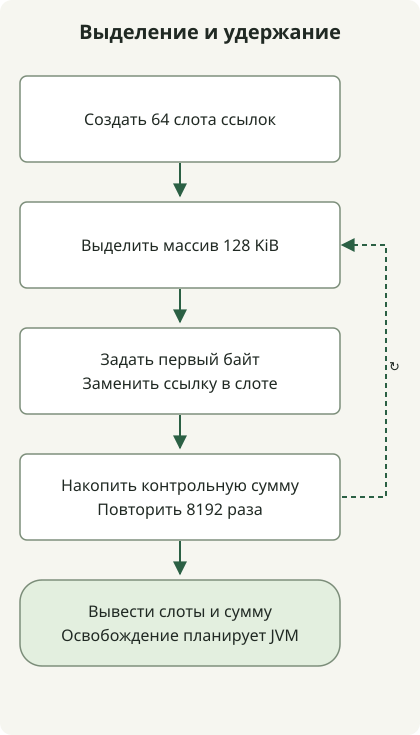

**Для современного HotSpot сначала соберите базовые показатели работы с G1, сравните ZGC или Shenandoah при строгих требованиях к задержке и рассмотрите Parallel GC, если главное — пропускная способность.** Прежде чем копировать старые флаги JVM, проверьте сборщик по умолчанию и доступные реализации в конкретном дистрибутиве JDK.

Дата актуальности — **2026-11-03**. [JDK 27](https://jdk.java.net/27/) — последний общедоступный функциональный выпуск; [JDK 28 находится в Early Access](https://jdk.java.net/28/). Статья посвящена **OpenJDK HotSpot**, а не всем реализациям JVM. Линейки Oracle с длительной поддержкой (LTS) — 8, 11, 17, 21 и 25 — часто выбирают для развертывания, но сроки и условия обновлений зависят от поставщика. [План поддержки Oracle](https://www.oracle.com/java/technologies/java-se-support-roadmap.html)

## От новейших JDK к более ранним выпускам

| JDK | Главное изменение GC | Что проверить в существующих развертываниях |
| --- | --- | --- |
| **28 EA** | [JEP 535](https://openjdk.org/jeps/535), делающий режим поколений Shenandoah режимом по умолчанию, имеет статус Targeted | Не считайте это уже поставленным в GA-выпуске. Это не делает Shenandoah сборщиком по умолчанию для всей JVM |
| **27** | [JEP 523](https://openjdk.org/jeps/523) выбирает G1 по умолчанию независимо от числа процессоров и объема памяти | Перепроверьте выбор по умолчанию у сервисов, которые раньше выбирали Serial в небольших средах |
| **26** | [JEP 522](https://openjdk.org/jeps/522) уменьшает накладные расходы синхронизации в G1 для повышения пропускной способности | Улучшение в основном проекте не доказывает такой же процент прироста для вашего сервиса |
| **25** | [JEP 521](https://openjdk.org/jeps/521) переводит Generational Shenandoah из экспериментального режима в штатную возможность | Доступность режима и выбор этого режима по умолчанию — разные изменения |
| **24 / 23** | 24 удаляет ZGC без поколений ([JEP 490](https://openjdk.org/jeps/490)); 23 делает режим поколений режимом по умолчанию при выборе ZGC ([JEP 474](https://openjdk.org/jeps/474)). 24 также вводит экспериментальный Generational Shenandoah ([JEP 404](https://openjdk.org/jeps/404)) | Выбор по умолчанию внутри ZGC не меняет сборщик по умолчанию для JVM |
| **21 / 17 / 15** | 21 вводит Generational ZGC ([JEP 439](https://openjdk.org/jeps/439)). ZGC и Shenandoah становятся штатными возможностями в 15 ([JEP 377](https://openjdk.org/jeps/377), [379](https://openjdk.org/jeps/379)), поэтому в 17 они также штатные | В 21 явно выбирайте ZGC с поколениями. Отдельно проверяйте доступность для платформы и дистрибутива |
| **14 / 12 / 11** | 14 удаляет CMS ([JEP 363](https://openjdk.org/jeps/363)). 12 добавляет экспериментальный Shenandoah ([JEP 189](https://openjdk.org/jeps/189)); 11 вводит экспериментальные ZGC и Epsilon ([JEP 333](https://openjdk.org/jeps/333), [318](https://openjdk.org/jeps/318)) | Различайте прежний экспериментальный и нынешний штатный статус; первоначальная поддержка охватывала не все платформы |
| **9** | G1 становится сборщиком по умолчанию для серверной конфигурации ([JEP 248](https://openjdk.org/jeps/248)); CMS объявляется устаревшим ([JEP 291](https://openjdk.org/jeps/291)); появляется унифицированное журналирование GC ([JEP 271](https://openjdk.org/jeps/271)) | Не переносите без изменений параметры и анализаторы журналов JDK 8 |
| **8** | Parallel — сборщик по умолчанию для высокой пропускной способности на машинах серверного класса; G1 и CMS — альтернативы. PermGen удален ([JEP 122](https://openjdk.org/jeps/122)) | Parallel был сборщиком по умолчанию не во всех средах. Не переносите флаги PermGen в новые развертывания |
| **7u4 / 6 / 5 / 1.4.1** | Oracle JDK поддерживает G1 начиная с 7u4. Параллельная полная сборка появляется в 5u6 и совершенствуется в 6. Документация 1.4.1 описывает параллельную сборку молодого поколения и конкурентную сборку старого поколения | Различайте раннюю параллельную сборку молодого поколения и появившуюся позднее параллельную сборку старого поколения |

Рассматривайте настройки по умолчанию JDK 8 в контексте [руководства по эргономике](https://docs.oracle.com/javase/8/docs/technotes/guides/vm/gctuning/ergonomics.html). Более ранние этапы описаны в [истории поддержки G1](https://docs.oracle.com/javase/8/docs/technotes/guides/vm/G1.html), [описании Parallel Compaction](https://docs.oracle.com/javase/8/docs/technotes/guides/vm/par-compaction-6.html) и [статье о GC в JDK 1.4.1](https://www.oracle.com/technical-resources/articles/java/garbagecollection-in-java-applications-using-jdk141.html). Исторические рекомендации по размеру кучи и целевым паузам относятся к своему времени; это не текущие настройки развертывания по умолчанию.

Таблица выделяет важные этапы. Она не перечисляет все исправления в обновлениях и не утверждает, что для этой статьи запускался каждый исторический выпуск.

## Три различия, которые нужно понимать перед выбором сборщика

GC освобождает память объектов, **недостижимых из корней GC**, например из ссылок, удерживаемых работающими потоками. Кэш или глобальная коллекция могут сохранять достижимость объектов даже после того, как приложение перестало в них нуждаться. Сборка по поколениям использует наблюдение, что многие объекты быстро умирают, а некоторые выживают, и собирает молодые и старые объекты по-разному. [Реализация GC в HotSpot](https://docs.oracle.com/en/java/javase/27/gctuning/garbage-collector-implementation.html)

**Параллельность** означает совместную работу нескольких потоков GC; **конкурентность** означает, что часть работы GC перекрывается с выполнением приложения. Это разные характеристики. Фаза **stop-the-world (STW)** приостанавливает выполнение приложения. Конкурентные сборщики все равно могут вызывать короткие паузы или задержки выделения памяти; конкурентность не устраняет задержку запросов.

Маркировка выявляет живые объекты; очистка делает освобождаемое пространство доступным для повторного использования. Уплотнение перемещает живые объекты, объединяя свободное пространство, а эвакуация копирует выжившие объекты из выбранных регионов в другие места. Сборщики по-разному сочетают эти задачи для поколений, регионов, параллельной и конкурентной работы.

| Сборщик | Основной подход | Условия для сравнения |
| --- | --- | --- |
| Serial | Один поток GC; небольшие расходы на координацию могут подходить для небольших задач | Измеряйте пропускную способность и паузы даже при небольшой куче или ограниченном CPU |
| Parallel | Несколько потоков сборки с приоритетом пропускной способности | Сравнивайте время завершения пакетной обработки и допустимые паузы |
| G1 | Регионы, конкурентная маркировка и эвакуация во время пауз | Базовый вариант для обычного сервера; целевая пауза не является гарантией реального времени |
| ZGC | Выполняет значительную часть перемещения и работы со ссылками конкурентно ради коротких пауз | Совместно отслеживайте запас CPU и кучи, скорость выделения памяти и задержку приложения |
| Shenandoah | Сборщик с короткими паузами и конкурентным перемещением; статус режима поколений зависит от выпуска | Сначала проверьте доступность в дистрибутиве и выбранный режим |
| CMS / Epsilon | CMS — исторический конкурентный сборщик mark-sweep; экспериментальный Epsilon не освобождает память | В новейшем JDK CMS недоступен. Epsilon не заменяет обычный GC для сервисов |

Для Serial и Parallel начните с [актуального руководства по выбору сборщика](https://docs.oracle.com/en/java/javase/27/gctuning/available-collectors.html). [Руководство по настройке G1](https://docs.oracle.com/en/java/javase/27/gctuning/garbage-first-garbage-collector-tuning.html) объясняет поведение G1 и целевые паузы. [Историческая документация CMS](https://docs.oracle.com/en/java/javase/13/gctuning/concurrent-mark-sweep-cms-collector.html) описывает конкурентные фазы и ограничения из-за фрагментации; [JEP 318](https://openjdk.org/jeps/318) определяет отсутствие освобождения памяти в Epsilon.

## Проверяйте режим поколений наряду с самим сборщиком

Для ZGC в JDK 21 параметры `-XX:+UseZGC -XX:+ZGenerational` выбирают режим поколений. В 23 параметр `-XX:+UseZGC` по умолчанию выбирает режим поколений; 24 удаляет реализацию без поколений. Перевод флага в неиспользуемое состояние и его удаление — отдельные шаги, отличные от удаления реализации. JDK 27 в этой лабораторной проверке отклонил `-XX:+ZGenerational`, поэтому не добавляйте его в текущую конфигурацию. [Актуальное руководство по ZGC](https://docs.oracle.com/en/java/javase/27/gctuning/z-garbage-collector.html)

Shenandoah проверяйте отдельно. Штатный режим поколений, появившийся в 25, выбирается параметрами `-XX:+UseShenandoahGC -XX:ShenandoahGCMode=generational`. **Сам по себе выбор Shenandoah в 27 не означает, что выбран режим поколений.** JEP 535 нацелен на 28 и на дату актуальности остается в статусе Targeted. Параметры сборки и обратные переносы изменений могут влиять на набор сборщиков в дистрибутиве; проверяйте конкретный исполняемый файл.

## Читайте журналы одной и той же программы выделения памяти

Этот **однопоточный лабораторный пример** показывает время жизни объектов и журналы GC. Он выделяет 8192 массива по 128 KiB, всего 1 GiB полезных данных массивов, заменяя ссылки в 64 циклически используемых слотах. Итоговый объем удерживаемых данных составляет 8 MiB; заголовки массивов, ссылки и память JVM учитываются дополнительно. Это не производственная нагрузка и не бенчмарк GC.



Схема соответствует выделению памяти и замене ссылок в коде. JVM решает, когда освобождать недостижимые объекты; код не вызывает `System.gc()`. Не предполагайте, что каждый замененный объект освобождается сразу.

### `GcProbe.java`

```java
import java.lang.management.GarbageCollectorMXBean;
import java.lang.management.ManagementFactory;

public final class GcProbe {
    private static volatile byte[][] retained;
    private static volatile long checksum;

    public static void main(String[] args) {
        System.out.println("runtime=" + System.getProperty("java.runtime.version"));
        for (GarbageCollectorMXBean gc : ManagementFactory.getGarbageCollectorMXBeans()) {
            System.out.println("collector=" + gc.getName());
        }
        retained = new byte[64][];
        for (int i = 0; i < 8192; i++) {
            byte[] block = new byte[128 * 1024];
            block[0] = (byte) i;
            retained[i % retained.length] = block;
            checksum += block[0] & 0xff;
        }
        System.out.println("iterations=8192 retainedSlots=" + retained.length
                + " checksum=" + checksum);
    }
}
```

Массивы остаются достижимыми извне через `retained`. Эта небольшая программа все же не позволяет установить распределение времени жизни объектов или узкое место производственного сервиса.

### Выберите четыре сборщика и изучите журналы в JDK 27

Эти команды используют оболочку в стиле Unix. Замените `GC_JDK` на **домашний каталог JDK**, сохраните Java-файл в новом рабочем каталоге и выполните там команды. Внешние библиотеки и сетевые запросы не нужны. Каждый запуск использует максимальную кучу 128 MiB и ротируемые журналы ограниченного размера.

```sh
GC_JDK="/path/to/jdk-27"
"$GC_JDK/bin/java" -version
mkdir -p out logs
"$GC_JDK/bin/javac" -d out GcProbe.java
for gc in G1 Parallel Serial Z; do
  "$GC_JDK/bin/java" "-XX:+Use${gc}GC" -Xms128m -Xmx128m \
    '-Xlog:gc*,safepoint:file=logs/gc-%p.log:time,uptime,level,tags:filecount=3,filesize=5M' \
    -cp out GcProbe
done
```

`%p` разворачивается в PID JVM, различая журналы отдельных запусков. Убедитесь, что все четыре запуска заканчиваются следующей строкой. Предшествующие строки версии среды и сборщика зависят от JDK и сборщика.

```text
iterations=8192 retainedSlots=64 checksum=1044480
```

Запуски выполнялись в среде **macOS arm64, Zulu 8u392-b08 и Temurin 21.0.13+9, 25.0.5+8 и 27.0.1.0.2+1**. Архивные версии иллюстрируют историческое поведение; это не рекомендация актуальных сочетаний обновлений безопасности. Проверены следующие запуски:

| JDK | Проверенные запуски |
| --- | --- |
| 8 | Parallel по умолчанию, явно выбранные G1 и CMS, включая завершение и журналы GC старого формата |
| 21 | ZGC без поколений и с явно выбранным режимом поколений, включая завершение и журналы |
| 25 | ZGC с поколениями, выбранный флагом ZGC, включая завершение и журналы |
| 27 | Serial, Parallel, G1, ZGC, Shenandoah без поколений и с явно выбранным режимом поколений, включая завершение и журналы |

Все **12 конфигураций запуска** дали одинаковую контрольную сумму и журналы GC. В них не контролируются различия реализаций, оптимизаций и безопасности между JDK, поэтому время выполнения или число сборок GC не являются рейтингом сборщиков. Этапы 28 EA и 1.4.1–7, 9–20, 22–24 и 26 проверены по приведенным выше официальным источникам.

### Что сообщает одна строка журнала

Это реальное событие G1 из JDK 27, из которого удалено только оформление временной меткой и тегами.

```text
GC(0) Pause Young (Normal) (G1 Evacuation Pause) 47M->10M(128M) 1.468ms
```

`47M->10M` — использование кучи до и после этой сборки GC; `(128M)` — емкость кучи в тот момент. Значение в скобках не всегда является максимальным размером кучи. В этом примере установлены равные значения `-Xms` и `-Xmx`. `1.468ms` — пауза этого события, а не p99 сервиса или суммарные затраты CPU на GC. Одна эта строка не исключает утечку памяти и не устанавливает гарантию длительности пауз.

### JDK 8 также требует других параметров журналирования

Не применяйте унифицированное журналирование JDK 9 к 8 без изменений. Перекомпилируйте тот же исходный код компилятором соответствующего JDK, чтобы избежать несовпадения версий class-файлов.

```sh
GC_JDK="/path/to/jdk-8"
mkdir -p out8 logs
"$GC_JDK/bin/javac" -d out8 GcProbe.java
"$GC_JDK/bin/java" -Xms128m -Xmx128m -XX:+UseConcMarkSweepGC \
  -XX:+PrintGCDetails -XX:+PrintGCDateStamps -Xloggc:logs/jdk8-cms.log \
  -cp out8 GcProbe
```

JDK 27 также отклонил `-XX:+UseConcMarkSweepGC`. Стадии поддержки, прекращения использования и удаления различаются по выпускам; при обновлениях изучайте реальные сообщения запуска и код завершения.

Проверьте выбор сборщика по умолчанию следующим образом. Эта команда сообщает **новой JVM** об одном CPU; она не меняет выделенные процессорные ресурсы работающего сервиса.

```sh
GC_JDK="/path/to/jdk-27"
"$GC_JDK/bin/java" -XX:ActiveProcessorCount=1 -Xms128m -Xmx128m \
  -XX:+PrintCommandLineFlags -version
```

В тех же условиях Temurin 21 вывел `UseSerialGC`, а Temurin 27 — `UseG1GC`. Явный выбор сборщика переопределяет значение по умолчанию. Важны CPU и память, видимые JVM; одних характеристик хоста недостаточно, чтобы определить выбор в контейнере.

## Что следует измерять при сравнении в производственной среде?

Для существующего сервиса сначала зафиксируйте текущий JDK, дистрибутив, флаги и нагрузку. При одинаковом характере запросов и бюджете CPU/памяти совместно наблюдайте **пропускную способность приложения, p95/p99, ошибки, RSS, использование кучи, скорость выделения памяти, паузы GC и CPU конкурентной сборки GC**. Более короткие паузы все равно могут сопровождаться ухудшением задержки приложения, если потоки GC и приложения сильнее конкурируют за CPU.

Для G1 получите базовые измерения с настройками по умолчанию, не фиксируя размер молодого поколения, унаследованный от другого сборщика, затем при необходимости измените общий размер кучи и целевые паузы. ZGC нужен запас для живых объектов и новых выделений во время конкурентной сборки. `-Xmx` не равен RSS процесса или лимиту памяти всего контейнера; предусмотрите также metaspace, стеки потоков и прямые буферы.

Если объем достижимых объектов продолжает расти, сначала изучите удерживаемые ссылки, ограничения кэша и время жизни запросов. Смена сборщика не удаляет достижимые объекты автоматически. Сочетайте данные сервиса с [процессом работы с журналами и трассировками LGTM](/en/posts/2026-11-02-grafana-lgtm-log-trace/), избегая предположения, что совпадение задержек запросов и событий GC доказывает причинную связь.
