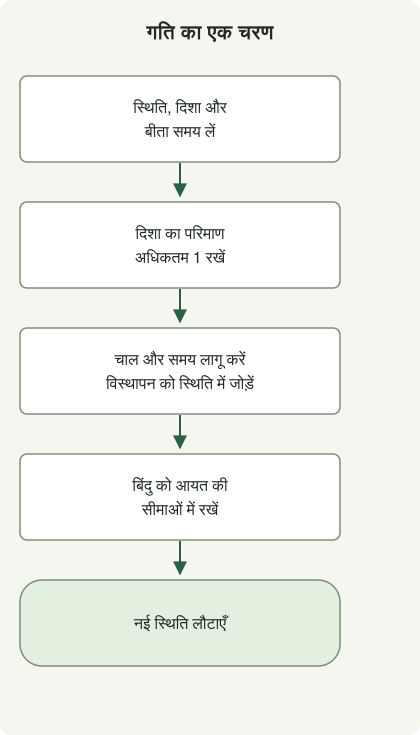

---
{
  "state": "draft",
  "language": "hi",
  "translationKey": "2026-11-02-open-source-game-engines",
  "title": "ओपन सोर्स गेम इंजन की तुलना में Godot, Bevy, Stride और O3DE कहाँ उपयुक्त हैं?",
  "description": "टीम के काम करने के तरीके, लाइसेंस और लक्ष्य प्लेटफ़ॉर्म की सीमाओं के आधार पर चार गेम इंजन की तुलना करें। Godot में गति का छोटा उदाहरण चलाकर उसका व्यवहार जाँचें।",
  "sourcePath": "src/content/posts/en/2026-11-02-open-source-game-engines.md",
  "sourceSha256": "a83f90ac45031156dd23d82e78c770e9d3254849fbf67e9594455bc58c54e153"
}
---

**सामान्य 2D या 3D गेम शुरू करने वाली छोटी टीम पहले Godot को आज़मा सकती है। Rust में काम करने वाली टीम अपने औज़ारों की अधिक ज़िम्मेदारी लेने को तैयार हो तो Bevy उपयुक्त है। C# पर काम करने वालों के लिए Stride विचार करने योग्य है। बड़े 3D एसेट और बिल्ड पाइपलाइन सँभालने वाली टीम O3DE को परख सकती है।** ये परीक्षण शुरू करने के आधार हैं। इनसे प्रदर्शन की रैंकिंग नहीं निकलती।

यह तुलना इंजन चुनने वाले डेवलपरों के लिए दस्तावेज़ों पर आधारित है। 2026-11-02 को जाँचे गए रिलीज़ संदर्भ Godot 4.7.2, Bevy 0.20, Stride 4.4 और O3DE 26.05 हैं। नीचे चलने वाला उदाहरण केवल Godot में गति का एक छोटा फ़ंक्शन जाँचता है। इससे दूसरे इंजनों में संपादन का अनुभव, रेंडरिंग की गति या एक्सपोर्ट की विश्वसनीयता सिद्ध नहीं होती।

## किस आधार पर तुलना करें?

चारों प्रोजेक्ट खुद को गेम इंजन कहते हैं। इनके साथ काम करने के तरीके अलग हैं। एकीकृत विज़ुअल एडिटर और कोड से चलने वाले ECS में टीम को अलग-अलग मात्रा में औज़ार जुटाने पड़ते हैं। फ़्रेमवर्क या रेंडरिंग लाइब्रेरी भी उपयुक्त हो सकती है। तुलना में दृश्य, एसेट और संपादन के लिए जो औज़ार नहीं मिलते, उन्हें टीम के हिस्से का काम मानें।

| इंजन और रिलीज़ संदर्भ | विकास का तरीका | अपनाने से पहले क्या जाँचें? |
| --- | --- | --- |
| [Godot 4.7.2](https://godotengine.org/download/archive/) | स्क्रिप्ट के साथ सीन और नोड संपादक | क्या चुनी भाषा से वास्तविक लक्ष्य प्लेटफ़ॉर्म के लिए एक्सपोर्ट हो सकता है? |
| [Bevy 0.20](https://bevy.org/news/bevy-0-20/) | ECS पर आधारित Rust सिस्टम और कंपोनेंट | क्या टीम औज़ारों का रखरखाव और API माइग्रेशन कर सकती है? |
| [Stride 4.4](https://www.stride3d.net/blog/announcing-stride-4-4/) | C# और Game Studio | क्या विकास की मशीनों पर एडिटर उपलब्ध है? |
| [O3DE 26.05](https://www.docs.o3de.org/docs/release-notes/2605-0-release-notes/) | विस्तार योग्य 3D एडिटर और कंपोनेंट पाइपलाइन | क्या टीम छोटा सीन बिल्ड कर सकती है, एसेट आयात कर सकती है और पैकेज बना सकती है? |

नीचे के सुझाव इन कार्यप्रणालियों से निकले हैं। ये किसी टीम के चारों इंजनों में गेम जारी करने के अनुभव नहीं हैं।

## टीम के काम का तरीका किस इंजन से मेल खाता है?

### Godot में संपादन से परीक्षण तक का पूरा चक्र आज़माएँ

टीम एक ही जगह सीन संपादित करना, उसके साथ व्यवहार जोड़ना और बदलाव आज़माना चाहती है तो Godot से शुरुआत कर सकती है। इसका [MIT लाइसेंस](https://godotengine.org/license/) मालिकाना गेम बनाने की अनुमति देता है। इंजन वितरित करते समय संबंधित कॉपीराइट और लाइसेंस सूचनाएँ देना ज़रूरी है। प्लगइन, फ़ॉन्ट, संगीत और मॉडल की अपनी शर्तें हैं।

शुरू में ही भाषा और लक्ष्य प्लेटफ़ॉर्म का मेल जाँचें। [Godot के वेब एक्सपोर्ट दस्तावेज़](https://docs.godotengine.org/en/stable/tutorials/export/exporting_for_web.html) के अनुसार लेख की जाँच के समय Godot 4 के C# प्रोजेक्ट वेब के लिए एक्सपोर्ट नहीं हो सकते थे। डेस्कटॉप पर चलता C# प्रोटोटाइप ब्राउज़र के लिए डिलीवरी का प्रमाण नहीं है। कंसोल के लिए [Godot की पोर्टिंग मार्गदर्शिका](https://godotengine.org/consoles/) प्लेटफ़ॉर्म की स्वीकृति, आधिकारिक SDK और निजी एक्सपोर्ट टेम्पलेट या बाहरी प्रदाताओं का विवरण देती है। ओपन सोर्स इंजन लेने पर भी यह प्रक्रिया करनी होती है।

### Bevy में Rust के साथ औज़ार सँभालने की ज़िम्मेदारी भी चुनें

Bevy पूरा इंजन है। इसका काम रेंडरिंग तक सीमित नहीं है। [परिचय](https://bevy.org/learn/quick-start/introduction/) में Rust, ECS और MIT या Apache 2.0 लाइसेंस के विकल्प दिए हैं। इसमें यह भी बताया गया है कि नई रिलीज़ में API संगतता टूट सकती है और माइग्रेशन कठिन हो सकता है।

जिस टीम के विकास मॉडल में सिस्टम और कंपोनेंट केंद्रीय हैं, उसके लिए Bevy विचार करने योग्य है। अपने प्रोजेक्ट में एडिटर का एकीकरण, एसेट बदलकर फिर आज़माना और संस्करण माइग्रेशन करके दिखाएँ। केवल Rust का अनुभव होने से संपादन का चक्र तेज़ साबित नहीं होता। समानांतर ECS से भी किसी विशेष गेम में हर फ़्रेम का समय बेहतर होना तय नहीं है।

### Stride में C# सपोर्ट और एडिटर की उपलब्धता अलग जाँचें

Stride के [सामान्य प्रश्न](https://www.stride3d.net/faq/) MIT लाइसेंस और इंजन रॉयल्टी न होने की जानकारी देते हैं। इसकी C# कार्यप्रणाली पहले से .NET इस्तेमाल कर रही टीम के लिए उपयोगी हो सकती है।

[प्लेटफ़ॉर्म तालिका](https://doc.stride3d.net/latest/en/manual/platforms/index.html) विकास की मशीनों और गेम चलाने के लक्ष्यों में अंतर करती है। Windows पर पूरा एडिटर उपलब्ध है। Linux और macOS पर कुछ शर्तों के साथ बिल्ड या केवल कोड पर आधारित विकास संभव है। Windows के बाहर नेटिव एडिटर उपलब्ध नहीं है। [4.4 की घोषणा](https://www.stride3d.net/blog/announcing-stride-4-4/) में अन्य सिस्टम पर बिल्ड में सुधार बताए गए हैं। उनसे यह निष्कर्ष न निकालें कि हर जगह एडिटर का अनुभव समान है।

### O3DE में आकर्षक डेमो से पहले पाइपलाइन जाँचें

विस्तार योग्य 3D पाइपलाइन खुद सँभाल सकने वाली टीम O3DE पर विचार कर सकती है। इसकी [लाइसेंस फ़ाइल](https://github.com/o3de/o3de/blob/2605.0/LICENSE.txt) में Apache 2.0 डिफ़ॉल्ट है, MIT का विकल्प है और बाहरी कंपोनेंट अलग पहचाने गए हैं। [डाउनलोड पृष्ठ](https://o3de.org/download/) पर Windows और Linux पैकेज तथा विकास मशीन के लिए पर्याप्त संसाधनों की ज़रूरत बताई गई है। ये होस्ट की शर्तें हैं। इन्हें गेम एक्सपोर्ट के सभी लक्ष्यों की सूची न मानें।

अपने गेम का प्रतिनिधि एसेट आयात करें, प्रोजेक्ट बिल्ड करें और पैकेज किया हुआ सीन चलाएँ। [26.05 के रिलीज़ नोट्स](https://www.docs.o3de.org/docs/release-notes/2605-0-release-notes/) नई पार्टिकल प्रणाली को प्रयोगात्मक बताते हैं और प्रोडक्शन में इस्तेमाल से बचने को कहते हैं। रिलीज़ नोट्स में सुविधा का नाम आ जाने से वह प्रोडक्शन निर्भरता के लिए तैयार नहीं हो जाती।

## क्या मुफ़्त का अर्थ ओपन सोर्स या बिना खर्च के गेम बनाना है?

नहीं। सोर्स कोड पढ़ पाने और खरीद मूल्य शून्य होने से ओपन सोर्स लाइसेंस सिद्ध नहीं होता। उदाहरण के लिए, [Defold खुद को source available बताता है](https://defold.com/open/)। इसे चारों इंजनों के साथ अपने आप एक श्रेणी में रखने से पहले इसका विशिष्ट लाइसेंस पढ़ें।

इंजन का लाइसेंस कंसोल पोर्टिंग, एसेट के लाइसेंस, होस्टिंग, प्लगइन या रखरखाव का खर्च भी नहीं उठाता। निर्णय से पहले तय करें कि इंजन क्या देता है, किन चीज़ों के लिए दूसरा लाइसेंस चाहिए और टीम खुद क्या बनाएगी। दायरा तय किए बिना कुल लागत का अनुमान न लगाएँ।

## छोटे प्रोटोटाइप में क्या जाँचें?

चुने गए हर इंजन को एक जैसी स्वीकृति जाँच दें। एक प्रतिनिधि एसेट लोड करें, एक इंटरैक्शन बनाएँ और वास्तविक लक्ष्य के लिए बिल्ड तैयार करें। सेटअप, बार-बार संपादन और परीक्षण में आने वाली रुकावटें तथा अधूरी ज़रूरतें दर्ज करें। यह मूल्यांकन का प्रस्ताव है। लेख के लिए ऐसा तुलनात्मक बेंचमार्क नहीं चलाया गया।

एक हिस्सा आप दोहरा सकते हैं। **Godot को बिना विंडो खोले चलाकर गति जाँचें।** फ़ंक्शन स्थिति, कृत्रिम दिशा और बीते सेकंड लेता है, दिशा का परिमाण अधिकतम 1 रखता है, चाल लागू करता है और परिणाम के बिंदु को आयत की सीमाओं में रखता है। मान लिया गया है कि इनपुट परिमित हैं और बीता समय ऋणात्मक नहीं है। सीमा में रखने से बाधाओं से टक्कर, स्प्राइट के आकार या भौतिकी का अनुकरण नहीं होता।



चित्र `advance` की एक कॉल दिखाता है। नीचे का परीक्षण बार-बार कॉल करके परिणाम जाँचता है। यह कीबोर्ड नहीं पढ़ता और कोई पात्र रेंडर नहीं करता। [Vector2 के संदर्भ](https://docs.godotengine.org/en/4.7/classes/class_vector2.html) में वेक्टर संक्रियाएँ बताई गई हैं। इस तरह जाँचे गए व्यवहार और एडिटर की उत्पादकता या गेम के प्रदर्शन संबंधी दावे अलग रहते हैं।

मानक Godot 4.7.2 एडिटर की बाइनरी `godot` नाम से उपलब्ध रखें। `project.godot` और `movement.gd` एक ही डायरेक्टरी में सेव करें। इंजन इंस्टॉल होने के बाद स्क्रिप्ट चलाने के लिए सीन, बाहरी एसेट, पैकेज या नेटवर्क पहुँच की ज़रूरत नहीं है।

`project.godot`:

```ini
config_version=5
```

`movement.gd`:

```gdscript
extends SceneTree

const SPEED := 120.0
const LIMIT := Vector2(640.0, 360.0)

func advance(pos: Vector2, direction: Vector2, delta: float) -> Vector2:
    var bounded := direction.limit_length(1.0)
    var next := pos + bounded * SPEED * delta
    return next.clamp(Vector2.ZERO, LIMIT)

func _initialize() -> void:
    var cases := [
        [Vector2(100, 100), Vector2.ZERO, 0.5, Vector2(100, 100)],
        [Vector2(100, 100), Vector2.RIGHT, 0.5, Vector2(160, 100)],
        [Vector2.ZERO, Vector2(1, 1), 1.0, Vector2(84.852814, 84.852814)],
        [Vector2.ZERO, Vector2(0.5, 0), 1.0, Vector2(60, 0)],
        [Vector2(639, 100), Vector2.RIGHT, 1.0, Vector2(640, 100)],
        [Vector2(5, 100), Vector2.LEFT, 1.0, Vector2(0, 100)],
        [Vector2(100, 359), Vector2.DOWN, 1.0, Vector2(100, 360)],
        [Vector2(100, 100), Vector2.RIGHT, 0.0, Vector2(100, 100)],
    ]
    for sample in cases:
        var actual := advance(sample[0], sample[1], sample[2])
        if not actual.is_equal_approx(sample[3]):
            push_error("movement mismatch")
            quit(1)
            return
    var split := advance(advance(Vector2(100, 100), Vector2.RIGHT, 0.25), Vector2.RIGHT, 0.25)
    if not split.is_equal_approx(advance(Vector2(100, 100), Vector2.RIGHT, 0.5)):
        push_error("time-step mismatch")
        quit(1)
        return
    print("movement cases=9")
    quit(0)
```

उसी डायरेक्टरी से [Godot का कमांड-लाइन इंटरफ़ेस](https://docs.godotengine.org/en/4.7/tutorials/editor/command_line_tutorial.html) चलाएँ। macOS पर यदि `godot` कमांड उपलब्ध नहीं है तो इंस्टॉल किए बंडल में `Godot.app/Contents/MacOS/Godot` का पथ दें, खासकर जब वह `PATH` में न हो।

```sh
godot --headless --no-header --path . --script movement.gd --quit-after 1
```

उदाहरण macOS पर Godot 4.7.2 के साथ स्थानीय रूप से चला। इसका आउटपुट था:

```text
movement cases=9
```

जाँच में शून्य इनपुट, क्षैतिज और तिरछी गति, आंशिक इनपुट परिमाण, ऊपरी और निचली सीमाएँ, शून्य बीता समय और सीमा से दूर एक समय-चरण को बाँटकर चलाना शामिल है। इसमें रेंडरिंग, लक्ष्य डिवाइस के लिए एक्सपोर्ट, बाधाएँ, नेटवर्किंग या तुलनात्मक प्रदर्शन नहीं जाँचे गए।

## अंतिम चुनाव कैसे करें?

वह इंजन चुनें जो गेम के लिए ज़रूरी कार्यप्रणाली और लक्ष्य बिल्ड दे, और जिसका रखरखाव टीम कर सके। विज़ुअल संपादन प्राथमिकता है तो Godot में प्रोटोटाइप शुरू करें। यदि टीम खास तौर पर Rust/ECS की ज़िम्मेदारी चाहती है तो Bevy के औज़ार और माइग्रेशन की लागत जाँचें। C# टीम अपनी वास्तविक संपादन मशीनों पर Stride परखे। बड़ी 3D पाइपलाइन के लिए किसी प्रदर्शन में दिखाई गई सुविधा पर निर्भर होने से पहले O3DE में एसेट से बिल्ड तक का चक्र जाँचें।

अगला उपयोगी परिणाम है लक्ष्य डिवाइस पर चलने वाला छोटा बिल्ड और अधूरी ज़रूरतों की सूची। सभी प्रोजेक्टों के लिए एक रैंकिंग बनाने की ज़रूरत नहीं है। निर्णय के प्रमाण प्रोजेक्ट के साथ रखें ताकि इंजन अपग्रेड को उसी व्यवहार के आधार पर परख सकें।
