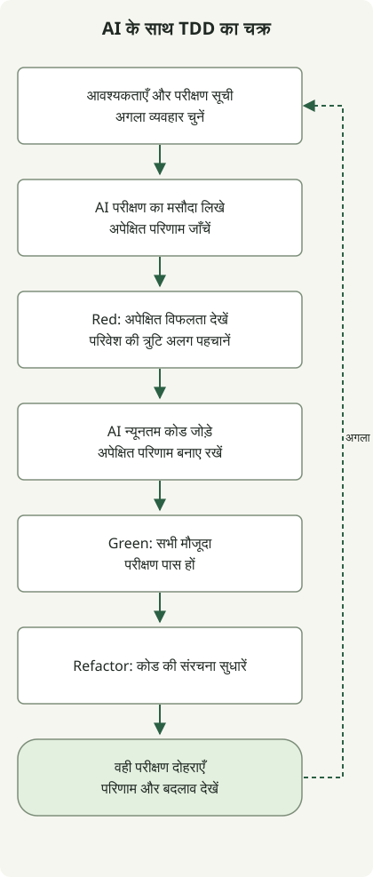

---
{
  "state": "draft",
  "language": "hi",
  "translationKey": "2026-11-02-ai-assisted-tdd",
  "title": "AI के साथ TDD: Red, Green और Refactor की जाँच कैसे करें",
  "description": "आवश्यकताओं से परीक्षण बनाएँ, विफलता देखें, फिर न्यूनतम कोड लिखकर रीफ़ैक्टर करें। Java और JUnit के उदाहरण से जाँचें कि परीक्षण अब भी सीमांत मामलों की गलतियाँ पकड़ते हैं।",
  "sourcePath": "src/content/posts/en/2026-11-02-ai-assisted-tdd.md",
  "sourceSha256": "bfc69c72419b9b2b5ce2693c4111b12dd8f935ed3d1115dd350b837bed13bf80"
}
---

**AI के साथ TDD अपनाते समय पहले आवश्यकताओं से अपेक्षित परिणाम तय करें। परीक्षण को विफल होते देखें, फिर छोटे बदलावों में कोड लिखें और रीफ़ैक्टर करें।** AI परीक्षण और कार्यान्वयन दोनों सुझा सकता है। दोनों एक ही गलत धारणा पर बने हों तो परीक्षण पास होने पर भी सुविधा गलत काम करेगी। हर अपेक्षा का आधार और टेस्ट रनर का वास्तविक परिणाम देखें।

TDD में परीक्षणों की सूची से अगला एक व्यवहार चुनकर Red → Green → Refactor का चक्र दोहराते हैं। [मार्टिन फ़ाउलर की TDD पर व्याख्या](https://www.martinfowler.com/bliki/TestDrivenDevelopment.html) में भी सूची, छोटे चक्र और रीफ़ैक्टरिंग पर ज़ोर है। नीचे Java के उदाहरण में AI को इस प्रक्रिया में शामिल किया गया है। इसे किसी खास टूल की ज़रूरत नहीं है। प्रॉम्प्ट उदाहरण के लिए लिखे गए हैं। किसी AI उत्पाद की बातचीत दर्ज नहीं की गई और उत्पादकता नहीं मापी गई।

## कार्यान्वयन दिखाने से पहले अपेक्षित व्यवहार तय करें

उदाहरण एक शुद्ध फ़ंक्शन है जो उपलब्ध और माँगी गई मात्रा से बचा हुआ स्टॉक निकालता है। नीति समझाने के लिए बनाई गई है। इसमें डेटाबेस अपडेट, आरक्षण सहेजना या एक साथ आए अनुरोधों को परमाणु रूप से संसाधित करना शामिल नहीं है।

| शर्त | अपेक्षित व्यवहार |
| --- | --- |
| स्टॉक 10, माँग 3 | 7 लौटाएँ |
| स्टॉक 10, माँग 10 | 0 लौटाएँ |
| माँग स्टॉक से अधिक हो, जैसे 1 इकाई की माँग हो और स्टॉक 0 हो | `IllegalStateException("insufficient_stock")` |
| स्टॉक ऋणात्मक हो | `IllegalArgumentException("stock")` |
| माँगी गई मात्रा शून्य या ऋणात्मक हो | `IllegalArgumentException("requested")` |
| दोनों इनपुट अमान्य हों | पहले स्टॉक जाँचें |
| स्टॉक `Integer.MAX_VALUE`, माँग 1 | `Integer.MAX_VALUE - 1` लौटाएँ |

परीक्षण का सही परिणाम इस तालिका से तय होता है। AI का लिखा कोड पढ़कर उसका लौटाया मान ही अपेक्षा में लिख देंगे तो कोड की गलती भी परीक्षण में आ सकती है। शुरुआत आवश्यकताओं और API अनुबंध से करें।

```text
अभी कार्यान्वयन मत लिखो।
StockPolicy.remaining(int stock, int requested) के लिए परीक्षण सुझाओ।
तालिका के नियमों से हर इनपुट और उसके अपेक्षित परिणाम या अपवाद का संबंध बताओ।

कोई बाहरी स्टोरेज या डेटाबेस मत जोड़ो।
सामान्य, सीमांत और अमान्य इनपुट अलग करो। पहले चक्र में केवल एक परीक्षण लिखो:
माँग 3 हो और स्टॉक 10 हो तो शेष 7 लौटे।
अस्पष्ट आवश्यकताओं के लिए अपनी ओर से नीति मत बनाओ।
```

## छोटे बदलाव चलाकर Red, Green और Refactor जोड़ें



चित्र में डेवलपर के नियंत्रण वाले चरण हैं। नए व्यवहार का परीक्षण विफल होने दें और न्यूनतम कोड जोड़ें। रीफ़ैक्टरिंग के बाद वही परीक्षण पास हों तो अगला मामला लें। यदि विफलता निर्भरता डाउनलोड करने या निष्पादन परिवेश में है तो उसे सुधारकर वही चरण दोबारा चलाएँ।

उदाहरण **JDK 17.0.8.1, Gradle 8.4 और JUnit Jupiter 5.12.2** के निश्चित संयोजन में चलाया गया था। उत्पादन के लिए मौजूदा संस्करण चुनने की सिफ़ारिश इससे नहीं निकलती। खाली फ़ोल्डर में नीचे की फ़ाइलें बनाएँ। पहली बार Maven Central से परीक्षण की निर्भरताएँ डाउनलोड हो सकती हैं। परीक्षण स्वयं किसी बाहरी API या डेटाबेस से नहीं जुड़ते। मौजूदा प्रोजेक्ट में उसके Gradle Wrapper और निर्भरता प्रबंधन के नियम अपनाएँ।

### `settings.gradle`

```groovy
rootProject.name = 'ai-tdd-stock'
```

### `build.gradle`

```groovy
plugins { id 'java' }
repositories { mavenCentral() }
dependencies {
    testImplementation platform('org.junit:junit-bom:5.12.2')
    testImplementation 'org.junit.jupiter:junit-jupiter'
    testRuntimeOnly 'org.junit.platform:junit-platform-launcher'
}
java {
    sourceCompatibility = JavaVersion.VERSION_17
    targetCompatibility = JavaVersion.VERSION_17
}
test {
    useJUnitPlatform()
    testLogging { events 'passed', 'failed' }
}
```

JUnit में `@Test`, `assertEquals` और `assertThrows` से लौटे मान और अपवाद जाँचते हैं। अपवाद ऑब्जेक्ट लेकर उसका संदेश भी जाँच सकते हैं। [JUnit 5.12.2 उपयोगकर्ता गाइड](https://docs.junit.org/5.12.2/user-guide/) · [Gradle में JVM परीक्षण](https://docs.gradle.org/current/userguide/java_testing.html)

### पहला परीक्षण: `src/test/java/StockPolicyTest.java`

```java
import org.junit.jupiter.api.Test;
import static org.junit.jupiter.api.Assertions.assertEquals;
import static org.junit.jupiter.api.Assertions.assertThrows;

class StockPolicyTest {
    @Test
    void reservesPartOfStock() {
        assertEquals(7, StockPolicy.remaining(10, 3));
    }
}
```

### पहला Red: `src/main/java/StockPolicy.java`

ऐसा API बनाएँ जिसे बुलाया जा सके लेकिन जो अभी मात्रा घटाता नहीं है। परीक्षण चलाकर देखें कि अपेक्षा `7` थी और `10` मिलने के कारण परीक्षण विफल हुआ।

```java
public class StockPolicy {
    public static int remaining(int stock, int requested) {
        return stock;
    }
}
```

प्रोजेक्ट की मूल डायरेक्टरी में यह कमांड चलाएँ। इस चरण में परीक्षण विफल होना और गैर-शून्य निकास कोड मिलना अपेक्षित है।

```sh
gradle --no-daemon --console=plain clean test
```

डाउनलोड या संकलन की त्रुटि को व्यवहार की विफलता से अलग पहचानें। यहाँ Red का प्रमाण `reservesPartOfStock()` में अपेक्षित और वास्तविक मान का अंतर है। रनर खराब हो तो व्यवहार की जाँच का प्रमाण नहीं मिलता।

### पहला Green: उसी `StockPolicy.java` को बदलें

```java
public class StockPolicy {
    public static int remaining(int stock, int requested) {
        return stock - requested;
    }
}
```

वही कमांड दोबारा चलाने पर पहला परीक्षण पास होता है। कोड अभी ऋणात्मक इनपुट या अपर्याप्त स्टॉक नहीं सँभालता। पहली सफलता के बाद अगली आवश्यकता जोड़ें।

AI को बदलाव का दायरा इस तरह बताएँ।

```text
विफल परीक्षण reservesPartOfStock है: expected=7, actual=10.
इसे पास कराने के लिए केवल StockPolicy.java बदलो।
परीक्षण, अपेक्षित मान और बिल्ड सेटिंग बनाए रखो।
बिना माँगे डेटाबेस, इंटरफ़ेस या कॉन्फ़िगरेशन की परत मत जोड़ो।
चलाई गई कमांड, निकास कोड और देखे गए परीक्षण परिणाम बताओ।
```

### अगला Red: मौजूदा टेस्ट क्लास में विधियाँ जोड़ें

विधियाँ `StockPolicyTest` के अंतिम बंद होने वाले ब्रेस के **अंदर** जोड़ें। सामान्य TDD में एक बार में एक मामला जोड़कर चक्र दोहराते हैं। यहाँ उदाहरण को आसानी से दोहराने के लिए बाकी मामले एक ब्लॉक में दिए हैं।

```java
    @Test
    void reservesAllStock() {
        assertEquals(0, StockPolicy.remaining(10, 10));
    }

    @Test
    void rejectsInsufficientStock() {
        var error = assertThrows(IllegalStateException.class,
                () -> StockPolicy.remaining(2, 3));
        assertEquals("insufficient_stock", error.getMessage());
    }

    @Test
    void rejectsEmptyStock() {
        var error = assertThrows(IllegalStateException.class,
                () -> StockPolicy.remaining(0, 1));
        assertEquals("insufficient_stock", error.getMessage());
    }

    @Test
    void rejectsNegativeStock() {
        var error = assertThrows(IllegalArgumentException.class,
                () -> StockPolicy.remaining(-1, 1));
        assertEquals("stock", error.getMessage());
    }

    @Test
    void rejectsZeroRequest() {
        var error = assertThrows(IllegalArgumentException.class,
                () -> StockPolicy.remaining(10, 0));
        assertEquals("requested", error.getMessage());
    }

    @Test
    void rejectsNegativeRequest() {
        var error = assertThrows(IllegalArgumentException.class,
                () -> StockPolicy.remaining(10, -1));
        assertEquals("requested", error.getMessage());
    }

    @Test
    void validatesStockBeforeRequest() {
        var error = assertThrows(IllegalArgumentException.class,
                () -> StockPolicy.remaining(-1, 0));
        assertEquals("stock", error.getMessage());
    }

    @Test
    void supportsMaximumStock() {
        assertEquals(Integer.MAX_VALUE - 1,
                StockPolicy.remaining(Integer.MAX_VALUE, 1));
    }
```

इस ब्लॉक को पहले Green वाले कोड के साथ चलाने पर 6 परीक्षण विफल होते हैं, कुल 9 परीक्षण चलते हैं।

### नए मामलों का Green: `StockPolicy.java` बदलें

```java
public class StockPolicy {
    public static int remaining(int stock, int requested) {
        if (stock >= 0) {
            if (requested > 0) {
                if (requested <= stock) {
                    return stock - requested;
                }
                throw new IllegalStateException("insufficient_stock");
            }
            throw new IllegalArgumentException("requested");
        }
        throw new IllegalArgumentException("stock");
    }
}
```

वही कमांड चलाकर देखें कि सभी 9 परीक्षण पास हों। अब निर्दिष्ट व्यवहार पूरे होते हैं। परीक्षणों को ज्यों का त्यों रखकर नेस्टेड शाखाएँ सरल करें।

### Refactor: उसी फ़ाइल में अमान्य इनपुट पहले जाँचें

```java
public class StockPolicy {
    public static int remaining(int stock, int requested) {
        if (stock < 0) throw new IllegalArgumentException("stock");
        if (requested <= 0) throw new IllegalArgumentException("requested");
        if (requested > stock) throw new IllegalStateException("insufficient_stock");
        return stock - requested;
    }
}
```

जाँचों का क्रम, लौटे मान और अपवाद बनाए रखते हुए शाखाओं की गहराई घटाई गई है। इस चरण में नई नीति न जोड़ें। AI को भी स्पष्ट बताएँ कि कौन सा व्यवहार बनाए रखना है और क्या चलाना है।

```text
अभी सभी 9 परीक्षण पास हैं।
StockPolicy.java में केवल नेस्टेड शाखाओं को शुरुआती जाँचों में बदलो।
माँगी गई मात्रा से पहले स्टॉक की जाँच, लौटे मान, अपवाद के प्रकार,
संदेश और मौजूदा परीक्षण बनाए रखो।
बदलाव से पहले और बाद में वही पूरी टेस्ट सुइट चलाओ। परिणाम और diff बताओ।
```

पहले Red से Refactor तक हर संस्करण अलग चलाया गया। JUnit की XML रिपोर्टों में ये परिणाम मिले।

| चरण | परीक्षण | विफल | छोड़े गए | Gradle निकास कोड |
| --- | ---: | ---: | ---: | ---: |
| पहला Red | 1 | 1 | 0 | 1 |
| पहला Green | 1 | 0 | 0 | 0 |
| नए मामलों का Red | 9 | 6 | 0 | 1 |
| नए मामलों का Green | 9 | 0 | 0 | 0 |
| Refactor | 9 | 0 | 0 | 0 |

HTML रिपोर्ट `build/reports/tests/test/index.html` में और मशीन-पठनीय XML `build/test-results/test/` में मिलता है। इन परिणामों से स्थानीय नीति फ़ंक्शन का व्यवहार जाँचा गया। AI उत्पाद की गुणवत्ता, उत्पादकता या उत्पादन प्रणाली की सटीकता नहीं मापी गई।

## परीक्षण और कार्यान्वयन दोनों में एक ही गलती हो सकती है

स्टॉक और माँग दोनों अमान्य होने पर **किसकी जाँच पहले होगी** यह `validatesStockBeforeRequest()` तय करता है। इसके बिना अपवाद संदेशों की प्राथमिकता उलट जाने की गलती छूट सकती है। सामान्य इनपुट के उदाहरण बढ़ाने से पहले देखें कि आवश्यकताओं की तालिका के हर नियम का परीक्षण है।

यह भी जाँच सकते हैं कि परीक्षण सीमांत मामलों की गलतियाँ पकड़ते हैं। अंतिम कोड में `requested > stock` को गलती से `requested >= stock` करने पर `reservesAllStock()` विफल होना चाहिए। `requested <= 0` को `requested < 0` करने पर `rejectsZeroRequest()` विफल होना चाहिए। इनपुट जाँचने का क्रम उलटकर भी `validatesStockBeforeRequest()` को विफल होते देखा गया। तीनों बदले हुए संस्करण चलाए गए थे। इससे हर दोष पकड़ने की गारंटी नहीं मिलती।

AI से समीक्षा कराते समय मूल आवश्यकताएँ फिर दें और मिलान कराएँ कि हर परीक्षण किस नियम की जाँच करता है। दूसरा एजेंट भी उन्हीं गलत आवश्यकताओं के आधार पर वही गलती दोहरा सकता है। अलग भूमिकाएँ देने के बाद भी अपेक्षित व्यवहार का आधार स्वतंत्र रूप से जाँचना ज़रूरी है।

```text
मूल आवश्यकताओं की तालिका और मौजूदा परीक्षण मिलाओ।
अभी परीक्षण या कार्यान्वयन मत बदलो।
जाँचे गए नियम, छूटे नियम, सीमांत मान और अनदेखी शर्तें अलग बताओ।
देखो कि कहीं परीक्षण ने मौजूदा कोड का आउटपुट ही अपेक्षित मान तो नहीं बनाया।
कोई बदलाव सुझाने से पहले उसका नियम और आधार बताओ।
```

## परीक्षण पास कराने के लिए AI जाँच को कमज़ोर न करे

विफल परीक्षण हटाने, उसे `@Disabled` से छोड़ने, गलत कार्यान्वयन के हिसाब से अपेक्षा बदलने या सभी अपवाद दबाने पर हरा परिणाम मिल सकता है जबकि आवश्यकता अधूरी है। रीफ़ैक्टरिंग में आवश्यकता वही हो तो अपेक्षित व्यवहार भी बनाए रखें। परीक्षण में गलती हो तो नीति और उसका आधार देखकर सुधार को कार्यान्वयन के बदलाव से अलग रखें। [AI के लिखे कोड की समीक्षा पर GitHub का मार्गदर्शन](https://docs.github.com/en/copilot/tutorials/review-ai-generated-code) भी हटाए या छोड़े गए परीक्षण और मूल मंशा से अंतर जाँचने को कहता है।

AI के ‘पास’ कहने पर वास्तविक कमांड, निकास कोड, JUnit रिपोर्ट और diff देखें। कोई परीक्षण न चला हो या केवल कुछ चले हों तो पूरी सफलता दर्ज न करें। CI में अंतिम कार्यान्वयन और पूरी टेस्ट सुइट सामान्य सफलता शर्तों के साथ चलाएँ। Red की अपेक्षित विफलता जाँचने वाला शैक्षिक अभ्यास अलग रखें। विफल कमांड को हमेशा अनदेखा करने वाली सेटिंग से CI पास न कराएँ।

मौजूदा कोड में पहले वर्तमान व्यवहार दर्ज करने वाले परीक्षण जुटाएँ, फिर बदलने के लिए एक व्यवहार चुनें। इसका क्रम और व्यवहार सुरक्षित रखने के मानदंड [AI एजेंट के साथ रीफ़ैक्टरिंग](/en/posts/2026-10-31-ai-agent-refactoring/) में दिए हैं। परीक्षण और बिल्ड भी कोड चलाते हैं, इसलिए [AI एजेंट की अनुमतियों](/en/posts/2026-11-01-ai-agent-permission-boundaries/) के अनुसार कार्य फ़ोल्डर और क्रेडेंशियल सीमित रखें।

इसे वास्तविक स्टॉक आरक्षण में बदलने पर समवर्ती अनुरोधों, लेनदेन, दोहरे अनुरोधों और पुनः प्रयासों के लिए अलग एकीकरण परीक्षण चाहिए। इस फ़ंक्शन के 9 यूनिट परीक्षण पास होने से उपलब्ध स्टॉक से अधिक बिक्री रोकने का प्रमाण नहीं मिलता।
