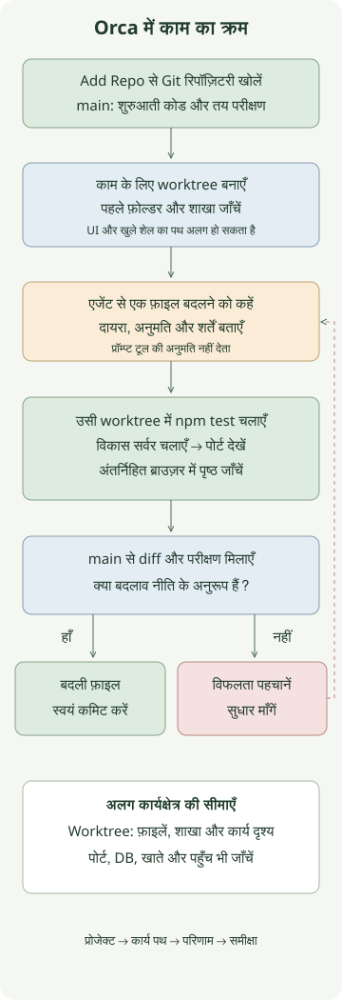

---
{
  "state": "draft",
  "language": "hi",
  "translationKey": "2026-11-12-orca-worktree-guide",
  "title": "Orca में काम कैसे करें: worktree में AI, परीक्षण और ब्राउज़र से जाँच",
  "description": "Orca में Git प्रोजेक्ट और काम के लिए अलग worktree बनाएँ। शिपिंग शुल्क के छोटे उदाहरण और प्रॉम्प्ट की मदद से सही फ़ोल्डर, परीक्षण, ब्राउज़र का परिणाम और diff जाँचें।",
  "sourcePath": "src/content/posts/en/2026-11-12-orca-worktree-guide.md",
  "sourceSha256": "4214532491f859b28104e614442c9bc3c33ecc9a00a62567a96d927bc90cffb6"
}
---

**Orca एक विकास परिवेश है जहाँ Git कार्यक्षेत्र, कोडिंग एजेंट, टर्मिनल, ब्राउज़र और बदलावों की समीक्षा साथ मिलते हैं।** हर काम के लिए एक worktree रखने से अलग बदलाव अलग शाखाओं और फ़ोल्डरों में कर सकते हैं। काम पूरा हुआ या नहीं, यह वास्तविक पथ, परीक्षण के आउटपुट और आधार शाखा से diff देखकर तय करें।

यह गाइड Stably AI के [आधिकारिक Orca ऐप](https://www.onorca.dev/) की है। इसके लिए macOS पर स्थापित **Orca 1.4.256**, साथ की CLI गाइड, Node.js 24.13.0, Python 3 और Git इस्तेमाल किए गए। मौजूदा कार्यक्षेत्र की जानकारी, Orca टर्मिनल में परीक्षण, पोर्ट की पहचान और अंतर्निहित ब्राउज़र में पृष्ठ जाँचे गए। नया worktree बनाने, मर्ज करने या AI एजेंट को नया काम देने के चरण नहीं चलाए गए। उनके प्रॉम्प्ट और कमांड पाठक के अभ्यास के लिए हैं।

## प्रोजेक्ट और worktree में क्या अंतर है?

[पहले सत्र की आधिकारिक गाइड](https://www.onorca.dev/docs/first-session) में दिए **Add Repo** से स्थानीय Git रिपॉज़िटरी खोलें। Orca प्रोजेक्ट सँभालता है लेकिन स्रोत फ़ाइल और कमिट Git रिपॉज़िटरी में ही रहते हैं। मॉडल प्रदाता की उपयोग शर्तें और प्रमाणीकरण अलग से देखें।

| घटक | अभ्यास में भूमिका |
| --- | --- |
| प्रोजेक्ट | उदाहरण की Git रिपॉज़िटरी और उसके कार्यक्षेत्रों को साथ रखता है |
| Worktree | एक खास शाखा का चेकआउट फ़ोल्डर और उससे जुड़ा कार्य दृश्य |
| एजेंट | दिए दायरे में फ़ाइल पढ़ने, बदलने और कमांड चलाने का प्रस्ताव देता है |
| टर्मिनल | काम के फ़ोल्डर में परीक्षण और विकास सर्वर चलाता है |
| अंतर्निहित ब्राउज़र | वास्तविक विकास सर्वर का पृष्ठ और सीमांत मान दिखाता है |

[Orca के worktree दस्तावेज़](https://www.onorca.dev/docs/model/worktrees) और [CLI गाइड](https://www.onorca.dev/docs/cli/overview) फ़ाइल, शाखा और कार्य दृश्य का संबंध समझाते हैं। UI में दूसरा worktree चुनने से पहले से खुले शेल की मौजूदा डायरेक्टरी अपने आप बदले, यह मानकर न चलें। **जिस टर्मिनल में कमांड चलाएँगे, उसी में पथ और शाखा जाँचें।**

## छोटा उदाहरण बनाएँ और शुरुआती स्थिति जाँचें



उदाहरण में **50,000 वॉन या अधिक के ऑर्डर पर शिपिंग मुफ़्त और उससे कम पर 3,000 वॉन** है। केवल गैर-ऋणात्मक सुरक्षित पूर्णांक मान्य हैं। यह अभ्यास की नीति है। नए `orca-shipping-example` फ़ोल्डर में नीचे की चार फ़ाइलें सहेजें। कोई बाहरी npm पैकेज आवश्यक नहीं है।

### `package.json`

```json
{
  "name": "orca-shipping-example",
  "private": true,
  "type": "module",
  "engines": { "node": ">=24" },
  "scripts": { "test": "node --test shipping.test.mjs" }
}
```

### `shipping.mjs`

```javascript
export function shippingFee(orderTotal) {
  return orderTotal > 50_000 ? 0 : 3000;
}
```

### `shipping.test.mjs`

```javascript
import test from 'node:test';
import assert from 'node:assert/strict';
import { shippingFee } from './shipping.mjs';

for (const [total, expected] of [[0, 3000], [49_999, 3000], [50_000, 0], [50_001, 0]]) {
  test(`shippingFee(${total}) = ${expected}`, () => {
    assert.equal(shippingFee(total), expected);
  });
}
for (const [label, total] of [
  ['negative', -1],
  ['fraction', 50_000.5],
  ['string', '50000'],
  ['NaN', Number.NaN],
  ['Infinity', Number.POSITIVE_INFINITY],
  ['unsafe integer', Number.MAX_SAFE_INTEGER + 1],
]) {
  test(`rejects ${label}`, () => {
    assert.throws(() => shippingFee(total), RangeError);
  });
}
```

### `index.html`

```html
<!doctype html>
<html lang="ko">
<meta charset="utf-8">
<meta name="viewport" content="width=device-width, initial-scale=1">
<title>Orca 배송비 예제</title>
<h1>배송비 경계값 확인</h1>
<pre id="result"></pre>
<script type="module">
  import { shippingFee } from './shipping.mjs';
  const totals = [49_999, 50_000, 50_001];
  document.querySelector('#result').textContent = totals
    .map(total => `${total}원 → 배송비 ${shippingFee(total)}원`)
    .join('\n');
</script>
</html>
```

Git में कमिट लेखक की सेटिंग करने के बाद उदाहरण वाले फ़ोल्डर में ये कमांड चलाएँ।

```sh
git init -b main
git add package.json shipping.mjs shipping.test.mjs index.html
git commit -m "Add shipping exercise"
npm test
```

शुरुआती कोड `50,000` की सीमा को गलत सँभालता है और अमान्य इनपुट स्वीकार करता है। वास्तविक रन में **3 परीक्षण पास और 7 विफल हुए, कुल 10 परीक्षण थे**। इसे आधार कमिट में दर्ज करने से बाद में परीक्षण या सेटिंग बदलने का भी पता चलेगा।

## worktree में एजेंट को बदलाव सौंपें

Orca के **Add Repo** से उदाहरण की रिपॉज़िटरी खोलें। उससे जुड़े टर्मिनल में CLI जाँचें। CLI उपलब्ध न हो तो [आधिकारिक गाइड](https://www.onorca.dev/docs/cli/overview) के अनुसार Settings → General → Orca CLI से स्थापित करें। इन कमांड में macOS का `orca` प्रोग्राम माना गया है।

```sh
orca skills get orca-cli
orca worktree current --json
```

काम अलग करने के लिए मौजूदा प्रोजेक्ट की `main` शाखा से नया worktree बनाएँ।

```sh
orca worktree create --name shipping-fee-fix \
  --parent-worktree active --base-branch main \
  --setup skip --activate --json
```

`--parent-worktree active` Orca में काम का संबंध दर्ज करता है। `--base-branch main` Git में शुरुआती शाखा तय करता है। इस उदाहरण में बाहरी निर्भरताएँ नहीं होने से सेटअप छोड़ा गया है। अपने प्रोजेक्ट की सेटअप नीति अपनाएँ। कमांड में `--agent` नहीं है, इसलिए इससे एजेंट को काम नहीं सौंपा जाता।

नए कार्यक्षेत्र में टर्मिनल खोलकर स्थिति जाँचें। मूल कमांड चलाने वाला शेल और नए worktree का शेल अलग पहचानें।

```sh
git rev-parse --show-toplevel
git branch --show-current
orca worktree current --json
```

Orca की उपसर्ग सेटिंग आदि के कारण शाखा का नाम बदल सकता है। JSON के worktree, Git पथ और शाखा से सही कार्यक्षेत्र की पुष्टि करें। फिर तैयार एजेंट टैब में नीचे का प्रॉम्प्ट दें। उपलब्ध एजेंट और चैट या CLI से काम करने का तरीका परिवेश के कॉन्फ़िगरेशन पर निर्भर है।

```text
पहले मौजूदा कार्य डायरेक्टरी और शाखा जाँचो। shipping.mjs और shipping.test.mjs पढ़ो।
उदाहरण की शिपिंग नीति इस अनुबंध के अनुसार ठीक करो:

- 50,000 वॉन या अधिक के ऑर्डर पर शिपिंग शुल्क 0 और उससे कम पर 3,000 वॉन है।
- कुल राशि केवल गैर-ऋणात्मक सुरक्षित पूर्णांक हो। अन्य सभी इनपुट पर RangeError उठाओ।
- केवल shipping.mjs बदलो। परीक्षण, package.json या index.html मत बदलो।
- निर्भरताएँ स्थापित मत करो। बाहरी नेटवर्क, कमिट, पुश या PR का उपयोग मत करो।

npm test चलाने का वास्तविक परिणाम और बदलाव का कारण बताओ।
कोई जाँच न चला सके तो स्पष्ट लिखो।
```

Orca काम एक साथ दिखाता है, लेकिन वास्तविक टूल अनुमतियाँ एजेंट और निष्पादन परिवेश तय करते हैं। प्रॉम्प्ट में सीमा लिख देना पहुँच नियंत्रण लागू नहीं करता। यहाँ अनुमतियों के बटनों के नाम या सभी प्रदाताओं का व्यवहार एक जैसा नहीं माना गया है।

## उसी कार्यक्षेत्र में परीक्षण और ब्राउज़र जाँचें

[अंतर्निहित टर्मिनल](https://www.onorca.dev/docs/terminal) में `npm test` चलाएँ। स्वचालन के लिए मौजूदा worktree में परीक्षण का टर्मिनल इस तरह बना सकते हैं।

```sh
orca terminal create --title "tests" --command "npm test" --json
```

अगली स्वचालित कमांड में लौटे टर्मिनल हैंडल को लक्ष्य बनाएँ। `terminal read --screen` मौजूदा स्क्रीन और साधारण `terminal read` अब तक का आउटपुट पढ़ता है। इनपुट स्वीकार होना और कमांड या एजेंट का काम शुरू होना अलग घटनाएँ हैं। इस अभ्यास के लिए बनाए टर्मिनल में **सभी 10 परीक्षण पास** मिले और केवल `shipping.mjs` बदली। संदर्भ समाधान सीधे डालकर जाँच की गई थी। यह किसी AI एजेंट के काम का रिकॉर्ड नहीं है।

ब्राउज़र जाँचने के लिए उसी worktree के टर्मिनल में सर्वर शुरू करें। यहाँ माना गया है कि पोर्ट 4877 उपलब्ध है।

```sh
python3 -m http.server 4877 --bind 127.0.0.1
```

दूसरे टर्मिनल में पोर्ट देखें।

```sh
orca ports --json
orca tab create --url http://127.0.0.1:4877/ --json
```

सर्वर दूसरे पोर्ट पर हो तो सूची में मिला पोर्ट और उसी का URL इस्तेमाल करें। `orca ports` की हर प्रविष्टि HTTP पृष्ठ नहीं होती। [अंतर्निहित ब्राउज़र गाइड](https://www.onorca.dev/docs/browser/overview) के अनुसार जुड़ें और उदाहरण के पृष्ठ पर ये मान देखें।

```text
49999원 → 배송비 3000원
50000원 → 배송비 0원
50001원 → 배송비 0원
```

संदर्भ समाधान वाले उदाहरण में ऊपर की तीन पंक्तियाँ वास्तविक Orca ब्राउज़र में देखी गईं। जाँच के बाद सर्वर के टर्मिनल में `Ctrl+C` दबाएँ। इसी काम की प्रक्रिया और टैब पहचानकर बंद करें। असंबंधित टर्मिनल खुले रहने दें।

## diff देखकर केवल बदली फ़ाइल कमिट करें

[Orca के diff दृश्य](https://www.onorca.dev/docs/review/diff-viewer) में आधार ref और बदली फ़ाइलें देखें। [बदली पंक्ति पर टिप्पणी](https://www.onorca.dev/docs/review/annotate-ai-diff) से एजेंट को सटीक जगह बता सकते हैं। उदाहरण के लिए, “50,000 वॉन पर भी शिपिंग मुफ़्त होनी चाहिए। परीक्षण की अपेक्षा बनाए रखो और तुलना का ऑपरेटर जाँचो।”

टर्मिनल में भी आधार शाखा `main` से तुलना करें।

```sh
git status --short
git diff main --name-only
git diff main -- shipping.mjs
git diff --exit-code main -- shipping.test.mjs package.json index.html
npm test
```

इस काम में केवल `shipping.mjs` बदलनी चाहिए। परीक्षण, कॉन्फ़िगरेशन या पृष्ठ बदला हो तो पहले कारण जानें। नई फ़ाइल साधारण diff में छूट सकती है, इसलिए Git की स्थिति भी देखें। एजेंट जो जाँच न चला सका उसे खुद चलाएँ। उसके ‘पूरा हुआ’ कहने से परीक्षण का परिणाम साबित नहीं होता।

नीचे सीधे जाँचा हुआ संदर्भ समाधान है। अभ्यास के बाद एजेंट का सुझाया कोड इससे मिलाएँ। चलाने के लिए कोड प्रोजेक्ट की मूल डायरेक्टरी में `shipping.mjs` में रखें।

### `reference/shipping.mjs`

```javascript
export function shippingFee(orderTotal) {
  if (!Number.isSafeInteger(orderTotal) || orderTotal < 0) {
    throw new RangeError('orderTotal must be a nonnegative safe integer');
  }
  return orderTotal >= 50_000 ? 0 : 3000;
}
```

संदर्भ समाधान से वही 10 परीक्षण पास हुए और मूल परीक्षण, कॉन्फ़िगरेशन तथा HTML सुरक्षित रहे। शर्तें जाँचकर कार्य शाखा में केवल ज़रूरी फ़ाइलें कमिट करें।

```sh
git add shipping.mjs
git commit -m "Fix free-shipping boundary and input validation"
```

कमिट करना और आधार शाखा में मर्ज करना अलग चरण हैं। किसी और काम में `main` बदली हो तो मर्ज से पहले diff और परीक्षण फिर जाँचें। worktree स्रोत फ़ाइलें अलग रखता है। सुरक्षा के लिए अलग सैंडबॉक्स नहीं बनता। अलग worktree भी डेटाबेस, पोर्ट, खाते और सीक्रेट साझा कर सकते हैं।

शुरुआत में एक काम से यह क्रम सीखें ताकि समस्या की जगह आसानी से पहचान सकें। फ़ाइलों या सुविधाओं का दायरा और पूरा होने की शर्तें अलग हों तभी कई काम समानांतर चलाएँ।
