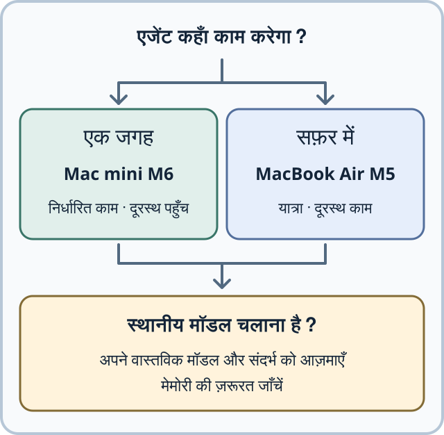

---
{
  "state": "draft",
  "language": "hi",
  "translationKey": "2026-11-23-mac-for-ai-agents",
  "title": "AI एजेंट के लिए MacBook लें या Mac mini?",
  "description": "Mac mini और MacBook Air की तुलना इस आधार पर करें कि एजेंट कहाँ चलेगा, कौन से काम साथ चलेंगे और स्थानीय मॉडल को कितनी मेमोरी चाहिए।",
  "sourcePath": "src/content/posts/en/2026-11-23-mac-for-ai-agents.md",
  "sourceSha256": "cf0a6f26766c7d6ada501ad70e444774995908e2d4c22f1683cddffe6211454a"
}
---

यदि आपके पास लैपटॉप है और आप AI एजेंट से ब्राउज़र परीक्षण या तय समय पर काम कराना चाहते हैं तो मेरी पसंद **Mac mini M6** है। सफ़र या दफ़्तर आते-जाते भी वही विकास परिवेश चाहिए और एक ही कंप्यूटर रखना है तो **13-इंच MacBook Air M5** बेहतर बैठता है। Ollama जैसे टूल से मॉडल खुद चलाना है तो पहले अपने मॉडल और संदर्भ की मेमोरी ज़रूरत जाँचें। स्थिर मशीन में 32GB से अधिक चाहिए तो **48GB और 64GB वाले Mac mini M5 Pro के विकल्प** देखें। [Mac mini के विनिर्देश](https://www.apple.com/kr/mac-mini/specs/) · [MacBook Air के विनिर्देश](https://www.apple.com/kr/macbook-air/specs/)



## एजेंट और मॉडल कहाँ चलते हैं?

मान लें कि आप Mac के टर्मिनल में Claude Code या Codex चला रहे हैं और क्लाउड मॉडल इस्तेमाल करते हैं। मॉडल का उत्तर दूरस्थ सेवा बनाती है। एजेंट के स्थानीय बिल्ड और परीक्षण Mac के CPU, मेमोरी और स्टोरेज का उपयोग करते हैं। एक एजेंट से कोड समीक्षा कराने और दो कार्य फ़ोल्डरों में Docker, परीक्षण और ब्राउज़र एक साथ चलाने की ज़रूरतें अलग हैं। क्लाउड मॉडल के साथ Mac के विनिर्देश वास्तव में साथ चलने वाले काम देखकर चुनें।

स्थानीय अनुमान में मॉडल भी Mac की मेमोरी लेता है। एक ही मॉडल के लिए भार की संख्यात्मक परिशुद्धता और एक बार में दिए गए इनपुट की लंबाई से ज़रूरत बदलती है। छोटी बातचीत सफल हो सकती है, फिर भी लंबे कोड और लॉग के साथ ब्राउज़र खोलने पर उत्तर धीमा हो सकता है। संभव हो तो खरीदने से पहले **अपने वास्तविक मॉडल, क्वांटाइज़ेशन संस्करण और संदर्भ की लंबाई** के साथ प्रतिक्रिया समय और मेमोरी दबाव देखें। [Ollama में संदर्भ की लंबाई](https://docs.ollama.com/context-length)

## काम के हिसाब से कॉन्फ़िगरेशन

| मुख्य काम | मेरी पसंद | खरीदने से पहले क्या देखें |
| --- | --- | --- |
| एक जगह क्लाउड मॉडल से कोडिंग और कभी-कभी परीक्षण | Mac mini M6 16GB | आधार मॉडल का 256GB स्टोरेज काफ़ी है? बिल्ड कैश और Docker इमेज रखते हैं तो 512GB से शुरू करके तुलना करें। |
| कैफ़े और दफ़्तर में बारी-बारी काम | 13-इंच MacBook Air M5 16GB · 512GB | कंटेनर और ब्राउज़र परीक्षण अक्सर साथ चलते हों तो पहले 24GB देखें। |
| कई कार्य फ़ोल्डरों में कंटेनर और परीक्षण साथ चलाना | स्थिर उपयोग में Mac mini M6 या सफ़र में MacBook Air M5, 24–32GB मेमोरी के साथ | साथ चलने वाली सेवाएँ और मेमोरी दबाव देखें। Docker Desktop की वर्चुअल मशीन को आवंटित मेमोरी भी जाँचें। |
| रोज़ स्थानीय मॉडल चलाना और 32GB से अधिक मेमोरी चाहिए | स्थिर उपयोग में Mac mini M5 Pro 48GB या 64GB | मॉडल लोड करने के बाद ब्राउज़र और IDE की ज़रूरत भी गिनें। बाहर भी वही मॉडल चलाना है तो क्षमता तय करके उसी क्षमता का MacBook Pro भी देखें। |

16GB, 24GB और 32GB काम के अनुसार शुरुआती विकल्प हैं। असल ज़रूरत प्रोजेक्ट की बिल्ड विधि और कंटेनरों की संख्या पर निर्भर है। [Docker Desktop की संसाधन सेटिंग](https://docs.docker.com/desktop/settings-and-maintenance/settings/#resources)

### Apple के कोरियाई स्टोर में शुरुआती कीमतें

ये आधार कॉन्फ़िगरेशन की सामान्य बिक्री कीमतें हैं, जिन्हें 2026-11-23 को जाँचा गया था।

| मॉडल | आधार मेमोरी · SSD | शुरुआती कीमत |
| --- | --- | ---: |
| Mac mini M6 | 16GB · 256GB | KRW 1,499,000 |
| 13-इंच MacBook Air M5 | 16GB · 512GB | KRW 2,190,000 |
| Mac mini M5 Pro | 24GB · 512GB | KRW 2,990,000 |

दोनों 16GB आधार मॉडलों की शुरुआती कीमत में 691,000 कोरियाई वॉन का अंतर है। MacBook Air में स्क्रीन, कीबोर्ड, बैटरी और बड़ा बेस SSD मिलता है। मॉनिटर और इनपुट उपकरण पहले से हैं तो Mac mini की कम कीमत का अधिक लाभ मिलेगा। मेमोरी या SSD बढ़ाने की योजना हो तो मनचाहे दोनों कॉन्फ़िगरेशन कार्ट में रखकर तुलना करें। [Apple का कोरियाई स्टोर](https://www.apple.com/kr/shop/buy-mac) · [Mac mini की लॉन्च कीमत](https://www.apple.com/kr/newsroom/2026/09/the-new-mac-mini-and-mac-studio-are-available-today/) · [Mac mini के विनिर्देश](https://www.apple.com/kr/mac-mini/specs/) · [MacBook Air के विनिर्देश](https://www.apple.com/kr/macbook-air/specs/)

## खरीदने से पहले अपने मौजूदा Mac पर क्या जाँचें?

1. नीचे की कमांड से मेमोरी और होम फ़ोल्डर वाले वॉल्यूम की खाली जगह देखें।
2. हमेशा की तरह एजेंट और IDE खोलें। अक्सर साथ चलने वाले बिल्ड, Docker और ब्राउज़र के काम चलाएँ। **Activity Monitor → Memory** में मेमोरी दबाव और स्वैप उपयोग देखें।
3. मेमोरी दबाव बार-बार बढ़े और ऐप भी धीमे हों तो अधिक मेमोरी वाले विकल्प देखें। केवल कंटेनर चलते समय समस्या आए तो Docker Desktop की आवंटन सीमा भी जाँचें। [Apple की Activity Monitor गाइड](https://support.apple.com/guide/activity-monitor/view-memory-usage-actmntr1004/mac) · [Docker Desktop की संसाधन सेटिंग](https://docs.docker.com/desktop/settings-and-maintenance/settings/#resources)

```sh
sw_vers -productVersion
sysctl -n hw.memsize | awk '{ printf "Unified memory: %.0f GiB\n", $1 / 1073741824 }'
df -h "$HOME" | awk 'NR == 2 { print "Free storage:", $4 }'
```

मेमोरी और डिस्क पर्याप्त हों तब भी तय समय पर काम चलाने वाली मशीन को जाँचें। काम के बाद स्क्रीन बंद रखकर एक निर्धारित काम चलाएँ और उसका लॉग देखें। स्लीप या रीबूट के बाद भी काम चलना चाहिए तो दोनों स्थितियाँ अलग जाँचें। मौजूदा MacBook पर यह जाँच बताएगी कि अलग Mac mini की ज़रूरत है या नहीं। [MacBook को निजी सर्वर की तरह चलाएँ](https://youdozi.github.io/hi/posts/2026-11-23-macbook-personal-server/)

विनिर्देश और कीमतें Apple के कोरियाई पृष्ठों से मिलाई गईं और ऊपर की तीन कमांड macOS पर चलाई गईं। मशीनों के बीच बिल्ड प्रदर्शन या स्थानीय मॉडल का प्रतिक्रिया समय नहीं मापा गया।
