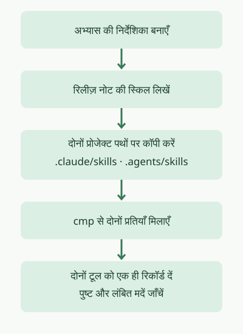

---
{
  "state": "draft",
  "language": "hi",
  "translationKey": "2026-11-18-claude-code-codex-skills-top-10",
  "title": "Claude Code और Codex के लिए 10 स्किल और उनके व्यावहारिक उपयोग",
  "description": "Claude Code और Codex CLI के लिए दस स्किल की तुलना करें, उन्हें स्थापित करना और बुलाना सीखें और दोनों टूल में एक ही रिलीज़ नोट स्किल आज़माएँ।",
  "sourcePath": "src/content/posts/en/2026-11-18-claude-code-codex-skills-top-10.md",
  "sourceSha256": "9338932f68b3342b8eee987674b733a84d8f24684b44e978ff027618dab08d68"
}
---

बार-बार एक ही अनुरोध लिखना पड़ता है तो उसे स्किल में सहेजें। हर बार बदलाव के सारांश का दायरा और जाँच के मानदंड लिखने की जगह स्किल में इनपुट और आउटपुट का प्रारूप तय कर दें। फिर हर काम के लिए केवल संबंधित फ़ाइलें बदलनी होंगी। विकास टीमें `skill-creator` और `webapp-testing` से शुरुआत कर सकती हैं। दस्तावेज़ों पर काम करने वाली टीम पहले अपने सबसे ज़्यादा इस्तेमाल होने वाले फ़ाइल प्रारूप की स्किल चुन सकती है।

यह गाइड टर्मिनल में चलने वाले **Claude Code** और **Codex CLI** के लिए है। 2026-11-18 को मैंने आधिकारिक स्रोतों में उपलब्ध विकल्प देखकर क्रम तय किया। मानदंड थे **दोबारा इस्तेमाल की आवृत्ति, परिणाम जाँचने की आसानी और स्थापना व बाहरी कनेक्शन में लगने वाला प्रयास**। यह व्यावहारिक सुझाव है, स्थापना की संख्या या प्रदर्शन का आँकड़ा नहीं। OpenAI पुराने स्किल कैटलॉग की जगह नए वितरण माध्यम अपनाने की सलाह देता है, इसलिए Codex के लिए मौजूदा दस्तावेज़ों और प्लगइन के स्थापना स्रोत दिए हैं। [Claude Code स्किल दस्तावेज़](https://code.claude.com/docs/en/skills) · [Codex स्किल दस्तावेज़](https://learn.chatgpt.com/docs/build-skills) · [पुराने कैटलॉग की सूचना](https://github.com/openai/skills) · [OpenAI प्लगइन रिपॉज़िटरी](https://github.com/openai/plugins)

## रोज़मर्रा के काम की 10 स्किल

स्रोत और परिवेश वाले कॉलम में स्किल मिलने का आधिकारिक माध्यम दिया है। Claude Code का उदाहरण Codex में ले जाते समय साझा `SKILL.md` प्रारूप इस्तेमाल कर सकते हैं। साथ की स्क्रिप्ट, टूल के नाम और होस्ट की सेटिंग अलग से जाँचें।

| क्रम | स्किल | स्रोत और परिवेश | अनुरोध का उदाहरण और जाँच |
| --- | --- | --- | --- |
| 1 | `skill-creator` | Codex में अंतर्निहित / [Claude Code उदाहरण](https://github.com/anthropics/skills/tree/main/skills/skill-creator) | “PR का विवरण लिखने की स्किल बनाओ। कोड सुधार और दस्तावेज़ वाले PR के लिए एक-एक इनपुट उदाहरण दो।” एक ऐसा अनुरोध दें जिस पर स्किल बुलानी चाहिए और एक जिस पर नहीं। |
| 2 | `webapp-testing` | [Claude Code उदाहरण](https://github.com/anthropics/skills/tree/main/skills/webapp-testing) | “स्थानीय ऑर्डर पेज पर Playwright से सफल सबमिशन और अनिवार्य फ़ील्ड खाली होने की जाँच करो।” वास्तविक स्क्रीन स्थिति और रन लॉग दर्ज करें। ब्राउज़र और ऐप चलाने का परिवेश चाहिए। |
| 3 | `frontend-design` | [Claude Code उदाहरण](https://github.com/anthropics/skills/tree/main/skills/frontend-design) | “घटना प्रबंधन डैशबोर्ड का मोबाइल दृश्य बनाओ। पहले स्थिति और अगली कार्रवाई दिखाओ।” खाली स्थिति, लंबा टेक्स्ट और कीबोर्ड नेविगेशन जाँचें। |
| 4 | `openai-docs` | Codex में अंतर्निहित / [OpenAI Developers गाइड](https://developers.openai.com/learn/developers-codex-plugin) | “आधिकारिक दस्तावेज़ों से पता करो कि Codex CLI प्रोजेक्ट स्किल कहाँ रखता है और कैसे बुलाता है।” देखें कि स्रोत CLI के दृश्य और बताई गई सुविधा की पुष्टि करते हैं। |
| 5 | `xlsx` | [Claude Code दस्तावेज़ स्किल](https://github.com/anthropics/skills/tree/main/skills/xlsx) | “ऑर्डर CSV से मासिक सारांश की वर्कबुक बनाओ। रद्द ऑर्डर अलग रखो और योग फ़ॉर्मूले से निकालो।” मूल पंक्तियों की संख्या, गणना का दायरा, योग और फ़ॉर्मूले की त्रुटियाँ जाँचें। |
| 6 | `pdf` | [Claude Code दस्तावेज़ स्किल](https://github.com/anthropics/skills/tree/main/skills/pdf) | “आवश्यकताओं वाली PDF से डिलीवरी की शर्तें और अपवाद पृष्ठ संख्या समेत निकालो।” पंक्तियों और कॉलम का क्रम मूल पृष्ठ से मिलाएँ और देखें कि कुछ छूटा तो नहीं। स्कैन की OCR गुणवत्ता अलग से देखें। |
| 7 | `docx` | [Claude Code दस्तावेज़ स्किल](https://github.com/anthropics/skills/tree/main/skills/docx) | “संलग्न Word टेम्पलेट में प्रोजेक्ट हस्तांतरण का दस्तावेज़ लिखो। शीर्षकों की शैली और तालिकाएँ बनाए रखो।” Word या संगत संपादक में खोलकर पृष्ठ विभाजन और तालिकाओं के कटने की जाँच करें। |
| 8 | `pptx` | [Claude Code दस्तावेज़ स्किल](https://github.com/anthropics/skills/tree/main/skills/pptx) | “संचालन की समीक्षा 6 स्लाइड में बनाओ। आँकड़ों के पास मापन अवधि और इकाइयाँ दो।” स्लाइड रेंडर करके आँकड़े, अक्ष और टेक्स्ट का कटना देखें। |
| 9 | `openai-api-troubleshooting` | [Codex के लिए OpenAI Developers प्लगइन](https://github.com/openai/plugins/tree/main/plugins/openai-developers/skills/openai-api-troubleshooting) | “इस API त्रुटि संदेश से संभावित कारण पहचानो। कुंजी हटा दी है और SDK संस्करण व अनुरोध ID संलग्न हैं।” अनुमान और उन्हें जाँचने वाले कमांड अलग रखें। असली कुंजियाँ और टोकन हटाएँ। |
| 10 | `imagegen` | Codex में अंतर्निहित / [स्किल का स्रोत](https://github.com/openai/codex/tree/main/codex-rs/skills/src/assets/samples/imagegen) | “ब्लॉग के लिए चौड़ा कवर चित्र बनाओ। लेख का शीर्षक चित्र में मत डालो।” चित्र बनाने की सुविधा उपलब्ध है या नहीं देखें, फिर आकार, संपादन का दायरा और अक्षरों की विकृति जाँचें। |

`skill-creator` पहले स्थान पर है क्योंकि इससे टीम अपनी दोहराई जाने वाली प्रक्रिया प्रोजेक्ट में रख सकती है। `webapp-testing` के लिए ऐप और ब्राउज़र चलने चाहिए, लेकिन लॉग और स्क्रीन देखकर परिणाम परखा जा सकता है। दस्तावेज़ों की चार स्किल में से फ़ाइल प्रारूप के अनुसार चुनें। API की त्रुटि या चित्र की ज़रूरत होने पर संबंधित निदान या चित्र निर्माण स्किल उपयोगी है।

विकास में `frontend-design` से तय करें कि स्क्रीन कैसे काम करे और फिर `webapp-testing` से उपयोगकर्ता की गतिविधियाँ जाँचें। डिज़ाइन तैयार होने पर भी अलग से जाँचें कि सबमिशन विफल होने पर इनपुट बचता है या नहीं। दस्तावेज़ के लिए `pdf` से तालिका पढ़ें और `xlsx` से सारांश बनाएँ। दूसरे चरण को डेटा देने से पहले निकाली हुई तालिका मूल से मिलाएँ।

## स्किल कैसे स्थापित करें और बुलाएँ?

Claude Code में Anthropic का आधिकारिक मार्केटप्लेस जोड़कर उपयुक्त बंडल चुनें। PDF, Word, Excel या PowerPoint के लिए `document-skills` और स्किल लेखन या वेब परीक्षण के उदाहरणों के लिए `example-skills` चुनें। अनुरोध में स्थापित प्लगइन की स्किल का नाम लिखकर उसे बुला सकते हैं। [Anthropic स्थापना निर्देश](https://github.com/anthropics/skills#claude-code)

```text
/plugin marketplace add anthropics/skills
/plugin install document-skills@anthropic-agent-skills
/plugin install example-skills@anthropic-agent-skills
```

Codex CLI में `/skills` या `$` चयन सूची से स्किल चुनें। अंतर्निहित `skill-creator` को `$skill-creator` से बुलाएँ। OpenAI API निदान स्किल जोड़ने के लिए Codex CLI के `/plugins` मेनू में **OpenAI Developers** खोजें और `Install plugin` चुनें। नया सत्र खोलकर `/skills` में स्किल की मौजूदगी देखें। [Codex स्किल बुलाने के निर्देश](https://learn.chatgpt.com/docs/build-skills) · [OpenAI Developers प्लगइन](https://developers.openai.com/learn/developers-codex-plugin)

प्रोजेक्ट में प्रबंधित स्किल Claude Code के लिए `.claude/skills/<name>/SKILL.md` और Codex के लिए `.agents/skills/<name>/SKILL.md` में रखें। प्लेसहोल्डर की जगह स्किल का नाम दें। आधिकारिक उदाहरण की प्रतिलिपि लेते समय उसकी `SKILL.md` में उल्लिखित फ़ाइलें और टूल जाँचें। बाहरी कनेक्शन चाहिए तो चलाने से पहले खाता और पहुँच का दायरा देखें। [Claude Code स्किल के स्थान](https://code.claude.com/docs/en/skills#choose-where-skills-load) · [Codex स्किल के स्थान](https://learn.chatgpt.com/docs/build-skills#where-to-save-skills)

## अभ्यास — दोनों टूल में एक ही रिलीज़ नोट स्किल इस्तेमाल करें

नई अभ्यास निर्देशिका से नीचे के कमांड चलाएँ। ये एक `SKILL.md` लिखकर दोनों प्रोजेक्ट पथों पर कॉपी करते हैं और `cmp` से प्रतियाँ मिलाते हैं। इसके लिए POSIX शेल और `mkdir`, `cp`, `cmp` चाहिए।



```sh
set -eu
mkdir skills-demo
cd skills-demo

mkdir -p .claude/skills/release-note-draft .agents/skills/release-note-draft

cat > release-note-source.md <<'SKILL'
---
name: release-note-draft
description: Draft a release note from a provided change list and test evidence.
---
Write three sections in Korean: 사용자 변경, 검증, 미확인.
Describe user-facing changes using only the supplied change list.
Put a test in 검증 only when the input explicitly says it ran and gives the result.
If a test is mentioned without a result, put it in 미확인.
Return the draft in the chat.
SKILL

cp release-note-source.md .claude/skills/release-note-draft/SKILL.md
cp release-note-source.md .agents/skills/release-note-draft/SKILL.md
cmp .claude/skills/release-note-draft/SKILL.md .agents/skills/release-note-draft/SKILL.md
printf '%s\n' 'Skill copies match.'
```

macOS की अस्थायी निर्देशिका में कमांड ने नीचे दिया आउटपुट और निकास कोड `0` दिया। उसी मूल निर्देशिका में दोबारा चलाने पर पहले `mkdir` पर काम रुक जाएगा क्योंकि `skills-demo` पहले से मौजूद है।

```text
Skill copies match.
```

`skills-demo` से अलग टर्मिनल सत्रों में `claude` और `codex` चलाएँ। Claude Code में `/release-note-draft` और Codex CLI में `$release-note-draft` चुनें। स्किल का नाम और नीचे दिया बदलाव व परीक्षण का रिकॉर्ड एक संदेश में भेजें।

**प्रॉम्प्ट का उदाहरण** बदलाव: सेटिंग पेज पर ईमेल फ़ील्ड खाली करने पर सहेजने का बटन निष्क्रिय हो जाता है। जाँच: सेटिंग पेज के 3 यूनिट परीक्षण चलाए, सभी पास हुए। योजना: मोबाइल ब्राउज़र में भी जाँच करेंगे। इस रिकॉर्ड से रिलीज़ नोट का मसौदा लिखो।

अपेक्षित उत्तर में उपयोगकर्ता को दिखने वाले बदलाव के अंतर्गत बटन का व्यवहार, जाँच के अंतर्गत पास हुए सभी 3 यूनिट परीक्षण और अपुष्ट मदों में मोबाइल ब्राउज़र की लंबित जाँच होनी चाहिए।

## एक ही इनपुट पर मिले उत्तरों की तुलना

दोनों CLI को एक ही स्किल फ़ाइल और बदलाव व परीक्षण का एक ही काल्पनिक रिकॉर्ड दिया गया। अभ्यास में देखना है कि वे उस रिकॉर्ड से **पूरे हो चुके और नियोजित परीक्षणों में अंतर** कर पाते हैं या नहीं। उनसे ऐप के परीक्षण नए सिरे से चलाने को नहीं कहा गया।

Codex CLI 0.169.0 में GPT-6.2 Sol चलाने पर लॉग में दिखा कि उसने प्रोजेक्ट की स्किल फ़ाइल पढ़ी। उसके उत्तर की मुख्य बातें नीचे हैं।

| भाग | Codex का उत्तर |
| --- | --- |
| उपयोगकर्ता को दिखने वाला बदलाव | सेटिंग पेज पर भरा ईमेल हटाने से सहेजने का बटन निष्क्रिय हो जाता है। |
| जाँच | सेटिंग पेज के सभी 3 यूनिट परीक्षण चलाए गए और पास हुए। |
| अपुष्ट | मोबाइल ब्राउज़र में व्यवहार की जाँच अभी होनी है। |

Claude Code 2.0.76 और 2.1.327 में भी प्रोजेक्ट स्किल सूची में दिखी। लॉगिन त्रुटि के कारण मॉडल कॉल रुक गई। इस रन से Claude Code द्वारा स्किल की पहचान और Codex का एक उत्तर ही पुष्ट हुआ।
