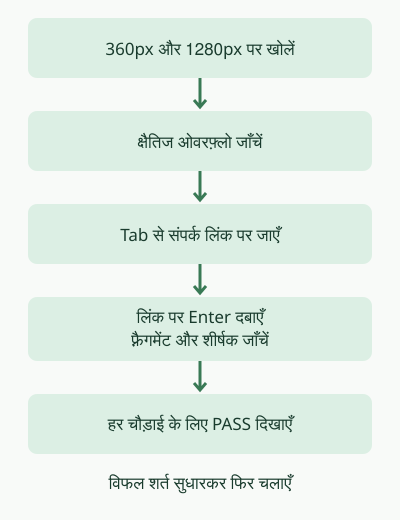

---
{
  "state": "draft",
  "language": "hi",
  "translationKey": "2026-11-19-website-building-agent-skills",
  "title": "Claude Code और Codex से वेबसाइट बनाना — योजना से तैनाती तक कौन-सी स्किल चुनें?",
  "description": "परिचयात्मक वेबसाइट या वेब ऐप बनाने के लिए Claude Code और Codex की स्किल चुनें। इंटरफ़ेस लागू करने, Playwright में जाँचने और तैनाती की पुष्टि करने के चरण उदाहरण सहित देखें।",
  "sourcePath": "src/content/posts/en/2026-11-19-website-building-agent-skills.md",
  "sourceSha256": "f7eb2b67f71eb23934048777fc9d7ffed4a983fc580e1b4d9a7b2cf3c8a3180e"
}
---

किसी छोटी कंपनी की वेबसाइट के लिए शुरुआत करें **पेज का पाठ और संरचना तय करने, इंटरफ़ेस बनाने और ब्राउज़र में संपर्क करने का रास्ता जाँचने** से। लॉगिन या भुगतान वाले वेब ऐप में पहले पहुँच के अधिकार, डेटा भंडारण और विफलता से उबरने का तरीका तय करें। साइट का प्रकार स्पष्ट हो तो स्किल और परिणाम परखने का तरीका चुनना आसान हो जाता है।

ये विकल्प 2026-11-19 को Anthropic, OpenAI और Vercel के आधिकारिक स्किल स्रोतों से काम के चरण के अनुसार चुने गए। उदाहरणों में Claude Code या Codex CLI में एजेंट को काम सौंपा जाता है। [Anthropic स्किल संग्रह](https://github.com/anthropics/skills) · [OpenAI Build Web Apps](https://github.com/openai/plugins/tree/main/plugins/build-web-apps) · [Vercel Agent Skills](https://github.com/vercel-labs/agent-skills)

## साइट के प्रकार के अनुसार स्किल चुनें

| क्या बनाना है | पहले क्या तय करें | सामान्य क्रम |
| --- | --- | --- |
| परिचयात्मक साइट, पोर्टफ़ोलियो या ब्लॉग | आगंतुक, मुख्य कार्रवाई, सार्वजनिक पेज और सामग्री संपादित करने का तरीका | पेज का पाठ → इंटरफ़ेस → ब्राउज़र परीक्षण → तैनाती की जाँच |
| बुकिंग, भुगतान या प्रशासन का वेब ऐप | उपयोगकर्ता के अधिकार, सहेजने वाला डेटा, सफलता व विफलता पर व्यवहार और संचालन के रिकॉर्ड | स्क्रीन और स्थिति की योजना → इंटरफ़ेस और सर्वर बनाना → सफल और विफल प्रवाह जाँचना → पूर्वावलोकन → लाइव साइट की जाँच |

मौजूदा रिपॉज़िटरी हो तो पहले उसका फ़्रेमवर्क और तैनाती की प्रक्रिया देखें। उदाहरण के लिए Astro ब्लॉग में पोस्ट और संपर्क लिंक मौजूदा व्यवस्था में ही जोड़ सकते हैं। React या Next.js के प्रदर्शन और भुगतान संबंधी स्किल तभी चुनें जब प्रोजेक्ट में संबंधित तकनीक या सुविधा की ज़रूरत हो।

| चरण | सुझाई गई स्किल या दिशानिर्देश | कौन-सा काम सौंपें और कैसे जाँचें |
| --- | --- | --- |
| योजना और लेखन | प्रोजेक्ट के `website-copywriting` दिशानिर्देश | आगंतुक और मुख्य कार्रवाई तय करके शीर्षक, विवरण और संपर्क का पाठ लिखें। पहली स्क्रीन पढ़कर देखें कि सेवा किसे क्या देती है। |
| इंटरफ़ेस की योजना | प्रोजेक्ट के `frontend-architecture-design` दिशानिर्देश | पेज के पथ, घटकों और स्थिति की ज़िम्मेदारी, सफलता और त्रुटि की स्क्रीन तय करें। बुकिंग ऐप में सबमिशन के दौरान बार-बार क्लिक और सहेजना विफल होने पर दोबारा कोशिश का व्यवहार तय करें। |
| इंटरफ़ेस बनाना | [Claude Code की `frontend-design`](https://github.com/anthropics/skills/tree/main/skills/frontend-design) या [Codex की `frontend-app-builder`](https://github.com/openai/plugins/tree/main/plugins/build-web-apps/skills/frontend-app-builder) | स्वीकृत पाठ और संरचना को मौजूदा प्रोजेक्ट के घटकों में लागू करें। देखें कि संकरी स्क्रीन पर भी शीर्षक, कार्रवाई का बटन और मुख्य पाठ क्रम से पढ़े जाते हैं। |
| ब्राउज़र में जाँच | [Claude Code की `webapp-testing`](https://github.com/anthropics/skills/tree/main/skills/webapp-testing) और [Codex की `frontend-testing-debugging`](https://github.com/openai/plugins/tree/main/plugins/build-web-apps/skills/frontend-testing-debugging) | मोबाइल पर संपर्क लिंक, फ़ॉर्म त्रुटियाँ और कंसोल जाँचें। जाँचा गया URL, स्क्रीन आकार, समस्या दोहराने के चरण और परिणाम लिखें। |
| सुलभता की समीक्षा | [Vercel की `web-design-guidelines`](https://github.com/vercel-labs/agent-skills/tree/main/skills/web-design-guidelines) | कोड में लेबल, कंट्रास्ट और फ़ोकस देखें। ब्राउज़र में टैब क्रम और फ़ोकस संकेतक जाँचें। स्वचालित व मैनुअल जाँच का रिकॉर्ड रखें। |
| React प्रदर्शन | [Build Web Apps की `react-best-practices`](https://github.com/openai/plugins/tree/main/plugins/build-web-apps/skills/react-best-practices) | React या Next.js प्रोजेक्ट में क्रमिक डेटा अनुरोध और शुरुआती बंडल देखें। प्रभाव आँकने के लिए बदलाव से पहले और बाद में एक ही परिवेश में मापें। |
| तैनाती | [Vercel की `deployments-cicd`](https://github.com/openai/plugins/tree/main/plugins/vercel/skills/deployments-cicd) या प्रोजेक्ट की तैनाती गाइड | होस्ट पर पूर्वावलोकन या स्टेजिंग URL जाँचकर स्वीकृत संस्करण तैनात करें। अंतिम URL और ज़रूरत पड़ने पर बहाल किया जाने वाला संस्करण दर्ज करें। |

पहली दो पंक्तियाँ उन भूमिकाओं के उदाहरण हैं जिन्हें आप अपने प्रोजेक्ट में परिभाषित करते हैं। प्रकाशित स्किल के लिए रखरखाव करने वाली टीम के स्थापना निर्देश देखें। Claude Code में Anthropic के आधिकारिक मार्केटप्लेस के `example-skills` में इंटरफ़ेस और परीक्षण स्किल हैं। Codex के **Build Web Apps** प्लगइन में इंटरफ़ेस निर्माण, परीक्षण और React अनुकूलन की स्किल साथ आती हैं। Vercel पर होस्ट की जाने वाली साइट के लिए Vercel की तैनाती स्किल इस्तेमाल करें। GitHub Pages के लिए रिपॉज़िटरी की Actions और पूर्वावलोकन प्रक्रिया अपनाएँ। [Claude Code स्थापना निर्देश](https://github.com/anthropics/skills#claude-code) · [OpenAI Build Web Apps में शामिल स्किल](https://github.com/openai/plugins/blob/main/plugins/build-web-apps/README.md)

## छोटी साइट पर स्किल किस क्रम में इस्तेमाल करें?

अनुरोध छोटा रख सकते हैं। सेवा का विवरण, पेज की संरचना और जाँचा जाने वाला व्यवहार साथ दें ताकि योजना, कार्यान्वयन और परीक्षण के मानदंड एक हों।

**प्रॉम्प्ट का उदाहरण** एक काल्पनिक फ़ोटोग्राफ़ी स्टूडियो का परिचय पेज बनाओ। आगंतुक शूट की जगह और परामर्श का तरीका जानना चाहते हैं। परिचय और परामर्श की जानकारी एक ही पेज पर रखो। पहली स्क्रीन का संपर्क लिंक परामर्श वाले भाग पर ले जाए। परिचय, संपर्क लिंक और परामर्श की जानकारी इसी क्रम में रहें। 360px की संकरी स्क्रीन और कीबोर्ड का ध्यान रखो। बनाने के बाद 360px और 1280px पर जाँचो कि सामग्री किनारे से बाहर तो नहीं जाती। Tab से संपर्क लिंक तक पहुँचो और Enter दबाकर परामर्श वाला भाग खोलो। हर चरण का परिणाम और जो नहीं जाँच सके उसे दर्ज करो।

इंटरफ़ेस बनाने के लिए परिचय और संपर्क लिंक दें। व्यूपोर्ट और कीबोर्ड की शर्तों को परीक्षण का आधार बनाएँ। जाँच विफल हो तो स्क्रीन की चौड़ाई और की गई कार्रवाई एजेंट को दें, फिर सुधार के बाद उसी स्थिति में परीक्षण करें। सुलभता समीक्षा में कंट्रास्ट, स्क्रीन रीडर द्वारा पढ़े गए नाम और दूसरे पेज पर जाने के बाद फ़ोकस की जगह भी देखें।

## अभ्यास — Playwright से संपर्क लिंक का रास्ता जाँचें

अभ्यास में एक पेज परीक्षण फ़ाइल में रखकर दो चौड़ाइयों पर ब्राउज़र में जाँचा जाता है। नई निर्देशिका में Node.js 22 और Chrome तैयार रखें। `npm init -y` चलाएँ और फिर `npm install --save-dev playwright-core@1.64.1` से निर्भरता स्थापित करें। नीचे का कोड `website-check.mjs` में सहेजें और macOS पर `node website-check.mjs` चलाएँ। Chrome कहीं और स्थापित हो तो `CHROME_PATH` में उसकी निष्पादन योग्य फ़ाइल का पथ दें। [Playwright में ब्राउज़र चलाने के विकल्प](https://playwright.dev/docs/api/class-browsertype#browser-type-launch)



```js
import assert from 'node:assert/strict';
import { chromium } from 'playwright-core';

const html = `<!doctype html>
<html lang="ko">
<meta charset="utf-8">
<meta name="viewport" content="width=device-width, initial-scale=1">
<title>봄 사진 스튜디오</title>
<style>
  body { margin: 0; font: 1rem/1.6 system-ui; }
  main { max-width: 42rem; margin: auto; padding: 1rem; }
  section { min-height: 74vh; }
</style>
<main>
  <section>
    <h1>봄 사진 스튜디오</h1>
    <p>프로필 사진과 가족사진을 촬영합니다.</p>
    <a href="#contact">문의하기</a>
  </section>
  <section id="contact">
    <h2>상담 안내</h2>
    <p>촬영 목적과 희망 일정을 준비해 주세요.</p>
  </section>
</main>
</html>`;

const browser = await chromium.launch({
  executablePath: process.env.CHROME_PATH
    ?? '/Applications/Google Chrome.app/Contents/MacOS/Google Chrome',
});

try {
  for (const width of [360, 1280]) {
    const page = await browser.newPage({ viewport: { width, height: 700 } });
    try {
      await page.setContent(html);
      const overflow = await page.evaluate(
        () => document.documentElement.scrollWidth > window.innerWidth,
      );
      assert.equal(overflow, false, `가로 넘침: ${width}px`);

      await page.keyboard.press('Tab');
      const focused = await page.evaluate(
        () => document.activeElement?.getAttribute('href'),
      );
      assert.equal(focused, '#contact', `문의 링크 포커스: ${width}px`);
      await page.keyboard.press('Enter');
      await page.waitForURL(/#contact$/);
      const heading = await page.getByRole('heading', { name: '상담 안내' }).boundingBox();
      assert.ok(heading && heading.y >= 0 && heading.y + heading.height <= 700);
      console.log(`PASS ${width}px: no overflow, keyboard link reaches contact`);
    } finally {
      await page.close();
    }
  }
} finally {
  await browser.close();
}
```

रन से नीचे दिया आउटपुट मिला। हर `PASS` का अर्थ है कि क्षैतिज ओवरफ़्लो नहीं था, कीबोर्ड से संपर्क लिंक तक पहुँचे और लिंक खोलने पर परामर्श का शीर्षक दिखाई दिया।

```text
PASS 360px: no overflow, keyboard link reaches contact
PASS 1280px: no overflow, keyboard link reaches contact
```

वास्तविक प्रोजेक्ट में HTML स्ट्रिंग की जगह स्थानीय सर्वर चलाकर लागू किया पेज `page.goto()` से खोलें। संपर्क फ़ॉर्म हो तो अनिवार्य फ़ील्ड खाली रहने, सबमिशन विफल होने पर इनपुट बचने और सफलता संदेश की अलग जाँच करें। संपर्क लिंक का गंतव्य दूसरे फ़्रैगमेंट पर बदलने से 360px पर लिंक परीक्षण विफल हुआ। इस अभ्यास की जाँच एक HTML पेज और Chrome की दो चौड़ाइयों तक सीमित थी।

## तैनाती के बाद क्या जाँचें?

पूर्वावलोकन और लाइव URL पर मुख्य पेज और संपर्क का रास्ता फिर खोलें। सर्वर की प्रतिक्रिया और स्थिर फ़ाइलें जाँचें। खोज के लिए सार्वजनिक पेज का शीर्षक, विवरण, कैनॉनिकल URL, आंतरिक लिंक और साइटमैप देखें। खोज इंजन ने वास्तव में पेज ढूँढ़ा और इंडेक्स किया है या नहीं, यह अलग से Search Console में जाँचें। [Google की शुरुआती SEO गाइड](https://developers.google.com/search/docs/fundamentals/seo-starter-guide)
