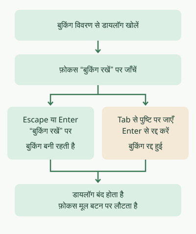

---
{
  "state": "draft",
  "language": "hi",
  "translationKey": "2026-11-20-ui-ux-design-agent-skills",
  "title": "UI/UX डिज़ाइन के लिए एजेंट स्किल चुनें और बुकिंग रद्द करने का फ़्लो जाँचें",
  "description": "Claude Code, Codex और Figma की स्किल से स्क्रीन की अवस्थाएँ तय करें और ब्राउज़र में कीबोर्ड, फ़ोकस और रद्दीकरण का परिणाम जाँचें।",
  "sourcePath": "src/content/posts/en/2026-11-20-ui-ux-design-agent-skills.md",
  "sourceSha256": "2fa2cdf9d087643f65deb61063a994cdd75549bf0b412379d831fa97c01906e2"
}
---

**स्क्रीन बनाने से पहले तय करें कि उपयोगकर्ता को क्या करना है और किस कदम पर वह वापस जा सकता है।** बुकिंग रद्द करते समय उसे कार्रवाई का परिणाम समझ आना चाहिए और बुकिंग रखने या रद्द करने का विकल्प मिलना चाहिए। डायलॉग का संदेश, खुलते समय फ़ोकस और बंद होने पर फ़ोकस कहाँ लौटेगा, यह पहले लिखें। तब कार्यान्वयन और परीक्षण एक ही मानदंड पर चलेंगे।

यह लेख [वेबसाइट बनाने की गाइड](/hi/posts/2026-11-19-website-building-agent-skills/) के UI/UX चरण को आगे बढ़ाता है। बुकिंग रद्द करने के उदाहरण को योजना से ब्राउज़र में जाँच तक देखेंगे। इसके आधार 2026-11-20 को देखे गए स्रोत हैं, जिनमें Claude Code और Codex की सार्वजनिक स्किल तथा Figma, Vercel और W3C की सामग्री शामिल है।

## जो बनाना है उसके अनुसार स्किल चुनें

| परिणाम | स्किल या कार्यप्रवाह | क्या जाँचें |
| --- | --- | --- |
| उपयोगकर्ता का रास्ता और स्क्रीन की अवस्थाएँ | प्रोजेक्ट के अपने `frontend-architecture-design` दिशानिर्देश | प्रवेश, पुष्टि, बाहर निकलना, प्रक्रिया जारी होना, सफलता और विफलता परिभाषित हों। उपयोगकर्ता शोध हो तो देखे गए व्यवहार और परिकल्पना अलग रखें। |
| समीक्षा के लिए प्रोटोटाइप | Codex का [Product Design प्लगइन](https://github.com/openai/plugins/tree/main/plugins/product-design) | अवस्थाओं के बीच बदलाव दिखाएँ। जाँचें कि उपयोगकर्ता बुकिंग रख सकता है और रद्द करने की पुष्टि भी कर सकता है। |
| दृश्य डिज़ाइन और UI कोड | Claude Code की [`frontend-design`](https://github.com/anthropics/skills/tree/main/skills/frontend-design) | शीर्षक, विवरण और कार्रवाई बटनों का दृश्य क्रम तय करें। लंबे शीर्षक या संकरी स्क्रीन पर भी अर्थ और क्रम स्पष्ट रहें। |
| Figma स्क्रीन बनाना | Figma प्लगइन की [`figma-generate-design`](https://github.com/openai/plugins/tree/main/plugins/figma/skills/figma-generate-design) | मौजूदा लाइब्रेरी के बटन और डायलॉग इंस्टेंस दोबारा इस्तेमाल करें। हर अवस्था का फ़्रेम बनाएँ और कंपोनेंट व वेरिएबल बाइंडिंग जाँचें। |
| डिज़ाइन सिस्टम लाइब्रेरी | Figma प्लगइन की [`figma-generate-library`](https://github.com/openai/plugins/tree/main/plugins/figma/skills/figma-generate-library) | कोड के डिज़ाइन टोकन और कंपोनेंट से Figma वेरिएबल व लाइब्रेरी बनाएँ या अपडेट करें। वेरिएंट और वेरिएबल बाइंडिंग के नाम कोड से मिलाएँ। |
| स्वीकृत Figma स्क्रीन का कार्यान्वयन | Figma प्लगइन की [`figma-design-to-code`](https://github.com/openai/plugins/tree/main/plugins/figma/skills/figma-design-to-code) | इच्छित फ़्रेम पढ़कर मौजूदा UI कोड की सहायता से उसे बनाएँ। स्क्रीन मिलाएँ, फिर कीबोर्ड इंटरैक्शन और विफलता की अवस्थाएँ अलग जाँचें। |
| UI की भाषा | प्रोजेक्ट के अपने UX लेखन दिशानिर्देश, जैसे `cms-ux-writing` | बटन पर ऐसी क्रिया लिखें जिससे क्लिक का परिणाम समझ आए, जैसे “बुकिंग रखें” और “रद्द करने की पुष्टि करें”। |
| इंटरफ़ेस की समीक्षा | Vercel की [`web-design-guidelines`](https://github.com/vercel-labs/agent-skills/tree/main/skills/web-design-guidelines) और ब्राउज़र में जाँच | कोड में पहुँच-सुगमता और UI की संभावित समस्याएँ खोजें। ब्राउज़र में अलग स्क्रीन आकारों पर लेआउट, कीबोर्ड क्रम और फ़ोकस का चलना जाँचें। |

प्रोजेक्ट के अपने दो दिशानिर्देश दिखाते हैं कि टीम स्क्रीन डिज़ाइन और लेखन के नियमों को दोबारा इस्तेमाल होने वाली स्किल कैसे बना सकती है। समीक्षक उपलब्ध हो तो पहले प्रोटोटाइप दिखाएँ, उसकी प्रतिक्रिया अवस्थाओं की तालिका में जोड़ें और तब कार्यान्वयन के लिए दें। Figma फ़्रेम और कोड कंपोनेंट पर पहले से सहमति हो तो कार्यान्वयन और पहुँच-सुगमता की समीक्षा से शुरू कर सकते हैं।

Claude Code के आधिकारिक मार्केटप्लेस में Anthropic के `example-skills` बंडल में `frontend-design` मिलता है। Codex में Figma स्किल इस्तेमाल करने के लिए प्लगइन से जुड़े Figma टूल और फ़ाइल की पहुँच चाहिए। Figma में स्क्रीन या कंपोनेंट बनाते समय संबंधित स्किल के साथ प्लगइन के `figma-use` दिशानिर्देश लागू करें। मौजूदा डिज़ाइन को कोड में बदलने के लिए लक्ष्य फ़्रेम का लिंक दें। नए फ़्रेम बनाने के लिए संपादन योग्य फ़ाइल और पुनः इस्तेमाल की जाने वाली लाइब्रेरी दें। [Anthropic के स्थापना निर्देश](https://github.com/anthropics/skills#claude-code) · [Codex का Figma प्लगइन](https://github.com/openai/plugins/tree/main/plugins/figma)

अपने ब्रांड के वास्तविक लोगो, रंग, फ़ॉन्ट और निषिद्ध उपयोग के उदाहरण दें। केवल नाम देखकर Anthropic की `brand-guidelines` लगाने पर आपके प्रोजेक्ट में Anthropic के रंग और टाइपोग्राफ़ी आ सकते हैं। उसकी डिफ़ॉल्ट सामग्री Anthropic के ब्रांड के लिए है। [`brand-guidelines` का स्रोत](https://github.com/anthropics/skills/tree/main/skills/brand-guidelines)

## बुकिंग रद्द करने का फ़्लो डिज़ाइन और इंजीनियरिंग को सौंपें

स्क्रीन बनाने से पहले उपयोगकर्ता की कार्रवाई और परिणाम तालिका में लिखें। यह डिज़ाइन का उदाहरण है। रिफ़ंड नियम या रद्दीकरण शुल्क लिखने से पहले वास्तविक सेवा नीति जाँचें।

| उपयोगकर्ता की कार्रवाई या सर्वर की स्थिति | स्क्रीन पर परिणाम |
| --- | --- |
| बुकिंग विवरण में “रद्द करने के विकल्प खोलें” चुनता है | डायलॉग खुलता है और फ़ोकस “बुकिंग रखें” पर जाता है। |
| “बुकिंग रखें” चुनता है या Escape दबाता है | डायलॉग बंद होता है, बुकिंग बनी रहती है और फ़ोकस उसे खोलने वाले बटन पर लौटता है। |
| “रद्द करने की पुष्टि करें” चुनता है | वास्तविक सेवा में अनुरोध भेजें और प्रक्रिया जारी होने की स्थिति दिखाएँ। अनुरोध दोहराने पर उसे दो बार संसाधित होने से रोकें। |
| सर्वर सफलता बताता है | स्थिति “बुकिंग रद्द हुई” करें और परिणाम की घोषणा करें। |
| सर्वर विफलता बताता है | बुकिंग की स्थिति बनाए रखें। विफलता का कारण और उपलब्ध अगले कदम बताएँ। |

जिस कार्रवाई को पलटना कठिन है, उसके पुष्टि डायलॉग में प्रारंभिक फ़ोकस सबसे कम नुकसान वाले विकल्प पर रखना उचित हो सकता है। बंद होने पर फ़ोकस सामान्यतः उसी नियंत्रण पर लौटाएँ जिसने डायलॉग खोला था। वह मौजूद न हो तो ऐसा तत्व चुनें जहाँ से उपयोगकर्ता काम जारी रख सके। [W3C का मोडल डायलॉग पैटर्न](https://www.w3.org/WAI/ARIA/apg/patterns/dialog-modal/)

कार्यान्वयन करने वाले एजेंट को अपेक्षित व्यवहार और स्वीकृति के मानदंड साथ दें।

**प्रॉम्प्ट का उदाहरण** — बुकिंग विवरण में रद्दीकरण डायलॉग डिज़ाइन करें। मौजूदा डायलॉग और बटन इस्तेमाल करें। शुरुआत में फ़ोकस “बुकिंग रखें” पर रखें। Escape से बंद होने पर बुकिंग की स्थिति बनाए रखें और फ़ोकस “रद्द करने के विकल्प खोलें” पर लौटाएँ। अनुरोध भेजने के बाद प्रक्रिया जारी होने, सफल होने और विफल होने की अवस्थाएँ अलग दिखाएँ। विफलता पर दोबारा प्रयास करने या सहायता पाने का अगला कदम बताएँ। हर फ़्रेम को उसकी अवस्था से जोड़ें ताकि कार्यान्वयन से पहले स्क्रीन और तालिका की समीक्षा हो सके।

## अभ्यास — डायलॉग में फ़ोकस और दोनों परिणाम जाँचें

तालिका की पहली दो पंक्तियों और रद्दीकरण की पुष्टि के बाद UI में बदलाव को ब्राउज़र में जाँचें। इस अभ्यास में पुष्टि केवल पेज के भीतर स्थिति बदलती है। सर्वर अनुरोध, विफलता सँभालना और दोहरा सबमिशन रोकना वास्तविक सेवा में अलग जाँचें। उदाहरण में मूल कोरियाई लेबल रखे गए हैं।



Node.js 22 और Chrome तैयार रखें। नई कार्य डायरेक्टरी में `npm init -y` और `npm install --save-dev playwright-core@1.64.1` चलाएँ। कोड को `dialog-check.mjs` के नाम से सहेजकर `node dialog-check.mjs` चलाएँ। Chrome दूसरे पथ पर हो तो `CHROME_PATH` सेट करें। [Playwright के लॉन्च विकल्प](https://playwright.dev/docs/api/class-browsertype#browser-type-launch)

```js
import assert from 'node:assert/strict';
import { chromium } from 'playwright-core';

const browser = await chromium.launch({
  executablePath: process.env.CHROME_PATH
    ?? '/Applications/Google Chrome.app/Contents/MacOS/Google Chrome',
});

try {
  const page = await browser.newPage({ viewport: { width: 360, height: 700 } });
  page.setDefaultTimeout(2000);
  await page.setContent(`
    <button id="open">취소 옵션 열기</button>
    <p role="status">예약 유지 중</p>
    <dialog aria-labelledby="title" aria-describedby="description">
      <h2 id="title">예약을 취소할까요?</h2>
      <p id="description">확정하면 예약 상태가 취소됨으로 바뀝니다.</p>
      <form method="dialog">
        <button value="keep" autofocus>예약 유지</button>
        <button value="cancel">예약 취소 확정</button>
      </form>
    </dialog>
    <script>
      const trigger = document.querySelector('#open');
      const dialog = document.querySelector('dialog');
      const status = document.querySelector('[role="status"]');

      trigger.addEventListener('click', () => {
        dialog.returnValue = '';
        dialog.showModal();
      });
      dialog.addEventListener('close', () => {
        if (dialog.returnValue === 'cancel') {
          status.textContent = '예약 취소됨';
        }
      });
    </script>
  `);

  const trigger = page.getByRole('button', { name: '취소 옵션 열기' });
  const dialog = page.getByRole('dialog', { name: '예약을 취소할까요?' });
  const status = page.getByRole('status');
  const focused = () => page.evaluate(
    () => document.activeElement?.textContent?.trim(),
  );

  for (const close of ['Escape', '예약 유지']) {
    await trigger.focus();
    await page.keyboard.press('Enter');
    await dialog.waitFor({ state: 'visible' });
    assert.equal(await focused(), '예약 유지', '초기 포커스');
    await page.keyboard.press(close === 'Escape' ? 'Escape' : 'Enter');
    await dialog.waitFor({ state: 'hidden' });
    assert.equal(await status.textContent(), '예약 유지 중');
    assert.equal(await focused(), '취소 옵션 열기', '닫은 뒤 포커스');
    console.log(`PASS ${close}: 예약 유지 및 포커스 복귀`);
  }

  await page.keyboard.press('Enter');
  await dialog.waitFor({ state: 'visible' });
  assert.equal(await focused(), '예약 유지', '초기 포커스');
  await page.keyboard.press('Tab');
  assert.equal(await focused(), '예약 취소 확정', '확정 버튼 포커스');
  await page.keyboard.press('Enter');
  await page.waitForFunction(
    () => document.querySelector('[role="status"]').textContent === '예약 취소됨',
  );
  await dialog.waitFor({ state: 'hidden' });
  assert.equal(await focused(), '취소 옵션 열기', '확정 뒤 포커스');
  console.log('PASS 예약 취소 확정: 상태 변경 및 포커스 복귀');
} finally {
  await browser.close();
}
```

मूल जाँच में macOS पर Chrome से यह आउटपुट मिला था।

```text
PASS Escape: 예약 유지 및 포커스 복귀
PASS 예약 유지: 예약 유지 및 포커스 복귀
PASS 예약 취소 확정: 상태 변경 및 포커스 복귀
```

नियंत्रण प्रयोग में `autofocus` को “रद्द करने की पुष्टि करें” पर ले जाने से शुरुआती फ़ोकस की जाँच विफल हुई। अभ्यास में डायलॉग का सुलभ नाम, कीबोर्ड का व्यवहार, प्रारंभिक फ़ोकस तथा बंद होने पर फ़ोकस और बुकिंग की स्थिति जाँची गई। वास्तविक इंटरफ़ेस में देखें कि कीबोर्ड फ़ोकस का संकेत दिखता है, बड़े अक्षरों में बटन और विवरण पढ़े जा सकते हैं और सहायक तकनीक स्थिति संदेश सुनाती है। [WCAG 2.2](https://www.w3.org/TR/WCAG22/)
