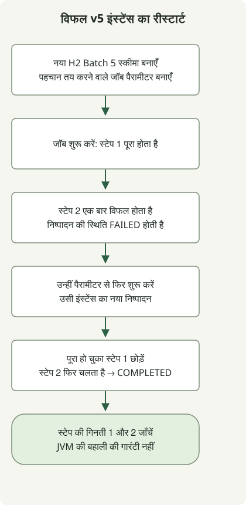

---
{
  "state": "draft",
  "language": "hi",
  "translationKey": "2023-10-27-springbatch5-migration",
  "title": "Spring Batch 5 में माइग्रेशन: स्कीमा, जॉब पैरामीटर और रीस्टार्ट",
  "description": "Spring Batch 5 के स्कीमा और जॉब पैरामीटर के माइग्रेशन की योजना बनाएँ। फिर नए H2 स्कीमा पर पैरामीटर के प्रकार, पूरे हो चुके इंस्टेंस और विफल स्टेप के रीस्टार्ट की जाँच करें।",
  "sourcePath": "src/content/posts/en/2023-10-27-springbatch5-migration.md",
  "sourceSha256": "688dd3a4a3f176f0d94406dbc3c73979ece0d8a4e0f23ca31a65de298e922d77"
}
---

Spring Batch 5 में जाने के लिए निर्भरताओं के साथ मेटाडेटा स्कीमा, सहेजे गए जॉब पैरामीटर का फ़ॉर्मैट, निष्पादन कॉन्टेक्स्ट और रीस्टार्ट नीति भी जाँचनी होती है। जिन कॉलम में डेटा है उन्हें पहले ही हटा देना या केवल टाइप कोड को क्लास नामों से बदल देना डेटा माइग्रेशन पूरा नहीं करता।

यह लेख Batch 5 में जाने के बारे में है। इसका लक्ष्य नवीनतम प्रमुख संस्करण अपनाना नहीं है। [आधिकारिक 5.0 माइग्रेशन गाइड](https://github.com/spring-projects/spring-batch/wiki/Spring-Batch-5.0-Migration-Guide) में माइग्रेशन के मुद्दे दिए हैं। नीचे का उदाहरण Batch 5 वातावरण में जॉब का व्यवहार जाँचता है।

## जॉब दोबारा चलने का क्रम



चित्र नए स्कीमा पर v5 रीस्टार्ट परीक्षण दिखाता है। इसमें v4 डेटाबेस का माइग्रेशन नहीं होता। उसी इंस्टेंस के दूसरे निष्पादन में विफल स्टेप फिर चलता है और पूरा हो चुका स्टेप पूरा ही रहता है।

## मौजूदा रिपॉज़िटरी बदलने से पहले

Batch 5 के लिए Java 17 या बाद का संस्करण चाहिए। Java EE के `javax.*` API को उनके Jakarta समकक्षों में बदलें। `javax.sql.DataSource` जैसे Java SE API को बनाए रखें।

पुरानी पैरामीटर तालिका में `TYPE_CD` और हर प्रकार के मान के लिए अलग कॉलम थे। नया स्कीमा `PARAMETER_TYPE` और `PARAMETER_VALUE` इस्तेमाल करता है। केवल `LONG` को `java.lang.Long` से बदलने पर मौजूदा LONG, DOUBLE और DATE मान न सुरक्षित होते हैं, न उनका अर्थ सही ढंग से बदलता है। लक्षित डेटाबेस और Batch संस्करण के साथ डेटाबेस की कॉपी पर रूपांतरण का अभ्यास करें। [Core JAR में अपने डेटाबेस के स्कीमा और माइग्रेशन स्क्रिप्ट](https://docs.spring.io/spring-batch/reference/5.2/schema-appendix.html) ढूँढें। प्रोडक्शन तालिकाओं पर नया स्कीमा बनाने की स्क्रिप्ट फिर चलाना माइग्रेशन का विकल्प नहीं है।

आधिकारिक गाइड में [पुराने डेटा तक पहुँच की सीमाएँ](https://github.com/spring-projects/spring-batch/wiki/Spring-Batch-5.0-Migration-Guide#historical-data-access-implications) भी दी हैं। v5 के कुछ JobExplorer कॉल v4 के निष्पादन पढ़ते समय विफल हो सकते हैं। गाइड के अनुसार विफल v4 इंस्टेंस को माइग्रेशन से पहले v4 पर सफलतापूर्वक दोबारा चलाएँ या कारोबारी निर्णय के आधार पर उन्हें छोड़ दें। यह न मानें कि v5 पुराने विफल v4 निष्पादन को सीधे शुरू कर सकता है। पैरामीटर रूपांतरण से अलग निष्पादन कॉन्टेक्स्ट के सीरियलाइज़ेशन की संगतता जाँचें।

## अपनी स्थिति के अनुसार शुरुआत करें

- **मौजूदा Batch 4 रिपॉज़िटरी:** बैकअप लें और डेटाबेस की कॉपी पर स्कीमा, पैरामीटर तथा निष्पादन कॉन्टेक्स्ट का रूपांतरण आज़माएँ। विफल v4 इंस्टेंस का निपटारा v4 पर ही करें। नीचे का उदाहरण v4 रिपॉज़िटरी का रूपांतरण या रीस्टार्ट नहीं करता।
- **नई Batch 5 रिपॉज़िटरी:** पैरामीटर के प्रकार, पूरे इंस्टेंस और विफल स्टेप के परीक्षण चलाएँ। ये एक ही प्रक्रिया में नए H2 स्कीमा पर तीन व्यवहार जाँचते हैं।
- **Batch जॉब वाली Boot ऐप्लिकेशन:** तय करें कि सेटअप और स्कीमा आरंभीकरण Boot सँभालेगा या आपकी स्पष्ट Batch सेटिंग। उदाहरण Spring की स्पष्ट सेटिंग इस्तेमाल करता है, Boot का ऑटो-कॉन्फ़िगरेशन नहीं।

यदि Boot का प्रमुख संस्करण भी बदल रहा है, तो रिपॉज़िटरी माइग्रेशन से अलग [Java और Jakarta माइग्रेशन की बुनियादी शर्तें](/en/posts/2023-09-08-springboot3-migration/) तय करें।

## नई Batch 5 रिपॉज़िटरी में व्यवहार जाँचें

उदाहरण को Gradle 8.4/JDK 17.0.8.1 पर चलाया गया था। इसमें Batch 5.2.4 और H2 2.3.232 के संस्करण Boot BOM 3.5.7 से तय हुए थे। ये संस्करण दर्ज परिणामों को दोहराने के लिए हैं। इन्हें आज के प्रोडक्शन संस्करण की सिफ़ारिश न मानें। नीचे की तीन फ़ाइलें एक खाली डायरेक्टरी में सहेजें।

यह प्रोजेक्ट Boot ऐप्लिकेशन शुरू करने के बजाय सीधे Spring टेस्ट कॉन्टेक्स्ट बनाता है। यह `@EnableBatchProcessing` इस्तेमाल करता है और अपना DataSource व ट्रांज़ैक्शन मैनेजर देता है। साथ में `DefaultBatchConfiguration` को एक्सटेंड नहीं करता। [Java कॉन्फ़िगरेशन के दस्तावेज़](https://docs.spring.io/spring-batch/reference/5.2/job/java-config.html) में ये दो वैकल्पिक तरीके हैं।

### `settings.gradle`

```groovy
rootProject.name = 'batch5-restart-example'
```

### `build.gradle`

```groovy
plugins { id 'java' }
repositories { mavenCentral() }
dependencies {
    testImplementation platform('org.springframework.boot:spring-boot-dependencies:3.5.7')
    testImplementation 'org.springframework.batch:spring-batch-core'
    testImplementation 'org.springframework:spring-jdbc'
    testImplementation 'com.h2database:h2'
    testImplementation 'org.junit.jupiter:junit-jupiter'
    testRuntimeOnly 'org.junit.platform:junit-platform-launcher'
}
test { useJUnitPlatform() }
```

### `src/test/java/example/BatchRestartTest.java`

```java
package example;

import java.util.Date;
import java.util.Set;
import java.util.concurrent.atomic.AtomicBoolean;
import java.util.concurrent.atomic.AtomicInteger;
import javax.sql.DataSource;

import org.junit.jupiter.api.AfterEach;
import org.junit.jupiter.api.BeforeEach;
import org.junit.jupiter.api.Test;
import org.springframework.batch.core.BatchStatus;
import org.springframework.batch.core.Job;
import org.springframework.batch.core.JobExecution;
import org.springframework.batch.core.JobParameters;
import org.springframework.batch.core.JobParametersBuilder;
import org.springframework.batch.core.Step;
import org.springframework.batch.core.configuration.annotation.EnableBatchProcessing;
import org.springframework.batch.core.job.builder.JobBuilder;
import org.springframework.batch.core.launch.JobLauncher;
import org.springframework.batch.core.repository.JobInstanceAlreadyCompleteException;
import org.springframework.batch.core.repository.JobRepository;
import org.springframework.batch.core.step.builder.StepBuilder;
import org.springframework.batch.repeat.RepeatStatus;
import org.springframework.beans.factory.annotation.Qualifier;
import org.springframework.context.annotation.AnnotationConfigApplicationContext;
import org.springframework.context.annotation.Bean;
import org.springframework.context.annotation.Configuration;
import org.springframework.jdbc.core.JdbcTemplate;
import org.springframework.jdbc.datasource.DataSourceTransactionManager;
import org.springframework.jdbc.datasource.embedded.EmbeddedDatabase;
import org.springframework.jdbc.datasource.embedded.EmbeddedDatabaseBuilder;
import org.springframework.jdbc.datasource.embedded.EmbeddedDatabaseType;
import org.springframework.transaction.PlatformTransactionManager;

import static org.junit.jupiter.api.Assertions.*;

class BatchRestartTest {
    AnnotationConfigApplicationContext context;
    Config config;
    JobLauncher launcher;
    Job job;

    @BeforeEach
    void open() {
        context = new AnnotationConfigApplicationContext(Config.class);
        config = context.getBean(Config.class);
        launcher = context.getBean(JobLauncher.class);
        job = context.getBean(Job.class);
    }

    @AfterEach
    void close() { context.close(); }

    JobParameters parameters() {
        return new JobParametersBuilder()
                .addLong("run.id", 1L)
                .addString("source", "example")
                .addDouble("ratio", 1.5)
                .addDate("day", new Date(0))
                .toJobParameters();
    }

    @Test
    void completedJobPersistsTypedParameters() throws Exception {
        JobExecution execution = launcher.run(job, parameters());
        assertEquals(BatchStatus.COMPLETED, execution.getStatus());
        var jdbc = new JdbcTemplate(context.getBean(DataSource.class));
        var types = jdbc.queryForList("select PARAMETER_TYPE from BATCH_JOB_EXECUTION_PARAMS", String.class);
        assertEquals(Set.of("java.lang.Long", "java.lang.String", "java.lang.Double", "java.util.Date"), Set.copyOf(types));
        assertEquals(4, types.size());
        assertEquals("1", jdbc.queryForObject("select PARAMETER_VALUE from BATCH_JOB_EXECUTION_PARAMS where PARAMETER_NAME = 'run.id'", String.class));
    }

    @Test
    void completedInstanceRejectsSameIdentifyingParameters() throws Exception {
        assertEquals(BatchStatus.COMPLETED, launcher.run(job, parameters()).getStatus());
        assertThrows(JobInstanceAlreadyCompleteException.class, () -> launcher.run(job, parameters()));
        assertEquals(1, config.firstRuns.get());
        assertEquals(1, config.secondRuns.get());
    }

    @Test
    void failedInstanceRestartsOnlyItsFailedStep() throws Exception {
        config.failOnce.set(true);
        JobExecution failed = launcher.run(job, parameters());
        assertEquals(BatchStatus.FAILED, failed.getStatus());
        JobExecution restarted = launcher.run(job, parameters());
        assertEquals(BatchStatus.COMPLETED, restarted.getStatus());
        assertEquals(failed.getJobInstance().getInstanceId(), restarted.getJobInstance().getInstanceId());
        assertNotEquals(failed.getId(), restarted.getId());
        assertEquals(1, config.firstRuns.get());
        assertEquals(2, config.secondRuns.get());
    }

    @Configuration
    @EnableBatchProcessing
    static class Config {
        final AtomicInteger firstRuns = new AtomicInteger();
        final AtomicInteger secondRuns = new AtomicInteger();
        final AtomicBoolean failOnce = new AtomicBoolean();

        @Bean(destroyMethod = "shutdown")
        EmbeddedDatabase dataSource() {
            return new EmbeddedDatabaseBuilder().generateUniqueName(true)
                    .setType(EmbeddedDatabaseType.H2)
                    .addScript("org/springframework/batch/core/schema-h2.sql").build();
        }

        @Bean
        PlatformTransactionManager transactionManager(DataSource dataSource) {
            return new DataSourceTransactionManager(dataSource);
        }

        @Bean
        Step firstStep(JobRepository repository, PlatformTransactionManager transactionManager) {
            return new StepBuilder("first", repository).tasklet((contribution, chunkContext) -> {
                firstRuns.incrementAndGet();
                return RepeatStatus.FINISHED;
            }, transactionManager).build();
        }

        @Bean
        Step secondStep(JobRepository repository, PlatformTransactionManager transactionManager) {
            return new StepBuilder("second", repository).tasklet((contribution, chunkContext) -> {
                secondRuns.incrementAndGet();
                if (failOnce.getAndSet(false)) throw new IllegalStateException("fixture failure");
                return RepeatStatus.FINISHED;
            }, transactionManager).build();
        }

        @Bean
        Job job(JobRepository repository, @Qualifier("firstStep") Step first,
                @Qualifier("secondStep") Step second) {
            return new JobBuilder("migrationCheck", repository).start(first).next(second).build();
        }
    }
}
```

## परीक्षण चलाएँ और नतीजे समझें

```sh
gradle --no-daemon clean test
```

तीन परीक्षण जाँचते हैं कि नए H2 स्कीमा में पैरामीटर अपने प्रकार के साथ सहेजे जाते हैं, समान पहचान पैरामीटर वाले पूरे हो चुके इंस्टेंस को फिर चलाने का प्रयास अस्वीकृत होता है और उसी विफल इंस्टेंस के नए निष्पादन में केवल उसका विफल स्टेप फिर चलता है। रीस्टार्ट के मामले में पहला स्टेप एक बार और दूसरा दो बार चलता है। काउंटर एक ही प्रक्रिया में रहते हैं, इसलिए इससे JVM रीस्टार्ट के बाद बहाली या बाहरी सिस्टम पर प्रभाव ठीक एक बार पड़ने की गारंटी सिद्ध नहीं होती।

यह उदाहरण **v4 डेटाबेस को v5 में नहीं बदलता**। प्रोडक्शन माइग्रेशन से पहले बैकअप और बहाली तैयार करें। फिर डेटाबेस की कॉपी पर हर प्रकार के मान, पुराने डेटा तक पहुँच, निष्पादन कॉन्टेक्स्ट और जॉब दोबारा चलाने की व्यावसायिक प्रक्रियाएँ जाँचें। नए स्कीमा पर परीक्षण पास होने से मौजूदा डेटा के साथ संगतता सिद्ध नहीं होती।

सेटिंग को Boot में लागू करते समय [Boot की Batch गाइड](https://docs.spring.io/spring-boot/3.5/how-to/batch.html) का एक नियम ध्यान रखें। `@EnableBatchProcessing` जोड़ने या `DefaultBatchConfiguration` को एक्सटेंड करने से Batch ऑटो-कॉन्फ़िगरेशन और उसके स्कीमा आरंभीकरण का समर्थन बंद हो जाता है। तय करें कि Boot का ऑटो-कॉन्फ़िगरेशन रखना है या सेटअप सीधे सँभालना है।

रनटाइम से जुड़े निर्णयों के लिए [JDK 21 के स्थायी और प्रीव्यू फ़ीचर](/en/posts/2023-09-20-jdk-21-release/) देखें। प्रकार वाले कॉन्फ़िगरेशन इनपुट के लिए [शेल स्क्रिप्ट में YAML से पोर्ट पढ़ने का उदाहरण](/en/posts/2021-07-27-parse-yaml/) देखें।
