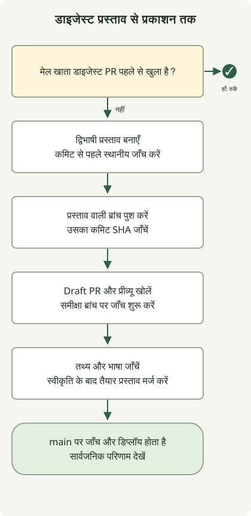

---
{
  "state": "draft",
  "language": "hi",
  "translationKey": "2026-04-07-jekyll-github-actions-content-pipeline",
  "title": "Jekyll के अपने आप प्रकाशन से Astro में Draft PR की समीक्षा तक",
  "description": "देखें कि द्विभाषी डाइजेस्ट कैसे तैयार होता है, उसके कमिट की जाँच कैसे होती है और Draft PR स्वीकृत होने पर वह कैसे प्रकाशित होता है। स्थानीय मॉक से GitHub को कॉल किए बिना समीक्षा स्क्रिप्ट चलाएँ।",
  "sourcePath": "src/content/posts/en/2026-04-07-jekyll-github-actions-content-pipeline.md",
  "sourceSha256": "12226531a63ffece862798351d0562f1f29cc2b14f9731dad4dd5fece0e77637"
}
---

सामग्री तैयार करने वाले प्रोग्राम का आउटपुट समीक्षा के लिए एक प्रस्ताव होना चाहिए। इस रिपॉज़िटरी में सामग्री बनने और CI सफल होने पर Draft PR खुलता है। प्रकाशन बाद में मर्ज और main ब्रांच के Pages वर्कफ़्लो से होता है।

अप्रैल की Jekyll पाइपलाइन Markdown लिखकर बनी हुई सामग्री पुश करती थी। अब साइट Astro इस्तेमाल करती है, नए द्विभाषी डाइजेस्ट JSON में रखती है और समीक्षा तक प्रस्तावित सामग्री को `main` से अलग रखती है। मौजूदा `_posts` फ़ाइलें और Ruby टूल पुरानी साइट का तरीका दिखाते हैं। आज प्रकाशन के लिए अलग कमांड चलता है।

## प्रस्तावित कमिट का रास्ता देखें



[सामग्री का वर्कफ़्लो](https://github.com/youdozi/youdozi.github.io/blob/main/.github/workflows/dev-content-pipeline.yml) केवल `main` पर नई सामग्री बनाता है। वह पहले इसी रिपॉज़िटरी से खुले `content/digest-review-` PR की तलाश करता है। ऐसा PR मिलने पर उसके मर्ज या बंद होने तक अगला प्रस्ताव रुका रहता है। यह नियम मैन्युअल प्रीव्यू पर भी लागू होता है।

कोई प्रस्ताव लंबित न हो तो `scripts/generate_digest.py` सामग्री एकत्र करके अंग्रेज़ी और कोरियाई संस्करण तैयार करती है। नई समीक्षा ब्रांच पर कमिट पुश करने से पहले बनी हुई फ़ाइल को `npm run check` और `npm run build` पास करने होते हैं। फिर साझा जाँच उसी कमिट SHA पर चलती है। समीक्षा जॉब के लिए सामग्री बनना और उसकी जाँच, दोनों सफल होने चाहिए। यह GitHub के [जॉब निर्भरता नियमों](https://docs.github.com/en/actions/how-tos/write-workflows/choose-what-workflows-do/use-jobs) के अनुरूप है।

समीक्षा जॉब जाँच के साक्ष्य दिखाता है, Draft PR बनाता है, समीक्षा के लिए प्रीव्यू URL जोड़ता है और समीक्षा ब्रांच पर साइट वर्कफ़्लो स्पष्ट रूप से शुरू करता है। प्रोडक्शन में डिप्लॉय की शर्त पूरी किए बिना भी उस ब्रांच की जाँच हो सकती है। जब ऑटोमेशन दूसरा वर्कफ़्लो शुरू करे, तब [टोकन से बनने वाले इवेंट के नियम](https://docs.github.com/en/actions/concepts/security/github_token) भी लागू होते हैं। अकेली सफल API रिक्वेस्ट से यह न मानें कि वर्कफ़्लो चल गया।

## GitHub को कॉल किए बिना समीक्षा का व्यवहार जाँचें

Node 24 इस्तेमाल करें और रिपॉज़िटरी के चेकआउट में `npm ci` चलाएँ। नीचे की पूरी फ़ाइल रिपॉज़िटरी के मूल में `review-contract.mjs` नाम से सहेजें और यह कमांड चलाएँ।

```sh
node review-contract.mjs
```

यह परीक्षण वास्तविक वर्कफ़्लो YAML पढ़ता है, उसके दो JavaScript अंश स्थानीय मॉक के साथ चलाता है और लंबित PR के पाँच मामलों के साथ बनाने, अपडेट करने और वर्कफ़्लो शुरू करने का क्रम जाँचता है। मॉक में मर्ज का कोई ऑपरेशन नहीं है। परीक्षण वर्कफ़्लो YAML निष्पादित नहीं करता, असली डाइजेस्ट नहीं बनाता और API को कॉल नहीं करता।

### `review-contract.mjs`

```javascript
import assert from 'node:assert/strict';
import { readFileSync } from 'node:fs';
import YAML from 'yaml';

const workflow = YAML.parse(readFileSync('.github/workflows/dev-content-pipeline.yml', 'utf8'));
const { generate, validate, review } = workflow.jobs;
assert.equal(generate.if, "github.ref == 'refs/heads/main'");
assert.deepEqual(review.needs, ['generate', 'validate']);
assert.equal(validate.with.ref, '${{ needs.generate.outputs.commit_sha }}');
assert.equal(validate.uses, './.github/workflows/site-checks.yml');
assert.equal(workflow.jobs.publish, undefined);

const AsyncFunction = Object.getPrototypeOf(async function () {}).constructor;
const pendingScript = generate.steps.find(step => step.id === 'pending').with.script;
const runPending = new AsyncFunction('github', 'context', 'core', pendingScript);
const context = { repo: { owner: 'example', repo: 'blog' } };
const summary = { addRaw() { return this; }, async write() {} };
const cases = [
    [[], false],
    [[{ head: { repo: { full_name: 'example/blog' }, ref: 'content/digest-review-1' }, html_url: 'mock' }], true],
    [[{ head: { repo: { full_name: 'other/blog' }, ref: 'content/digest-review-1' } }], false],
    [[{ head: { repo: { full_name: 'example/blog' }, ref: 'content/manual-1' } }], false],
    [[{ head: { repo: null, ref: 'content/digest-review-1' } }], false],
];
for (const [pulls, expected] of cases) {
    let exists;
    const github = { rest: { pulls: { list() {} } }, paginate: async () => pulls };
    const core = { summary, setOutput(key, value) { if (key === 'exists') exists = value; } };
    await runPending(github, context, core);
    assert.equal(exists, expected);
}

const calls = [];
const github = { rest: {
    pulls: {
        async create(payload) { calls.push(['create', payload]); return { data: { number: 42, html_url: 'mock-pr' } }; },
        async update(payload) { calls.push(['update', payload]); },
    },
    actions: { async createWorkflowDispatch(payload) { calls.push(['dispatch', payload]); } },
} };
const core = { summary, setOutput() {} };
const requireMock = name => {
    assert.equal(name, 'node:fs');
    return { readFileSync: () => 'Mock review body' };
};
const script = review.steps.find(step => step.id === 'pr').with.script;
const runReview = new AsyncFunction('require', 'github', 'context', 'core', 'process', script);
await runReview(requireMock, github,
    { ...context, serverUrl: 'https://github.com', runId: 7 }, core,
    { env: { REVIEW_BRANCH: 'content/digest-review-7-1' } });
assert.deepEqual(calls.map(call => call[0]), ['create', 'update', 'dispatch']);
assert.equal(calls[0][1].draft, true);
assert.equal(calls[0][1].base, 'main');
assert.equal(calls[0][1].head, 'content/digest-review-7-1');
assert.equal(calls[2][1].workflow_id, 'site-quality-gates.yml');
assert.equal(calls[2][1].ref, calls[0][1].head);
console.log('5 pending-PR cases and the mocked draft/create-update-dispatch sequence passed.');
```

जाँच में यह आउटपुट मिला।

```text
5 pending-PR cases and the mocked draft/create-update-dispatch sequence passed.
```

पाँच इनपुट ये स्थितियाँ अलग करते हैं: कोई लंबित PR नहीं है, इसी रिपॉज़िटरी का मेल खाता डाइजेस्ट PR है, दूसरी रिपॉज़िटरी का PR है, स्थानीय ब्रांच अलग है या head रिपॉज़िटरी अनुपलब्ध है। परीक्षण पास होने से स्क्रिप्ट का चुना हुआ व्यवहार जाँचा जाता है। इससे GitHub टोकन की अनुमतियाँ, ब्रांच सुरक्षा, स्रोत की सटीकता या पूरा होस्टेड वर्कफ़्लो नहीं जाँचा जाता।

## प्रस्ताव माँगें और तय करें कि क्या प्रकाशित करना है

**Actions → Dev Content Pipeline → Run workflow** में `main` चुनें। समीक्षा के लिए सामग्री तैयार करने हेतु `preview` को अचिह्नित रखें। अभ्यास के लिए इसे चुनें: उस स्थिति में `--dry-run --force --max-items 2` चलता है और कोई प्रस्ताव कमिट नहीं होता। पहले से लंबित डाइजेस्ट हो तो नई सामग्री बनना फिर भी रुका रहता है। GitHub के [वर्कफ़्लो मैन्युअल रूप से चलाने के निर्देश](https://docs.github.com/en/actions/how-tos/manage-workflow-runs/manually-run-a-workflow) देखें।

Draft PR और उसका द्विभाषी प्रीव्यू खोलें। स्रोत की तारीख, मूल दावा, उसका आधार, अनुवाद का दायरा और लिंक जाँचें। तय करें कि सामग्री प्रकाशन योग्य है या नहीं। कोड और स्कीमा की स्वचालित जाँच यह संपादकीय निर्णय नहीं ले सकती। ज़रूरत हो तो प्रस्ताव बदलें, नए कमिट की जाँच की पुष्टि करें, फिर PR को समीक्षा के लिए तैयार चिह्नित करें और प्रकाशन की स्वीकृति मिलने पर मर्ज करें। ड्राफ़्ट को केवल तैयार चिह्नित करने से वह डिप्लॉय नहीं होता।

[गुणवत्ता जाँच का लेख](/hi/posts/2026-04-07-jekyll-quality-gates-proof-html-bundler-audit/) बताता है कि सफल PR में भी डिप्लॉय क्यों छूट सकता है और मर्ज के बाद क्या जाँचना है। पुराने Ruby वातावरण के लिए [Jekyll की बिल्ड समस्या का विवरण](/hi/posts/2026-04-07-ruby-rbenv-jekyll-build-troubleshooting/) देखें।
