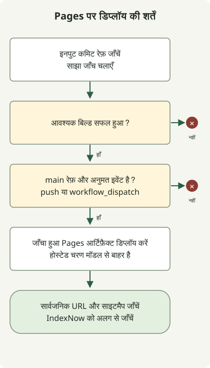

---
{
  "state": "draft",
  "language": "hi",
  "translationKey": "2026-04-07-jekyll-quality-gates-proof-html-bundler-audit",
  "title": "Astro की गुणवत्ता जाँच: सफल PR अपने आप डिप्लॉय क्यों नहीं होता?",
  "description": "Astro की जाँच और GitHub Pages पर प्रकाशन की शर्तें अलग हैं। मॉडल के 24 मामलों और छह जानबूझकर किए गए बदलावों से कमिट रेफ़, बिल्ड की सफलता और डिप्लॉय की शर्तें जाँचें।",
  "sourcePath": "src/content/posts/en/2026-04-07-jekyll-quality-gates-proof-html-bundler-audit.md",
  "sourceSha256": "f5c09678ab191654be64bc9fd457df828066c7f199625a6b32c5d94a02200363"
}
---

PR का बिल्ड सफल होने का अर्थ है कि उसके लिए तय जाँचें पास हुईं। इस साइट पर प्रस्तावित बदलाव को प्रोडक्शन में प्रकाशित करने के लिए `main` रेफ़, अनुमत इवेंट और उस बिल्ड की सफलता भी ज़रूरी है जिस पर डिप्लॉय निर्भर है।

पुराने Jekyll सेटअप में `proof-html` और `bundler-audit` चलते थे। मौजूदा Astro सेटअप में जाँच के लिए `site-checks.yml` और Pages पर डिप्लॉय करने के लिए `site-quality-gates.yml` है। Ruby की जाँच पुराने टूल पर लागू होती है। इससे साइट बनाने वाली npm निर्भरताओं का ऑडिट नहीं होता।

## जाँच और डिप्लॉय की शर्तें



[साइट का वर्कफ़्लो](https://github.com/youdozi/youdozi.github.io/blob/main/.github/workflows/site-quality-gates.yml) साझा जाँच को `${{ github.sha }}` देता है। [दोबारा इस्तेमाल होने वाला वर्कफ़्लो](https://github.com/youdozi/youdozi.github.io/blob/main/.github/workflows/site-checks.yml) उसी इनपुट रेफ़ को चेकआउट करता है। उसमें एक बिल्ड जॉब है और रिपॉज़िटरी की सामग्री केवल पढ़ने की अनुमति है। कॉल करने वाला वर्कफ़्लो चालू न करे तो Pages आर्टिफ़ैक्ट का विकल्प false रहता है। GitHub का [`workflow_call` दस्तावेज़](https://docs.github.com/en/actions/how-tos/reuse-automations/reuse-workflows) इस इंटरफ़ेस को समझाता है।

हर जाँच अलग तरह की विफलता पकड़ती है।

| जाँच | इससे क्या पता चलता है |
| --- | --- |
| Python और Node टेस्ट | सामग्री संग्रह, भाषा, प्रकाशन और रेंडरिंग के जाँचे गए नियम |
| लेखों से निकाले गए उदाहरण | दर्ज टूलचेन पर उदाहरणों के चुने गए मामलों का परिणाम |
| `npm run check` | सामग्री के नियम और Astro के टाइप व स्कीमा की जाँच |
| `npm run build` | स्टैटिक आउटपुट, आंतरिक लिंक, चित्र, एंकर और माइग्रेशन का कवरेज |

आंतरिक लिंक जाँचने से बाहरी URL की उपलब्धता सिद्ध नहीं होती। एक उदाहरण सफल होने से प्रोडक्शन का हर व्यवहार नहीं जाँचा जाता, और सही संरचना वाले लेख में भी कोई दावा बिना आधार के हो सकता है। चालू वर्कफ़्लो npm की सभी निर्भरताओं की कमज़ोरियों का सामान्य ऑडिट भी नहीं करता।

## डिप्लॉय के चुने हुए नियमों की जाँच दोहराएँ

Node 24 के साथ इस रिपॉज़िटरी के चेकआउट में `npm ci` चलाएँ। नीचे की पूरी फ़ाइल रिपॉज़िटरी के मूल में `deploy-contract.mjs` नाम से सहेजें और यह कमांड चलाएँ।

```sh
node deploy-contract.mjs
```

स्क्रिप्ट पहले वास्तविक YAML मान जाँचती है, फिर इनपुट के 24 संयोजनों पर तय डिप्लॉय शर्त का मॉडल चलाती है। जानबूझकर बदले गए छह वर्कफ़्लो ऑब्जेक्ट में से हर एक को नियम की जाँच में विफल होना चाहिए। स्क्रिप्ट न तो डिप्लॉय करती है, न नेटवर्क कॉल करती है।

### `deploy-contract.mjs`

```javascript
import assert from 'node:assert/strict';
import { readFileSync } from 'node:fs';
import YAML from 'yaml';

const read = file => YAML.parse(readFileSync(`.github/workflows/${file}`, 'utf8'));
const site = read('site-quality-gates.yml');
const checks = read('site-checks.yml');
const condition = "github.ref == 'refs/heads/main' && (github.event_name == 'push' || github.event_name == 'workflow_dispatch')";
function verify(site, checks) {
    assert.equal(site.jobs.deploy.if, condition);
    assert.equal(site.jobs.deploy.needs, 'build');
    assert.equal(site.jobs.build.with.ref, '${{ github.sha }}');
    assert.equal(site.jobs.build.with.pages_artifact, '${{ ' + condition + ' }}');
    assert.deepEqual(Object.keys(checks.jobs), ['build']);
    assert.deepEqual(checks.permissions, { contents: 'read' });
    assert.equal(checks.on.workflow_call.inputs.pages_artifact.default, false);
    assert.equal(checks.jobs.build.steps[0].with.ref, '${{ inputs.ref }}');
    assert.ok(site.jobs.deploy.steps.some(step => step.uses === 'actions/deploy-pages@v4'));
}
verify(site, checks);

// A model of this fixed condition and successful dependency, not the Actions engine.
function allowed(ref, event, build) {
    return build === 'success' && ref === 'refs/heads/main' &&
        (event === 'push' || event === 'workflow_dispatch');
}
const expected = new Set([
    'refs/heads/main|push|success',
    'refs/heads/main|workflow_dispatch|success',
]);
let cases = 0;
for (const ref of ['refs/heads/main', 'refs/heads/develop', 'refs/heads/content/example', 'refs/pull/42/merge']) {
    for (const event of ['push', 'workflow_dispatch', 'pull_request']) {
        for (const build of ['success', 'failure']) {
            assert.equal(allowed(ref, event, build), expected.has(`${ref}|${event}|${build}`));
            cases++;
        }
    }
}

const mutations = [
    (site, checks) => { site.jobs.deploy.if = "github.event_name == 'pull_request'"; },
    (site, checks) => { site.jobs.deploy.needs = []; },
    (site, checks) => { site.jobs.build.with.ref = 'main'; },
    (site, checks) => { checks.permissions.pages = 'write'; },
    (site, checks) => { checks.on.workflow_call.inputs.pages_artifact.default = true; },
    (site, checks) => { checks.jobs.build.steps[0].with.ref = 'main'; },
];
for (const mutate of mutations) {
    const badSite = structuredClone(site), badChecks = structuredClone(checks);
    mutate(badSite, badChecks);
    assert.throws(() => verify(badSite, badChecks), assert.AssertionError);
}
console.log(`${cases} policy-model combinations and ${mutations.length} rejected workflow mutations passed.`);
```

जाँच में यह आउटपुट मिला।

```text
24 policy-model combinations and 6 rejected workflow mutations passed.
```

मॉडल केवल `main` पर `push` या `workflow_dispatch` के सफल बिल्ड को अनुमति देता है। स्वयं शुरू की गई फ़ीचर ब्रांच सहित बाकी सभी संयोजन अस्वीकृत होते हैं। `pull_request` रन सामान्यतः पुल रिक्वेस्ट का मर्ज रेफ़ इस्तेमाल करता है, इसलिए उसका सफल होना इस साइट की डिप्लॉय शर्त पूरी नहीं करता। GitHub के दस्तावेज़ों में [जॉब की शर्तें](https://docs.github.com/en/actions/how-tos/write-workflows/choose-when-workflows-run/control-jobs-with-conditions) और [निर्भर जॉब की सफलता के नियम](https://docs.github.com/en/actions/how-tos/write-workflows/choose-what-workflows-do/use-jobs) दिए हैं।

मॉडल चुनी गई रेफ़ और इवेंट की शर्त तथा सफल बिल्ड की आवश्यकता जाँचता है। यह Actions एक्सप्रेशन इंटरप्रेटर नहीं है। यह सफलता और विफलता जाँचता है। इसमें रद्द किए गए रन, छोड़े गए पूर्ववर्ती जॉब, रनर शेड्यूलिंग, टोकन अनुमतियाँ, आर्टिफ़ैक्ट की उत्पत्ति या Pages डिप्लॉय का अनुकरण नहीं होता। नीति बदलने पर YAML की जाँच विफल होती है ताकि बदलाव की समीक्षा हो और पुराने मॉडल का परिणाम नई सेटिंग पर चुपचाप लागू न हो।

## प्रकाशित परिणाम की पुष्टि करें

प्रस्ताव स्वीकृत और मर्ज होने के बाद main के रन का कमिट, बिल्ड परिणाम और डिप्लॉय जॉब देखें। सफल PR रन में `deploy: skipped` अपेक्षित है। अकेले बिल्ड की सफलता प्रकाशन का प्रमाण नहीं है। Pages जॉब [Astro के Pages डिप्लॉय तरीके](https://docs.astro.build/en/guides/deploy/github/) के अनुसार जाँचा हुआ आर्टिफ़ैक्ट इस्तेमाल करता है।

सार्वजनिक लेख और उसके भाषा लिंक खोलें, फिर canonical URL, स्रोत की तारीखें और साइटमैप की प्रविष्टि जाँचें। IndexNow डिप्लॉय के बाद ऐसे चरणों में चलता है जिनकी विफलता सहन की जाती है। इसलिए Pages सफल होने पर भी IndexNow विफल हो सकता है। सूचना स्वीकार होना और साइटमैप में URL मिलना भी सर्च इंजन में इंडेक्स होने या इम्प्रेशन मिलने का प्रमाण नहीं है।

[प्रस्तावित सामग्री के वर्कफ़्लो का लेख](/hi/posts/2026-04-07-jekyll-github-actions-content-pipeline/) इससे पहले होने वाली Draft PR समीक्षा समझाता है। तकनीकी जाँच और प्रकाशन का निर्णय अलग ज़िम्मेदारियाँ हैं। दोनों के साथ लेख के दावों की जाँच भी ज़रूरी है।
