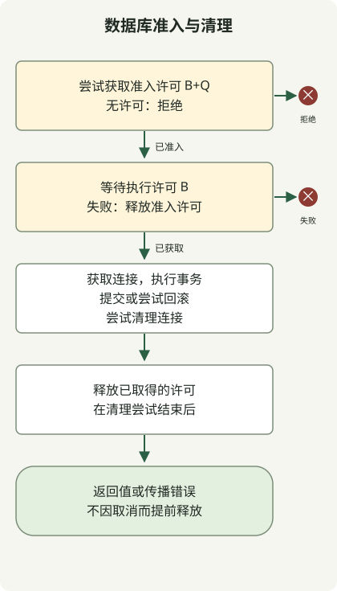

使用虚拟线程并不意味着必须在数据库前增加信号量。连接池已经限制了连接数。当你希望**更早地拒绝数据库工作、限制获准进入的操作数量，或为特定工作负载分配并发预算**时，额外的信号量才有用。Oracle 的虚拟线程指南也说明，数据库连接池本身就起着信号量的作用。[Oracle 虚拟线程指南](https://docs.oracle.com/en/java/javase/25/core/virtual-threads.html)

本文承接 [JDK 21–25 虚拟线程对比](/en/posts/2026-10-31-virtual-threads-jdk21-jdk25/)，进一步讨论数据库连接，并将 [10k RPS 架构](/en/posts/2026-10-31-jdk-10k-rps-architecture/)中讨论的整体准入控制落实到数据库工作的边界。适用范围是 Java 21 及以上版本，且一次同步 JDBC 事务使用一个连接。信号量应由应用实例内的各个请求共享，不要为每个请求创建一个新的信号量。

## 已有连接池时，还应该限制什么？

虚拟线程让大量等待中的任务只需相对较低的线程开销就能保留下来。但虚拟线程本身不会提高数据库的查询处理能力，也不会减少锁竞争。连接池已满时，等待获取连接的请求仍然占用内存并保留请求状态。

| 情况 | 优先采用的控制措施 |
| --- | --- |
| 连接数量限制和连接池的等待时限已经足够 | 保持现有连接池配置 |
| 希望在过载请求进入连接池之前将其拒绝 | 增加准入控制 |
| 批处理工作负载或高开销查询独占连接 | 为不同工作负载设置预算；必要时拆分连接池 |
| 慢 SQL 或锁导致连接被占用过久 | 首先检查查询、索引、事务和数据库限制 |

HikariCP 的 `maximumPoolSize` 限制池中的连接数。如果没有可用连接，`getConnection()` 会等待最多 `connectionTimeout`，随后抛出异常。该超时的最小值为 250ms。将信号量等待时间设为 20ms，并不会让连接池的等待也在 20ms 内结束。[HikariCP 配置](https://github.com/brettwooldridge/HikariCP#configuration-knobs-baby)

## 同时限制执行量和准入总量

示例使用两个信号量。

- **B 个执行许可：**限制从获取连接到事务和连接清理结束期间，正在进行的操作数量。
- **B+Q 个准入许可：**限制此关卡内的所有操作，包括等待执行许可的操作。没有剩余准入许可时立即拒绝。

当 B 个执行许可全部被占用时，最多还能保留 Q 个额外获准进入的操作。不过，任务也可能在获取执行许可之前被调度，因此这不意味着每一时刻的等待者数量都严格限制在 Q 以内。仅限制等待时间的单个信号量，无法限制已获准进入的等待者数量。



数据库资源框概括了内部异常路径。如果获取连接失败，跳过工作并进入许可释放流程。如果事务初始化失败，尝试清理已获取的连接。如果工作或提交失败，尝试回滚。

如果准入失败，就没有需要释放的许可。如果执行许可获取失败，或等待线程被中断，仅释放准入许可。取得两个许可后，应等待获取连接、事务处理和清理流程正常结束或因异常退出后，再释放许可。**不要仅因为调用方超时，就从另一个线程释放许可。**如果实际数据库工作仍在继续，这样做可能突破配置的执行上限。

## 如何选择 B、Q 和连接池大小？

B 统计的是并发数据库操作数，而不是每秒请求数。它包括获取连接的等待、提交和清理，因此实际 SQL 并发量可能低于 B。应根据数据库饱和度、连接持有时间和其他工作负载的预算进行测量后选择 B。Q 是过载时额外允许进入的操作数量，选择时应同时考虑等待预算和内存。

例如，连接池 P=24、关卡 B=16 时，通过此关卡同时进行的操作最多为 16 个。剩下的 8 个连接并没有为其他工作预留。共享同一连接池、但不经过此关卡的调用方，可能占用所有连接。即使为了隔离而拆分连接池，也应在数据库层面汇总各池的连接预算。

规划连接数限制时，应检查 `peak simultaneous instances × pool size per instance + batch, operations and other client connections ≤ DB connection budget`。实例峰值包括自动扩缩容，以及滚动部署期间新旧实例重叠的情况。`instance count × B` 仅限制经过此关卡的工作。这些数字只是计算示例，既不是推荐配置，也不是性能测量结果。

## 可运行的 JDBC 示例

示例中的关卡负责管理自己的事务和连接。回调必须同步执行，并且只能返回已完全加载的值。不要在回调中提交、回滚或更改自动提交设置。返回 `Connection`、`ResultSet` 或惰性查询流，或在回调中启动独立的异步数据库工作，都会超出此边界的保护范围。

### `DbBulkhead.java`

```java
import java.sql.Connection;
import java.sql.SQLException;
import java.time.Duration;
import java.util.Objects;
import java.util.concurrent.RejectedExecutionException;
import java.util.concurrent.Semaphore;
import java.util.concurrent.TimeUnit;
import javax.sql.DataSource;

public final class DbBulkhead {
    @FunctionalInterface
    public interface SqlWork<T> {
        T run(Connection connection) throws SQLException;
    }

    private final DataSource source;
    private final Semaphore slots;
    private final Semaphore running;

    public DbBulkhead(DataSource source, int concurrent, int extraSlots) {
        this.source = Objects.requireNonNull(source);
        if (concurrent < 1 || extraSlots < 0) {
            throw new IllegalArgumentException("invalid capacity");
        }
        slots = new Semaphore(Math.addExact(concurrent, extraSlots));
        running = new Semaphore(concurrent, true);
    }

    public <T> T transaction(Duration queueWait, SqlWork<T> work)
            throws SQLException, InterruptedException {
        Objects.requireNonNull(work);
        long nanos = queueWait.toNanos();
        if (nanos < 0) throw new IllegalArgumentException("negative wait");
        if (!slots.tryAcquire()) {
            throw new RejectedExecutionException("db admission full");
        }
        boolean acquired = false;
        try {
            acquired = running.tryAcquire(nanos, TimeUnit.NANOSECONDS);
            if (!acquired) {
                throw new RejectedExecutionException("db admission timed out");
            }
            try (Connection connection = source.getConnection()) {
                connection.setAutoCommit(false);
                try {
                    T value = work.run(connection);
                    connection.commit();
                    return value;
                } catch (SQLException | RuntimeException | Error failure) {
                    try {
                        connection.rollback();
                    } catch (SQLException rollbackFailure) {
                        failure.addSuppressed(rollbackFailure);
                    }
                    throw failure;
                }
            }
        } finally {
            if (acquired) running.release();
            slots.release();
        }
    }

    int available() { return running.availablePermits(); }
    int availableSlots() { return slots.availablePermits(); }
}
```

代码仅在成功获取 `running` 后才释放它，因此等待失败或中断不会导致许可数量增加。SQL 异常、运行时异常和错误都会触发回滚尝试；如果回滚失败，该失败会作为受抑制异常附加到原始异常。调用方只有在提交和连接的 `close()` 完成后才会收到返回值。如果提交失败，或提交后的连接清理失败，即使调用方收到异常，写入也可能已经生效。不要无条件重试写入。

即使是公平信号量，也不能保证每个请求的端到端处理顺序。示例在公平的执行信号量上使用限时获取，但在准入阶段使用立即获取。不带超时的 `tryAcquire()` 不遵守公平性设置。`available()` 方法用于观察实验状态；读取这些值后再单独决定是否准入，会产生竞态条件。[Semaphore API](https://docs.oracle.com/en/java/javase/25/docs/api/java.base/java/util/concurrent/Semaphore.html)

演示将连接池大小设为 2，B=1，Q=0。它检查第一个事务持有许可时，第二个操作是否被拒绝。通过 latch 短暂保持事务只是为了协调复现过程，并不是推荐的服务处理模式。

### `Demo.java`

```java
import com.zaxxer.hikari.HikariConfig;
import com.zaxxer.hikari.HikariDataSource;
import java.sql.SQLException;
import java.time.Duration;
import java.util.concurrent.CountDownLatch;
import java.util.concurrent.ExecutionException;
import java.util.concurrent.Executors;
import java.util.concurrent.RejectedExecutionException;
import java.util.concurrent.TimeUnit;

public class Demo {
    static HikariDataSource pool() {
        HikariConfig config = new HikariConfig();
        config.setJdbcUrl(System.getenv("DB_URL"));
        config.setUsername(System.getenv("DB_USER"));
        config.setPassword(System.getenv("DB_PASSWORD"));
        config.setMaximumPoolSize(2);
        config.setMinimumIdle(0);
        config.setConnectionTimeout(500);
        config.setValidationTimeout(250);
        return new HikariDataSource(config);
    }

    public static void main(String[] args) throws Exception {
        try (var pool = pool(); var tasks = Executors.newVirtualThreadPerTaskExecutor()) {
            var gate = new DbBulkhead(pool, 1, 0);
            var entered = new CountDownLatch(1);
            var release = new CountDownLatch(1);
            var first = tasks.submit(() -> gate.transaction(Duration.ZERO, connection -> {
                if (!Thread.currentThread().isVirtual()) throw new AssertionError();
                try (var statement = connection.createStatement()) {
                    statement.setQueryTimeout(2);
                    try (var rows = statement.executeQuery("SELECT 42")) {
                        rows.next();
                        int value = rows.getInt(1);
                        entered.countDown();
                        try {
                            if (!release.await(5, TimeUnit.SECONDS)) {
                                throw new SQLException("demo coordination timed out");
                            }
                        } catch (InterruptedException interrupted) {
                            Thread.currentThread().interrupt();
                            throw new SQLException("demo interrupted", interrupted);
                        }
                        return value;
                    }
                }
            }));
            try {
                if (!entered.await(5, TimeUnit.SECONDS)) throw new AssertionError("not entered");
                var second = tasks.submit(() -> gate.transaction(Duration.ZERO, c -> 0));
                try {
                    second.get(5, TimeUnit.SECONDS);
                    throw new AssertionError("must reject");
                } catch (ExecutionException failure) {
                    if (!(failure.getCause() instanceof RejectedExecutionException)) throw failure;
                    System.out.println("overload=rejected");
                }
            } finally {
                release.countDown();
            }
            System.out.println("query=" + first.get(5, TimeUnit.SECONDS));
            System.out.println("available=" + gate.available());
        }
    }
}
```

### `build.gradle`

```groovy
plugins { id 'application' }
repositories { mavenCentral() }
dependencies {
    implementation 'com.zaxxer:HikariCP:7.1.0'
    runtimeOnly 'org.postgresql:postgresql:42.7.14'
    runtimeOnly 'org.slf4j:slf4j-simple:2.0.20'
}
sourceSets.main.java {
    srcDirs = ['.']
    include 'DbBulkhead.java', 'Demo.java', 'DbBulkheadChecks.java'
}
tasks.withType(JavaCompile).configureEach { options.release = 21 }
application { mainClass = 'Demo' }
tasks.register('copyDependencies', Copy) {
    from configurations.runtimeClasspath
    into layout.buildDirectory.dir('deps')
}
tasks.register('contracts', JavaExec) {
    classpath = sourceSets.main.runtimeClasspath
    mainClass = 'DbBulkheadChecks'
}
```

### `settings.gradle`

```groovy
rootProject.name = 'virtual-threads-db-semaphore'
```

### 在本地运行

将上述四个文件保存在单独的实验目录中，并安装 Docker、JDK 21 和 Gradle 8.14.3。Gradle 在 JDK 21 上运行以下载依赖。随后编译和执行直接使用所选 JDK 的 `javac` 和 `java`，因此测试 JDK 25 时，无需让 Gradle 8.14.3 在 JDK 25 上运行。Gradle 本身要在 JDK 21 上运行，需要 8.5 或更高版本；本实验使用 8.14.3。[Gradle 对 Java 21 运行时的支持](https://docs.gradle.org/8.5/release-notes.html)

在 POSIX shell 中运行以下命令。`JAVA_HOME` 必须指向要用于执行的 JDK；下载依赖时请选择 JDK 21。示例密码仅用于临时本地数据库。如果端口 55432 已被占用，请选择其他端口。

```sh
(
  set -eu
  gradle --no-daemon -q copyDependencies
  db_container=$(docker run -d --rm -p 127.0.0.1:55432:5432 \
    -e POSTGRES_USER=demo -e POSTGRES_DB=demo \
    -e POSTGRES_PASSWORD=example-only \
    postgres@sha256:839fbb5a4942a7758dd93e18b42ea5649807491a0545b5eeeb8f0b8bb11857a5)
  trap 'docker stop "$db_container" >/dev/null' EXIT
  ready=false
  for attempt in $(seq 1 30); do
    if docker exec "$db_container" pg_isready -h 127.0.0.1 -U demo -d demo >/dev/null 2>&1; then
      ready=true
      break
    fi
    sleep 1
  done
  if [ "$ready" != true ]; then exit 1; fi
  mkdir -p build/classes
  "$JAVA_HOME/bin/javac" --release 21 -cp 'build/deps/*' \
    -d build/classes DbBulkhead.java Demo.java
  DB_URL='jdbc:postgresql://127.0.0.1:55432/demo?connectTimeout=2&socketTimeout=5' \
    DB_USER=demo DB_PASSWORD=example-only \
    "$JAVA_HOME/bin/java" -cp 'build/classes:build/deps/*' Demo
)
```

本地观察到的标准输出如下。HikariCP 的启动和关闭日志可能会单独输出。

```text
overload=rejected
query=42
available=1
```

验证环境为 Temurin 21.0.13+9 和 25.0.5+8、PostgreSQL 17.11、HikariCP 7.1.0 及 pgJDBC 42.7.14。补充检查在每个 JDK 上验证了 45 项条件：提交和回滚、准入超额、等待超时和中断、取消后工作继续执行、服务器端语句超时后的恢复、连接池耗尽，以及反复失败后的许可恢复。未进行 HTTP 负载测试或生产吞吐量测量。

## 超时和 Spring 事务中需要保留的边界

**区分等待超时与工作超时。**示例中的 `queueWait` 仅限制等待执行许可的时间。连接池获取、SQL 和锁等待、网络以及清理都有各自的预算。要实现整体请求截止时间，还需要额外设计，将剩余时间传递给各个阶段。此示例未实现这种端到端的截止时间传递。

PostgreSQL 的 `statement_timeout` 限制服务器端的语句执行时间，而 `lock_timeout` 限制获取锁的等待时间。实验在事务内设置了 `SET LOCAL statement_timeout = '100ms'`，检查 `pg_sleep(2)` 是否以 SQLState `57014` 失败，并验证后续工作能够继续。实际配置值应根据查询和截止时间选择。[PostgreSQL 17 超时设置](https://www.postgresql.org/docs/17/runtime-config-client.html)

无论是 `Future.cancel(true)`，还是结束 HTTP 请求，都不能保证立即终止 JDBC 查询。pgJDBC 对查询、取消信号发送和套接字读取分别设有限制。套接字超时后关闭连接，也不等于确认服务器端工作已经停止。在取消和清理期间，执行边界仍持有许可的所有权。如果写入结果不确定，应使用幂等键或查询结果，再决定是否重试。[pgJDBC 连接属性](https://jdbc.postgresql.org/documentation/use/)

**使用 Spring 时，应在启动事务之前取得准入许可。**可以在独立 bean 的非事务入口方法中先通过关卡，再调用事务代理；也可以在获准进入的范围内运行 `TransactionTemplate`。在代理调用或模板完成提交和清理并返回后，再释放许可。如果在事务已经开始的方法中等待，可能会继续占用外层事务的资源。不要将上面由代码负责管理 JDBC 资源的实现直接混入现有的 Spring 事务中。

`REQUIRES_NEW` 可能在保留外层事务连接的同时，还需要另一个连接。这打破了本示例中每个操作使用一个连接的假设，可能导致连接池耗尽或死锁等待。此关卡也不可重入；不要递归获取同一关卡。[Spring 事务传播与连接池耗尽警告](https://docs.spring.io/spring-framework/reference/data-access/transaction/declarative/tx-propagation.html)

在生产环境中，应将准入已满导致的拒绝与等待超时分开统计，并结合观察关卡等待时间、连接池等待时间、连接持有时间、SQL 耗时和锁等待。将拒绝映射为 HTTP 503 或其他响应时，应定义客户端重试预算，避免无限重试放大负载。不要仅根据拒绝次数提高 B，应结合数据库延迟和饱和度作出决定。
