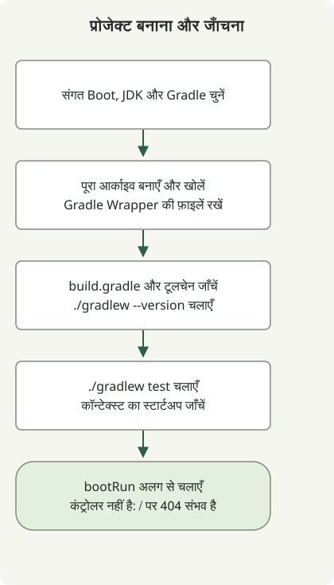

---
{
  "state": "draft",
  "language": "hi",
  "translationKey": "2023-09-07-springboot-initializer",
  "title": "Spring Initializr से Gradle प्रोजेक्ट बनाएँ और उसका परीक्षण करें",
  "description": "Spring Boot प्रोजेक्ट बनाकर Java और Gradle की सेटिंग जाँचें और Wrapper से टेस्ट चलाएँ। उदाहरण में काम करने वाले Boot 4.1.2 प्रोजेक्ट की चार मुख्य फ़ाइलें हैं।",
  "sourcePath": "src/content/posts/en/2023-09-07-springboot-initializer.md",
  "sourceSha256": "97a876012a6c3d2dbf40856ed6360dc850f12741aecbd5ee7bd96023fb05275f"
}
---

Spring Initializr से प्रोजेक्ट बनाने के बाद IDE में काम शुरू करने से पहले प्रोजेक्ट के साथ मिले Gradle Wrapper से टेस्ट चलाएँ। प्रोजेक्ट बनाना, डिपेंडेंसी हल करना, JDK की संगतता और ऐप्लिकेशन शुरू होना अलग-अलग जाँचें। इससे पता चलता है कि गड़बड़ी किस चरण में हुई।

इस उदाहरण में Boot 4.1.2 और Java 17 वाला Gradle Groovy प्रोजेक्ट इस्तेमाल हुआ। इसे [start.spring.io](https://start.spring.io/) से 2026-10-27 को बनाया गया था। इसके Wrapper ने Gradle 9.8.2 चुना। सेवा की डिफ़ॉल्ट सेटिंग और उपलब्ध संस्करण बदलते हैं, इसलिए यही संयोजन हमेशा मिलने की उम्मीद न करें।

## प्रोजेक्ट बनाने से उसे चलाने तक



पूरा आर्काइव तैयार करने के बाद ही उसका Wrapper चलाएँ। कॉन्टेक्स्ट टेस्ट से पता चलता है कि टेस्ट कॉन्टेक्स्ट शुरू होता है। चल रहे HTTP ऐप्लिकेशन की जाँच अलग से होती है।

## प्रोजेक्ट की सेटिंग चुनें

| सेटिंग | उदाहरण | अर्थ |
| --- | --- | --- |
| Project / Language | Gradle - Groovy / Java | बिल्ड टूल और सोर्स कोड की भाषा |
| Spring Boot | 4.1.2 | उदाहरण बनाते समय उपलब्ध अंतिम रिलीज़ |
| Java / Packaging | 17 / Jar | सोर्स के लिए टूलचेन और पैकेज का फ़ॉर्मैट |
| Group / Artifact | example / demo | प्रोजेक्ट के पहचानकर्ता |
| Package name | example.demo | ऐप्लिकेशन का पैकेज |
| Dependencies | Spring Web | HTTP एंडपॉइंट के लिए डिपेंडेंसी |

UI में Generate पर क्लिक करें या इस URL से आर्काइव डाउनलोड करें। **अगली कमांड चलाने से पहले देखें कि पिछली कमांड सफल हुई है।** किसी मौजूदा प्रोजेक्ट की फ़ाइलें गलती से बदलने से बचने के लिए खाली डायरेक्टरी इस्तेमाल करें।

```sh
curl --fail --show-error --location 'https://start.spring.io/starter.zip?type=gradle-project&language=java&bootVersion=4.1.2&baseDir=demo&groupId=example&artifactId=demo&name=Demo&packageName=example.demo&packaging=jar&javaVersion=17&dependencies=web' --output demo.zip
unzip demo.zip
cd demo
./gradlew --version
./gradlew test
```

जब सेवा कोई संस्करण देना बंद कर देती है, तो प्रोजेक्ट बनाने वाला API उस संस्करण का अनुरोध अस्वीकार कर सकता है। [सेवा का मौजूदा मेटाडेटा](https://start.spring.io/metadata/client) और [Initializr का संदर्भ दस्तावेज़](https://docs.spring.io/initializr/docs/current/reference/html/) देखकर Boot, JDK और Gradle के परस्पर संगत संस्करण चुनें। उदाहरण में चुपचाप नए डिफ़ॉल्ट मान रखने से उसे दोहराने की शर्तें बदल जाती हैं।

## प्रोजेक्ट में बनी चार मुख्य फ़ाइलें जाँचें

नीचे चार मुख्य फ़ाइलों का फ़ॉर्मैट पढ़ने के लिए सरल रखा है। पूरे आर्काइव में Wrapper की स्क्रिप्ट, उसका JAR और सेटिंग, और रिसोर्स फ़ाइलें भी हैं। केवल ये चार फ़ाइलें खाली डायरेक्टरी में कॉपी करने से `./gradlew` नहीं बनता।

### `settings.gradle`

```groovy
rootProject.name = 'demo'
```

### `build.gradle`

```groovy
plugins {
    id 'java'
    id 'org.springframework.boot' version '4.1.2'
    id 'io.spring.dependency-management' version '1.1.7'
}
group = 'example'
version = '0.0.1-SNAPSHOT'
java {
    toolchain { languageVersion = JavaLanguageVersion.of(17) }
}
repositories { mavenCentral() }
dependencies {
    implementation 'org.springframework.boot:spring-boot-starter-webmvc'
    testImplementation 'org.springframework.boot:spring-boot-starter-webmvc-test'
    testRuntimeOnly 'org.junit.platform:junit-platform-launcher'
}
tasks.named('test') { useJUnitPlatform() }
```

### `src/main/java/example/demo/DemoApplication.java`

```java
package example.demo;

import org.springframework.boot.SpringApplication;
import org.springframework.boot.autoconfigure.SpringBootApplication;

@SpringBootApplication
public class DemoApplication {
    public static void main(String[] args) {
        SpringApplication.run(DemoApplication.class, args);
    }
}
```

### `src/test/java/example/demo/DemoApplicationTests.java`

```java
package example.demo;

import org.junit.jupiter.api.Test;
import org.springframework.boot.test.context.SpringBootTest;

@SpringBootTest
class DemoApplicationTests {
    @Test
    void contextLoads() {}
}
```

बने हुए Boot 4.1.2 प्रोजेक्ट में `spring-boot-starter-webmvc` और `spring-boot-starter-webmvc-test` हैं। Boot की अलग-अलग पीढ़ियों के अंश मिलाने के बजाय चुनी हुई रिलीज़ के लिए बनी सेटिंग से शुरू करें। [Boot 4.1.2 की आवश्यकताओं](https://docs.spring.io/spring-boot/4.1/system-requirements.html) के अनुसार Java 17 या बाद का संस्करण चाहिए। Gradle के लिए 8.x शृंखला में 8.14 या बाद का संस्करण, या फिर 9.x चाहिए।

## टेस्ट और ऐप्लिकेशन स्टार्टअप की अलग जाँच करें

`contextLoads()` पास होने का अर्थ है कि टेस्ट कॉन्टेक्स्ट शुरू हो गया। अभी कोई कंट्रोलर नहीं है, इसलिए `/` से मिला 404 उत्तर स्टार्टअप की विफलता नहीं दर्शाता। ऐप्लिकेशन अलग से चलाएँ और उसी टर्मिनल में Ctrl+C से बंद करें।

```sh
./gradlew bootRun
```

प्रोजेक्ट के साथ बनी `build.gradle` और [Gradle Wrapper की फ़ाइलें](https://docs.gradle.org/current/userguide/gradle_wrapper.html) एक साथ कमिट करें। Gradle का संस्करण और `java.toolchain` में दिया Java संस्करण अलग हैं। `./gradlew --version` से देखें कि कौन सा JVM Gradle चला रहा है। कंपाइलेशन और ऐप्लिकेशन चलाने के लिए चुना गया JDK इससे अलग हो सकता है।

इसके बाद [IntelliJ में प्रोजेक्ट खोलकर HTTP अनुरोध का उत्तर दें](/en/posts/2023-09-10-springboot-intellij-import/)। Boot और Framework की संस्करण संख्याएँ अलग क्यों हैं, यह जानने के लिए [Spring Boot की रिलीज़ का इतिहास और संस्करणों का संबंध](/en/posts/2023-09-13-springboot-history/) देखें।
