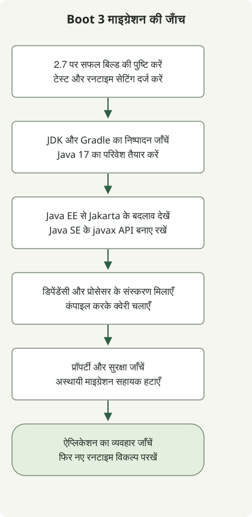

---
{
  "state": "draft",
  "language": "hi",
  "translationKey": "2023-09-08-springboot3-migration",
  "title": "Spring Boot 3 पर माइग्रेशन में Java 17, Jakarta और ऐप्लिकेशन की जाँच",
  "description": "Spring Boot 2.7 से 3.0 पर जाते समय Java 17, Jakarta डिपेंडेंसी और रनटाइम टेस्ट की जाँच करें। उस बदलाव की आवश्यकताओं और आज प्रोडक्शन के लिए संस्करण चुनने में अंतर समझें।",
  "sourcePath": "src/content/posts/en/2023-09-08-springboot3-migration.md",
  "sourceSha256": "4939fec22f416da9344b529b0e428c91a700920a27c10fdba00bdfd32e8a53a7"
}
---

Spring Boot 2.7 से 3.0 पर जाने से पहले पुष्टि करें कि ऐप्लिकेशन 2.7 पर ठीक चलता है। फिर Java 17 की आवश्यकता, Java EE से Jakarta में नेमस्पेस के बदलाव और लाइब्रेरी व रनटाइम की संगतता जाँचें। [3.0 की आधिकारिक माइग्रेशन गाइड](https://github.com/spring-projects/spring-boot/wiki/Spring-Boot-3.0-Migration-Guide) में यही क्रम दिया गया है। सफल कंपाइलेशन से अकेले यह साबित नहीं होता कि डेटाबेस मैपिंग, अनुमति जाँच और कॉन्फ़िगरेशन सही हैं।

यह **2.7 से 3.0 पर माइग्रेशन की गाइड** है, जिसका विषय मूल 2023 के लेख से लिया गया है। इसे आज Boot 3.0 डिप्लॉय करने की सिफ़ारिश न समझें। वास्तविक अपग्रेड के लिए ऐसा लक्ष्य संस्करण चुनें जिसे अभी समर्थन मिलता हो और बीच की रिलीज़ की माइग्रेशन गाइड भी देखें।

## माइग्रेशन की जाँच का क्रम



यहाँ माइग्रेशन की जाँच के लिए एक क्रम सुझाया गया है। कमांड परिवेश का निरीक्षण करती हैं। वे ऐप्लिकेशन या डेटाबेस को अपने आप माइग्रेट नहीं करतीं।

## 1. जाँचें कि ऐप्लिकेशन 2.7 पर चलता है

पुराने 2.x ऐप्लिकेशन को अगला प्रमुख संस्करण अपनाने से पहले 2.7.x शृंखला की अंतिम रिलीज़ तक अपडेट करें। सफल टेस्ट के परिणाम सहेजें और Wrapper, बिल्ड JVM और डिपेंडेंसी दर्ज करें। मौजूदा Wrapper वाले Gradle प्रोजेक्ट में इन कमांड से शुरू करें।

```sh
java -version
./gradlew --version
./gradlew clean test
./gradlew dependencies --configuration runtimeClasspath
```

अपग्रेड के बाद यही जाँचें दोहराएँ। कई प्रोजेक्ट वाले बिल्ड में डिपेंडेंसी रिपोर्ट ऐप्लिकेशन मॉड्यूल के लिए चलाएँ, जैसे `./gradlew :app:dependencies --configuration runtimeClasspath`। मॉड्यूल का नाम अपने प्रोजेक्ट के अनुसार रखें।

बदलाव से पहले डेटा सहेजने, उपयोगकर्ता की पहचान जाँचने, सीरियलाइज़ेशन, निर्धारित जॉब और बाहर भेजे जाने वाले HTTP अनुरोधों का परीक्षण करें। आख़िरी जाँच के लिए [स्थानीय MockWebServer के साथ WebClient टेस्ट](/hi/posts/2023-09-19-springboot-test-webclient/) एक ऐसा उदाहरण देते हैं जिसे आप दोहरा सकते हैं।

## 2. Java EE के इम्पोर्ट और डिपेंडेंसी एक साथ बदलें

Boot 3.0 को Java 17 और Spring Framework 6 चाहिए। Java EE के `javax.persistence` और `javax.servlet` जैसे पैकेज क्रमशः `jakarta.persistence` और `jakarta.servlet` में जाते हैं। Java SE के `javax.sql` और `javax.crypto` जैसे पैकेजों के नाम बने रहते हैं।

| मौजूदा उपयोग | माइग्रेशन में क्या करें |
| --- | --- |
| `javax.persistence.Entity` | `jakarta.persistence.Entity` और संगत JPA डिपेंडेंसी इस्तेमाल करें। |
| `javax.servlet.Filter` | `jakarta.servlet.Filter` और संगत सर्वलेट डिपेंडेंसी इस्तेमाल करें। |
| `javax.sql.DataSource` | Java SE का पैकेज नाम बनाए रखें। |
| `javax.crypto.Cipher` | Java SE का पैकेज नाम बनाए रखें। |

इम्पोर्ट के साथ यह भी देखें कि Gradle ने असल में कौन सी डिपेंडेंसी चुनी हैं। उदाहरण के लिए, `./gradlew dependencyInsight --dependency javax.servlet-api --configuration runtimeClasspath` से पुराने सर्वलेट आर्टिफ़ैक्ट का पता लगाया जा सकता है। खाली रिपोर्ट पूरे ऐप्लिकेशन का माइग्रेशन साबित नहीं करती। ऐप्लिकेशन की दूसरी लाइब्रेरी और वास्तविक कॉन्फ़िगरेशन भी जाँचें। [Gradle की डिपेंडेंसी रिपोर्ट](https://docs.gradle.org/current/userguide/viewing_debugging_dependencies.html) देखें।

Querydsl JPA के लिए [JPA और एनोटेशन प्रोसेसर के आर्टिफ़ैक्ट के संस्करण मिलाएँ](/hi/posts/2023-09-09-springboot3-querydsl/)। जहाँ उस आर्टिफ़ैक्ट शृंखला को Jakarta वेरिएंट की ज़रूरत हो, वहाँ वही चुनें। जाँचें कि एनोटेशन प्रोसेसिंग से अपेक्षित Q टाइप बनते हैं और प्रतिनिधि क्वेरी चलती हैं। Gradle का `configureEach` टास्क कॉन्फ़िगरेशन को नियंत्रित करता है। यह असंगत Java EE डिपेंडेंसी को Jakarta डिपेंडेंसी में नहीं बदल सकता।

## 3. बदले हुए प्रॉपर्टी नाम और अनुमति जाँच का व्यवहार देखें

Boot से प्रबंधित Gradle प्रोजेक्ट में प्रॉपर्टी के बदलाव पहचानने के लिए आधिकारिक माइग्रेशन गाइड यह अस्थायी सहायक देती है।

```groovy
dependencies {
    runtimeOnly 'org.springframework.boot:spring-boot-properties-migrator'
}
```

टेस्ट परिवेश में ऐप्लिकेशन शुरू करें, स्टार्टअप के डायग्नोस्टिक संदेश पढ़ें और प्रभावित प्रॉपर्टी अपडेट करें। माइग्रेशन पूरा होने पर सहायक हटा दें। लक्ष्य रिलीज़ के कॉन्फ़िगरेशन बदलाव भी पढ़ना ज़रूरी है।

Boot 3.0 में Spring Security 6 भी है। माइग्रेशन गाइड Spring Security 5.8 को पहले Boot 2.7 पर अपनाने और फिर 6.0 पर जाने का सुझाव देती है। अनुमति वाले, अस्वीकृत और बिना प्रमाणीकरण के अनुरोधों का परीक्षण करें। सर्वलेट ऐप्लिकेशन में error या forward डिस्पैच इस्तेमाल होते हैं तो उन्हें भी जाँचें। केवल सफल स्टार्टअप से अनुमति जाँच का व्यवहार पता नहीं चलता।

## 4. वर्चुअल थ्रेड का अलग परीक्षण करें

वर्चुअल थ्रेड चालू करने की सेटिंग **Boot 3.2 में JDK 21 के साथ** आई थी। Boot 3.0 में यह सुविधा नहीं थी।

```properties
spring.threads.virtual.enabled=true
```

यह बताता है कि सुविधा कब आई थी। इससे आज Boot 3.2 चुनने की सिफ़ारिश नहीं निकलती। पहले नेमस्पेस और डिपेंडेंसी माइग्रेशन की पुष्टि करें। फिर चुनी हुई रिलीज़, कनेक्शन पूल और थ्रेड-लोकल डेटा संबंधी मान्यताओं के साथ वर्चुअल थ्रेड का आकलन करें। केवल सेटिंग से प्रदर्शन में सुधार सिद्ध नहीं होता। [Boot 3.2 पर Spring का विवरण](https://spring.io/blog/2023/09/09/all-together-now-spring-boot-3-2-graalvm-native-images-java-21-and-virtual) देखें।

JDK के प्रीव्यू फ़ीचर की अपनी रिलीज़ शर्तें भी होती हैं। [String Templates की संगतता का उदाहरण](/en/posts/2023-09-23-jdk-21-string-templates/) दिखाता है कि प्रीव्यू फ़्लैग चालू करना अपग्रेड की हर समस्या का हल क्यों नहीं है।

<span id="decide-whether-the-application-is-ready"></span>

## कैसे तय करें कि माइग्रेशन तैयार है?

| जाँच | कौन सा प्रमाण जुटाएँ |
| --- | --- |
| बिल्ड और जनरेट हुआ कोड | सफल Wrapper बिल्ड, अपेक्षित Q टाइप और हल की गई डिपेंडेंसी के संस्करण। |
| रनटाइम व्यवहार | डेटा सहेजने, प्रमाणीकरण और प्रतिनिधि HTTP अनुरोधों के सफल टेस्ट। |
| कॉन्फ़िगरेशन | प्रॉपर्टी अपडेट हो गई हैं और माइग्रेशन सहायक की ज़रूरत ख़त्म हो गई है। |
| डिप्लॉयमेंट | डिप्लॉय होने वाला आर्टिफ़ैक्ट वास्तविक उपयोग जैसे परिवेश में जाँच पास करता है। |

ये कमांड आपके प्रोजेक्ट के लिए निदान का क्रम देती हैं। ये आपके ऐप्लिकेशन पर किए गए माइग्रेशन के परिणाम नहीं हैं। रोलबैक के लिए अपग्रेड से पहले का आर्टिफ़ैक्ट और कॉन्फ़िगरेशन उपलब्ध रखें। प्रमुख संस्करण का माइग्रेशन रखरखाव में मदद करता है, लेकिन सुरक्षा डिप्लॉय किए गए सटीक संस्करणों और कॉन्फ़िगरेशन पर निर्भर रहती है।
