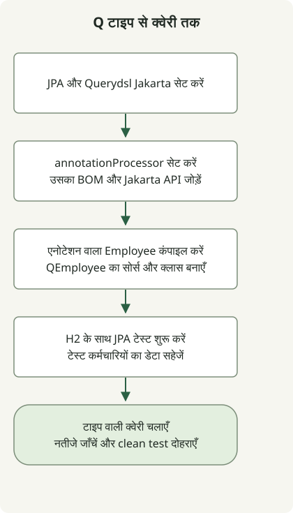

---
{
  "state": "draft",
  "language": "hi",
  "translationKey": "2023-09-09-springboot3-querydsl",
  "title": "Spring Boot 3 में Querydsl के लिए Jakarta सेट करें और Q टाइप बनाएँ",
  "description": "Jakarta डिपेंडेंसी और एनोटेशन प्रोसेसर के संस्करण मिलाकर Spring Boot 3 में Querydsl के Q टाइप बनाएँ। फिर क्लीन बिल्ड और H2 क्वेरी टेस्ट से परिणाम जाँचें।",
  "sourcePath": "src/content/posts/en/2023-09-09-springboot3-querydsl.md",
  "sourceSha256": "17f0353d5a048f80291207543b7abbb29e1d987ab0435009b82a4e1c16a7d953"
}
---

Spring Boot 3 में Querydsl JPA के Q टाइप बनाने के लिए `querydsl-jpa` और `querydsl-apt` के संस्करण मिलाएँ और दोनों के लिए `jakarta` क्लासिफ़ायर चुनें। एनोटेशन प्रोसेसिंग सेट करने के बाद क्लीन बिल्ड और डेटाबेस क्वेरी का टेस्ट चलाएँ। Querydsl के [5.0 रिलीज़ नोट्स](https://github.com/querydsl/querydsl/releases/tag/QUERYDSL_5_0_0) में Jakarta क्लासिफ़ायर के समर्थन का विवरण है। जनरेट होने वाले सोर्स के लिए Gradle के डिफ़ॉल्ट पथ रखने से मुख्य और टेस्ट कंपाइलेशन का आउटपुट एक ही डायरेक्टरी में लिखने की समस्या से बचते हैं।

इस गाइड में 2023 के मूल कोरियाई उदाहरण को चलाने योग्य बनाया गया है। नीचे दिए संस्करण प्रयोग को दोहराने के लिए तय किए गए हैं। आज के प्रोडक्शन की डिपेंडेंसी चुनने के लिए इन्हें सिफ़ारिश न मानें।

## Q टाइप बनने से क्वेरी चलने तक



मुख्य सोर्स के कंपाइलेशन में प्रोसेसर QEmployee बनाता है। फिर H2 का टेस्ट जनरेट हुए टाइप का इस्तेमाल करके क्वेरी चलाता है।

## प्रयोग का परिवेश और पूरा Gradle कॉन्फ़िगरेशन

| घटक | प्रयोग में इस्तेमाल संस्करण |
| --- | --- |
| JDK / Gradle | 17.0.8.1 / 8.4 |
| Spring Boot BOM | 3.5.7 |
| Querydsl JPA / APT | 5.1.0, दोनों के लिए `jakarta` क्लासिफ़ायर |
| Hibernate / H2 | 6.6.33.Final / 2.3.232, BOM से प्रबंधित |

नई डायरेक्टरी में ये पाँच फ़ाइलें बनाएँ। टेस्ट प्रोजेक्ट में Java प्लगइन और Boot BOM इस्तेमाल होते हैं। इसके लिए Boot Gradle प्लगइन की ज़रूरत नहीं है। किसी मौजूदा Boot ऐप्लिकेशन में डिपेंडेंसी प्रबंधन का चुना हुआ तरीका बनाए रखें और केवल ज़रूरी डिपेंडेंसी जोड़ें।

### `settings.gradle`

```groovy
rootProject.name = 'querydsl-jakarta-example'
```

### `build.gradle`

```groovy
plugins { id 'java' }
repositories { mavenCentral() }
dependencies {
    implementation platform('org.springframework.boot:spring-boot-dependencies:3.5.7')
    implementation 'org.springframework.boot:spring-boot-starter-data-jpa'
    implementation 'com.querydsl:querydsl-jpa:5.1.0:jakarta'

    annotationProcessor platform('org.springframework.boot:spring-boot-dependencies:3.5.7')
    annotationProcessor 'com.querydsl:querydsl-apt:5.1.0:jakarta'
    annotationProcessor 'jakarta.persistence:jakarta.persistence-api'
    annotationProcessor 'jakarta.annotation:jakarta.annotation-api'

    testImplementation 'org.springframework.boot:spring-boot-starter-test'
    testRuntimeOnly 'com.h2database:h2'
    testRuntimeOnly 'org.junit.platform:junit-platform-launcher'
}
test { useJUnitPlatform() }
```

Gradle सामान्य कंपाइल और रनटाइम क्लासपाथ से अलग `annotationProcessor` की डिपेंडेंसी हल करता है। इसीलिए उदाहरण में प्रोसेसर कॉन्फ़िगरेशन पर भी BOM लागू किया गया है और Jakarta Persistence व Annotation API स्पष्ट रूप से जोड़े गए हैं। `implementation` पर दी डिपेंडेंसी अपने आप प्रोसेसर को उपलब्ध नहीं होती। [Gradle Java प्लगइन का दस्तावेज़](https://docs.gradle.org/current/userguide/java_plugin.html) देखें।

## ऐप्लिकेशन और एंटिटी बनाएँ

ऐप्लिकेशन क्लास से JPA टेस्ट को Boot का कॉन्फ़िगरेशन मिलता है। टेस्ट चलाने के लिए अलग सर्वर प्रक्रिया शुरू करने की ज़रूरत नहीं है।

### `src/main/java/example/Application.java`

```java
package example;

import org.springframework.boot.SpringApplication;
import org.springframework.boot.autoconfigure.SpringBootApplication;

@SpringBootApplication
public class Application {
    public static void main(String[] args) {
        SpringApplication.run(Application.class, args);
    }
}
```

### `src/main/java/example/Employee.java`

```java
package example;

import jakarta.persistence.Entity;
import jakarta.persistence.GeneratedValue;
import jakarta.persistence.GenerationType;
import jakarta.persistence.Id;

@Entity
public class Employee {
    @Id
    @GeneratedValue(strategy = GenerationType.IDENTITY)
    private Long id;
    private String name;

    public String getName() { return name; }

    protected Employee() {}

    public Employee(String name) {
        this.name = name;
    }
}
```

`Employee` में `jakarta.persistence` इस्तेमाल होता है। `QEmployee` ख़ुद न लिखें। नीचे के टेस्ट में इस्तेमाल होने वाला यह टाइप एनोटेशन प्रोसेसर बनाता है।

## जनरेट हुए Q टाइप से क्वेरी करें

### `src/test/java/example/EmployeeQueryTest.java`

```java
package example;

import com.querydsl.jpa.impl.JPAQueryFactory;
import org.junit.jupiter.api.Test;
import org.springframework.beans.factory.annotation.Autowired;
import org.springframework.boot.test.autoconfigure.orm.jpa.DataJpaTest;
import org.springframework.boot.test.autoconfigure.orm.jpa.TestEntityManager;

import static org.assertj.core.api.Assertions.assertThat;

@DataJpaTest
class EmployeeQueryTest {
    @Autowired
    private TestEntityManager entityManager;

    @Test
    void findsEmployeeByName() {
        entityManager.persistAndFlush(new Employee("Alice"));
        entityManager.persistAndFlush(new Employee("Bob"));
        QEmployee employee = QEmployee.employee;
        var names = new JPAQueryFactory(entityManager.getEntityManager())
            .select(employee.name).from(employee)
            .where(employee.name.eq("Alice")).fetch();
        assertThat(names).containsExactly("Alice");
    }

    @Test
    void returnsNoRowsForMissingName() {
        entityManager.persistAndFlush(new Employee("Alice"));
        QEmployee employee = QEmployee.employee;
        var names = new JPAQueryFactory(entityManager.getEntityManager())
            .select(employee.name).from(employee)
            .where(employee.name.eq("Missing")).fetch();
        assertThat(names).isEmpty();
    }
}
```

`@DataJpaTest` उदाहरण के क्लासपाथ में मौजूद H2 इस्तेमाल करता है। हर टेस्ट एक ट्रांज़ैक्शन में चलता है और अंत में उसे रोलबैक किया जाता है। `persistAndFlush` से डेटा डालने के बाद जनरेट हुए `QEmployee` से दो जाँचें होती हैं। एक क्वेरी बिल्कुल वही नाम ढूँढ़ती है और दूसरी में कोई पंक्ति नहीं मिलती। [Spring Boot की JPA टेस्टिंग गाइड](https://docs.spring.io/spring-boot/3.5/reference/testing/spring-boot-applications.html#testing.spring-boot-applications.autoconfigured-spring-data-jpa-tests) देखें।

ये टेस्ट H2 पर इस एंटिटी और क्वेरी को जाँचते हैं। आपके प्रोडक्शन डेटाबेस की SQL बोली, टेक्स्ट तुलना व क्रम के नियम, लॉकिंग और माइग्रेशन व्यवहार की जाँच इनके दायरे से बाहर है।

## टेस्ट चलाएँ और बनी फ़ाइलें देखें

JDK 17 चुनें और स्थापित Gradle 8.4 इस्तेमाल करें। प्रोजेक्ट की मूल डायरेक्टरी से कमांड चलाएँ।

```sh
java -version
gradle --version
gradle --no-daemon clean test
```

ये जनरेट हुए आर्टिफ़ैक्ट और टेस्ट रिपोर्ट देखें।

```text
build/generated/sources/annotationProcessor/java/main/example/QEmployee.java
build/classes/java/main/example/QEmployee.class
build/reports/tests/test/index.html
```

इस कॉन्फ़िगरेशन में दोनों टेस्ट पास हुए। `clean test` दोहराने पर Q टाइप फिर बना और दोनों टेस्ट दोबारा पास हुए। मौजूदा प्रोजेक्ट में Gradle Wrapper हो तो `./gradlew clean test` से उसी का चुना संस्करण चलाएँ।

उदाहरण में जनरेट हुआ Q टाइप `javax.annotation.processing.Generated` इम्पोर्ट करता है, जो Java SE के `java.compiler` का API है। इस इम्पोर्ट को Jakarta नाम से बदलने की ज़रूरत नहीं है। [JDK 17 में Generated का API](https://docs.oracle.com/en/java/javase/17/docs/api/java.compiler/javax/annotation/processing/Generated.html) देखें।

<span id="troubleshoot-missing-or-duplicate-q-types"></span>

## Q टाइप क्यों नहीं मिलते या दो बार क्यों बनते हैं?

| लक्षण | पहले क्या जाँचें |
| --- | --- |
| `QEmployee` नहीं मिलता | CLI में `clean compileJava` का परिणाम, प्रोसेसर की डिपेंडेंसी और एंटिटी के `jakarta.persistence` इम्पोर्ट जाँचें। |
| प्रोसेसर को Persistence API नहीं मिलते | जाँचें कि ज़रूरी Jakarta API सामान्य क्लासपाथ से अलग प्रोसेसर पथ पर भी हैं। |
| असंगत `javax.persistence.EntityManager` टाइप दिखता है | दोनों Querydsl आर्टिफ़ैक्ट के संस्करण और Jakarta क्लासिफ़ायर मिलाएँ। |
| Q टाइप दो बार बनते हैं या बिल्ड सिर्फ़ clean के बाद चलता है | हाथ से लिखे Q सोर्स और साझा जनरेशन पथ हटाएँ। मुख्य और टेस्ट आउटपुट का कॉन्फ़िगरेशन जाँचें। |
| CLI सफल है लेकिन IDE को Q टाइप नहीं मिलते | Gradle सिंक, बिल्ड किसे सौंपा गया है और IDE की एनोटेशन प्रोसेसिंग जाँचें। |

इस उदाहरण में जनरेट हुई फ़ाइलों के लिए अलग `sourceSets`, `JavaCompile` या `clean` कॉन्फ़िगरेशन नहीं जोड़ा गया है। कस्टम पथ चाहिए तो मुख्य और टेस्ट आउटपुट अलग रखें। `configureEach` ज़रूरत पड़ने पर टास्क कॉन्फ़िगर करने का तरीका नियंत्रित करता है। इससे Jakarta डिपेंडेंसी की असंगतता दूर नहीं होती। [Gradle में अनावश्यक टास्क कॉन्फ़िगरेशन से बचने की गाइड](https://docs.gradle.org/current/userguide/lazy_configuration.html) देखें।

अपग्रेड के पूरे क्रम के लिए [Spring Boot 3 माइग्रेशन गाइड](/hi/posts/2023-09-08-springboot3-migration/) देखें। बाहर भेजे जाने वाले HTTP अनुरोधों को जाँचने के लिए [WebClient और MockWebServer के टेस्ट](/hi/posts/2023-09-19-springboot-test-webclient/) देखें।

## क्वेरी टूल बदलने से पहले तुलना करें

पूरी Employee क्लास में एक गेटर है ताकि रिपॉज़िटरी से मिले नतीजों की तुलना नाम से कर सकें। उसी एंटिटी पर आठ अतिरिक्त जाँचें चलाने के लिए [Querydsl और Specification की तुलना](/en/posts/2023-09-05-querydsl-no-release/) से तीन फ़ाइलें जोड़ें। ऊपर के दोनों मूल टेस्ट भी दस टेस्ट वाले उस प्रोजेक्ट में रहते हैं। यह H2 पर चुनी हुई क्वेरी शर्तों की तुलना है। इससे डेटाबेस का हर व्यवहार नहीं जाँचा जाता। [Spring Boot गाइड](/en/categories/springboot/) में सेटअप और परीक्षण के संबंधित चरण मिलेंगे।
