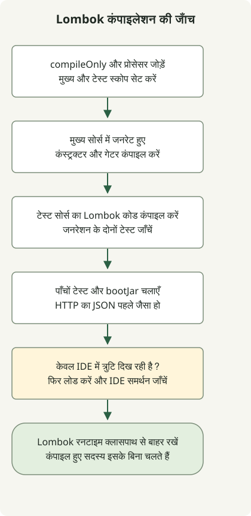

---
{
  "state": "draft",
  "language": "hi",
  "translationKey": "2023-09-15-springboot-intellij-lombok",
  "title": "IntelliJ में Lombok की समस्या सुलझाएँ और Gradle कंपाइलेशन अलग से जाँचें",
  "description": "मुख्य और टेस्ट सोर्स के लिए Lombok एनोटेशन प्रोसेसिंग सेट करें। जनरेट हुए कंस्ट्रक्टर, गेटर और JSON आउटपुट जाँचकर पता लगाएँ कि त्रुटि Gradle में है या IDE में।",
  "sourcePath": "src/content/posts/en/2023-09-15-springboot-intellij-lombok.md",
  "sourceSha256": "9fe45995bdaea610316410d2b79746c008656c5d20256f9de7d66bc47499dda1"
}
---

अगर Lombok से बनने वाले मेथड नहीं दिख रहे हैं, तो पहले `./gradlew clean test` चलाकर देखें कि बिल्ड भी विफल होता है या नहीं। IDE का समर्थन एडिटर को जनरेट हुए सदस्यों को पहचानने में मदद करता है। Gradle की एनोटेशन प्रोसेसर सेटिंग कंपाइलेशन के दौरान उन्हें बनाती है। दोनों की अपनी भूमिका है।

यह उदाहरण [Initializr प्रोजेक्ट](/hi/posts/2023-09-07-springboot-initializer/) और [HTTP उदाहरण](/en/posts/2023-09-10-springboot-intellij-import/) को आगे बढ़ाता है। इसमें Boot 4.1.2, Gradle 9.8.2 और JDK 17 इस्तेमाल हुए। BOM ने Lombok 1.18.48 चुना। यह एक ऐसा संयोजन है जो प्रयोग में चला था। JDK और Lombok के हर संयोजन के लिए संगतता की गारंटी नहीं है।

## Gradle के टेस्ट से IDE की जाँच तक



मुख्य और टेस्ट सोर्स को कंपाइल करते समय जनरेट हुए कंस्ट्रक्टर और गेटर अलग-अलग जाँचें। Wrapper के टेस्ट पास होने के बाद IDE में उनकी पहचान की समस्या सुलझाएँ।

## Gradle कंपाइलेशन सेट करें

मौजूदा `build.gradle` में यह ब्लॉक जोड़ें। जो घोषणाएँ पहले से हैं उन्हें दोबारा न जोड़ें।

```groovy
dependencies {
    compileOnly 'org.projectlombok:lombok'
    annotationProcessor 'org.projectlombok:lombok'
    testCompileOnly 'org.projectlombok:lombok'
    testAnnotationProcessor 'org.projectlombok:lombok'
}
```

[Gradle के लिए Lombok की आधिकारिक सेटिंग](https://projectlombok.org/setup/gradle) में मुख्य और टेस्ट सोर्स की कंपाइल डिपेंडेंसी और प्रोसेसर अलग हैं। टेस्ट वाली दोनों घोषणाएँ तभी चाहिए जब टेस्ट सोर्स भी Lombok एनोटेशन इस्तेमाल करे। नीचे के टेस्ट उस स्थिति को भी जाँचते हैं।

यहाँ संस्करण दिए बिना घोषणाएँ काम करती हैं क्योंकि प्रोजेक्ट में Boot प्लगइन और `io.spring.dependency-management` लागू हैं, जिससे [Boot का BOM इम्पोर्ट होता है](https://docs.spring.io/spring-boot/4.1/gradle-plugin/managing-dependencies.html)। साधारण Gradle प्रोजेक्ट में ज़रूरी घोषणाओं में एक ही संगत संस्करण स्पष्ट रूप से दें या उन कॉन्फ़िगरेशन के लिए अलग से डिपेंडेंसी प्रबंधन सेट करें।

## जनरेट हुए कंस्ट्रक्टर और गेटर इस्तेमाल करें

`Greeting` जोड़ें और मौजूदा कंट्रोलर की जगह नीचे वाला संस्करण रखें। HTTP टेस्ट बनाए रखें और Lombok की जाँच वाली टेस्ट क्लास जोड़ें।

### `src/main/java/example/demo/Greeting.java`

```java
package example.demo;

import lombok.Getter;
import lombok.RequiredArgsConstructor;

@Getter
@RequiredArgsConstructor
public class Greeting {
    private final String message;
}
```

### `src/main/java/example/demo/GreetingController.java`

```java
package example.demo;

import org.springframework.web.bind.annotation.GetMapping;
import org.springframework.web.bind.annotation.RestController;

@RestController
public class GreetingController {
    @GetMapping("/greeting")
    public Greeting greeting() {
        return new Greeting("Hello, Gradle");
    }
}
```

### `src/test/java/example/demo/LombokGenerationTest.java`

```java
package example.demo;

import lombok.Getter;
import lombok.RequiredArgsConstructor;
import org.junit.jupiter.api.Test;

import static org.junit.jupiter.api.Assertions.*;

class LombokGenerationTest {
    @Getter
    @RequiredArgsConstructor
    static class Expected {
        private final String message;
    }

    @Test
    void mainSourceConstructorAndGetterAreGenerated() {
        assertEquals("Hello, Gradle", new Greeting("Hello, Gradle").getMessage());
    }

    @Test
    void testSourceConstructorAndGetterAreGenerated() {
        assertEquals("test fixture", new Expected("test fixture").getMessage());
    }
}
```

```sh
./gradlew clean test bootJar
./gradlew dependencyInsight --configuration annotationProcessor --dependency lombok
```

अब पाँच टेस्ट हैं। एक कॉन्टेक्स्ट का, दो HTTP के और दो Lombok से कोड बनने के हैं। वे मुख्य और टेस्ट सोर्स में जनरेट हुए कंस्ट्रक्टर और गेटर को कॉल करते हैं। `/greeting` से वही JSON मिलता रहना चाहिए। इससे जनरेट हुए गेटर के ज़रिए सीरियलाइज़ेशन भी जँचता है।

Lombok की डिपेंडेंसी `compileOnly` है, इसलिए उदाहरण के एक्ज़ीक्यूटेबल JAR में यह रनटाइम लाइब्रेरी के रूप में शामिल नहीं होती। केवल IDE प्लगइन लगाने से Gradle कंपाइलेशन सफल नहीं हो जाता। इस सेटअप में पहले से कंपाइल किए गए गेटर का उपयोग करने के लिए Lombok को रनटाइम `implementation` डिपेंडेंसी बनाने की ज़रूरत नहीं है।

## जब केवल IDE त्रुटि दिखाए

Wrapper के टेस्ट पास हों तो Gradle प्रोजेक्ट फिर से लोड करें। [JetBrains के अनुसार](https://www.jetbrains.com/help/idea/annotation-processors-support.html) बिल्ड फ़ाइल से प्रोसेसर इम्पोर्ट होने पर एनोटेशन प्रोसेसिंग अपने आप चालू हो जाती है। हर बार हाथ से चेकबॉक्स बदलना ज़रूरी नहीं है।

फिर [IntelliJ के लिए Lombok गाइड](https://projectlombok.org/setup/intellij) से अपने IDE संस्करण में Lombok के समर्थन और प्लगइन के सक्रिय होने की जाँच करें। यह न मानें कि किसी एक एडिशन में हमेशा हाथ से इंस्टॉल करना होगा और दूसरे में प्लगइन हमेशा साथ आता है। यह भी देखें कि IDE अपना कंपाइलर इस्तेमाल करता है या बिल्ड Gradle को सौंपता है।

यदि जनरेट हुए सदस्य न मिलने से Gradle भी विफल हो, तो देखें कि कहीं `compileOnly` तो है लेकिन `annotationProcessor` छूट गया है। केवल टेस्ट विफल हों तो दोनों टेस्ट कॉन्फ़िगरेशन जाँचें। प्रयोग की जाँच करने वाली स्क्रिप्ट मुख्य और टेस्ट प्रोसेसर को बारी-बारी से हटाकर कंपाइलेशन विफल होने की पुष्टि करती है। उन्हें वापस जोड़कर वह फिर पाँचों टेस्ट पास होने की पुष्टि करती है। इन जाँचों में IDE के UI का संचालन शामिल नहीं है।
