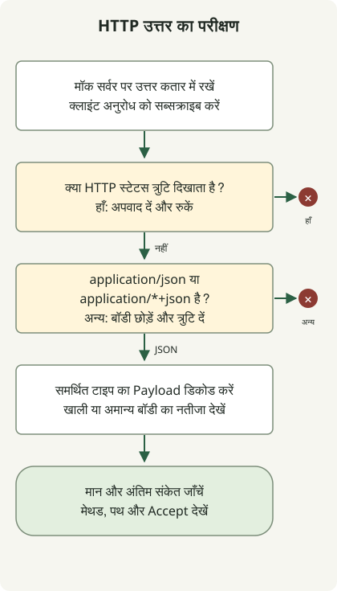

---
{
  "state": "draft",
  "language": "hi",
  "translationKey": "2023-09-19-springboot-test-webclient",
  "title": "MockWebServer और JUnit 5 से Spring WebClient के HTTP उत्तर जाँचें",
  "description": "WebClient के टेस्ट में HTTP स्टेटस, Content-Type, JSON डिकोडिंग और समापन संकेत जाँचें। समझें कि HTTP 200 के साथ HTML मिलने पर उत्तर क्लाइंट की अपेक्षाओं पर क्यों खरा नहीं उतरता।",
  "sourcePath": "src/content/posts/en/2023-09-19-springboot-test-webclient.md",
  "sourceSha256": "f0a277b8719dc886c37dd8cbeb15f1e68228dce2f44d7fac53a97fee9cb5f885"
}
---

स्थानीय MockWebServer के साथ WebClient का परीक्षण करते समय HTTP स्टेटस, उत्तर का Content-Type, बॉडी की डिकोडिंग और अंत में सफलता या त्रुटि का संकेत एक साथ जाँचें। HTML वाला `200 OK` उत्तर सफल स्टेटस के बावजूद क्लाइंट की अपेक्षा का उल्लंघन कर सकता है। अनुरोध में `Accept: application/json` भेजने से JSON उत्तर मिलना अनिवार्य नहीं हो जाता। Spring ने वास्तविक HTTP क्लाइंट के साथ [मॉक वेब सर्वर का उपयोग](https://docs.spring.io/spring-framework/reference/6.2/web/webflux-webclient/client-testing.html) समझाया है।

इन टेस्ट में WebClient की मेथड चेन को मॉक करने के बजाय वास्तविक WebClient से स्थानीय HTTP अनुरोध भेजे जाते हैं। टेस्ट नीचे दिए उत्तरों के लिए अपेक्षित व्यवहार जाँचते हैं। प्रोडक्शन की टाइमआउट और पुनः प्रयास नीतियों के लिए अलग टेस्ट चाहिए।

## HTTP उत्तर की जाँच का क्रम



क्लाइंट पहले स्टेटस और फिर मीडिया टाइप देखता है। वह अस्वीकृत बॉडी के संसाधन छोड़ता है और समर्थित JSON को डिकोड करता है। StepVerifier निकले हुए मानों के साथ समापन या त्रुटि का संकेत भी जाँचता है।

## अलग टेस्ट प्रोजेक्ट बनाएँ

प्रयोग में JDK 17.0.8.1, Gradle 8.4, Spring Boot **3.5.7 BOM** और MockWebServer **4.12.0** इस्तेमाल हुए। ये संस्करण उदाहरण की डिपेंडेंसी तय करते हैं। इन्हें आज के प्रोडक्शन संस्करणों की सिफ़ारिश न मानें। यह साधारण Java टेस्ट प्रोजेक्ट है, इसलिए Spring Boot ऐप्लिकेशन चलाने की ज़रूरत नहीं है।

नई डायरेक्टरी में `settings.gradle` बनाएँ और उसमें `rootProject.name = 'webclient-example'` लिखें। फिर नीचे दी गई पूरी `build.gradle` फ़ाइल बनाएँ।

```groovy
plugins { id 'java' }
repositories { mavenCentral() }
dependencies {
    testImplementation platform('org.springframework.boot:spring-boot-dependencies:3.5.7')
    testImplementation 'org.springframework.boot:spring-boot-starter-webflux'
    testImplementation 'org.springframework.boot:spring-boot-starter-test'
    testImplementation 'io.projectreactor:reactor-test'
    testImplementation 'com.squareup.okhttp3:mockwebserver:4.12.0'
    testRuntimeOnly 'org.junit.platform:junit-platform-launcher'
}
test { useJUnitPlatform() }
```

यहाँ BOM स्पष्ट रूप से दिया है ताकि Spring Boot Gradle प्लगइन के बिना भी Spring और Reactor की डिपेंडेंसी के संस्करण तय हों। Boot से पहले ही प्रबंधित ऐप्लिकेशन के लिए टेस्ट डिपेंडेंसी उसके चुने हुए BOM से मिलाएँ।

## उत्तर के आठ संभावित व्यवहार जाँचें

इस पूरी क्लास को `src/test/java/ExternalApiTest.java` में सहेजें।

```java
import java.io.IOException;
import java.time.Duration;
import java.util.concurrent.TimeUnit;
import okhttp3.mockwebserver.MockResponse;
import okhttp3.mockwebserver.MockWebServer;
import okhttp3.mockwebserver.RecordedRequest;
import org.junit.jupiter.api.AfterEach;
import org.junit.jupiter.api.BeforeEach;
import org.junit.jupiter.api.Test;
import org.springframework.http.MediaType;
import org.springframework.web.reactive.function.client.WebClient;
import reactor.core.publisher.Mono;
import reactor.test.StepVerifier;
import static org.junit.jupiter.api.Assertions.*;

class ExternalApiTest {
    private MockWebServer server;
    private WebClient client;
    record Payload(String message) {}

    @BeforeEach
    void start() throws IOException {
        server = new MockWebServer();
        server.start();
        client = WebClient.builder().baseUrl(server.url("/").toString()).build();
    }

    @AfterEach
    void stop() throws IOException {
        server.shutdown();
    }

    private Mono<Payload> fetch() {
        return client.get().uri("/employee/100")
            .accept(MediaType.APPLICATION_JSON)
            .exchangeToMono(response -> {
                if (response.statusCode().isError()) {
                    return response.createException().flatMap(Mono::error);
                }
                boolean json = response.headers().contentType()
                    .map(type -> "application".equals(type.getType())
                        && ("json".equals(type.getSubtype())
                            || type.getSubtype().endsWith("+json")))
                    .orElse(false);
                if (!json) {
                    return response.releaseBody().then(Mono.<Payload>error(
                        new IllegalStateException("Expected JSON response")));
                }
                return response.bodyToMono(Payload.class);
            });
    }

    @Test
    void rejectsHtmlEvenWhenStatusIs200() throws Exception {
        server.enqueue(new MockResponse().setResponseCode(200)
            .setHeader("Content-Type", "text/html; charset=UTF-8")
            .setBody("<html><body>Unknown failure</body></html>"));
        StepVerifier.create(fetch())
            .expectErrorMatches(error -> error instanceof IllegalStateException
                && error.getMessage().equals("Expected JSON response"))
            .verify(Duration.ofSeconds(5));
        RecordedRequest request = server.takeRequest(1, TimeUnit.SECONDS);
        assertNotNull(request);
        assertEquals("GET", request.getMethod());
        assertEquals("/employee/100", request.getPath());
        assertEquals("application/json", request.getHeader("Accept"));
    }

    @Test
    void preservesHttp500Error() {
        server.enqueue(new MockResponse().setResponseCode(500)
            .setHeader("Content-Type", "text/html")
            .setBody("<html>Unknown failure</html>"));
        StepVerifier.create(fetch())
            .expectError(org.springframework.web.reactive.function.client.WebClientResponseException.InternalServerError.class)
            .verify(Duration.ofSeconds(5));
    }

    @Test
    void decodesJson() {
        server.enqueue(new MockResponse().setResponseCode(200)
            .setHeader("Content-Type", "application/json")
            .setBody("{\"message\":\"ok\"}"));
        StepVerifier.create(fetch())
            .expectNextMatches(payload -> payload.message().equals("ok"))
            .expectComplete().verify(Duration.ofSeconds(5));
    }

    @Test
    void rejectsMissingContentType() {
        server.enqueue(new MockResponse().setResponseCode(200)
            .setBody("{\"message\":\"ok\"}"));
        StepVerifier.create(fetch())
            .expectErrorMatches(error -> error instanceof IllegalStateException
                && error.getMessage().equals("Expected JSON response"))
            .verify(Duration.ofSeconds(5));
    }

    @Test
    void rejectsMalformedJson() {
        server.enqueue(new MockResponse().setResponseCode(200)
            .setHeader("Content-Type", "application/json").setBody("{broken"));
        StepVerifier.create(fetch())
            .expectError(org.springframework.core.codec.DecodingException.class)
            .verify(Duration.ofSeconds(5));
    }

    @Test
    void decodesStructuredJsonSubtype() {
        server.enqueue(new MockResponse().setResponseCode(200)
            .setHeader("Content-Type", "application/vnd.example+json")
            .setBody("{\"message\":\"ok\"}"));
        StepVerifier.create(fetch())
            .expectNextMatches(payload -> payload.message().equals("ok"))
            .expectComplete().verify(Duration.ofSeconds(5));
    }

    @Test
    void completesWithoutPayloadForEmptyJsonBody() {
        server.enqueue(new MockResponse().setResponseCode(200)
            .setHeader("Content-Type", "application/json"));
        StepVerifier.create(fetch())
            .expectComplete().verify(Duration.ofSeconds(5));
    }

    @Test
    void rejectsNonApplicationJsonSubtype() {
        server.enqueue(new MockResponse().setResponseCode(200)
            .setHeader("Content-Type", "text/example+json")
            .setBody("{\"message\":\"ok\"}"));
        StepVerifier.create(fetch())
            .expectErrorMatches(error -> error instanceof IllegalStateException
                && error.getMessage().equals("Expected JSON response"))
            .verify(Duration.ofSeconds(5));
    }
}
```

JDK 17 चुनें और स्थापित Gradle 8.4 से ये कमांड चलाएँ।

```sh
java -version
gradle --version
gradle --no-daemon test
```

आठों टेस्ट पास होने चाहिए। हर टेस्ट का परिणाम देखने के लिए `build/reports/tests/test/index.html` खोलें। Gradle टास्क के आउटपुट में हर सफल टेस्ट का नाम आना ज़रूरी नहीं है।

| उत्तर | उदाहरण में अपेक्षित परिणाम |
| --- | --- |
| HTTP 200, JSON बॉडी | पेलोड डिकोड करें। |
| HTTP 200, HTML बॉडी | अनपेक्षित कंटेंट टाइप अस्वीकार करें। |
| HTTP 500, HTML बॉडी | HTTP त्रुटि का टाइप बनाए रखें। |
| HTTP 200, Content-Type अनुपस्थित | बिना निर्दिष्ट फ़ॉर्मैट का उत्तर अस्वीकार करें। |
| HTTP 200, अमान्य JSON | डिकोडिंग त्रुटि दें। |
| HTTP 200, `application/vnd.example+json` | संगत JSON पेलोड डिकोड करें। |
| HTTP 200, खाली JSON बॉडी | बिना पेलोड दिए पूरा करें। |
| HTTP 200, `text/example+json` | application श्रेणी से बाहर का मीडिया टाइप अस्वीकार करें। |

खाली बॉडी का यह व्यवहार उदाहरण में जानबूझकर चुना गया है। यदि आपके एंडपॉइंट में पेलोड अनिवार्य है, तो `switchIfEmpty(Mono.error(...))` जोड़ें और टेस्ट में ऐप्लिकेशन की त्रुटि की अपेक्षा रखें।

<span id="why-status-and-decoding-are-checked-separately"></span>

## HTTP 200 मिलने पर भी उत्तर की जाँच क्यों विफल हो सकती है?

`fetch()` सफल उत्तर का फ़ॉर्मैट देखने से पहले त्रुटि वाले स्टेटस सँभालता है। `createException()` HTTP 500 को `WebClientResponseException.InternalServerError` के रूप में बनाए रखता है। कनेक्शन विफल होने पर आम तौर पर `WebClientRequestException` मिलता है क्योंकि उस स्थिति में सर्वर से HTTP उत्तर नहीं आया।

त्रुटिरहित स्टेटस पर कोड `application/json` और `application/*+json` मीडिया टाइप स्वीकार करता है और बॉडी की जाँच डिकोडर को सौंपता है। इसलिए ग़लत Content-Type और अमान्य JSON से अलग-अलग त्रुटियाँ मिलती हैं। यह उदाहरण के लिए तय व्यवहार है। रीडायरेक्ट और हर सफल स्टेटस के लिए पूरी नीति अलग से चाहिए।

सफल स्टेटस वाले उत्तर को अस्वीकार करते समय कोड ऐप्लिकेशन की त्रुटि देने से पहले बॉडी के संसाधन छोड़ता है। `exchangeToMono` के कॉलबैक में ही बॉडी पढ़ें या उसे सँभालें। [Spring के दस्तावेज़](https://docs.spring.io/spring-framework/reference/6.2/web/webflux-webclient/client-exchange.html) के अनुसार कॉलबैक से लौटी स्ट्रीम पूरी होने के बाद बिना पढ़ी बॉडी के संसाधन छोड़ दिए जाते हैं।

`setBody(html)` सीधे HTML भेजता है। उस स्ट्रिंग को पहले JSON में सीरियलाइज़ करने से टेस्ट का उत्तर बदल जाएगा। दर्ज किए गए अनुरोध की जाँच से यह भी पता चलता है कि वास्तव में कौन सा मेथड, पथ और `Accept` हेडर भेजा गया।

`verify(Duration.ofSeconds(5))` तय करता है कि हर टेस्ट कितनी देर प्रतीक्षा करेगा। प्रोडक्शन क्लाइंट के कनेक्शन या उत्तर का टाइमआउट इससे सेट नहीं होता। अपने API के अनुबंध के अनुसार ट्रांसपोर्ट टाइमआउट और पुनः प्रयास के टेस्ट अलग से जोड़ें। वे इन आठ मामलों में शामिल नहीं हैं।

ऊपर दिए परिवेश में आठों टेस्ट पास हुए थे। इस रिपॉज़िटरी में `python3 scripts/check_webclient_example.py` से वह जाँच दोहराई जा सकती है। Jakarta पर जाने वाले प्रोजेक्ट में क्लाइंट का व्यवहार बदलने से पहले [Spring Boot माइग्रेशन का शुरुआती परीक्षण](/hi/posts/2023-09-08-springboot3-migration/) करें।

ये क्लाइंट टेस्ट स्थानीय मॉक सर्वर इस्तेमाल करते हैं। डिप्लॉय हुए ऐप्लिकेशन की स्टैटिक फ़ाइलें इनमें नहीं जँचतीं। यदि ऐप्लिकेशन में Vue ऐप पैकेज किए जाते हैं, तो [Gradle से फ़्रंटएंड पैकेज करने का उदाहरण](/en/posts/2021-07-23-multiple-gradle-build/) एक्ज़ीक्यूटेबल JAR और उसके HTML/JavaScript उत्तर जाँचता है। दोनों उदाहरणों के परिवेश अलग तय हैं। इन्हें मिलाने से पहले डिपेंडेंसी की संगतता जाँचें।

MockWebServer API के लिए [OkHttp 4.12.0 का सोर्स और उदाहरण](https://github.com/square/okhttp/tree/parent-4.12.0/mockwebserver) देखें।

समय सीमा और पुनः प्रयास की संख्या के लिए [WebClient टाइमआउट और सीमित पुनः प्रयास के टेस्ट](/hi/posts/2026-10-30-webclient-timeout-retry/) देखें। उस उदाहरण में केवल 503 स्टेटस वाले GET अनुरोध दोहराए जाते हैं। हर प्रयास की सीमा और सभी प्रयासों का कुल समय अलग रखे जाते हैं।
