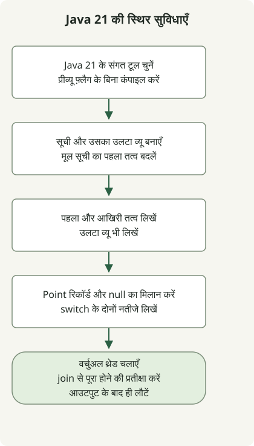

---
{
  "state": "draft",
  "language": "hi",
  "translationKey": "2023-09-20-jdk-21-release",
  "title": "Java 21 में वर्चुअल थ्रेड, सीक्वेंस्ड कलेक्शन और प्रीव्यू सुविधाएँ",
  "description": "Java 21 में वर्चुअल थ्रेड, सीक्वेंस्ड कलेक्शन और पैटर्न मैचिंग बिना प्रीव्यू फ़्लैग के चलाएँ। देखें कि उस रिलीज़ में कौन-सी सुविधाएँ स्थिर, प्रीव्यू या इनक्यूबेटर चरण में थीं।",
  "sourcePath": "src/content/posts/en/2023-09-20-jdk-21-release.md",
  "sourceSha256": "c38821661e446a15de8907378b649d66ad3bb5744a6015a346fce772f8dcc578"
}
---

वर्चुअल थ्रेड, सीक्वेंस्ड कलेक्शन, रिकॉर्ड पैटर्न और switch में पैटर्न मैचिंग JDK 21 की स्थिर सुविधाएँ हैं। इन्हें प्रीव्यू फ़्लैग के बिना इस्तेमाल कर सकते हैं। उसी रिलीज़ में स्ट्रिंग टेम्पलेट अभी प्रीव्यू में थे। JDK अपग्रेड करने पर हर नई सुविधा को समान रूप से स्थिर न मानें। [JDK 21 के रिलीज़ नोट्स](https://www.oracle.com/java/technologies/javase/21all-relnotes.html) स्थिर, प्रीव्यू और इनक्यूबेटर सुविधाओं में अंतर बताते हैं।

[Java 21 की सामान्य उपलब्धता](https://inside.java/2023/09/19/the-arrival-of-java-21/) 19 सितंबर 2023 को घोषित हुई थी। यहाँ उस रिलीज़ को ऐसे उदाहरण से समझेंगे जिसे आप खुद चला सकते हैं। इस लेख में नवीनतम JDK या प्रोडक्शन के लिए कोई पैच संस्करण सुझाया नहीं गया है।

## उदाहरण कैसे चलता है



चित्र में Jdk21Example बिना प्रीव्यू फ़्लैग के चलता है। उलटी सूची मूल सूची का व्यू है। join वर्चुअल थ्रेड को अपना आउटपुट लिखकर पूरा होने का समय देता है।

## JDK 21 में सुविधाओं की स्थिति

| सुविधा | JDK 21 में स्थिति | ध्यान देने योग्य बात |
| --- | --- | --- |
| वर्चुअल थ्रेड | स्थिर | जब कई टास्क I/O की प्रतीक्षा करते हों तब उपयोगी हैं। CPU की गणना तेज़ होने की गारंटी नहीं है। |
| सीक्वेंस्ड कलेक्शन | स्थिर | पहले और आखिरी तत्व तक पहुँचने और उलटे क्रम का व्यू लेने के लिए एक जैसे API |
| रिकॉर्ड पैटर्न और switch में पैटर्न मैचिंग | स्थिर | मान के घटक निकालें और पैटर्न के आधार पर अलग शाखा चुनें |
| स्ट्रिंग टेम्पलेट | प्रीव्यू | बाद की JDK रिलीज़ में इनके बने रहने की धारणा न रखें |
| स्ट्रक्चर्ड कॉन्करेंसी | प्रीव्यू | इसकी स्थिति वर्चुअल थ्रेड के स्थिर होने से अलग जाँचें |
| Vector API | छठा इनक्यूबेटर संस्करण | इनक्यूबेटर API को स्थिर और प्रीव्यू सुविधाओं से अलग समझें |

यह चुनिंदा सुविधाओं की सूची है। [JDK 21 के रिलीज़ नोट्स](https://www.oracle.com/java/technologies/javase/21all-relnotes.html) में प्रीव्यू और इनक्यूबेटर सुविधाओं की स्थिति भी दर्ज है। भाषा से जुड़ी सुविधाओं के लिए [Java 21 में भाषा के बदलाव](https://docs.oracle.com/en/java/javase/21/language/java-language-changes.html) देखें। JDK 23 में स्ट्रिंग टेम्पलेट शामिल नहीं थे। उनके [इतिहास और मानक विकल्पों](/hi/posts/2023-09-23-jdk-21-string-templates/) के बारे में अलग लेख में पढ़ें।

## प्रीव्यू फ़्लैग के बिना कंपाइल करें

नीचे का कोड स्थानीय रूप से Zulu JDK 21.0.1 पर चलाया गया था। यह पुराना पैच संस्करण केवल परीक्षण के परिवेश को दर्ज करता है। इसे प्रोडक्शन के लिए सुझाया नहीं गया है। पहले जाँचें कि `javac` और `java` एक ही JDK 21 इंस्टॉलेशन से चल रहे हैं।

### `Jdk21Example.java`

```java
import java.util.ArrayList;
import java.util.List;

public class Jdk21Example {
    record Point(int x, int y) {}

    static String describe(Object value) {
        return switch (value) {
            case null -> "missing";
            case Point(int x, int y) -> "point=" + x + "," + y;
            default -> "other";
        };
    }

    public static void main(String[] args) throws InterruptedException {
        var names = new ArrayList<>(List.of("alpha", "beta", "gamma"));
        var reverse = names.reversed();
        names.set(0, "ALPHA");
        System.out.println(names.getFirst() + "/" + names.getLast());
        System.out.println(reverse);
        System.out.println(describe(new Point(2, 3)));
        System.out.println(describe(null));
        Thread worker = Thread.ofVirtual().start(() ->
                System.out.println("virtual=" + Thread.currentThread().isVirtual()));
        worker.join();
    }
}
```

```sh
javac --release 21 Jdk21Example.java
java Jdk21Example
```

```text
ALPHA/gamma
[gamma, beta, ALPHA]
point=2,3
missing
virtual=true
```

`reversed()` मूल सूची को उलटे क्रम में देखने की सुविधा देता है। यह स्वतंत्र कॉपी नहीं बनाता। मूल सूची का पहला तत्व बदलने के बाद उलटे क्रम के आउटपुट का आखिरी तत्व भी `ALPHA` हो जाता है। खाली कलेक्शन पर `getFirst()` कॉल करने से एक्सेप्शन आता है। उदाहरण की सूची खाली नहीं है। इस व्यू का व्यवहार [SequencedCollection API](https://docs.oracle.com/en/java/javase/21/docs/api/java.base/java/util/SequencedCollection.html) में परिभाषित है।

`Point(int x, int y)` एक रिकॉर्ड पैटर्न है और `case null` इनपुट में मिले null को अलग संभालता है। आखिरी पंक्ति वर्चुअल थ्रेड लिखता है और `join()` उसके पूरा होने तक प्रतीक्षा करता है। उदाहरण API का व्यवहार जाँचता है। इसमें थ्रूपुट या लेटेंसी नहीं मापी गई। [वर्चुअल थ्रेड गाइड](https://docs.oracle.com/en/java/javase/21/core/virtual-threads.html) बताती है कि कई समवर्ती टास्क जब अधिकांश समय I/O की प्रतीक्षा में बिताते हैं तब ये थ्रेड क्यों उपयोगी होते हैं।

किसी ऐप्लिकेशन का रनटाइम बदलने से पहले उसके फ़्रेमवर्क, बिल्ड टूल और इंस्ट्रुमेंटेशन एजेंट की JDK 21 से संगतता जाँचें। किसी सुविधा की स्थिति और वितरक की समर्थन अवधि अलग सवाल हैं। [Temurin 21 की रिलीज़ और बाइनरी चयन](/hi/posts/2023-10-10-temurin-jdk21-delay/) में देखें कि वितरक ने वास्तव में क्या प्रकाशित किया था।
