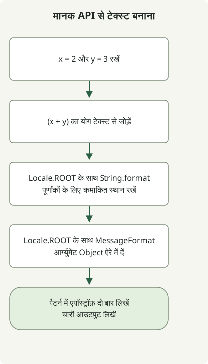

---
{
  "state": "draft",
  "language": "hi",
  "translationKey": "2023-09-23-jdk-21-string-templates",
  "title": "Java स्ट्रिंग टेम्पलेट का JDK 21 प्रीव्यू, JDK 23 में हटना और मानक विकल्प",
  "description": "JDK 21 में स्ट्रिंग टेम्पलेट का पूरा उदाहरण चलाएँ। समझें कि JDK 23 में STR क्यों उपलब्ध नहीं था और मानक Java API से वही आउटपुट कैसे बनाएँ।",
  "sourcePath": "src/content/posts/en/2023-09-23-jdk-21-string-templates.md",
  "sourceSha256": "82b3cfe0b6ea0478f27df7cea88e1b5974a7e661e6be9f9baa20c5d663c7a01b"
}
---

स्ट्रिंग टेम्पलेट JDK 21 और 22 में प्रीव्यू सुविधाएँ थे और JDK 23 में हटा दिए गए। JDK 23 में `--enable-preview` जोड़ने से `STR` वापस नहीं आता। जिस कोड को उन प्रीव्यू संस्करणों के बाद भी चलना है, उसमें मानक स्ट्रिंग API या आउटपुट प्रारूप के अनुरूप सीरियलाइज़र इस्तेमाल करें। [Oracle ने इस बदलाव की वजह समझाई है](https://inside.java/2024/06/20/newscast-71/)।

## मानक API से उदाहरण कैसे चलता है



चित्र में मानक API वाला FormattingExample दिखाया गया है। पुराना प्रीव्यू उदाहरण अलग है। यहाँ टेक्स्ट बनाने के तीन तरीकों की तुलना होती है और यह भी जाँचा जाता है कि MessageFormat में एपॉस्ट्रॉफ़ कैसे लिखें।

## पुराना उदाहरण किस JDK पर चलता है?

| JDK | स्ट्रिंग टेम्पलेट की स्थिति | कैसे चलाएँ |
| --- | --- | --- |
| 21 | प्रीव्यू | कंपाइल करने और चलाने, दोनों के लिए JDK 21 चुनें और प्रीव्यू चालू करें। |
| 22 | दूसरा प्रीव्यू | JDK 22 का कंपाइलर और रनटाइम चुनें और उसी रिलीज़ के प्रीव्यू विकल्प इस्तेमाल करें। |
| 23 | हटा दिए गए | प्रीव्यू सिंटैक्स बदलें। फ़्लैग किसी हटाई गई सुविधा को वापस नहीं ला सकता। |

नए कंपाइलर पर पुराने प्रीव्यू को चलाने के लिए `--release` फ़्लैग पर्याप्त नहीं है। [Oracle की प्रीव्यू गाइड](https://docs.oracle.com/en/java/javase/21/language/preview-language-and-vm-features.html) के अनुसार जिस रिलीज़ का प्रीव्यू है, उसी का कंपाइलर चाहिए।

## JDK 21 का पुराना उदाहरण चलाएँ

पूरी क्लास को `Example.java` नाम से सहेजें। आपके सिस्टम का डिफ़ॉल्ट JDK कोई और हो, तब भी इस उदाहरण के लिए JDK 21 चाहिए।

```java
public class Example {
    public static void main(String[] args) {
        int x = 2;
        int y = 3;
        String result = STR."\{x} plus \{y} equals \{x + y}";
        System.out.println(result);
    }
}
```

पहले चुने गए टूल के संस्करण देखें। फिर जिस डायरेक्टरी में फ़ाइल रखी है, वहीं उसे कंपाइल करके चलाएँ।

```sh
javac -version
java -version
javac --enable-preview --release 21 Example.java
java --enable-preview Example
```

आउटपुट `2 plus 3 equals 5` है। कंपाइल करते समय यह सूचना भी मिलती है कि क्लास प्रीव्यू सुविधाओं का उपयोग करती है। JDK 21 के इस प्रीव्यू में `STR` अपने आप इम्पोर्ट होता था। बाद की रिलीज़ में प्रोसेसर उपलब्ध न हो तो इम्पोर्ट जोड़ने से वह नहीं मिलेगा। [JDK 21 की स्ट्रिंग टेम्पलेट गाइड](https://docs.oracle.com/en/java/javase/21/language/string-templates.html) देखें।

## प्रीव्यू सिंटैक्स की जगह मानक API इस्तेमाल करें

नीचे दिया कोड `FormattingExample.java` नाम से सहेजें। इसमें मानक API हैं और किसी प्रीव्यू फ़्लैग की ज़रूरत नहीं है। पूरी क्लास Java 17 पर चलती है। `String.format` और `MessageFormat` के लिए लोकेल स्पष्ट रूप से दिया गया है ताकि संख्याओं का आउटपुट दोबारा चलाने पर भी एक जैसा रहे।

```java
import java.text.MessageFormat;
import java.util.Locale;

public class FormattingExample {
    public static void main(String[] args) {
        int x = 2;
        int y = 3;
        System.out.println(x + " plus " + y + " equals " + (x + y));
        System.out.println(String.format(Locale.ROOT, "%1$d plus %2$d equals %3$d", x, y, x + y));
        MessageFormat format = new MessageFormat("{0} plus {1} equals {2}", Locale.ROOT);
        System.out.println(format.format(new Object[] {x, y, x + y}));
        System.out.println(new MessageFormat("It''s {0}", Locale.ROOT)
            .format(new Object[] {"ready"}));
    }
}
```

```sh
javac FormattingExample.java
java FormattingExample
```

आउटपुट

```text
2 plus 3 equals 5
2 plus 3 equals 5
2 plus 3 equals 5
It's ready
```

| ज़रूरत | उपयुक्त API | ध्यान देने योग्य बात |
| --- | --- | --- |
| छोटा एक्सप्रेशन | `+` | `x + y` के चारों ओर कोष्ठक रखने पर पहले संख्याओं का योग होता है। |
| बार-बार टेक्स्ट जोड़ना | `StringBuilder` | टेक्स्ट को थोड़ा-थोड़ा करके बनाते समय उपयोगी है। |
| फ़ॉर्मैट स्ट्रिंग | `String.format` या `.formatted` | `%d` और `%s` Formatter के नियम मानते हैं। लोकेल तय करना हो तो `String.format(Locale.ROOT, ...)` इस्तेमाल करें। |
| स्थानीयकृत संदेश का पैटर्न | `MessageFormat` | क्रमांक वाले आर्ग्युमेंट, ऑब्जेक्ट ऐरे और उद्धरण चिह्नों के अलग नियम इस्तेमाल होते हैं। |

`MessageFormat` सिंगल कोट को पैटर्न के सिंटैक्स का हिस्सा मानता है। `It''s {0}` में लगातार दो सिंगल कोट लिखने से आउटपुट में एक एपॉस्ट्रॉफ़ मिलता है। `%s` की जगह `{0}` वाला पैटर्न चुनते समय API भी बदलना होगा और देखना होगा कि नया API लोकेल कैसे लागू करता है। [MessageFormat API](https://docs.oracle.com/en/java/javase/21/docs/api/java.base/java/text/MessageFormat.html) और [String API](https://docs.oracle.com/en/java/javase/21/docs/api/java.base/java/lang/String.html) देखें।

## फ़ॉर्मैटिंग और एन्कोडिंग को अलग समझें

`STR` और सामान्य फ़ॉर्मैटिंग, दोनों में मनमाने मान डालने से सुरक्षित JSON, SQL या HTML नहीं बनता। आउटपुट के अनुसार JSON सीरियलाइज़र, SQL पैरामीटर बाइंडिंग या रेंडरिंग सिस्टम की HTML एस्केपिंग इस्तेमाल करें। साधारण इनपुट पर सही दिखने वाली स्ट्रिंग किसी मान में उद्धरण चिह्न या बैकस्लैश आने पर ग़लत हो सकती है।

ऊपर दी गई कमांड से दोनों क्लास कंपाइल करके चलाई गई थीं। प्रीव्यू उदाहरण JDK 21.0.1 पर चला और मानक विकल्प JDK 17.0.8.1 और 21.0.1 पर। तालिका में JDK 22 और 23 की जानकारी दस्तावेज़ों में दर्ज इतिहास से ली गई है। इन संस्करणों को इस परिवेश में चलाकर नहीं जाँचा गया था।

JDK अपग्रेड करने पर फ़्रेमवर्क की संगतता भी बदलती है। पुराने Spring ऐप्लिकेशन के लिए [Spring Boot 2.7 से 3.0 पर माइग्रेशन के चरण](/hi/posts/2023-09-08-springboot3-migration/) देखें।
