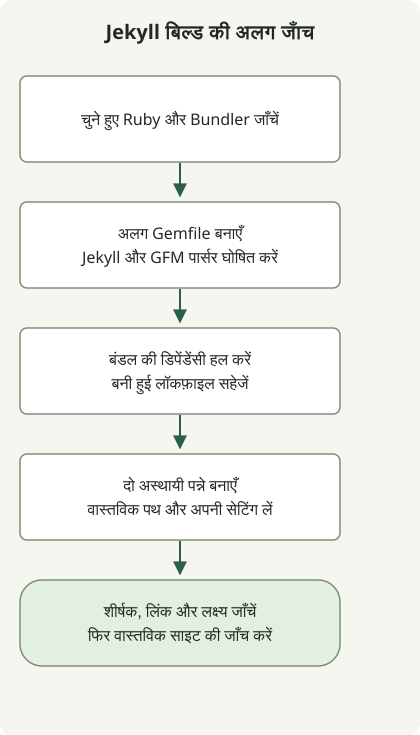

---
{
  "state": "draft",
  "language": "hi",
  "translationKey": "2023-09-04-jekyll-install",
  "title": "macOS पर Jekyll चलाना: Ruby, Bundler और दो पन्नों के बिल्ड की जाँच",
  "description": "अनुमतियाँ बदलने से पहले देखें कि कौन-सा Ruby चल रहा है और Bundler किन gem का उपयोग कर सकता है। पुराने Jekyll बंडल से अलग निर्देशिका में दो पन्ने बनाकर इसकी जाँच करें।",
  "sourcePath": "src/content/posts/en/2023-09-04-jekyll-install.md",
  "sourceSha256": "0dbe6c1bad26411bc78aabc17773da808b4c74fe9cdc098a9bada2cfb2873e08"
}
---

अनुमतियाँ बदलने से पहले देखें कि कौन-सा Ruby चल रहा है, कौन-सा Bundler डिपेंडेंसी सँभाल रहा है और क्या उससे एक छोटी साइट बनती है। इस साइट का मौजूदा बिल्ड Astro से बनता है। नीचे दिया गया Jekyll उदाहरण पुराने Ruby संग्रह में समस्या का पता लगाने के लिए है।

मूल इंस्टॉलेशन में Ruby 3.2.2 इस्तेमाल हुआ था। उस रिलीज़ शृंखला का [समर्थन समाप्त हो चुका है](https://www.ruby-lang.org/en/downloads/branches/)। पुराने संस्करण का इस्तेमाल यहाँ उसी वातावरण में संगतता जाँचने के लिए किया गया है। नई स्थापना के लिए ऐसा Ruby संस्करण चुनें जिसका रखरखाव जारी हो और जो आपके प्रोजेक्ट के gem के अनुकूल हो।

## gem स्थापित करने से पहले इंटरप्रेटर जाँचें



[Jekyll के macOS निर्देश](https://jekyllrb.com/docs/installation/macos/) सिस्टम Ruby से अलग Ruby वातावरण इस्तेमाल करने की सलाह देते हैं। इस रिपॉज़िटरी के पुराने सेटअप में rbenv था। उसके [संस्करण चुनने के नियम](https://github.com/rbenv/rbenv#readme) बताते हैं कि प्रोजेक्ट की `.ruby-version`, `RBENV_VERSION` और वैश्विक डिफ़ॉल्ट की क्या भूमिका है।

प्रोजेक्ट की निर्देशिका में ये कमांड चलाएँ।

```sh
command -v ruby
ruby --version
rbenv version
rbenv which ruby
gem env home
bundle --version
```

यदि `ruby` अपेक्षित संस्करण प्रबंधक से नहीं चुना जा रहा है, तो कुछ भी स्थापित करने से पहले शेल का आरंभिक कॉन्फ़िगरेशन ठीक करें। अपने स्थापित rbenv संस्करण के निर्देशों के अनुसार `rbenv init` चलाएँ। किसी दूसरे उपयोगकर्ता की होम निर्देशिका का पथ अपनी शेल प्रोफ़ाइल में न डालें। `rbenv global` से सभी Ruby प्रोजेक्ट का संस्करण बदलने की जगह इसी प्रोजेक्ट का संस्करण चुनें।

## बंडल से दो पन्ने बनाकर जाँचें

संगतता की यह जाँच Ruby 3.2.2, Bundler 2.4.19, Jekyll 3.9.3 और kramdown-parser-gfm 1.1.0 पर चलाई गई थी। ये पुराने वातावरण को दोहराने के लिए दर्ज संस्करण हैं। इनसे आज समर्थित संस्करणों का निर्धारण नहीं होता। Gemfile दोनों प्रत्यक्ष gem के संस्करण तय करती है। उससे बनने वाली Gemfile.lock आपके प्लेटफ़ॉर्म पर उनकी डिपेंडेंसी के संस्करण भी दर्ज करती है।

इसके लिए एक अलग अस्थायी निर्देशिका बनाएँ और उसमें नीचे दी गई पूरी फ़ाइलें सहेजें। रिपॉज़िटरी की मौजूदा Gemfile बनाए रखें।

### `Gemfile`

```ruby
source 'https://rubygems.org'
gem 'jekyll', '= 3.9.3'
gem 'kramdown-parser-gfm', '= 1.1.0'
```

### `jekyll_probe.rb`

```ruby
require 'jekyll'
require 'tmpdir'
require 'fileutils'
require 'json'

Dir.mktmpdir('jekyll-probe-') do |root|
  root = File.realpath(root)
  source = File.join(root, 'source')
  destination = File.join(root, 'output')
  FileUtils.mkdir_p(File.join(source, '_layouts'))
  File.write(File.join(source, '_layouts', 'default.html'), '<!doctype html><html lang="en"><body>{{ content }}</body></html>')
  File.write(File.join(source, 'index.md'), "---\nlayout: default\ntitle: Probe\n---\n# Bundled build\n\n[Guide](/guide/)\n")
  File.write(File.join(source, 'guide.md'), "---\nlayout: default\npermalink: /guide/\n---\n# Local guide\n")
  config = Jekyll.configuration('config' => [], 'source' => source, 'destination' => destination, 'quiet' => true)
  Dir.chdir(source) { Jekyll::Site.new(config).process }
  home = File.read(File.join(destination, 'index.html'))
  guide = File.read(File.join(destination, 'guide', 'index.html'))
  raise 'Missing rendered heading' unless home.include?('<h1') && home.include?('Bundled build')
  raise 'Missing guide link' unless home.include?('href="/guide/"')
  raise 'Missing guide output' unless guide.include?('Local guide')
  puts JSON.generate('ruby' => RUBY_VERSION, 'jekyll' => Jekyll::VERSION, 'pages' => 2, 'result' => 'passed')
end
```

चुने हुए Ruby और Bundler उपलब्ध होने पर उसी निर्देशिका से ये कमांड चलाएँ।

```sh
bundle install
bundle exec ruby jekyll_probe.rb
```

यदि ठीक इन्हीं संस्करणों के gem पहले से स्थापित हैं, तो जाँच चलाने से पहले `bundle lock --local` स्थानीय gem से डिपेंडेंसी हल कर सकता है। यह किसी अनुपलब्ध gem को डाउनलोड नहीं कर सकता। समस्या को दोहराते समय लॉकफ़ाइल सँभालकर रखें और उसे अपडेट करने से पहले बदलाव की समीक्षा करें। [Bundler की एप्लिकेशन गाइड](https://guides.rubygems.org/using_bundler_in_applications/) Gemfile और लॉकफ़ाइल की भूमिकाएँ समझाती है।

जाँच चलाने पर यह परिणाम मिला था।

```json
{"ruby":"3.2.2","jekyll":"3.9.3","pages":2,"result":"passed"}
```

जाँच एक अस्थायी निर्देशिका में बिल्ड करती है। macOS पर `/var` के सिमलिंक से पथ का अंतर न आए, इसलिए यह निर्देशिका का वास्तविक पथ लेती है। यह डिफ़ॉल्ट कॉन्फ़िगरेशन फ़ाइल की स्वतः खोज बंद करती है और रेंडर करते समय अपनी स्रोत निर्देशिका में जाती है। यह शीर्षक, लिंक और उसके लक्ष्य पन्ने की जाँच करती है। बाद में अस्थायी फ़ाइलें हट जाती हैं। जाँच में पूरा संग्रह, उसकी थीम, प्लगइन, CSS और परिनियोजन शामिल नहीं थे।

## स्थापित gem और बंडल में उपलब्ध gem

इस वातावरण में Jekyll लोड हो गया था, लेकिन Markdown रूपांतरण विफल हुआ क्योंकि बंडल में `kramdown-parser-gfm` घोषित नहीं था। मशीन पर कोई gem स्थापित होने भर से वह `bundle exec` में उपलब्ध नहीं हो जाता। इस उदाहरण की Gemfile में पार्सर जोड़ने के बाद रूपांतरण सफल हुआ।

दो पन्ने सफलतापूर्वक बनने पर अगली जाँच वास्तविक साइट के कॉन्फ़िगरेशन, थीम, प्लगइन और इनपुट पर केंद्रित करें। यदि त्रुटि नेटिव एक्सटेंशन लोड करते समय आती है, तो [Ruby और C++ की निदान जाँच](/hi/posts/2026-04-07-ruby-rbenv-jekyll-build-troubleshooting/) देखें। इस साइट की मौजूदा प्रकाशन प्रक्रिया के लिए [Astro में प्रकाशन से पहले मसौदे की समीक्षा](/hi/posts/2026-04-07-jekyll-github-actions-content-pipeline/) देखें।
