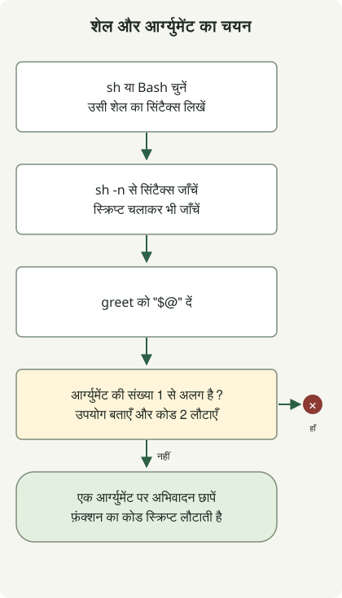

---
{
  "state": "draft",
  "language": "hi",
  "translationKey": "2023-09-20-linux-shellscript-function-error",
  "title": "शेल फ़ंक्शन की चेतावनी कैसे ठीक करें: POSIX sh और Bash",
  "description": "शेल के अनुसार फ़ंक्शन घोषित करें, उद्धरण चिह्नों से आर्ग्युमेंट सुरक्षित रखें और जाँचें कि फ़ंक्शन का रिटर्न कोड स्क्रिप्ट का निकास कोड कैसे बनता है।",
  "sourcePath": "src/content/posts/en/2023-09-20-linux-shellscript-function-error.md",
  "sourceSha256": "06ada98f4723e3b70cb188c01cc5efe1f31f9a724392b8e273b665663b5a73f8"
}
---

`#!/bin/sh` स्क्रिप्ट में फ़ंक्शन को `hello() { ...; }` के रूप में घोषित करें और `function` कीवर्ड छोड़ दें। यदि स्क्रिप्ट को Bash सिंटैक्स चाहिए, तो Bash चुनें और उसी से चलाएँ। `sh script.sh` चलाने पर फ़ाइल में लिखी Bash शेबैंग लागू नहीं होती।

[ShellCheck SC2112](https://www.shellcheck.net/wiki/SC2112) बताता है कि `function` POSIX sh के सिंटैक्स का हिस्सा नहीं है। किसी एक `/bin/sh` में यह चलने से यह साबित नहीं होता कि स्क्रिप्ट दूसरे शेल में भी चलेगी।

## स्क्रिप्ट कैसे चलती है



जिस इंटरप्रेटर को चलाया जाता है, वही फ़ंक्शन को पार्स करता है। उदाहरण एक आर्ग्युमेंट की अपेक्षा करता है और उद्धरण चिह्नों की मदद से उसके स्पेस और वाइल्डकार्ड अक्षर सुरक्षित रखता है।

## चुने हुए शेल के लिए फ़ंक्शन लिखें

इसे `greet.sh` नाम से सहेजें। `"$1"` और `"$@"` में लगे उद्धरण चिह्न आर्ग्युमेंट के स्पेस और वाइल्डकार्ड को सुरक्षित रखते हैं।

### `greet.sh`

```sh
#!/bin/sh
set -eu

greet() {
    if [ "$#" -ne 1 ]; then
        printf '%s\n' 'usage: greet.sh NAME' >&2
        return 2
    fi
    printf 'Hello, %s\n' "$1"
}

greet "$@"
```

```sh
sh -n greet.sh
sh greet.sh 'Ada Lovelace'
sh greet.sh 'Ada *'
```

आउटपुट क्रमशः `Hello, Ada Lovelace` और `Hello, Ada *` हैं। `sh -n` केवल सिंटैक्स जाँचता है, इसलिए स्क्रिप्ट चलाकर भी देखें। आर्ग्युमेंट कम या ज़्यादा हों तो इस्तेमाल का निर्देश stderr पर जाता है और निकास कोड 2 मिलता है। सही आर्ग्युमेंट पर कोड 0 मिलता है।

## शेबैंग और कमांड में चुने गए इंटरप्रेटर का अंतर

| चलाने का तरीका | कौन-सा इंटरप्रेटर चलता है |
| --- | --- |
| `sh greet.sh NAME` | कमांड में चुना गया `sh` फ़ाइल पढ़ता है। |
| `bash greet.sh NAME` | Bash फ़ाइल पढ़ता है। |
| `chmod +x greet.sh`, फिर `./greet.sh NAME` | इस तरह फ़ाइल की शेबैंग लागू होती है। |

Bash ऐरे या `[[ ... ]]` के लिए `#!/usr/bin/env bash` लिखें और `bash script.sh` या निष्पादन योग्य `./script.sh` चलाएँ। `sh script.sh` चलाते समय Bash सिंटैक्स की अपेक्षा न करें। [शेल के चयन पर ShellCheck का स्पष्टीकरण](https://www.shellcheck.net/wiki/SC2112) देखें।

फ़ंक्शन का `return` नियंत्रण और स्टेटस कोड कॉल करने वाले को लौटाता है। `exit` चल रहे शेल को समाप्त करता है। यहाँ फ़ंक्शन आखिरी कमांड है, इसलिए उसका स्टेटस ही स्क्रिप्ट का निकास कोड बनता है।

इस उदाहरण को स्पेस और वाइल्डकार्ड वाले आर्ग्युमेंट के साथ और गलत संख्या में आर्ग्युमेंट देकर जाँचा गया था। `/bin/sh` के कार्यान्वयन अलग होते हैं, इसलिए परिनियोजन वाले शेल पर भी जाँचें। स्वचालन के अगले चरण के लिए [संख्यात्मक संस्करणों की तुलना](/hi/posts/2023-11-17-linux-shellscript-version-compare/) या [GitHub रिलीज़ खोजना](/en/posts/2023-09-23-linux-shellscript-github-latest/) देखें। वहाँ भी इनपुट और विफलता के स्टेटस कोड मायने रखते हैं।
