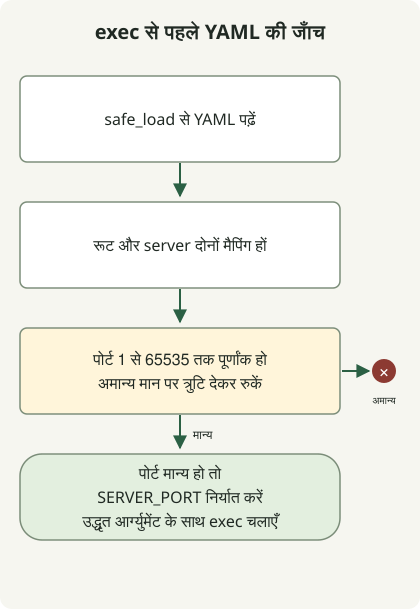

---
{
  "state": "draft",
  "language": "hi",
  "translationKey": "2021-07-27-parse-yaml",
  "title": "शेल से YAML पढ़ें और पोर्ट जाँचकर eval के बिना कमांड चलाएँ",
  "description": "Python और PyYAML से YAML पोर्ट का प्रकार और सीमा जाँचें। अमान्य इनपुट रोकें और शेल कोड बनाए या eval चलाए बिना चाइल्ड कमांड को SERVER_PORT दें।",
  "sourcePath": "src/content/posts/en/2021-07-27-parse-yaml.md",
  "sourceSha256": "102f35eacb16194761699d994cc9b12de6dbd6cfb89d6e54580f0d74f30ec17f"
}
---

शेल से `eval` के बिना YAML में दिया पोर्ट पढ़ने के लिए [YAML पार्सर](https://pyyaml.org/wiki/PyYAMLDocumentation#loading-yaml) इस्तेमाल करें। मान का प्रकार और सीमा जाँचें और केवल ज़रूरी वेरिएबल आगे दें। यह उदाहरण Python और PyYAML से `server.port` का एक मान पढ़ता है और जाँच सफल होने पर ही चाइल्ड कमांड शुरू करता है। YAML का पूरा व्याकरण संभालने के लिए sed/awk के पैटर्न पर निर्भर न रहें।

सिर्फ़ दिखने वाला टेक्स्ट पढ़कर YAML के पूर्णांक `8080` और स्ट्रिंग `"8080"` में भरोसेमंद अंतर नहीं कर सकते। यह लोडर **स्ट्रिंग को संख्या में नहीं बदलता**। यह केवल ऐसा मान स्वीकार करता है जिसे पार्सर ने पूर्णांक पढ़ा हो और जो 1 से 65535 के बीच हो। Python में bool, int का सबक्लास है। इसलिए `type(port) is int` बूलियन को अस्वीकार करता है, जबकि `isinstance(port, int)` उसे स्वीकार कर लेता।

## कॉन्फ़िगरेशन से कमांड तक



SERVER_PORT निर्यात करने से पहले पोर्ट पढ़ें और जाँचें कि वह मान्य पूर्णांक है। लोडर विफल हो तो लक्ष्य कमांड शुरू नहीं होता। सफल होने पर exec लक्ष्य कमांड का एग्ज़िट स्टेटस बनाए रखता है।

## वातावरण और इनपुट

Python 3 और [PyYAML 6.0.3](https://pypi.org/project/PyYAML/6.0.3/) इस्तेमाल करें। मूल उदाहरण के स्थानीय परीक्षण में Python 3.13 इस्तेमाल हुआ था। ये तीन फ़ाइलें एक ही डायरेक्टरी में सहेजें और डिपेंडेंसी अलग वर्चुअल एनवायरनमेंट में इंस्टॉल करें।

```sh
python3 -m venv .venv
.venv/bin/python -m pip install PyYAML==6.0.3
```

### `application.yml`

```yaml
server:
  port: 8080
```

### `read-port.py`

```python
import sys
from pathlib import Path
import yaml

if len(sys.argv) != 2:
    sys.exit("usage: read-port.py CONFIG")
try:
    with Path(sys.argv[1]).open(encoding="utf-8") as stream:
        config = yaml.safe_load(stream)
    if not isinstance(config, dict):
        raise ValueError("root must be a mapping")
    server = config.get("server")
    if not isinstance(server, dict):
        raise ValueError("server must be a mapping")
    port = server.get("port")
    if type(port) is not int or not 1 <= port <= 65535:
        raise ValueError("server.port must be an integer from 1 to 65535")
except (OSError, UnicodeError, yaml.YAMLError, ValueError) as error:
    print(f"invalid configuration: {error}", file=sys.stderr)
    sys.exit(2)
print(port)
```

### `run-with-port.sh`

```sh
#!/bin/sh
set -eu
if [ "$#" -lt 2 ]; then
    printf '%s\n' 'usage: run-with-port.sh CONFIG COMMAND [ARG ...]' >&2
    exit 2
fi
config=$1
shift
script_dir=$(CDPATH= cd -- "$(dirname -- "$0")" && pwd)
port=$("${PYTHON:-python3}" "$script_dir/read-port.py" "$config")
export SERVER_PORT="$port"
exec "$@"
```

## जाँचे हुए मान के साथ कमांड चलाएँ

```sh
PYTHON=.venv/bin/python sh run-with-port.sh application.yml \
  .venv/bin/python -c 'import os; print(os.environ["SERVER_PORT"])'
```

```text
8080
```

`read-port.py` केवल मान्य मान stdout पर लिखता है और त्रुटियाँ stderr पर भेजता है। फ़ाइल न मिलना, अमान्य YAML, एक से अधिक दस्तावेज़, मैपिंग की जगह कोई और प्रकार, फ़ील्ड न मिलना, स्ट्रिंग, बूलियन, दशमलव संख्या या सीमा से बाहर का मान मिलने पर यह स्टेटस 2 के साथ बंद होता है। `run-with-port.sh` लक्ष्य कमांड शुरू किए बिना वही विफलता आगे देता है। लक्ष्य शुरू होने पर `exec` उसका एग्ज़िट स्टेटस बनाए रखता है।

`"$@"` कमांड और उसके हर आर्ग्युमेंट को अलग रखता है। आर्ग्युमेंट में मौजूद स्पेस या `$()` को दोबारा शेल कोड की तरह नहीं पढ़ा जाता। सापेक्ष `PYTHON` पथ और कॉन्फ़िगरेशन पथ कॉल करने वाले की कार्यशील डायरेक्टरी से तय होते हैं। रैपर `read-port.py` को अपनी डायरेक्टरी में ढूँढ़ता है।

निर्यात किया गया वेरिएबल चाइल्ड प्रोसेस को मिलता है। कॉल करने वाले पैरेंट शेल का वातावरण नहीं बदलता। रैपर को सोर्स करने के बजाय `sh run-with-port.sh ...` से चलाएँ। अलग से जाँचें कि आपका एप्लिकेशन वास्तव में `SERVER_PORT` पढ़ता है।

## लोडर किन इनपुट को संभालता है

[`safe_load`](https://pyyaml.org/wiki/PyYAMLDocumentation) ऐसे टैग स्वीकार नहीं करता जो मनमाने Python ऑब्जेक्ट बना सकें। फिर भी एप्लिकेशन के लिए ज़रूरी प्रकार और सीमा जाँचनी पड़ती है। यह उदाहरण जानबूझकर दिए गए बेहद बड़े इनपुट के लिए मेमोरी या समय की सीमा नहीं लगाता। इसे भरोसेमंद स्थानीय कॉन्फ़िगरेशन के लिए इस्तेमाल करें।

लोडर प्रकार तय करने के लिए PyYAML के अपने नियम अपनाता है। मसलन, `on` बूलियन बन सकता है। यह दोहराई गई कुंजियों को अस्वीकार नहीं करता और बाद वाला मान रह सकता है। इनपुट में ऐसी कुंजियाँ प्रतिबंधित करें और उनके लिए अलग जाँच रखें। यह YAML 1.2 के प्रकार संबंधी सभी नियम लागू नहीं करता और न ही हर तरह के कॉन्फ़िगरेशन की स्कीमा जाँचता है। हर अतिरिक्त फ़ील्ड का प्रकार और उसके अनुपस्थित होने पर व्यवहार स्पष्ट रूप से तय करें।

कमांड की विफलता और एग्ज़िट स्टेटस संभालने के लिए [GitHub रिलीज़ की जानकारी पढ़ना](/en/posts/2023-09-23-linux-shellscript-github-latest/) देखें। JVM जॉब में पहले से सहेजे डेटा की संगतता के लिए [Spring Batch 5 माइग्रेशन](/hi/posts/2023-10-27-springbatch5-migration/) देखें।
