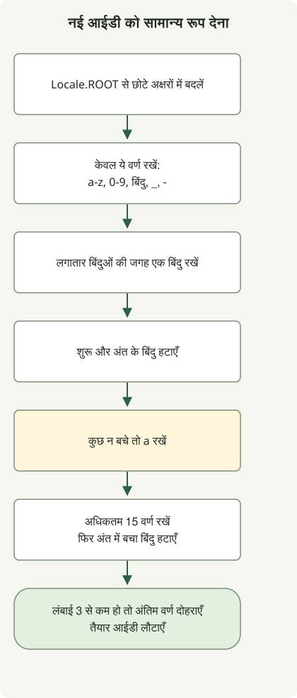

---
{
  "state": "draft",
  "language": "hi",
  "translationKey": "2021-07-19-new-id",
  "title": "Java में नई आईडी बनाना: नियमों का क्रम और 15 वर्णों की सीमा",
  "description": "Optional और लूप से आईडी को सामान्य रूप दें। लगातार बिंदुओं, खाली परिणाम, लंबाई की सीमा और अंतिम वर्ण की पुनरावृत्ति के लिए दोनों विधियों को एक ही इनपुट पर परखें।",
  "sourcePath": "src/content/posts/en/2021-07-19-new-id.md",
  "sourceSha256": "d974b2c5791736b9568a1598a457390b7df0c0450c6dd11323c3c26a895ea8a2"
}
---

आईडी को सामान्य रूप देते समय नियम लगाने का क्रम मायने रखता है। खासकर, आईडी को 15 वर्णों तक काटने के बाद अंत में बिंदु हो तो उसे फिर से हटाना पड़ता है। मूल आईडी के अंत का बिंदु पहले ही हटा दिया हो, तब भी काटने से कोई दूसरा बिंदु अंत में आ सकता है।

[अभ्यास के नियमों](https://school.programmers.co.kr/learn/courses/30/lessons/72410) के अनुसार पहले ASCII अक्षरों को छोटे अक्षरों में बदलें और केवल अनुमत वर्ण रखें। इसके बाद क्रम से बिंदुओं, खाली परिणाम और लंबाई को सँभालें। दोनों हल मानते हैं कि इनपुट null नहीं है, जैसा कि प्रश्न में तय है। Optional वाले हल में Java 11 की `repeat()` विधि इस्तेमाल होती है। दोनों हल Java 11 के लिए संकलित होते हैं। किसी एक हल को `Solution.java` में सहेजें। दोनों क्लास एक ही फ़ाइल में न रखें।

## आईडी बनाने का क्रम



चित्र में Optional वाले हल का क्रम है। लूप में अनुमत वर्ण चुनते समय ही लगातार बिंदुओं को एक बिंदु में समेट दिया जाता है। दोनों पर एक ही नियम लागू होते हैं।

## Optional से चरण जोड़ें

```java
import java.util.Locale;
import java.util.Optional;

public class Solution {
    public String solution(String new_id) {
        return Optional.of(new_id)
                .map(s -> s.toLowerCase(Locale.ROOT))
                .map(s -> s.replaceAll("[^a-z0-9._-]", ""))
                .map(s -> s.replaceAll("[.]+", "."))
                .map(s -> s.replaceAll("^[.]|[.]$", ""))
                .map(s -> s.isEmpty() ? "a" : s)
                .map(s -> s.length() > 15 ? s.substring(0, 15) : s)
                .map(s -> s.replaceAll("[.]$", ""))
                .map(s -> s.length() < 3
                        ? s + s.substring(s.length() - 1).repeat(3 - s.length()) : s)
                .orElseThrow();
    }
}
```

`Locale.ROOT` से बड़े अक्षरों को छोटे अक्षरों में बदलने का परिणाम डिफ़ॉल्ट लोकेल पर निर्भर नहीं रहता। पैटर्न केवल छोटे ASCII अक्षर, अंक, बिंदु, अंडरस्कोर और हाइफ़न रखता है। लगातार बिंदुओं की जगह एक बिंदु रखें और दोनों सिरों के बिंदु हटा दें। खाली परिणाम की जगह `a` रखें। फिर लंबाई को 15 वर्णों तक सीमित करें, अंत में आया बिंदु हटाएँ और लंबाई 3 तक पहुँचने तक अंतिम वर्ण दोहराएँ।

चरणों को एक के बाद एक लिखने के लिए यहाँ Optional का इस्तेमाल हुआ है। एल्गोरिदम के लिए यह डेटा संरचना अनिवार्य नहीं है। `Optional.of` को null देने पर त्रुटि आती है। उसे खाली आईडी नहीं माना जाता।

## लूप में वही नियम लागू करें

यह हल एक ही बार में अनुमत वर्ण चुनता है और लगातार बिंदुओं को हटाता है। केवल बड़े ASCII अक्षरों को छोटे अक्षरों में बदलना इस अभ्यास के इनपुट के लिए पर्याप्त है। सामान्य Unicode नामों को सामान्य रूप देने का दायरा इससे बड़ा है।

```java
import java.util.Objects;

public class Solution {
    public String solution(String new_id) {
        Objects.requireNonNull(new_id);
        StringBuilder result = new StringBuilder();
        for (char input : new_id.toCharArray()) {
            char c = input >= 'A' && input <= 'Z' ? (char) (input + 32) : input;
            boolean allowed = (c >= 'a' && c <= 'z') || (c >= '0' && c <= '9')
                    || c == '-' || c == '_' || c == '.';
            if (!allowed || (c == '.' && (result.length() == 0
                    || result.charAt(result.length() - 1) == '.'))) continue;
            result.append(c);
        }
        if (result.length() > 0 && result.charAt(result.length() - 1) == '.') {
            result.setLength(result.length() - 1);
        }
        if (result.length() == 0) result.append('a');
        if (result.length() > 15) result.setLength(15);
        if (result.charAt(result.length() - 1) == '.') result.setLength(result.length() - 1);
        while (result.length() < 3) result.append(result.charAt(result.length() - 1));
        return result.toString();
    }
}
```

| इनपुट | परिणाम | किस नियम की जाँच होती है |
| --- | --- | --- |
| `=.=` | `aaa` | खाली परिणाम की जगह वर्ण रखना और लंबाई पूरी करना |
| `z-+.^.` | `z--` | अनुमत वर्ण रखना और अंत का बिंदु हटाना |
| `I` | `iii` | डिफ़ॉल्ट लोकेल से स्वतंत्र रूप से छोटे अक्षर बनाना |
| `abcdefghijklmn.op` | `abcdefghijklmn` | काटने पर अंत में आया बिंदु हटाना |

इनपुट की लंबाई n हो तो दोनों हल O(n) समय और O(n) अतिरिक्त स्थान लेते हैं। रेगुलर एक्सप्रेशन वाला हल कई मध्यवर्ती स्ट्रिंग बना सकता है, जबकि लूप StringBuilder का इस्तेमाल करता है। गति मापे बिना किसी एक को हमेशा तेज़ नहीं कहा जा सकता। वर्ण बदलने, छोटे अक्षर बनाने और दोहराने का व्यवहार [String API](https://docs.oracle.com/en/java/javase/11/docs/api/java.base/java/lang/String.html) में दिया है।

अंकों के अंग्रेज़ी नामों को बदलने के लिए [replace और replaceAll का अंतर](/hi/posts/2021-07-23-number-word/) देखें। लोकेल से स्वतंत्र कैश कुंजियाँ बनाने के लिए [LRU कैश का उदाहरण](/hi/posts/2021-08-17-cache/) देखें।
