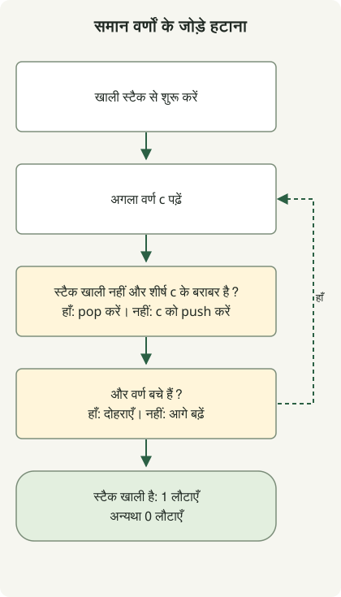

---
{
  "state": "draft",
  "language": "hi",
  "translationKey": "2021-07-20-pair-delete",
  "title": "Java में आसन्न समान वर्ण हटाना: ArrayDeque स्टैक में क्या बचता है?",
  "description": "स्टैक से पास-पास के समान वर्ण हटाएँ। एक उदाहरण में देखें कि एक जोड़ा हटने से अगला जोड़ा कैसे बनता है और दस लाख वर्णों पर समय और स्थान की ज़रूरत कैसे बदलती है।",
  "sourcePath": "src/content/posts/en/2021-07-20-pair-delete.md",
  "sourceSha256": "a1962a62aeb00132eea16a0b3b607dfb9e256902ddc165613dbe7c044f14966e"
}
---

पास-पास के दो समान वर्ण हटाने के लिए स्ट्रिंग को एक बार पढ़ना पर्याप्त है। अब तक पढ़े गए हिस्से से जोड़े हटाने के बाद जो बचता है, उसे स्टैक में रखें। अगला वर्ण स्टैक के शीर्ष से मेल खाए तो जोड़ा हटा दें। अलग हो तो नया वर्ण स्टैक पर रखें।

[अभ्यास](https://school.programmers.co.kr/learn/courses/30/lessons/12973) में इनपुट 1 से 1,000,000 तक छोटे अंग्रेज़ी अक्षरों की स्ट्रिंग है। सभी वर्ण हट जाएँ तो 1 लौटाएँ, अन्यथा 0। हर वर्ण सम संख्या में आया है या नहीं, केवल यह जाँचना काफ़ी नहीं है। जोड़ा हटाने के लिए दोनों वर्ण पास-पास होने चाहिए।

## स्टैक में जोड़ा कैसे हटता है



स्टैक में पढ़े हुए हिस्से से जोड़े हटाने का परिणाम रहता है। नया वर्ण शीर्ष से मेल खाए तो शीर्ष को निकालें। अलग हो तो नया वर्ण शीर्ष पर रखें।

## पढ़े हुए हिस्से के बचे वर्ण रखें

पूरी क्लास `Solution.java` में सहेजें। मूल उदाहरण को Java 11 के लिए संकलित करके JDK 17 पर चलाया गया था।

```java
import java.util.ArrayDeque;
import java.util.Deque;

public class Solution {
    public int solution(String s) {
        Deque<Character> stack = new ArrayDeque<>();
        for (int i = 0; i < s.length(); i++) {
            char c = s.charAt(i);
            if (!stack.isEmpty() && stack.peek() == c) stack.pop();
            else stack.push(c);
        }
        return stack.isEmpty() ? 1 : 0;
    }
}
```

हर चरण के बाद स्टैक में बचे वर्णों में कोई भी दो आसन्न वर्ण समान नहीं होते। अगला वर्ण शीर्ष के बराबर हो तो दोनों मिलकर हटाने योग्य जोड़ा बनाते हैं। इसलिए शीर्ष को निकाल देते हैं। अलग वर्ण से कोई जोड़ा नहीं बनता, इसलिए उसे स्टैक पर रख देते हैं। इस तरह अगले चरण में भी वही शर्त बनी रहती है।

| पढ़ा गया वर्ण | स्टैक में नीचे से ऊपर तक |
| --- | --- |
| b | b |
| a | ba |
| a | b |
| b | खाली |
| a | a |
| a | खाली |

इसलिए `baabaa` का परिणाम 1 है। वहीं `abab` का परिणाम 0 है। दोनों वर्ण सम संख्या में आते हैं, लेकिन कोई दो समान वर्ण पास-पास नहीं हैं। जोड़ा हटने के बाद जो वर्ण पड़ोसी बनते हैं उनकी तुलना स्टैक के शीर्ष पर होती है। पूरी स्ट्रिंग पर बार-बार प्रतिस्थापन नहीं करना पड़ता।

## ArrayDeque और जटिलता

[`ArrayDeque`](https://docs.oracle.com/en/java/javase/17/docs/api/java.base/java/util/ArrayDeque.html) को Deque के `push`, `peek` और `pop` ऑपरेशन से चलाएँ। `c` का प्रकार आदिम char है, इसलिए `stack.peek() == c` में Character को तुलना से पहले char में बदला जाता है। यहाँ वर्णों के मान की तुलना होती है।

प्रत्येक वर्ण अधिकतम एक बार स्टैक पर रखा जाता है और अधिकतम एक बार निकाला जाता है। डेक ऑपरेशन की परिशोधित लागत के आधार पर समय O(n) है। जब कोई वर्ण नहीं हटता, तब अतिरिक्त स्थान O(n) होता है। मूल परीक्षणों में एक ही वर्ण की दस लाख पुनरावृत्तियाँ और बारी-बारी से आने वाले दस लाख वर्ण शामिल थे जिनमें कोई जोड़ा नहीं हटता। इनसे सीमा पर व्यवहार की जाँच हुई। इनसे गति या हर परिवेश में मेमोरी की उपलब्धता का निष्कर्ष नहीं निकलता।

कौन-सी जानकारी रखनी है, यह प्रश्न पर निर्भर करता है। [दौड़ पूरी न करने वाले धावक के अभ्यास](/en/posts/2021-07-23-unsuccessful-runner/) में पड़ोसी वर्णों का क्रम रखने की जगह हर नाम की आवृत्ति रखी जाती है।
