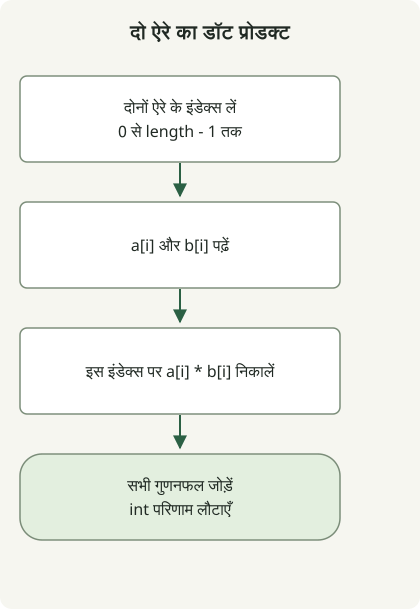

---
{
  "state": "draft",
  "language": "hi",
  "translationKey": "2021-07-22-dot-product",
  "title": "Java में दो ऐरे का डॉट प्रोडक्ट: IntStream और int की सीमा",
  "description": "समान इंडेक्स पर रखे मानों को गुणा करके जोड़ें। ऋणात्मक मानों, int की सीमा और बड़े इनपुट के लिए गुणा से पहले long में बदलने का कारण समझें।",
  "sourcePath": "src/content/posts/en/2021-07-22-dot-product.md",
  "sourceSha256": "aa027f07c568f5c9d25dc08d3ee21ea8c23917f73f1409b25b221ad21be86463"
}
---

दो ऐरे का डॉट प्रोडक्ट निकालने के लिए एक ही इंडेक्स के दोनों मानों को गुणा करें और सभी गुणनफल जोड़ें। पहले दोनों मान जोड़ने या दोनों ऐरे के अलग-अलग योग निकालकर उन्हें गुणा करने से गणना बदल जाती है।

[अभ्यास](https://school.programmers.co.kr/learn/courses/30/lessons/70128) में दो समान लंबाई वाले पूर्णांक ऐरे मिलते हैं। लंबाई 1 से 1,000 तक और हर मान -1,000 से 1,000 तक है। इन सीमाओं में परिणाम के लिए `int` पर्याप्त है।

## डॉट प्रोडक्ट की गणना



हर इंडेक्स से एक गुणनफल मिलता है। इन्हें जोड़ने पर डॉट प्रोडक्ट मिलता है, जो प्रश्न की सीमाओं के भीतर int में समा जाता है।

## हर इंडेक्स का गुणनफल जोड़ें

पूरी क्लास `Solution.java` में सहेजें। इसे Java 11 के लिए संकलित किया गया था। यह मानती है कि प्रश्न की शर्त के अनुसार दोनों ऐरे की लंबाई समान है।

```java
import java.util.stream.IntStream;

public class Solution {
    public int solution(int[] a, int[] b) {
        return IntStream.range(0, a.length)
                .map(i -> a[i] * b[i])
                .sum();
    }
}
```

[`IntStream.range(0, a.length)`](https://docs.oracle.com/en/java/javase/17/docs/api/java.base/java/util/stream/IntStream.html) अंतिम सीमा को शामिल नहीं करता। हर इंडेक्स से `a[i] * b[i]` निकालें और फिर `sum()` से गुणनफल जोड़ें। इंडेक्स की स्ट्रीम आदिम पूर्णांक देती है, इसलिए Integer ऑब्जेक्ट की सूची बनाने की ज़रूरत नहीं है।

`[1, 2, 3, 4]` और `[-3, -1, 0, 2]` के लिए गुणनफल `-3, -2, 0, 8` हैं और इनका योग 3 है। ऋण चिह्न बनाए रखें। निरपेक्ष मान लेने से डॉट प्रोडक्ट बदल जाता है।

## int कब पर्याप्त है?

प्रत्येक गुणनफल का निरपेक्ष मान अधिकतम 1,000,000 है और पदों की संख्या अधिकतम 1,000 है। इसलिए योग का निरपेक्ष मान 1,000,000,000 से अधिक नहीं हो सकता, जो Java के int की सीमा में है। मूल परीक्षणों में 1,000 पदों से मिलने वाले सबसे बड़े धनात्मक और सबसे छोटे ऋणात्मक योग की भी जाँच हुई।

बड़े इनपुट में केवल योग रखने वाले चर का प्रकार long करना काफ़ी नहीं हो सकता। `(long) (a[i] * b[i])` में int गुणा के बाद प्रकार बदलता है। उस समय तक ओवरफ़्लो हो चुका हो सकता है। `(long) a[i] * b[i]` लिखकर गुणा से **पहले** प्रकार बदलें और योग तथा लौटाए जाने वाले मान का प्रकार भी long रखें। ऊपर दी गई विधि मूल प्रश्न के अनुसार int लौटाती है।

लंबाई n के लिए समय O(n) और अतिरिक्त स्थान O(1) है। यह विधि असमान लंबाई, null ऐरे या तय सीमा से बाहर के मानों की जाँच नहीं करती। इसका दायरा इसी प्रश्न तक है।

अंकों के तय अंग्रेज़ी नामों को पूर्णांक में बदलने का उदाहरण [अंकों के नाम और संख्यात्मक स्ट्रिंग](/hi/posts/2021-07-23-number-word/) में देखें।
