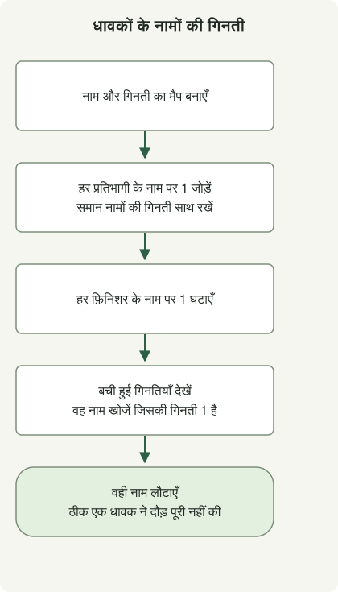

---
{
  "state": "draft",
  "language": "hi",
  "translationKey": "2021-07-23-unsuccessful-runner",
  "title": "Java में नामों की गिनती से दौड़ पूरी न करने वाले धावक को खोजें",
  "description": "HashMap में हर नाम के प्रतिभागियों की संख्या से उसी नाम के फ़िनिशरों की संख्या घटाएँ। एक ही नाम के कई धावक हों, तब भी बची हुई गिनती से पता चलता है कि कौन दौड़ पूरी नहीं कर पाया।",
  "sourcePath": "src/content/posts/en/2021-07-23-unsuccessful-runner.md",
  "sourceSha256": "a8c9e485842a9d8718e6cec7f5d0bcbda5a716bad751608cc67094ac938487d6"
}
---

किस धावक ने दौड़ पूरी नहीं की, यह जानने के लिए हर नाम के लोगों की संख्या गिनें। प्रतिभागियों की गिनती से उसी नाम के फ़िनिशरों की गिनती घटाएँ। प्रश्न की शर्त के अनुसार अंत में ठीक एक नाम की गिनती 1 बचती है।

[इनपुट की शर्तों](https://school.programmers.co.kr/learn/courses/30/lessons/42576) के अनुसार अधिकतम 100,000 प्रतिभागी होते हैं और दौड़ पूरी करने वालों की संख्या एक कम होती है। कई लोगों का नाम एक हो सकता है। हर नाम अंग्रेज़ी के 1–20 छोटे अक्षरों से बनता है। माना गया है कि प्रतिभागियों की सूची से एक व्यक्ति हटाने पर फ़िनिशरों की सूची मिलती है, भले ही क्रम अलग हो।

## नामों की गिनती का क्रम



पहले सभी प्रतिभागियों को गिनें। फिर हर फ़िनिशर के नाम की गिनती एक घटाएँ। अंत में वह नाम लौटाएँ जिसकी गिनती एक बची है।

## हर नाम के लिए गिनती का अंतर रखें

पूरी क्लास को `Solution.java` में सहेजें। मूल उदाहरण को Java 11 के लिए संकलित करके JDK 17 पर चलाया गया था।

```java
import java.util.HashMap;
import java.util.Map;

public class Solution {
    public String solution(String[] participant, String[] completion) {
        Map<String, Integer> counts = new HashMap<>();
        for (String name : participant) counts.merge(name, 1, Integer::sum);
        for (String name : completion) counts.put(name, counts.get(name) - 1);
        for (Map.Entry<String, Integer> entry : counts.entrySet()) {
            if (entry.getValue() == 1) return entry.getKey();
        }
        throw new IllegalArgumentException("Expected exactly one missing runner");
    }
}
```

`merge(name, 1, Integer::sum)` नए नाम की गिनती 1 से शुरू करता है और पहले से दर्ज नाम की गिनती बढ़ाता है। हर फ़िनिशर के लिए उसके नाम की गिनती एक घटती है। यदि प्रतिभागी `[ana, bob, ana]` और फ़िनिशर `[bob, ana]` हैं, तो ana की गिनती `2 - 1 = 1` बचती है।

दो Set का अंतर लेने पर यह जानकारी खो जाएगी कि ana नाम के दो लोग थे। गिनती रखने से एक ही नाम के सभी लोग दर्ज रहते हैं और छूटा हुआ व्यक्ति मिल जाता है। फ़िनिशरों के ऐरे का क्रम बदलने से उत्तर नहीं बदलता।

## HashMap के क्रम पर निर्भर क्यों नहीं होना पड़ता

[`HashMap`](https://docs.oracle.com/en/java/javase/17/docs/api/java.base/java/util/HashMap.html) प्रविष्टियों को पढ़ने का कोई निश्चित क्रम नहीं देता। पहली धनात्मक प्रविष्टि लौटाना इसलिए सही है क्योंकि मान्य इनपुट में ऐसी केवल एक प्रविष्टि बचती है। कोड उसी नाम को लौटाता है जिसकी गिनती 1 है।

अंत में दिया गया अपवाद पूरे इनपुट की जाँच नहीं करता। दो सूचियों का मिलान करने वाले सामान्य API को अनजान फ़िनिशरों और एक से अधिक लापता लोगों के लिए अलग नियम और जाँच चाहिए।

नाम की लंबाई अधिकतम 20 है। यदि हैश पर होने वाली क्रियाओं में औसतन स्थिर समय लगे, तो कुल समय O(n) है और u अलग-अलग नामों के लिए अतिरिक्त स्थान O(u) है। यहाँ कोई बेंचमार्क यह तय नहीं करता कि स्ट्रीम या लूप हर स्थिति में अधिक तेज़ है।

जब केवल अलग-अलग प्रकारों की संख्या मायने रखती है, तब Set काफ़ी है। [पोनकेटमोन अभ्यास में चयन की सीमा](/hi/posts/2021-07-29-ponkemon/) देखें।
