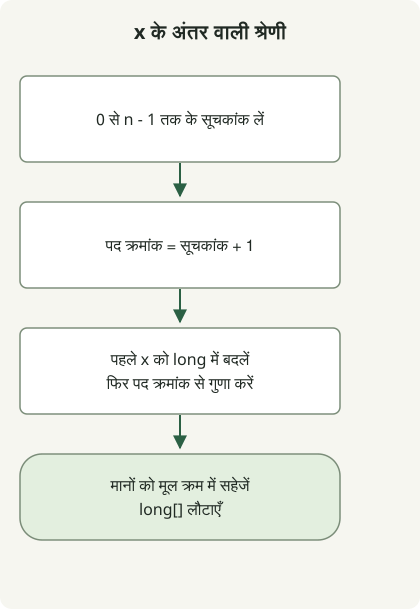

---
{
  "state": "draft",
  "language": "hi",
  "translationKey": "2021-07-29-interval-num",
  "title": "Java में x के अंतर वाली श्रेणी बनाएँ और गुणा से पहले long में बदलें",
  "description": "IntStream से x से लेकर x*n तक n पद बनाएँ। जानें कि अकेला mapToLong गुणा में int ओवरफ़्लो क्यों नहीं रोकता और धनात्मक, ऋणात्मक तथा शून्य अंतर के लिए परिणाम कैसे जाँचें।",
  "sourcePath": "src/content/posts/en/2021-07-29-interval-num.md",
  "sourceSha256": "4674cdefcccdc5107e92b9fe49ee186426b25a096d2687d60d42724c51d29cf4"
}
---

x से शुरू होने वाली श्रेणी के n पद `x × 1` से `x × n` तक हैं। परिणाम int की सीमा से बाहर जा सकते हैं, इसलिए परिणाम का ऐरे long का होना चाहिए और **गुणा भी long में** होना चाहिए।

[अभ्यास](https://school.programmers.co.kr/learn/courses/30/lessons/12954) में x की सीमा -10,000,000 से 10,000,000 और n की सीमा 1 से 1,000 है। इसलिए अंतिम पद का निरपेक्ष मान 10,000,000,000 तक हो सकता है और उसे रखने के लिए long ऐरे चाहिए।

## सूचकांक से श्रेणी तक



शून्य से शुरू होने वाले हर सूचकांक को उसके पद क्रमांक में बदलें। फिर x को long में बदलकर गुणा करें और मानों को उसी क्रम में ऐरे में रखें।

## सूचकांक से पद क्रमांक निकालें

पूरी क्लास को `Solution.java` में सहेजें। मूल उदाहरण को Java 11 के लिए संकलित करके JDK 17 पर चलाया गया था।

```java
import java.util.stream.IntStream;

public class Solution {
    public long[] solution(int x, int n) {
        return IntStream.range(0, n)
                .mapToLong(i -> (long) x * (i + 1))
                .toArray();
    }
}
```

[`IntStream.range(0, n)`](https://docs.oracle.com/en/java/javase/17/docs/api/java.base/java/util/stream/IntStream.html) से 0 से n-1 तक के सूचकांक मिलते हैं। x को `i + 1` से गुणा करने पर पहला पद x और अंतिम पद x×n होता है। x×0 से शुरू करने पर प्रश्न में माँगी गई श्रेणी बदल जाएगी।

| x | n | परिणाम |
| --- | --- | --- |
| 2 | 5 | `[2,4,6,8,10]` |
| -4 | 2 | `[-4,-8]` |
| 0 | 3 | `[0,0,0]` |

ऋणात्मक x के लिए हर अगला पद छोटा होता है। x=0 होने पर सभी पद शून्य होते हैं। पदों का मूल क्रम बनाए रखें। उन्हें छाँटने की ज़रूरत नहीं है।

## अकेला mapToLong गुणा में ओवरफ़्लो क्यों नहीं रोकता

`mapToLong` के भीतर भी `x * (i + 1)` में दोनों संकार्य int हैं, इसलिए गुणा int में होता है। `(long) (x * (i + 1))` लिखने पर भी प्रकार बदलने तक ओवरफ़्लो हो चुका हो सकता है।

उदाहरण में `(long) x * (i + 1)` पहले एक संकार्य को long में बदलता है। धनात्मक और ऋणात्मक सीमाओं के लिए पूरे परिणाम ऐरे संदर्भ ऐरे से मिलाए गए थे, जिनके अंतिम पद क्रमशः 10,000,000,000 और -10,000,000,000 थे। छोटे धनात्मक, ऋणात्मक और शून्य इनपुट के परिणाम भी बार-बार जोड़कर बनाए गए ऐरे से मिलाए गए थे।

समय O(n) है और लौटाए गए ऐरे सहित स्थान O(n) है। यह विधि अभ्यास की शर्तों पर आधारित है। यह श्रेणी के आकार या किसी सामान्य API को मिलने वाले मनमाने इनपुट की जाँच नहीं करती।

अपनी इनपुट सीमाओं में int में समाने वाली गणनाओं के लिए [चिह्न सहित योग](/hi/posts/2021-07-22-plus-minus/) और [ऐरे का अदिश गुणनफल](/hi/posts/2021-07-22-dot-product/) देखें। [Java कोडिंग अभ्यास मार्गदर्शिका](/hi/categories/coding-test/) में ऐरे के साथ स्ट्रिंग और कलेक्शन के अभ्यास भी हैं।
