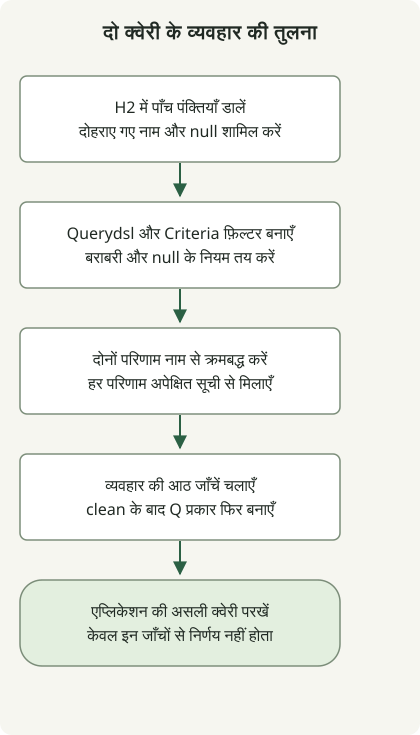

---
{
  "state": "draft",
  "language": "hi",
  "translationKey": "2023-09-05-querydsl-no-release",
  "title": "Querydsl से JPA Specification पर जाने से पहले अपनी क्वेरी कैसे जाँचें",
  "description": "H2 के एक ही डेटा पर Querydsl और JPA Specification की शर्तों की तुलना करें। दोहराए गए मान, शाब्दिक मिलान, AND/OR, null के नियम और स्ट्रिंग से लिखे एट्रिब्यूट की त्रुटि जाँचें।",
  "sourcePath": "src/content/posts/en/2023-09-05-querydsl-no-release.md",
  "sourceSha256": "23fe3b60bb4735a72a59a7bcc0dfabd76d68df0af84bdd636d79f15699cfc798"
}
---

क्वेरी टूल चुनते समय देखें कि आपको कौन-सी क्वेरी लिखनी है और उसका व्यवहार कैसे जाँचेंगे। दो रिलीज़ के बीच लंबा अंतराल विकल्पों की पड़ताल करने की वजह हो सकता है। इससे यह तय नहीं होता कि टूल बदलने पर एप्लिकेशन की क्वेरी पहले जैसे परिणाम देगी।

मूल लेख में 2023 में उठाई गई चिंता के बाद [Querydsl 5.1.0 रिलीज़](https://github.com/querydsl/querydsl/releases/tag/QUERYDSL_5_1_0) हुई। टैग से उस रिलीज़ की पुष्टि होती है। जिस संस्करण-शृंखला को अपनाना चाहते हैं, उसके रिपॉज़िटरी, आर्टिफ़ैक्ट निर्देशांक और संगतता को अलग से परखें। नीचे के संस्करण उदाहरण को दोहराने के लिए तय किए गए हैं। इन्हें आज के प्रोडक्शन परिवेश की सिफ़ारिश न समझें।

## एक प्रतिनिधि शर्त का परिणाम मिलाएँ



वही पाँच पंक्तियाँ डालें, दोनों शर्तें बनाएँ और परिणामों को पहले से तय मानों से मिलाएँ। इन परीक्षणों का दायरा H2 पर इसी एंटिटी तक है। माइग्रेशन का फ़ैसला करने के लिए अपने एप्लिकेशन के जॉइन, प्रोजेक्शन, पेजिनेशन और डेटाबेस का व्यवहार भी जाँचें।

[Spring Data JPA Specifications](https://docs.spring.io/spring-data/jpa/reference/3.5/jpa/specifications.html) से Criteria की शर्तें जोड़कर `JpaSpecificationExecutor` के माध्यम से चलाई जा सकती हैं। साधारण रिपॉज़िटरी फ़िल्टर के लिए मौजूदा JPA पर्सिस्टेंस मॉडल में इतना ही पर्याप्त हो सकता है।

## Querydsl उदाहरण में तीन फ़ाइलें जोड़ें

[जकार्ता Querydsl के पूरे प्रोजेक्ट](/hi/posts/2023-09-09-springboot3-querydsl/) की पाँचों फ़ाइलों से शुरू करें, जिनमें `Employee.getName()` भी है। उदाहरण को दोहराने के लिए Java17, Gradle8.4, Boot3.5.7, Querydsl5.1.0 Jakarta और H2 इस्तेमाल किए गए थे। नीचे दी गई तीन पूरी फ़ाइलें जोड़ें। इस कॉन्फ़िगरेशन को मार्गदर्शिका के अलग Boot4 उदाहरणों के साथ न मिलाएँ।

### `src/main/java/example/EmployeeRepository.java`

```java
package example;

import org.springframework.data.jpa.repository.JpaRepository;
import org.springframework.data.jpa.repository.JpaSpecificationExecutor;

public interface EmployeeRepository extends JpaRepository<Employee, Long>,
        JpaSpecificationExecutor<Employee> {}
```

### `src/main/java/example/EmployeeSpecs.java`

```java
package example;

import org.springframework.data.jpa.domain.Specification;

public final class EmployeeSpecs {
    private EmployeeSpecs() {}

    public static Specification<Employee> named(String name) {
        if (name == null) throw new IllegalArgumentException("Use withoutName for null");
        return (root, query, builder) -> builder.equal(root.get("name"), name);
    }

    public static Specification<Employee> withoutName() {
        return (root, query, builder) -> builder.isNull(root.get("name"));
    }
}
```

### `src/test/java/example/QueryStrategyTest.java`

```java
package example;

import java.util.Arrays;
import java.util.List;
import com.querydsl.core.types.Predicate;
import com.querydsl.jpa.impl.JPAQueryFactory;
import org.junit.jupiter.api.BeforeEach;
import org.junit.jupiter.api.Test;
import org.springframework.beans.factory.annotation.Autowired;
import org.springframework.boot.test.autoconfigure.orm.jpa.DataJpaTest;
import org.springframework.boot.test.autoconfigure.orm.jpa.TestEntityManager;
import org.springframework.dao.InvalidDataAccessApiUsageException;
import org.springframework.data.domain.Sort;
import org.springframework.data.jpa.domain.Specification;

import static org.assertj.core.api.Assertions.*;

@DataJpaTest
class QueryStrategyTest {
    @Autowired TestEntityManager entityManager;
    @Autowired EmployeeRepository employees;
    final QEmployee employee = QEmployee.employee;

    @BeforeEach
    void seed() {
        for (String name : Arrays.asList("Alice", "Bob", "Alice", "A_%", null)) {
            entityManager.persist(new Employee(name));
        }
        entityManager.flush();
    }

    void equivalent(Predicate predicate, Specification<Employee> specification,
                    List<String> expected) {
        var querydsl = new JPAQueryFactory(entityManager.getEntityManager())
                .select(employee.name).from(employee).where(predicate)
                .orderBy(employee.name.asc()).fetch();
        var criteria = employees.findAll(specification, Sort.by("name"))
                .stream().map(Employee::getName).toList();
        assertThat(querydsl).containsExactlyElementsOf(expected);
        assertThat(criteria).containsExactlyElementsOf(expected);
    }

    @Test
    void exactEqualityPreservesDuplicates() {
        equivalent(employee.name.eq("Alice"), EmployeeSpecs.named("Alice"),
                List.of("Alice", "Alice"));
    }

    @Test
    void missingValueReturnsNoRows() {
        equivalent(employee.name.eq("Missing"), EmployeeSpecs.named("Missing"), List.of());
    }

    @Test
    void wildcardCharactersAreLiteralForEquality() {
        equivalent(employee.name.eq("A_%"), EmployeeSpecs.named("A_%"), List.of("A_%"));
    }

    @Test
    void andCanEliminateAllRows() {
        equivalent(employee.name.eq("Alice").and(employee.name.eq("Bob")),
                EmployeeSpecs.named("Alice").and(EmployeeSpecs.named("Bob")), List.of());
    }

    @Test
    void orKeepsMatchesAndDuplicatesInOrder() {
        equivalent(employee.name.eq("Alice").or(employee.name.eq("Bob")),
                EmployeeSpecs.named("Alice").or(EmployeeSpecs.named("Bob")),
                List.of("Alice", "Alice", "Bob"));
    }

    @Test
    void nullRequiresAnExplicitPredicate() {
        equivalent(employee.name.isNull(), EmployeeSpecs.withoutName(),
                Arrays.asList((String) null));
    }

    @Test
    void stringAttributeTypoFailsAtRuntime() {
        Specification<Employee> typo = (root, query, builder) ->
                builder.equal(root.get("missingName"), "Alice");
        assertThatThrownBy(() -> employees.findAll(typo))
                .isInstanceOf(InvalidDataAccessApiUsageException.class);
    }

    @Test
    void equalityHelpersRejectNull() {
        assertThatThrownBy(() -> employee.name.eq((String) null))
                .isInstanceOf(IllegalArgumentException.class);
        assertThatThrownBy(() -> EmployeeSpecs.named(null))
                .isInstanceOf(IllegalArgumentException.class);
    }
}
```

JDK17 चुनकर प्रोजेक्ट की मूल डायरेक्टरी में ये कमांड चलाएँ।

```sh
gradle --version
gradle --no-daemon clean test
```

अब प्रोजेक्ट में दस परीक्षण हैं। इनमें मूल Querydsl की दो जाँचें और व्यवहार की तुलना तथा अनुबंध की आठ जाँचें हैं। परिणामों की छह तुलनाओं में दोनों कार्यान्वयनों का परिणाम स्वतंत्र रूप से तय की गई सूची से मिलना चाहिए। केवल आपस में मिलना पर्याप्त नहीं है। Q प्रकार दोबारा बनते हैं या नहीं, यह देखने के लिए `clean test` फिर चलाएँ।

| स्थिति | अपेक्षित परिणाम |
| --- | --- |
| नाम Alice के बराबर | Alice दो बार मिलता है |
| नाम मौजूद नहीं है | कोई पंक्ति नहीं |
| नाम `A_%` के बराबर | अक्षरशः वही मान मिलता है। LIKE पैटर्न लागू नहीं होता |
| Alice AND Bob | कोई पंक्ति नहीं |
| Alice OR Bob | नाम के क्रम में Alice, Alice, Bob |
| null के लिए स्पष्ट शर्त | एक पंक्ति जिसका नाम null है |

## टूल बदलते समय अलग व्यवहार का ध्यान रखें

Querydsl में जनरेट हुआ `employee.name` Java का एक सदस्य है। इस Specification में `root.get("name")` एट्रिब्यूट का नाम स्ट्रिंग में लेता है। इसलिए जानबूझकर गलत लिखा गया `missingName` भी संकलित हो जाता है और त्रुटि तब आती है जब रिपॉज़िटरी इसे चलाती है। Specifications में स्ट्रिंग का इस्तेमाल अनिवार्य नहीं है। [JPA का स्टैटिक मेटामॉडल](https://docs.spring.io/spring-data/jpa/reference/3.5/jpa/specifications.html) भी एक विकल्प है।

उदाहरण का `named` सहायक null को स्पष्ट रूप से अस्वीकार करता है और Querydsl में बराबरी की जाँच भी इसे अस्वीकार करती है। null मानों के लिए अलग `withoutName()` और `isNull()` शर्तें इस्तेमाल करें। यह उदाहरण का इनपुट नियम है। वास्तविक माइग्रेशन में अनजाने में null का अर्थ बदलकर फ़िल्टर हटा देना परिणाम बदल सकता है।

| टूल | क्या परखें |
| --- | --- |
| Querydsl JPA | जनरेट होने वाले Q प्रकार, JPA क्वेरी के रूप और प्रोसेसर की संगतता |
| JPA Specification | दोबारा इस्तेमाल होने वाले Criteria फ़िल्टर और रिपॉज़िटरी से उनका एकीकरण |
| [jOOQ](https://www.jooq.org/doc/latest/manual/getting-started/use-cases/jooq-as-a-sql-builder-without-codegeneration/) | SQL-केंद्रित DSL और स्कीमा मॉडलिंग। कोड जनरेशन वैकल्पिक है |
| [Jdbi](https://jdbi.org/) | JDBC क्वेरी और परिणामों की मैपिंग |
| [Doma](https://docs.domaframework.org/en/latest/) | संकलन के समय प्रोसेसिंग, SQL टेम्पलेट और Criteria API |

ये टूल अलग-अलग स्तरों पर काम करते हैं। इस परीक्षण में jOOQ, Jdbi या Doma की तुलना और प्रदर्शन का बेंचमार्क शामिल नहीं है। इससे प्रोडक्शन डेटाबेस पर समान व्यवहार की पुष्टि भी नहीं होती। टूल बदलने से पहले अपने वास्तविक जॉइन, क्रम, पेजिनेशन, null के नियम और ट्रांज़ैक्शन के परीक्षण जोड़ें। चुने हुए डेटाबेस का व्यवहार और आर्टिफ़ैक्ट की लाइसेंस शर्तें भी जाँचें।

[Spring Boot मार्गदर्शिका](/hi/categories/springboot/) प्रोजेक्ट सेटअप, पर्सिस्टेंस की जाँच, HTTP परीक्षण और पैकेजिंग को जोड़ती है। हर लेख में उसके उदाहरण को दोहराने के लिए इस्तेमाल हुए संस्करण दिए गए हैं।
