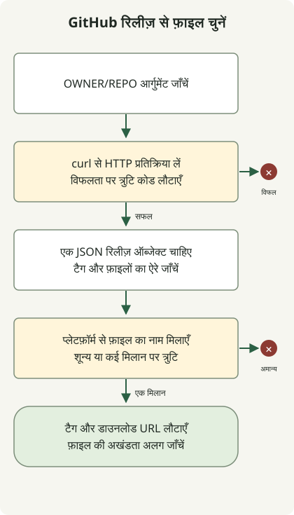

---
{
  "state": "draft",
  "language": "hi",
  "translationKey": "2023-09-23-linux-shellscript-github-latest",
  "title": "curl और jq से GitHub की नवीनतम रिलीज़ की एक डाउनलोड फ़ाइल कैसे चुनें",
  "description": "OS, CPU और फ़ाइल प्रारूप के अनुसार एक रिलीज़ फ़ाइल चुनें। HTTP त्रुटि, अमान्य JSON और शून्य या एक से अधिक मिलानों को अलग-अलग सँभालें।",
  "sourcePath": "src/content/posts/en/2023-09-23-linux-shellscript-github-latest.md",
  "sourceSha256": "921c781aad6d00452ee4730c3ae3ccb6d7af94c4ec4e129e5968b7f1ae596e61"
}
---

GitHub की नवीनतम रिलीज़ की जानकारी `curl` से लें और `jq` से अपने OS, CPU और फ़ाइल प्रारूप के लिए ठीक एक डाउनलोड फ़ाइल चुनें। नीचे की स्क्रिप्ट HTTP त्रुटि, अमान्य JSON या मेल खाने वाली फ़ाइलों की संख्या शून्य या एक से अधिक होने पर रुक जाती है। यह फ़ाइल डाउनलोड किए बिना उसका मेटाडेटा लौटाती है।

`releases/latest` एंडपॉइंट Git टैगों में सबसे बड़ी संख्यात्मक वैल्यू नहीं खोजता। [रिलीज़ API के दस्तावेज़](https://docs.github.com/en/rest/releases/releases#get-the-latest-release) साधारण टैग, ड्राफ़्ट, प्रीरिलीज़ और प्रकाशित रिलीज़ के बीच अंतर बताते हैं।

यह उदाहरण सार्वजनिक `adoptium/temurin17-binaries` रिपॉज़िटरी से Linux x64 HotSpot JDK की tar.gz फ़ाइल का मेटाडेटा माँगता है। इसके लिए टोकन या फ़ाइल डाउनलोड की ज़रूरत नहीं है। रिपॉज़िटरी आर्गुमेंट न देने पर यही डिफ़ॉल्ट लागू होता है। स्पष्ट रूप से खाली आर्गुमेंट देने पर स्क्रिप्ट उसे अस्वीकार करती है।

## रिलीज़ से फ़ाइल चुनने का क्रम



HTTP अनुरोध विफल होने पर स्क्रिप्ट JSON पढ़ने से पहले रुक जाती है। वैध रिलीज़ ऑब्जेक्ट में ठीक एक फ़ाइल शर्तों से मेल खानी चाहिए। उसका URL चुनने से डाउनलोड हुई फ़ाइल की जाँच नहीं होती।

## HTTP त्रुटि और JSON से फ़ाइल चुनने की त्रुटि अलग पहचानें

स्क्रिप्ट के लिए `curl`, `jq` और POSIX sh चाहिए। इसे `latest-release.sh` नाम से सहेजें।

### `latest-release.sh`

```sh
#!/bin/sh
set -eu
if [ "$#" -gt 1 ]; then
    printf '%s\n' 'usage: latest-release.sh OWNER/REPO' >&2
    exit 2
fi
repo=${1-adoptium/temurin17-binaries}
case "$repo" in
    */*/*|/*|*/|*[!A-Za-z0-9_./-]*) printf '%s\n' 'usage: latest-release.sh OWNER/REPO' >&2; exit 2 ;;
esac
case "$repo" in
    */*) ;;
    *) printf '%s\n' 'usage: latest-release.sh OWNER/REPO' >&2; exit 2 ;;
esac
api=${GITHUB_API_URL:-https://api.github.com}
response=$(curl --fail --silent --show-error --location --max-time 20 \
    --header 'Accept: application/vnd.github+json' \
    --header 'X-GitHub-Api-Version: 2026-03-10' \
    "$api/repos/$repo/releases/latest") || exit 1
printf '%s' "$response" | jq --slurp --exit-status '
    if length != 1 or (.[0] | type) != "object" then
        error("expected one release object")
    else .[0] end
    | . as $release
    | if (.tag_name | type) != "string" or (.tag_name | length) == 0
         or (.assets | type) != "array" then
        error("missing release tag or assets")
      else . end
    | [.assets[] | select(.name | test("^OpenJDK17U-jdk_x64_linux_hotspot_.*\\.tar\\.gz$"))] as $assets
    | if ($assets | length) != 1 then
        error("expected exactly one Linux x64 JDK tar.gz asset")
      elif ($assets[0].browser_download_url | type) != "string"
           or ($assets[0].browser_download_url | length) == 0 then
        error("missing asset download URL")
      else {tag_name: $release.tag_name, download_url: $assets[0].browser_download_url} end
'
```

```sh
sh latest-release.sh adoptium/temurin17-binaries
```

सफल होने पर JSON ऑब्जेक्ट में `tag_name` और `download_url` मिलते हैं। इनके मान अनुरोध के समय उपलब्ध रिलीज़ पर निर्भर हैं। नीचे का परीक्षण डेटा परिणाम का प्रारूप दिखाता है। यह मौजूदा नवीनतम रिलीज़ का विवरण नहीं है।

```json
{"tag_name":"jdk-17.0.8.1+1","download_url":"https://github.com/adoptium/temurin17-binaries/releases/download/example/OpenJDK17U-jdk_x64_linux_hotspot_example.tar.gz"}
```

`curl --fail` पहले HTTP त्रुटियाँ सँभालता है। प्रतिक्रिया को पार्स करने से पहले सहेजने पर पाइपलाइन का अंतिम कमांड नेटवर्क की विफलता को छिपा नहीं पाता। [curl के विकल्प](https://curl.se/docs/manpage.html)।

`jq --slurp` पूरा इनपुट एक ऐरे में पढ़ता है। ठीक एक JSON मान की शर्त से खाली प्रतिक्रिया भी अस्वीकार हो जाती है। इसके बाद फ़िल्टर रिलीज़ ऑब्जेक्ट, टैग और फ़ाइलों के ऐरे को जाँचता है। सही नाम वाली ठीक एक फ़ाइल मिलने पर ही परिणाम देता है। [jq की नियमावली](https://jqlang.org/manual/)।

## ऑटोमेशन में किन परिणामों को सँभालें?

| स्थिति | परिणाम |
| --- | --- |
| वैध प्रतिक्रिया और मेल खाती एक फ़ाइल | JSON आउटपुट, निकास कोड 0। |
| HTTP403/404 या कनेक्शन विफल | निकास कोड शून्य से अलग। |
| खाली प्रतिक्रिया या अमान्य JSON | निकास कोड शून्य से अलग। |
| कोई फ़ाइल मेल न खाए या कई मेल खाएँ | मनमाने ढंग से फ़ाइल चुनने के बजाय विफलता लौटाएँ। |
| रिपॉज़िटरी आर्गुमेंट का प्रारूप अमान्य | उपयोग का संदेश, निकास कोड 2। |

HTTP अनुरोध सफल हो लेकिन कोई फ़ाइल मेल न खाए, तो `jq` फ़िल्टर बदलने से पहले रिलीज़ के फ़ाइल नाम देखें। यह उदाहरण Java 17 का Linux x64 पैकेज चुनता है, सभी JDK पैकेज नहीं। Java 21 के लिए [Temurin के प्लेटफ़ॉर्म मेटाडेटा का उदाहरण](/hi/posts/2023-10-10-temurin-jdk21-delay/) देखें। रिपॉज़िटरी या प्लेटफ़ॉर्म के मान YAML से आते हों, तो उन्हें कमांड में देने से पहले [कॉन्फ़िगरेशन को डेटा की तरह पढ़ें और जाँचें](/hi/posts/2021-07-27-parse-yaml/)।

मूल उदाहरण में स्थानीय HTTP प्रतिक्रियाओं से सफल अनुरोध, HTTP त्रुटियाँ, अमान्य JSON और मेल खाने वाली फ़ाइलों की अनुपस्थिति या दोहराव जाँचे गए थे। `GITHUB_API_URL` डिफ़ॉल्ट रूप से सार्वजनिक API का पता लेता है। इसे उसी प्रतिक्रिया प्रारूप वाले परीक्षण सर्वर पर भी सेट कर सकते हैं।

सार्वजनिक संसाधन पढ़ने के लिए प्रमाणीकरण की ज़रूरत नहीं है। प्रमाणित अनुरोध जोड़ें तो टोकन को सोर्स कोड और शेल ट्रेस लॉग से बाहर रखें। अनुरोध सीमा से संबंधित प्रतिक्रिया हेडर और [GitHub के दर-सीमा दस्तावेज़](https://docs.github.com/en/rest/using-the-rest-api/rate-limits-for-the-rest-api) देखें।

स्क्रिप्ट URL चुनती है। इंस्टॉलेशन फ़ाइल की अखंडता की जाँच अलग से करनी होती है। इंस्टॉलेशन को स्वचालित करने के लिए प्रदाता के चेकसम या हस्ताक्षर और लक्षित प्लेटफ़ॉर्म की जानकारी भी चाहिए। किसी टैग को [संख्यात्मक संस्करणों की तुलना करने वाली स्क्रिप्ट](/hi/posts/2023-11-17-linux-shellscript-version-compare/) में देने से पहले जाँचें कि उसका प्रारूप उस स्क्रिप्ट की शर्तों के अनुरूप है।

चुनी हुई फ़ाइल डाउनलोड करने के बाद [उसका SHA-256 चेकसम भरोसेमंद अपेक्षित मान से मिलाएँ](/hi/posts/2026-10-30-verify-sha256-download/)। जाँच प्रोग्राम स्थानीय बाइट पढ़ता है। वह रिलीज़ को डाउनलोड या प्रमाणित नहीं करता।
