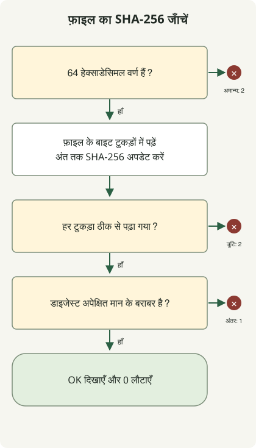

---
{
  "state": "draft",
  "language": "hi",
  "translationKey": "2026-10-30-verify-sha256-download",
  "title": "Python से डाउनलोड की हुई फ़ाइल का SHA-256 चेकसम कैसे जाँचें",
  "description": "फ़ाइल को टुकड़ों में पढ़कर उसका SHA-256 भरोसेमंद मान से मिलाएँ। सही, बदली हुई और न पढ़ी जा सकने वाली फ़ाइल के लिए निकास कोड समझें।",
  "sourcePath": "src/content/posts/en/2026-10-30-verify-sha256-download.md",
  "sourceSha256": "9c91eef87fd5390b5be8f867c298bdaaaa20979b4571c13ba7694d62ba172e89"
}
---

डाउनलोड की हुई फ़ाइल जाँचने के लिए उसका SHA-256 डाइजेस्ट निकालें और किसी भरोसेमंद प्रकाशक से मिले अपेक्षित मान से मिलाएँ। Python का [hashlib](https://docs.python.org/3.11/library/hashlib.html) बाइनरी डेटा को टुकड़ों में पढ़कर हैश निकाल सकता है। मिलान से केवल पता चलता है कि इन बाइट का डाइजेस्ट उस मान के बराबर है। इससे प्रकाशक की पहचान या प्रोग्राम की सुरक्षा सिद्ध नहीं होती। Adoptium ने [हस्ताक्षर सत्यापन](https://adoptium.net/installation/gpg-verification) की प्रक्रिया अलग बताई है।

## किस चेकसम से मिलाएँ?

उसी रिलीज़, OS, CPU और आर्काइव प्रारूप का चेकसम लें जिसकी फ़ाइल आपने डाउनलोड की है। [GitHub रिलीज़ से फ़ाइल चुनने वाली स्क्रिप्ट](/hi/posts/2023-09-23-linux-shellscript-github-latest/) डाउनलोड URL चुनती है। [Temurin मेटाडेटा का उदाहरण](/hi/posts/2023-10-10-temurin-jdk21-delay/) चेकसम का प्रारूप भी जाँचता है। दोनों में से कोई भी डाउनलोड हुई फ़ाइल का हैश नहीं निकालता। Adoptium के [आर्काइव से इंस्टॉल करने के निर्देश](https://adoptium.net/installation/archives) बताते हैं कि फ़ाइल के साथ दिया गया चेकसम कहाँ मिलेगा।

अपेक्षित मान प्रकाशक के भरोसेमंद वितरण माध्यम से लें। डाउनलोड की हुई फ़ाइल से डाइजेस्ट निकालकर उसी को अपेक्षित मान मान लेने से ग़लत डाउनलोड पकड़ में नहीं आएगा। यदि कोई हमलावर फ़ाइल और उसके साथ प्रकाशित चेकसम दोनों बदल सके, तो उनका मेल प्रामाणिकता सिद्ध नहीं करता। प्रकाशक की विश्वसनीय कुंजी से हस्ताक्षर जाँचना अलग चरण है, जो इस उदाहरण के दायरे से बाहर है।

## फ़ाइल की जाँच कैसे होती है?



अपेक्षित मान जाँचें, एक ऐसी नियमित फ़ाइल को बाइनरी मोड में खोलें जो बदल न रही हो, फ़ाइल का अंत आने तक हर टुकड़े से डाइजेस्ट अपडेट करें और फिर तुलना करें। अमान्य इनपुट या पढ़ने की त्रुटि पर 2, अंतर मिलने पर 1 और केवल मिलान होने पर 0 लौटता है। चित्र में टुकड़े पढ़ने का लूप एक चरण में दिखाया गया है। जाँच के दौरान या जाँच और उपयोग के बीच फ़ाइल को बदलें या उसकी जगह दूसरी फ़ाइल न रखें। यह उपकरण जाँच और निष्पादन को एक अविभाज्य क्रिया के रूप में नहीं करता।

## अतिरिक्त पैकेज के बिना जाँच चलाएँ

Python 3.11 या उसके बाद का संस्करण इस्तेमाल करें और नीचे का प्रोग्राम `verify-sha256.py` नाम से सहेजें। कमांड POSIX शेल के लिए हैं। प्रोग्राम स्थानीय फ़ाइल पढ़ता है। वह उसे डाउनलोड, अनपैक या निष्पादित नहीं करता। यदि सिमलिंक किसी नियमित फ़ाइल की ओर इशारा करता है तो प्रोग्राम उसे पढ़ता है। इसे चेकसम मैनिफ़ेस्ट, फ़ाइल नाम या URL की जगह 64 हेक्साडेसिमल वर्णों का एक मान दें। बड़े अक्षर भी मान्य हैं।

### `verify-sha256.py`

```python
import hashlib
from pathlib import Path
import re
import sys


def main(argv):
    if len(argv) != 3 or not re.fullmatch(r"[0-9a-fA-F]{64}", argv[1]):
        print("usage: verify-sha256.py EXPECTED_SHA256 FILE", file=sys.stderr)
        return 2
    path = Path(argv[2])
    try:
        if not path.is_file():
            raise OSError("expected an existing regular file")
        digest = hashlib.sha256()
        with path.open("rb") as source:
            for chunk in iter(lambda: source.read(1024 * 1024), b""):
                digest.update(chunk)
    except OSError as error:
        print(f"READ ERROR: {error}", file=sys.stderr)
        return 2
    if digest.hexdigest() != argv[1].lower():
        print("MISMATCH", file=sys.stderr)
        return 1
    print("OK")
    return 0


if __name__ == "__main__":
    raise SystemExit(main(sys.argv))
```

`rb` पंक्ति के अंत समेत मूल बाइट को सुरक्षित रखता है। हर बार अधिकतम 1 MiB पढ़ा जाता है, इसलिए पूरी फ़ाइल मेमोरी में नहीं लानी पड़ती। अमान्य चेकसम मिलने पर प्रोग्राम पाथ खोलने से पहले रुक जाता है। पाथ न मिलने, डायरेक्टरी मिलने और पढ़ने में त्रुटि आने पर निकास कोड 2 है। नेम्ड पाइप और डिवाइस फ़ाइल नियमित फ़ाइल की शर्त पूरी नहीं करते।

## मेल खाती और बदली हुई फ़ाइल से जाँच दोहराएँ

नई खाली डायरेक्टरी लें। यह परीक्षण `sample.bin` में तीन बाइट `abc` और `changed.bin` में `abcd` लिखता है। कमांड में दिया डाइजेस्ट केवल `abc` का है। यह किसी JDK आर्काइव का चेकसम नहीं है।

### `make-samples.py`

```python
from pathlib import Path

Path("sample.bin").write_bytes(b"abc")
Path("changed.bin").write_bytes(b"abcd")
```

```sh
python3 make-samples.py
expected='ba7816bf8f01cfea414140de5dae2223b00361a396177a9cb410ff61f20015ad'
python3 verify-sha256.py "$expected" sample.bin
python3 verify-sha256.py "$expected" changed.bin
printf 'exit=%s\n' "$?"
```

मेल खाती फ़ाइल के लिए `OK` दिखाई देता है। बदली हुई फ़ाइल के लिए stderr पर `MISMATCH` और अंतिम कमांड से `exit=1` मिलता है। `set -e` इस्तेमाल करते समय अपेक्षित अंतर के लिए स्पष्ट `if` या त्रुटि सँभालने की दूसरी शाखा रखें। वरना शेल निकास कोड दिखाने से पहले रुक सकता है।

| निकास कोड | अर्थ | अगला कदम |
| --- | --- | --- |
| 0 | डाइजेस्ट दिए गए अपेक्षित मान से मेल खाता है | अपेक्षित मान भरोसेमंद स्रोत से मिला हो तभी आगे बढ़ें |
| 1 | डाइजेस्ट अलग हैं | फ़ाइल इस्तेमाल करना रोकें और चुनी गई रिलीज़ फ़ाइल तथा डाउनलोड जाँचें |
| 2 | आर्गुमेंट, चेकसम के प्रारूप या फ़ाइल पढ़ने में त्रुटि | इनपुट या फ़ाइल तक पहुँच ठीक करके दोबारा चलाएँ |

सिर्फ़ अंतर मिलने से यह तय नहीं होता कि फ़ाइल ख़राब हुई, ग़लत फ़ाइल चुनी गई या किसी ने जानबूझकर उसे बदला। इस जाँच में हस्ताक्षर सत्यापन या मैलवेयर स्कैन शामिल नहीं है।
