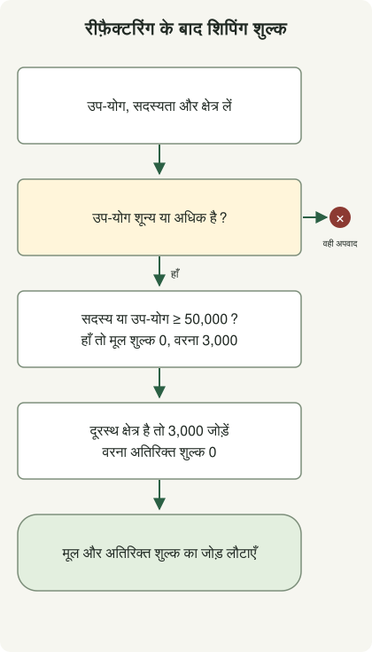

---
{
  "state": "draft",
  "language": "hi",
  "translationKey": "2026-10-31-ai-agent-refactoring",
  "title": "AI एजेंट के साथ रीफ़ैक्टरिंग करते समय कोड का व्यवहार कैसे जाँचें",
  "description": "एजेंट को बदलाव का दायरा, बनाए रखने वाला व्यवहार और जाँच के कमांड दें। Java के पहले और बाद के कोड और प्रॉम्प्ट से सीमांत मामले, अपवाद और टेस्ट की विश्वसनीयता परखें।",
  "sourcePath": "src/content/posts/en/2026-10-31-ai-agent-refactoring.md",
  "sourceSha256": "efd733fd275675221deef4ebffa545ba2f54a6819e72fed217917d6708e3e4b9"
}
---

**AI एजेंट के साथ रीफ़ैक्टरिंग शुरू करते समय तय करें कि कौन-सा व्यवहार बचाना है और कहाँ बदलाव करना है। फिर कोड चलाकर मिले परिणाम और diff देखकर बदलाव जाँचें।** फ़ंक्शन छोटा हो जाना या एजेंट का यह कहना कि “टेस्ट पास हो गए” काफ़ी नहीं है। देखें कि लौटाए गए मान, अपवाद और बाहरी प्रभाव पहले जैसे हैं और कहीं जाँच ही कमज़ोर तो नहीं कर दी गई।

यह गाइड उन डेवलपरों के लिए है जो Git और टेस्ट चलाना जानते हैं। इसके लिए किसी ख़ास उत्पाद के इंटरफ़ेस या मॉडल की ज़रूरत नहीं है। नीचे के प्रॉम्प्ट दिए गए काम के लिए लिखे गए उदाहरण हैं जिन्हें आप अपनाकर बदल सकते हैं। ये किसी उत्पाद से हुई बातचीत के प्रतिलेख या प्रदर्शन मापन नहीं हैं। Java उदाहरण को चलाने के परिणाम अलग दिए गए हैं।

## पहले अनुरोध में क्या शामिल करें?

[मार्टिन फ़ाउलर की परिभाषा](https://refactoring.com/) के अनुसार रीफ़ैक्टरिंग में बाहर से दिखाई देने वाला व्यवहार बनाए रखते हुए कोड की आंतरिक संरचना बदली जाती है। नीति में बदलाव या बग सुधार ज़रूरी हो, तो उसे रीफ़ैक्टरिंग से अलग रखें ताकि पुराने और नए परिणामों का अंतर समझ सकें।

एजेंट को लक्षित फ़ाइलों के साथ उन्हें कॉल करने वाला कोड, संबंधित टेस्ट, रिपॉज़िटरी की परंपराएँ और जाँच के वास्तविक कमांड दें। पूरी रिपॉज़िटरी पढ़वाने की जगह उन पाथ से शुरू करें जिनकी इस निर्णय के लिए ज़रूरत है। पहले बिना संपादन किए मौजूदा व्यवहार और उसके प्रमाण समझाने को कहें। इससे ग़लतफ़हमी के कारण बदलाव का दायरा फैलने का जोखिम घट सकता है।

नीचे की शिपिंग नीति के नियम **सिर्फ़ उदाहरण के लिए तय किए गए हैं**। ये किसी वास्तविक सेवा की नीति या घटना की रिपोर्ट नहीं हैं।

| शर्त | व्यवहार जो बनाए रखना है |
| --- | --- |
| ऑर्डर का उप-योग ऋणात्मक है | `IllegalArgumentException("subtotal")` फेंकें |
| सदस्य है या ऑर्डर का उप-योग कम से कम 50,000 KRW है | मूल शिपिंग शुल्क 0 KRW |
| अन्यथा | मूल शिपिंग शुल्क 3,000 KRW |
| डिलीवरी द्वीप या दूरस्थ क्षेत्र में है | मूल शिपिंग मुफ़्त होने पर भी 3,000 KRW जोड़ें |

पहला अनुरोध इस तरह लिख सकते हैं। मान लें कि आगे दिया गया पूरा कोड `ShippingRefactorDemo.java` में सहेजा है। एजेंट से संपादन का अभ्यास करने के लिए पहले `before()` का फ़ंक्शन बॉडी `after()` में कॉपी करें। तुलना के लिए नीचे के पूरे कोड में रीफ़ैक्टरिंग का अंतिम रूप दिया है।

```text
ShippingRefactorDemo.java में before(), after() और main() पढ़कर केवल विश्लेषण करें।
अभी फ़ाइलें न बदलें।

लक्ष्य है before() का शिपिंग शुल्क वाला व्यवहार बनाए रखते हुए after() में नेस्टेड शाखाएँ घटाना।
राशियाँ KRW में हैं और उनका प्रकार long है।
ऋणात्मक राशि पर अपवाद का प्रकार और संदेश, 50,000 KRW की सीमा,
और मुफ़्त मूल शिपिंग व दूरस्थ क्षेत्र के अतिरिक्त शुल्क के संयोजन जाँचें।

मौजूदा व्यवहार का प्रमाण कोड से दें। बताएँ कि टेस्ट अभी क्या जाँचते हैं,
और कौन-से सीमांत मामले जाँचने चाहिए। ऐसा न्यूनतम बदलाव सुझाएँ जो केवल after() तक सीमित हो।
अस्पष्ट नीति को अनुमान लगाकर न बदलें।
```

इस चरण में हर शर्त का मौजूदा व्यवहार और संपादन की जगह पहचानना उपयोगी है। “कोड की गुणवत्ता बढ़ाने की योजना” भर से काम नहीं चलेगा। मसलन, “सदस्य हमेशा शिपिंग के लिए 0 KRW देते हैं” वाली व्याख्या दूरस्थ क्षेत्र के अतिरिक्त शुल्क से टकराती है। इसे कोड बदलने से पहले ठीक करें।

## छोटा बदलाव करें और व्यवहार मिलाएँ

इस उदाहरण में दोहराई गई शाखाओं से **मूल शिपिंग और अतिरिक्त शुल्क की गणना अलग की गई है**। मौजूदा इनपुट, आउटपुट और अपवाद बनाए रखने के लिए कोई नया स्ट्रैटेजी इंटरफ़ेस या कॉन्फ़िगरेशन परत नहीं जोड़ी गई। छोटा बदलाव होने से समीक्षक जाँच सकता है कि नीति जस की तस है और केवल संरचना बदली है। [छोटे बदलावों पर Google के दिशानिर्देश](https://google.github.io/eng-practices/review/developer/small-cls.html)



चित्र नीचे के `after()` में गणना का क्रम दिखाता है, AI टूल की आंतरिक कार्यप्रणाली नहीं। `before()` और `after()` इस उदाहरण के लिए लिखे गए हैं। `main()` स्पष्ट अपेक्षित मान जाँचता है और दोनों के परिणाम मिलाता है। यह बाहरी निर्भरताओं के बिना JDK 21 या बाद के संस्करण पर चलता है।

```java
public class ShippingRefactorDemo {
    static final long FREE_THRESHOLD = 50_000;
    record Case(long subtotal, boolean member, boolean remote, long expected) {}

    static long before(long subtotal, boolean member, boolean remote) {
        if (subtotal < 0) throw new IllegalArgumentException("subtotal");
        if (member) {
            if (remote) return 3_000;
            return 0;
        }
        if (subtotal >= 50_000) {
            if (remote) return 3_000;
            return 0;
        }
        if (remote) return 6_000;
        return 3_000;
    }

    static long after(long subtotal, boolean member, boolean remote) {
        if (subtotal < 0) throw new IllegalArgumentException("subtotal");
        long base = (member || subtotal >= FREE_THRESHOLD) ? 0 : 3_000;
        long surcharge = remote ? 3_000 : 0;
        return base + surcharge;
    }

    static void equal(long actual, long expected) {
        if (actual != expected) {
            throw new AssertionError("expected=" + expected + ", actual=" + actual);
        }
    }

    public static void main(String[] args) {
        Case[] examples = {
            new Case(0, false, false, 3_000),
            new Case(49_999, false, false, 3_000),
            new Case(50_000, false, false, 0),
            new Case(0, true, false, 0),
            new Case(49_999, false, true, 6_000),
            new Case(50_000, false, true, 3_000),
            new Case(0, true, true, 3_000),
            new Case(Long.MAX_VALUE, false, true, 3_000)
        };
        for (Case c : examples) {
            equal(before(c.subtotal(), c.member(), c.remote()), c.expected());
            equal(after(c.subtotal(), c.member(), c.remote()), c.expected());
        }
        System.out.println("examples=" + examples.length);

        int comparisons = 0;
        long[] amounts = {0, 1, 49_999, 50_000, 50_001, Long.MAX_VALUE};
        for (long subtotal : amounts) {
            for (boolean member : new boolean[] {false, true}) {
                for (boolean remote : new boolean[] {false, true}) {
                    equal(after(subtotal, member, remote), before(subtotal, member, remote));
                    comparisons++;
                }
            }
        }
        System.out.println("comparisons=" + comparisons);

        int rejected = 0;
        for (boolean refactored : new boolean[] {false, true}) {
            try {
                if (refactored) after(-1, false, false);
                else before(-1, false, false);
                throw new AssertionError("Negative amount was accepted");
            } catch (IllegalArgumentException e) {
                if (!"subtotal".equals(e.getMessage())) throw new AssertionError(e);
                rejected++;
            }
        }
        System.out.println("negative-inputs=" + rejected);
    }
}
```

```sh
javac --release 21 ShippingRefactorDemo.java
java ShippingRefactorDemo
```

मूल उदाहरण में Zulu JDK `21.0.1+12-LTS` पर नीचे का आउटपुट मिला। शुरुआती संस्करण में `after()` और `before()` की बॉडी एक जैसी थी। उस संस्करण और यहाँ दिए गए रीफ़ैक्टरिंग के अंतिम रूप, दोनों से यही आउटपुट मिला।

```text
examples=8
comparisons=24
negative-inputs=2
```

Java के `assert` को `-ea` विकल्प के आधार पर बंद किया जा सकता है। इसलिए अंतर मिलने पर कोड सीधे `AssertionError` फेंकता है। आउटपुट में दिए अंक तय किए गए मामलों और इनपुट संयोजनों की गिनती हैं। वे पूरे प्रोडक्शन कोड की टेस्ट कवरेज नहीं बताते।

बदलाव लागू करने को कहते समय पहले जाँची गई शर्तों के साथ संपादन का दायरा और चलाने के कमांड भी दें।

```text
ऊपर तय शिपिंग नियम बनाए रखते हुए केवल after() को रीफ़ैक्टर करें।
before(), main(), अपेक्षित मान और FREE_THRESHOLD न बदलें।
सार्वजनिक इनपुट और आउटपुट, अपवाद के प्रकार और संदेश बनाए रखें। नई निर्भरता या परत न जोड़ें।
यदि इस फ़ाइल के बाहर बदलाव ज़रूरी लगे, तो उसे लागू किए बिना कारण बताएँ।

javac --release 21 ShippingRefactorDemo.java और java ShippingRefactorDemo चलाएँ।
वास्तव में चलाए गए कमांड, निकास कोड, प्राप्त आउटपुट और बदलाव का diff दें।
जाँच विफल हो तो विफल शर्त और उसका कारण पहचानकर ठीक करें। टेस्ट पास कराने के लिए जाँच हटाएँ या अपेक्षित मान न बदलें।
```

एजेंट फ़ाइल संपादित या कमांड निष्पादित न कर सके, तो सुझाया पैच ख़ुद लागू करें और वही कमांड चलाएँ। प्रॉम्प्ट में “न बदलें” लिखना केवल काम का दायरा बताता है। टूल की वास्तविक अनुमतियाँ और फ़ाइल तक पहुँच की पाबंदियाँ अलग लागू होती हैं।

## क्या टेस्ट पास होने का अर्थ है कि व्यवहार सुरक्षित रहा?

यह उदाहरण 8 स्पष्ट अपेक्षित मान जाँचता है, 24 इनपुट संयोजनों पर बदलाव से पहले और बाद के परिणाम मिलाता है और ऋणात्मक इनपुट के लिए दोनों मेथड के अपवाद जाँचता है। इससे हर संभव `long` इनपुट पर समानता सिद्ध नहीं होती। केवल `before()` के परिणाम को सही उत्तर मानने से पुरानी त्रुटियाँ भी बच सकती हैं। स्वतंत्र अपेक्षित मान और व्यावसायिक आवश्यकताएँ भी इस्तेमाल करें। कोई पुराना दोष मिले तो अलग से तय करें कि उसे ठीक करना है या नहीं और कौन-सा व्यवहार बदलेगा।

प्रासंगिक अंतर जाँच में पकड़ में आता है या नहीं, यह देखने के लिए एक प्रति-उदाहरण भी बना सकते हैं। मसलन, `subtotal >= FREE_THRESHOLD` को `after()` में `subtotal > FREE_THRESHOLD` कर देने पर ग़ैर-सदस्य का ठीक 50,000 KRW वाला ऑर्डर मुफ़्त मूल शिपिंग से बाहर हो जाता है। तब अपेक्षित मान की जाँच विफल होनी चाहिए।

अस्थायी कॉपी में केवल इस सीमा को ग़लत बदलकर चलाने पर `AssertionError: expected=0, actual=3000` के साथ विफलता की पुष्टि हुई थी। इससे पता चलता है कि जाँच इस ख़ास ग़लती को पकड़ती है। हर ग़लत बदलाव पकड़ने की गारंटी नहीं मिलती। लेख के अंतिम कोड में यह ग़लती शामिल नहीं है।

वास्तविक प्रोजेक्ट में रिटर्न मान के साथ कॉल करने वाले को दिखाई देने वाले दूसरे व्यवहार भी जाँचें। इनमें अपवाद, डेटाबेस क्वेरी और ट्रांज़ैक्शन की सीमाएँ, बाहरी कॉल की संख्या और क्रम, सीरियलाइज़ किए गए परिणाम और संसाधन मुक्त करना शामिल हैं। इस शुद्ध फ़ंक्शन के टेस्ट पास होने से डेटाबेस या HTTP पाथ की जाँच नहीं होती। प्रदर्शन सुधारना लक्ष्य हो तो निश्चित इनपुट और परिवेश में अलग से माप भी लें।

## अंतिम समीक्षा में पहले बदलाव देखें, फिर स्पष्टीकरण

एजेंट का विवरण पढ़ने से पहले diff और निष्पादन के परिणाम देखें। अनावश्यक फ़ाइल बदलाव, हटाए या छोड़े गए टेस्ट, दबाए गए अपवाद और असंबंधित निर्भरताएँ खोजें। `git diff --check` खाली जगह जैसी फ़ॉर्मैटिंग की त्रुटियाँ जाँचता है। इससे व्यावसायिक व्यवहार नहीं परखा जाता।

अलग संदर्भ में समीक्षा करा सकें तो शुरुआत में सफलता का दावा देने के बजाय मूल आवश्यकताएँ, पहले और बाद का कोड, diff और चलाने के प्रमाण दें। समीक्षा के निष्कर्ष भी ग़लत हो सकते हैं। हर टिप्पणी को कोड और आवश्यकताओं के प्रमाण से मिलाएँ। [एजेंट की सीमाओं पर GitHub के दस्तावेज़](https://docs.github.com/en/copilot/responsible-use/agents) भी बताते हैं कि जनरेट किया गया कोड और समीक्षा टिप्पणियाँ ग़लत हो सकती हैं।

```text
बिना संपादन किए इस बदलाव की समीक्षा करें।
इनपुट में शिपिंग शुल्क के नियम, पहले और बाद का कोड, diff, टेस्ट कमांड और वास्तविक परिणाम हैं।

ऐसे प्रति-उदाहरण खोजें जिनमें लौटाया गया मान, अपवाद, 50,000 KRW की सीमा या दूरस्थ क्षेत्र का शुल्क बदल गया हो।
दायरे से बाहर के बदलाव और कमज़ोर किए गए टेस्ट भी जाँचें।
हर निष्कर्ष के साथ जगह, एक उदाहरण इनपुट, दिखाई देने वाला अंतर और उसका प्रमाण दें।
जो जाँच नहीं चलाई, उसे चलाने का दावा न करें।
```

अंत में संक्षेप में बताएँ कि संरचना में क्या बदला, कौन-सा व्यवहार बना रहा, कौन-सी जाँच वास्तव में चली और क्या जाँचना बाक़ी है। टेस्ट विफल हो तो विफलता दिखाने वाले इनपुट और उसके अपेक्षित व्यवहार को अधिक स्पष्ट करें, फिर उसी मामले तक सुधार सीमित करें। बदलाव बढ़ने लगें तो उन्हें अलग कामों में बाँटें। एजेंट के साथ भी **इतना छोटा बदलाव जिसे देखकर समीक्षक समझा सके कि व्यवहार क्यों बना रहा**, काम पूरा मानने का व्यावहारिक आधार है।
