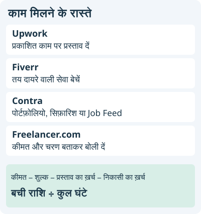

---
{
  "state": "draft",
  "language": "hi",
  "translationKey": "2026-11-25-overseas-freelance-platforms",
  "title": "अतिरिक्त फ़्रीलांस काम के लिए Upwork, Fiverr, Contra और Freelancer.com की तुलना",
  "description": "दक्षिण कोरिया से काम करने वाले डेवलपर प्रस्ताव, सेवा सूची, भुगतान सुरक्षा और शुल्क काटने के बाद प्रति घंटे की कमाई की तुलना कैसे करें।",
  "sourcePath": "src/content/posts/en/2026-11-25-overseas-freelance-platforms.md",
  "sourceSha256": "459d7a14dff0b6e636f388225c92b5c5b2feacd82c5314c7ee576111648842aa"
}
---

**यदि आप दक्षिण कोरिया से फ़्रीलांस डेवलपमेंट शुरू कर रहे हैं, तो प्रकाशित कामों पर प्रस्ताव देने के लिए Upwork और तय दायरे वाली एक ही सेवा बार-बार बेचने के लिए Fiverr देखें।** किसी की सिफ़ारिश से ग्राहक मिल चुका हो और अब अनुबंध व भुगतान सँभालना हो, तो Contra उपयुक्त हो सकता है। Freelancer.com पर भी बोली दे सकते हैं। पहले बोली के लिए ज़रूरी बैलेंस और तय कीमत का काम स्वीकार करते समय लगने वाला शुल्क देखें।

मान लें कि Spring Boot का एक टेस्ट विफल हो रहा है। कारण मालूम न हो तो ग्राहक का विवरण पढ़ें और शुल्क लेकर समस्या की जाँच का प्रस्ताव दें। यदि आप इसी तरह के टेस्ट नियमित रूप से ठीक करते हैं, तो सेवा के विवरण में लिख सकते हैं कि कौन-सा टेस्ट ठीक करेंगे और ग्राहक को क्या सौंपेंगे। यह तुलना प्लेटफ़ॉर्म के अपने दस्तावेज़ों पर आधारित है, जिन्हें 25 नवंबर 2026 को जाँचा गया था।

## ग्राहक कहाँ मिलते हैं और क्या ख़र्च आता है?

| प्लेटफ़ॉर्म | काम कैसे मिलता है | किन ख़र्चों पर ध्यान दें |
| --- | --- | --- |
| Upwork | हर काम के लिए अलग प्रस्ताव भेजें | प्रति अनुबंध 0–15% सेवा शुल्क। ज़रूरी Connects की संख्या पोस्टिंग के अनुसार बदलती है। ख़रीदे गए हर Connect की कीमत $0.15 है। |
| Fiverr | दायरा और कीमत तय करके सेवा (Gig) सूचीबद्ध करें और ऑर्डर लें | पूरे हुए ऑर्डर की कीमत का 80% आपको मिलता है। |
| Contra | पोर्टफ़ोलियो या Job Feed से ग्राहक खोजें या अपना मौजूदा ग्राहक लाएँ | फ़्रीलांसर का कमीशन 0% है। प्लेटफ़ॉर्म और प्रोसेसिंग शुल्क के साथ निकासी व मुद्रा रूपांतरण की लागत भी जाँचें। |
| Freelancer.com | कीमत और डिलीवरी के चरण बताकर बोली दें | तय कीमत वाले सामान्य काम पर 10% या $5 में जो अधिक हो, वह शुल्क है। घंटे के हिसाब से काम पर सामान्य शुल्क 10% है। बोली के लिए सामान्य न्यूनतम बैलेंस $20 है। |

[Upwork का सेवा शुल्क](https://support.upwork.com/hc/en-us/articles/211062538-Learn-about-the-Freelancer-Service-Fee) · [Upwork Connects](https://support.upwork.com/hc/en-us/articles/211062898-About-Connects-costs-uses-balances-and-expiration) · [Fiverr की कमाई](https://help.fiverr.com/hc/en-us/articles/9234443621137-Your-earnings-page) · [Contra के शुल्क](https://help.contra.com/en/articles/9322934-fees-overview) · [Freelancer.com के शुल्क](https://www.freelancer.com/feesandcharges)

### Upwork पर हर काम के लिए हल का प्रस्ताव दें

पोस्टिंग चुनें और दायरा, समय और कीमत बताएँ। कारण स्पष्ट न हो तो पहला अनुबंध सशुल्क जाँच तक सीमित रखें। विफल टेस्ट को दोबारा चलाकर कारण और सुधार की योजना दें। असफल आवेदन में भी समय लगता है और Connects ख़र्च हो सकते हैं। आवेदन से पहले दिखाया गया अनुबंध शुल्क और आवश्यक Connects दोनों जाँचें।

तय कीमत वाले अनुबंध में ग्राहक हर चरण के लिए पहले से पैसा जमा कर सकता है। भुगतान सुरक्षा के लिए काम शुरू होने से पहले उस चरण की पूरी राशि जमा होना ज़रूरी है। तय काम **Submit Work for Payment** से सौंपें। कोरियाई वॉन खाते में **Direct to Local Bank** से हर निकासी पर Upwork का शुल्क $0.99 था। आपके बैंक के अपने शुल्क और शर्तें हो सकती हैं। [तय कीमत वाले काम की भुगतान सुरक्षा](https://support.upwork.com/hc/en-us/articles/211063748-How-Fixed-Price-Payment-Protection-works-for-freelancers-on-Upwork) · [स्थानीय बैंक में निकासी](https://support.upwork.com/hc/en-us/articles/211063888-How-to-withdraw-earnings-with-Direct-to-Local-Bank)

### Fiverr पर ऐसी सेवा बेचें जिसे बार-बार दे सकें

ऐसी सेवा तय करें जिसे ग्राहक सीधे ऑर्डर कर सके, जैसे विफल हो रहा एक Spring Boot टेस्ट ठीक करना और पैच के साथ विफलता दोहराने का कमांड देना। कीमत के साथ समर्थित संस्करण, संशोधन और ग्राहक से आवश्यक सामग्री लिखें ताकि हर ऑर्डर में वही दायरा इस्तेमाल कर सकें। दूसरे मॉड्यूल में भी बदलाव लग सकता हो तो पहले दायरा स्पष्ट करें या अलग कीमत का प्रस्ताव भेजें।

ग्राहक ऑर्डर पेज पर काम देखकर उसे स्वीकार कर सकता है या संशोधन माँग सकता है। आम तौर पर ऑर्डर पूरा होने के 14 दिन बाद कमाई निकासी के लिए उपलब्ध होती है। कुछ स्तरों और कार्यक्रमों में यह पहले भी हो सकती है। Payoneer से बैंक ट्रांसफ़र समेत अपने चुने विकल्प की क्षेत्रीय उपलब्धता और न्यूनतम निकासी राशि देखें। [ऑर्डर और कमाई उपलब्ध होने का समय](https://help.fiverr.com/hc/en-us/articles/360010639617-A-freelancer-s-guide-to-the-Fiverr-order-process) · [Fiverr से निकासी के तरीके](https://help.fiverr.com/hc/en-us/articles/360010530058-Withdrawing-your-earnings-managing-payout-methods)

### Contra पर पोर्टफ़ोलियो से अनुबंध तक जाएँ

सिफ़ारिश से आए ग्राहक को पोर्टफ़ोलियो दिखाकर अनुबंध और भुगतान एक जगह सँभालें या Job Feed से नया काम खोजें। फ़्रीलांसर का कमीशन 0% था, लेकिन मुफ़्त प्लान में प्लेटफ़ॉर्म शुल्क $15 था जब भुगतान $1–$499 हो, और $29 जब भुगतान $500 या अधिक हो। भुगतान के तरीके और प्लान के अनुसार अंतिम शुल्क जाँचें। शुल्क सूची में कोरियाई वॉन खाते में स्थानीय ट्रांसफ़र के लिए $2 दिए गए थे। मुद्रा रूपांतरण अलग से जाँचें। [Contra का परिचय](https://help.contra.com/en/articles/9322235-contra-overview) · [काम के लिए आवेदन](https://help.contra.com/en/articles/9322973-applying-to-jobs-on-contra) · [भुगतान और निकासी के शुल्क](https://help.contra.com/en/articles/9322934-fees-overview)

नए ग्राहक के साथ स्पष्ट दायरे वाले **Project** में एस्क्रो विकल्पों की तुलना करें। प्रोजेक्ट का पैसा अभी एस्क्रो में हो तो Contra उससे जुड़े विवाद सुलझाने में मदद कर सकता है। अलग से जारी इनवॉइस और भुगतान लिंक इस सहायता के दायरे से बाहर हैं। [सशुल्क प्रोजेक्ट के प्रकार](https://help.contra.com/en/articles/9322763-paid-projects) · [विवाद में सहायता](https://help.contra.com/en/articles/11329360-contra-s-dispute-assistance)

### Freelancer.com पर बोली देने और काम स्वीकार करने से पहले ख़र्च देखें

अपनी कीमत और डिलीवरी के चरण बताकर बोली दें। बोली के लिए सामान्य न्यूनतम उपलब्ध बैलेंस $20 था। कुछ प्रोजेक्ट या खातों में अधिक राशि चाहिए हो सकती है। तय कीमत वाले सामान्य प्रोजेक्ट का शुल्क काम स्वीकार करते ही लगता है। $30 के काम का 10% यानी $3 होता है, इसलिए $5 का न्यूनतम शुल्क लगता है और निकासी के ख़र्च से पहले $25 बचते हैं। [शुल्क और न्यूनतम बैलेंस](https://www.freelancer.com/feesandcharges)

पहला काम शुरू करने से पहले जाँचें कि उस चरण के **Milestone Payment** में राशि जमा हो चुकी है। विवाद उसी भुगतान से जुड़े होते हैं। अपने खाते में उपलब्ध निकासी विकल्प देखें। प्रकाशित Express Withdrawal देश सूची में दक्षिण कोरिया शामिल नहीं था। PayPal और Payoneer दोनों के लिए न्यूनतम निकासी $50 दी गई थी। [चरणवार भुगतान](https://www.freelancer.com/support/payments/how-do-i-get-paid) · [Express Withdrawal की देश सूची](https://www.freelancer.com/support/freelancer/payments/express-withdrawals) · [निकासी के तरीके और न्यूनतम राशि](https://www.freelancer.com/support/payments/how-to-withdraw-funds)

## पहले अनुबंध से प्रति घंटे कितनी कमाई होगी?

केवल सेवा शुल्क घटाने से प्रस्ताव और समीक्षा में लगा समय छूट जाता है। मान लें कि डिलीवरी में 6 घंटे और बातचीत व समीक्षा में 1 घंटा लगता है। आपने 6 प्रस्तावों पर 20 मिनट प्रति प्रस्ताव लगाकर $300 का अनुबंध हासिल किया। मानें कि Upwork इस अनुबंध पर 10% शुल्क दिखाता है। हर प्रस्ताव के लिए 12 ख़रीदे गए Connects और कोरियाई वॉन खाते में एक निकासी भी गणना में लें।



यह उदाहरण केवल Python 3 की मानक लाइब्रेरी का उपयोग करता है। इसे `estimate.py` नाम से सहेजें और `python3 estimate.py` चलाएँ। इसमें विनिमय दर का अंतर और कर शामिल नहीं हैं।

```python
from decimal import Decimal

contract_usd = Decimal("300")
service_fee_rate = Decimal("0.10")
proposals = 6
connects_per_proposal = 12
connect_price_usd = Decimal("0.15")
withdrawal_usd = Decimal("0.99")

proposal_hours = Decimal(proposals * 20) / 60
delivery_hours = Decimal("6")
review_hours = Decimal("1")

proposal_cost = proposals * connects_per_proposal * connect_price_usd
remaining = contract_usd * (1 - service_fee_rate) - proposal_cost - withdrawal_usd
total_hours = proposal_hours + delivery_hours + review_hours

print(f"Costs deducted, before tax: ${remaining:.2f}")
print(f"Total hours: {total_hours:.1f}")
print(f"Per hour, before tax: ${remaining / total_hours:.2f}")
```

उदाहरण चलाने पर यह आउटपुट मिलता है।

```text
Costs deducted, before tax: $258.21
Total hours: 9.0
Per hour, before tax: $28.69
```

उसी $300 के अनुबंध में भी प्रस्ताव दोबारा लिखने या अतिरिक्त संशोधन करने पर प्रति घंटे कमाई बदल जाती है। शुरुआत ऐसे काम से करें जिसे एक पंक्ति में बता सकें, जैसे विफल टेस्ट को दोहराकर पैच देना। यदि कोई अनुबंध से पहले असली ग्राहक कोड पर मुफ़्त ट्रायल या प्लेटफ़ॉर्म से बाहर भुगतान माँगे, तो सार्वजनिक नमूना दिखाएँ या प्लेटफ़ॉर्म पर सशुल्क जाँच का प्रस्ताव दें। [धोखाधड़ी के संकेत पहचानने पर Upwork की गाइड](https://support.upwork.com/hc/en-us/articles/35088484250003-Recognize-red-flags-and-avoid-scams)
