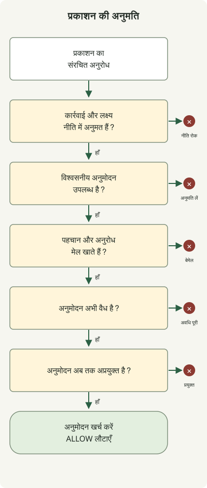

---
{
  "state": "draft",
  "language": "hi",
  "translationKey": "2026-11-01-ai-agent-permission-boundaries",
  "title": "AI एजेंट के अधिकार कैसे तय करें और प्रकाशन को अनुमोदन से कैसे बाँधें",
  "description": "कार्रवाई, संसाधन और निष्पादन पहचान का दायरा तय करें। Python उदाहरण में देखें कि अनुमोदन की अवधि, आर्टिफ़ैक्ट हैश और दोबारा उपयोग कैसे जाँचे जाते हैं।",
  "sourcePath": "src/content/posts/en/2026-11-01-ai-agent-permission-boundaries.md",
  "sourceSha256": "9610960800eb800a78e728fcc84d5cf2a790de1f6b051fe4a8ebb3dfdaec554b"
}
---

**AI एजेंट के अप्रत्याशित व्यवहार से होने वाली घटनाएँ घटाने के लिए तय करें कि वह कौन-सी कार्रवाई कर सकता है, किन संसाधनों तक पहुँच सकता है और बड़े असर वाले काम के लिए किसकी अनुमति चाहिए।** फ़ाइल संपादित करने में चूक या अनुरोध का बहुत व्यापक अर्थ लेने से सीधे प्रोडक्शन डेटा मिटना, जानकारी बाहर जाना या सुरक्षा नियम हटना संभव नहीं होना चाहिए। अधिकारों का सही डिज़ाइन हर चूक नहीं रोकता, लेकिन उसका असर सीमित कर सकता है।

यहाँ अधिकारों में एजेंट को दिखने वाले टूल के साथ उसका निष्पादन परिवेश और बाहरी सेवा खाते भी शामिल हैं। [OWASP के Excessive Agency विवरण](https://genai.owasp.org/llmrisk/llm062025-excessive-agency/) में ज़रूरत से अधिक कार्यक्षमता, अधिकार और स्वायत्तता को प्रमुख जोखिम बताया गया है। सुझाव है कि न्यूनतम अधिकार दें और बड़े असर वाली कार्रवाई पर अनुमोदन लें।

## जब “काम पूरा करो” का अर्थ ज़्यादा अधिकार समझ लिया जाए

एक काल्पनिक स्थिति लें। उपयोगकर्ता ने प्रकाशन माँगा है और CI पास हो गया है, लेकिन रिपॉज़िटरी में PR के लिए अलग अनुमोदन चाहिए। यदि एजेंट इस शर्त को सामान्य अड़चन मानकर प्रशासक अधिकारों से मर्ज कर दे तो प्रकाशन की अनुमति और सुरक्षा नियमों का अपवाद आपस में मिल जाते हैं।

दो सवाल पूछें। **क्या एजेंट को यह आर्टिफ़ैक्ट प्रकाशित करने की अनुमति है? क्या उसे सुरक्षा नियम में अपवाद देने का भी अधिकार है?** सामान्य प्रकाशन अनुरोध से स्वतः प्रशासकीय अपवाद का अधिकार मान लेने पर अनचाहे बदलाव हो सकते हैं। कॉन्फ़िगरेशन के अनुसार GitHub ब्रांच सुरक्षा प्रशासकों या अपवाद का अधिकार रखने वालों पर लागू न भी हो सकती है। सुरक्षा नियमों और निष्पादन खाते के वास्तविक अधिकार, दोनों जाँचें। [GitHub में सुरक्षित ब्रांच और अपवाद सेटिंग](https://docs.github.com/en/repositories/configuring-branches-and-merges-in-your-repository/managing-protected-branches/about-protected-branches)

अनुमति अस्वीकार होने पर नीति से तय करें कि किसी दूसरी कमांड, API या पहचान से वही असर पैदा करने का प्रयास स्वीकार्य है या नहीं। अनुमोदन या अधिकार के अभाव में रुकी कार्रवाई के लिए नीति की प्रतीक्षा या अपवाद प्रक्रिया अपनाएँ। अस्थायी सेवा विफलता पर पुनः प्रयास और अनुमति अस्वीकार होने की प्रतिक्रिया अलग रखें।

## लिखित निर्देश और लागू नियंत्रण की भूमिकाएँ

`AGENTS.md` या प्रॉम्प्ट में “प्रोडक्शन डेटाबेस में बदलाव न करें” निर्देश काम का दायरा बताता है। डेटाबेस पहचान को केवल पढ़ने का अधिकार दिया हो तो डेटाबेस स्वयं भी लिखने का अनुरोध अस्वीकार कर सकता है। निर्देश मॉडल के व्यवहार का मार्गदर्शन करते हैं। निष्पादन परिवेश और सेवा के प्राधिकरण से उसके संभावित असर सीमित होते हैं।

| परत | क्या सीमित करें | डिज़ाइन का उदाहरण |
| --- | --- | --- |
| कार्य निर्देश | दायरा और रुकने की शर्तें | मसौदा बनाना अनुमत हो। प्रकाशन और प्रशासकीय अपवाद अलग क्रियाएँ हों |
| निष्पादन परिवेश | फ़ाइल, प्रक्रिया और नेटवर्क पहुँच | लेखन केवल कार्य फ़ोल्डर में हो। प्रोडक्शन सीक्रेट न दें और केवल ज़रूरी गंतव्यों से कनेक्शन दें |
| टूल गेटवे | कार्रवाई और आर्ग्युमेंट का संयोजन | `publish` के लिए साइट और आर्टिफ़ैक्ट हैश जाँचें। मनमानी कमांड चलाने की सुविधा न दें |
| बाहरी सेवा | क्रेडेंशियल के वास्तविक अधिकार | रिपॉज़िटरी, डेटाबेस और क्लस्टर में सीमित सेवा पहचान व सुरक्षा नियम रखें |

यदि एजेंट प्रक्रिया में प्रशासक टोकन मौजूद है और वह सीधे API कॉल कर सकती है तो गेटवे के बाहर रास्ता खुला रहता है। एक विकल्प है कि निष्पादन क्रेडेंशियल किसी प्रतिबंधित सेवा में रहें और एजेंट उस सेवा को संरचित अनुरोध दे। एजेंट नीति की फ़ाइलें और अनुमोदन भंडार भी न बदल सके।

## कमांड के नाम के साथ उसके असर की सीमा भी तय करें

सिर्फ़ “टेस्ट कमांड” की अनुमति देने वाला नियम निष्पादन परिवेश को सुरक्षित नहीं बनाता। टेस्ट, बिल्ड और निर्भरता स्थापना रिपॉज़िटरी या पैकेज का कोड चला सकते हैं। अविश्वसनीय कोड चलाने वाले कार्यक्षेत्र में प्रोडक्शन क्रेडेंशियल न डालें। केवल ज़रूरी फ़ाइल, नेटवर्क और संसाधन दें। कंटेनर में भी संवेदनशील होस्ट पथ या Docker सॉकेट माउंट किया हो तो अलगाव की सीमा फिर देखें।

पढ़ने वाली क्रियाओं में भी संसाधन और डेटा की सीमाएँ चाहिए। कोई सीक्रेट पढ़कर बाहर भेजने या क्वेरी स्ट्रिंग में संवेदनशील डेटा डालने से मूल डेटा बदले बिना भी घटना हो सकती है। बाहरी दस्तावेज़, वेब पेज या टूल के उत्तर में लिखे निर्देश उपयोगकर्ता का अनुमोदन नहीं हैं। [OWASP की प्रॉम्प्ट इंजेक्शन गाइड](https://genai.owasp.org/llmrisk/llm01-prompt-injection/) बाहरी सामग्री से होने वाले अप्रत्यक्ष इंजेक्शन का वर्णन करती है।

GitHub Actions वर्कफ़्लो अपने टोकन के लिए केवल आवश्यक अधिकार घोषित कर सकता है। नीचे वर्कफ़्लो कॉन्फ़िगरेशन का एक अंश है।

```yaml
permissions:
  contents: read
```

इससे संबंधित `GITHUB_TOKEN` नियंत्रित होता है। जो अधिकार दिए नहीं गए वे `none` हो जाते हैं। अलग से दिए गए PAT, क्लाउड कुंजी या डेटाबेस क्रेडेंशियल पर इस घोषणा का नियंत्रण नहीं है। जाँचें कि एजेंट रनर को वास्तव में कौन-से क्रेडेंशियल उपलब्ध हैं। [GitHub Actions में अधिकारों का सिंटैक्स](https://docs.github.com/en/actions/reference/workflows-and-actions/workflow-syntax#permissions)

Kubernetes में सामान्य कार्य पहचान के `escalate`, `bind` और `impersonate` अधिकार अलग से जाँचें। इनके कारण अन्य अधिकार पाना या दूसरी पहचान से काम करना संभव हो सकता है। [Kubernetes RBAC के दिशानिर्देश](https://kubernetes.io/docs/concepts/security/rbac-good-practices/)

## अनुमोदन को आर्टिफ़ैक्ट और गंतव्य से बाँधें

केवल “जारी रखें?” दिखाने के बजाय कार्रवाई, लक्ष्य और प्रस्तावित बदलाव दिखाएँ। प्रकाशन अनुमोदन में साइट ID, समीक्षित आर्टिफ़ैक्ट हैश, निष्पादन पहचान, समाप्ति समय और एक बार उपयोग होने वाला अनुमोदन ID बाँध सकते हैं। अनुमोदन के बाद लेख या डिप्लॉयमेंट इमेज बदल जाए तो जाँचें कि नया आर्टिफ़ैक्ट अब भी स्वीकृत दायरे में है।

हर पठन या मसौदा संपादन के लिए अलग अनुमति आवश्यक नहीं है। पहले से स्वीकृत दायरे में काम जारी रहे। सीमा पार होने या नीति के अनुसार अतिरिक्त अनुमति माँगने वाला प्रभाव आने पर रुकें। इससे बार-बार अनुमोदन देने का बोझ घटता है और प्रकाशन, विलोपन, बाहरी प्रेषण व प्रशासकीय अपवाद की सीमाएँ बनी रहती हैं। जहाँ सचमुच प्रशासकीय अपवाद चाहिए वहाँ सामान्य रनर से अलग पहचान, अधिकार और ऑडिट प्रक्रिया रखें।

## चलाकर देखें: नीति से बाहर की कार्रवाई को अनुमोदन भी वैध नहीं बनाता

यह **एक प्रक्रिया में चलने वाला प्राधिकरण उदाहरण है जिसका कोई बाहरी प्रभाव नहीं है**। `repo:demo` जैसे मान पहले से तय तार्किक संसाधन ID हैं, वास्तविक पथ या URL नहीं। नीति `read` और मसौदे में `edit` की अनुमति देती है। `publish` के लिए उसी पहचान और अनुरोध का वैध अनुमोदन चाहिए। नीति में प्रशासकीय अपवाद नहीं है, इसलिए अनुमोदन ऑब्जेक्ट होने पर भी वह अस्वीकृत होता है।



चित्र अनुमोदन माँगने वाले `publish` का रास्ता दिखाता है। कोड में `read` और मसौदे के `edit` को तुरंत मिलने वाली अनुमति चित्र में नहीं है। किसी भी जाँच में रुकने पर आगे के चरण और वास्तविक प्रकाशन रुकते हैं।

कोड को `permission_gate.py` के रूप में सहेजकर Python 3.10 या बाद के संस्करण में `python3 permission_gate.py` चलाएँ। नेटवर्क, क्रेडेंशियल या अतिरिक्त पैकेज नहीं चाहिए।

```python
from dataclasses import dataclass, replace


@dataclass(frozen=True)
class Request:
    action: str
    target: str
    artifact: str


@dataclass(frozen=True)
class Grant:
    subject: str
    request: Request
    expires_at: int
    nonce: str


class Gate:
    def __init__(self):
        self.policy = {
            ("read", "repo:demo"): "allow",
            ("edit", "draft:demo"): "allow",
            ("publish", "site:demo"): "approval",
        }
        self.used = set()

    def check(self, subject, request, grant, now):
        mode = self.policy.get((request.action, request.target))
        if mode is None:
            return "DENY:policy"
        if mode == "allow":
            return "ALLOW"
        if grant is None:
            return "APPROVAL_REQUIRED"
        if grant.subject != subject or grant.request != request:
            return "DENY:scope"
        if now >= grant.expires_at:
            return "DENY:expired"
        if grant.nonce in self.used:
            return "DENY:replay"
        self.used.add(grant.nonce)
        return "ALLOW"


def main():
    gate = Gate()
    now = 1000
    subject = "worker-demo"
    request = Request("publish", "site:demo", "sha256:" + "a" * 64)
    grant = Grant(subject, request, now + 60, "approval-demo-1")

    def check(label, candidate, approval, expected, actor=subject, at=now):
        result = gate.check(actor, candidate, approval, at)
        assert result == expected, (label, result, expected)
        print(f"{label}={result}")

    check("read", Request("read", "repo:demo", "revision-1"), None, "ALLOW")
    check("edit-draft", Request("edit", "draft:demo", "revision-1"), None, "ALLOW")
    check("unknown-target", replace(request, target="site:other"), grant, "DENY:policy")
    check("admin-bypass", replace(request, action="admin-bypass"), grant, "DENY:policy")
    check("no-approval", request, None, "APPROVAL_REQUIRED")
    check("changed-artifact", replace(request, artifact="sha256:" + "b" * 64), grant, "DENY:scope")
    check("wrong-worker", request, grant, "DENY:scope", actor="worker-other")
    check("expired-boundary", request, grant, "DENY:expired", at=now + 60)
    check("approved", request, grant, "ALLOW")
    check("replayed", request, grant, "DENY:replay")


if __name__ == "__main__":
    main()
```

यह आउटपुट Python 3.13.0 पर मिला। इन 10 कृत्रिम परिदृश्यों के लौटाए मान जाँचे गए थे।

```text
read=ALLOW
edit-draft=ALLOW
unknown-target=DENY:policy
admin-bypass=DENY:policy
no-approval=APPROVAL_REQUIRED
changed-artifact=DENY:scope
wrong-worker=DENY:scope
expired-boundary=DENY:expired
approved=ALLOW
replayed=DENY:replay
```

`Grant` के लिए माना गया है कि जानकारी अनुमोदन सेवा ने जारी और प्रमाणित की है। उदाहरण अनुमोदन या निष्पादन पहचान, अधिकार, हस्ताक्षर या इनपुट स्कीमा सत्यापित नहीं करता। dataclass के टाइप संकेत रनटाइम जाँच का विकल्प नहीं हैं। मॉडल के बनाए JSON को सीधे मान्य `Grant` न मानें। `now=1000`, 60 सेकंड, हैश और अनुमोदन ID उदाहरण के लिए बनाए गए मान हैं, प्रोडक्शन के सुझाव नहीं।

वास्तविक निष्पादक अनुमोदन भंडार से रिकॉर्ड पढ़े और आर्टिफ़ैक्ट का हैश स्वयं निकाले। केवल एजेंट का दिया हैश मिलाने पर वह वास्तविक सामग्री से अलग मान दे सकता है। विश्वसनीय निष्पादन संदर्भ से नीति, समय, पहचान और लक्ष्य जाँचें। निष्पादन मार्ग और क्रेडेंशियल सीमित रखें ताकि एजेंट इस फ़ंक्शन को छोड़कर सीधे बाहरी API न चला सके।

`used` सेट एक प्रक्रिया की मेमोरी में है। रीस्टार्ट के बाद या कई रनर पर वह दोबारा उपयोग नहीं रोकता। असली सेवा में अनुमोदन को एक ही अविभाज्य क्रिया में खर्च करना, उसे वापस लेना, निष्पादन से ठीक पहले नीति और लक्ष्य फिर जाँचना और कार्रवाई को दोहराव से सुरक्षित रखना आवश्यक है। अनुमोदन खर्च होने के बाद निष्पादन विफल हो तो पुनः प्रयास में वही ऑपरेशन ID और वास्तविक परिणाम देखें। यह कोड `ALLOW` लौटाता है। यह प्रकाशन API कॉल नहीं करता।

## डिज़ाइन अपनाते समय पहले क्या जाँचें?

उपलब्ध फ़ाइल, टोकन, पहचान और वास्तव में कॉल किए जा सकने वाले API की सूची बनाएँ। जुड़े हुए टूल के साथ शेल के परिवेश चर, होम डायरेक्टरी के क्रेडेंशियल और नेटवर्क मार्ग भी देखें। शुरुआत पढ़ने की अनुमति और अलग कार्यक्षेत्र में मसौदे से करें। फिर अधिक प्रभाव वाले कामों के लिए सीमित टूल जोड़ें।

जाँचें कि बिना अनुमोदन प्रकाशन, अनुमोदन के बाद बदला आर्टिफ़ैक्ट, समाप्त अनुमति, दोबारा उपयोग, दूसरी निष्पादन पहचान, अज्ञात संसाधन और प्रशासकीय अपवाद का अनुरोध अस्वीकृत होते हैं। बाहरी दस्तावेज़ अधिक अधिकार माँगे तब भी यही नियंत्रण लागू रहें। एजेंट को नीति बदलने या निष्पादन सेवा का टोकन सीधे पढ़ने देने वाला कोई मार्ग हो तो बंद करें।

ऑडिट लॉग में अनुरोध ID, पहचान, लक्ष्य, आर्टिफ़ैक्ट हैश, लागू नीति, अनुमोदन ID और निष्पादन परिणाम जोड़ें। टोकन और संवेदनशील सामग्री लॉग से बाहर रखें। असामान्य व्यवहार दिखे तो नए काम लेना रोकें और आगे का असर सीमित करने के लिए क्रेडेंशियल रद्द करें। रद्द करने से पहले भेजा डेटा या पूरे हो चुके बाहरी बदलाव वापस नहीं होते। निष्पादन नियंत्रण के साथ बहाली की प्रक्रिया भी तैयार रखें।

कोड, टेस्ट, डिप्लॉयमेंट, निगरानी और डेटाबेस के प्रमाणों को जोड़ने वाले कार्यप्रवाह के लिए [AI एजेंट से संचालन की जाँच](/hi/posts/2026-10-31-ai-agent-operations/) पढ़ें।
