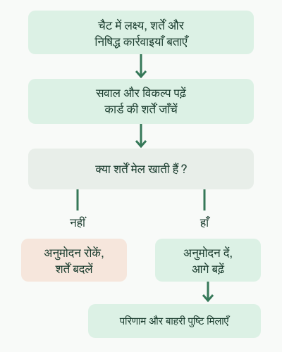

---
{
  "state": "draft",
  "language": "hi",
  "translationKey": "2026-11-15-pickle-ai-guide",
  "title": "Pickle AI का उपयोग: शर्तों के साथ काम सौंपें और परिणाम जाँचें",
  "description": "Pickle AI में जानकारी जुटाने या आरक्षण का अनुरोध दें, ज़रूरी खाते जोड़ें और पुष्टि कार्ड, निर्धारित कार्य व पहुँच के रिकॉर्ड जाँचें।",
  "sourcePath": "src/content/posts/en/2026-11-15-pickle-ai-guide.md",
  "sourceSha256": "14e4d005498c53673a0240cfc0c6b8392223b8b04375e824d04a56b8aa51f6d8"
}
---

Pickle AI एक निजी AI एजेंट है। आप चैट में जानकारी जुटाने या आरक्षण करने जैसा काम सौंप सकते हैं और उसकी प्रगति देख सकते हैं। शुरुआत ऐसे शोध से करें जिसमें भुगतान या खाता जोड़ना ज़रूरी न हो और परिणाम स्वयं जाँचें। आरक्षण या खरीदारी के लिए तारीख़, बजट और अनुमोदन की शर्तें भी बताएँ।

यह गाइड [Pickle की आधिकारिक सहायता](https://www.pickle.com/help) पर आधारित है। नीचे के उदाहरण असली खाते से ऐप चलाने या काम पूरा करने का रिकॉर्ड नहीं हैं। स्क्रीन और उपलब्ध सुविधाएँ ऐप संस्करण, खाते और क्षेत्र के अनुसार बदल सकती हैं।

## शुरू करने से पहले

Pickle ऐप और खाता तैयार करें, फिर ऐप में उपलब्ध प्लान और सीमाएँ देखें। कोरियाई [प्लान गाइड](https://www.pickle.com/help/credits/plans) के अनुसार कोरिया में मुफ़्त उपयोग की एक सीमा है जो रोज़ रीसेट होती है। सीमा पूरी होने पर निर्धारित काम छूट सकते हैं। **My Pickle** टैब में बची सीमा और रीसेट का समय देखें। प्लान और सीमा समय व क्षेत्र के अनुसार बदल सकते हैं।

[आधिकारिक परिचय](https://www.pickle.com/help/start/what-is-pickle) के अनुसार Pickle चैट में अनुरोध लेता है, अलग ब्राउज़र में वेबसाइट पर काम करता है और जो काम ऑनलाइन न हो सके उसके लिए कॉल भी कर सकता है। इससे यह निष्कर्ष निकालने की ज़रूरत नहीं कि वह आपके iPhone पर इंस्टॉल दूसरे ऐप पर सीधे टैप करता है। आपके क्षेत्र और सेवा में सुविधा और कॉल उपलब्ध हैं या नहीं, ऐप की स्क्रीन पर देखें।



चित्र में पुष्टि कार्ड मिलने की स्थिति सरल रूप में दिखाई गई है। हर अनुरोध पर कार्ड मिलना या हर बाहरी कार्रवाई सफल होना निश्चित नहीं है। नीचे का छद्मकोड पाठक के निर्णय का क्रम बताता है। यह Pickle का आंतरिक कोड नहीं है।

```text
अनुरोध = लक्ष्य, तारीख़ और स्थान, बजट, अनुमत और निषिद्ध कार्रवाइयाँ
Pickle को अनुरोध भेजें
अपनी शर्तों के अनुसार अतिरिक्त सवालों का उत्तर दें या विकल्प चुनें
यदि पुष्टि कार्ड दिखे:
    उसकी सामग्री और शर्तें पढ़ें
    शर्तें मेल न खाएँ तो अनुमोदन दिए बिना संशोधन करें
    शर्तें मेल खाएँ तो अनुमोदन दें
परिणाम आने पर अनुरोध और बाहरी पुष्टि से मिलाएँ
```

## पहला काम: बिना भुगतान किए विकल्प ढूँढें

मसलन, रेस्तराँ चुनते समय चैट में नीचे का अनुरोध दें। तारीख़, समय और इलाका अपनी ज़रूरत के अनुसार बदलें।

```text
सियोल के गंगनम स्टेशन के पास 2 लोगों के लिए शनिवार शाम 6 बजे खुले रेस्तराँ ढूँढें।
बजट प्रति व्यक्ति अधिकतम 30,000 वॉन है। शाकाहारी विकल्पों को प्राथमिकता दें।
हर विकल्प का नाम, स्थान, खुलने का समय और मेन्यू के स्रोत का लिंक दें।
आरक्षण, कॉल या भुगतान न करें। अनिश्चित जानकारी अलग बताएँ।
```

तारीख़ या दूसरी शर्तों पर सवाल आएँ तो उत्तर दें। फिर दिए गए लिंक खोलकर उस दिन के खुलने का समय और मेन्यू जाँचें। लिंक न मिले या शर्तें सत्यापित न हों तो पूछें, “आपने कौन-से स्रोत जाँचे? जिस जानकारी की पुष्टि न हो सके उसका अनुमान न लगाएँ।” यह उदाहरण है। सेवा में यह प्रॉम्प्ट चलाकर उसका परिणाम नहीं जाँचा गया था।

[काम सौंपने की गाइड](https://www.pickle.com/help/tasks/delegate) के अनुसार चैट में लक्ष्य बताने पर ज़रूरी विवरण के लिए सवाल आ सकते हैं और प्रस्तावित कार्रवाई व शर्तों का कार्ड दिख सकता है। कार्य कार्ड चैट में दिखाई देते हैं। ऐप बंद करने के बाद भी काम जारी रह सकता है। ऐप बंद करना रद्द करने के बराबर न मानें। रोकना हो तो मौजूदा स्थिति और रद्द करने का विकल्प जाँचें।

## आरक्षण या खरीदारी सौंपना

शोध के परिणाम जाँचने के बाद अलग अनुरोध में स्पष्ट करें कि अब कौन-सी कार्रवाइयाँ अनुमत हैं।

```text
विकल्पों में से मेरे चुने रेस्तराँ में आरक्षण का उपलब्ध समय जाँचें।
शर्तें हैं 2 लोग, शनिवार शाम 6 बजे। अग्रिम राशि या भुगतान चाहिए तो आगे न बढ़ें।
पहले रकम और रद्द करने की शर्तें दिखाएँ।
समय या लोगों की संख्या बदलनी पड़े तो आरक्षण से पहले मुझसे पूछें।
```

पुष्टि कार्ड आए तो जगह, तारीख़, समय, लोगों की संख्या, रकम और रद्द करने की शर्तें पढ़ें। सहमत होने पर ही स्वीकृति दें। आधिकारिक निर्देशों में आरक्षण और भुगतान जैसे मुश्किल से पलट सकने वाले काम से पहले शर्तें पक्की करने का वर्णन है। प्रॉम्प्ट हर चूक नहीं रोक सकता। स्वीकृति के बाद रेस्तराँ या विक्रेता की पुष्टि स्क्रीन या ईमेल में आरक्षण और भुगतान की वास्तविक स्थिति देखें। रद्द करने का अनुरोध करने से बाहर पूरी हो चुकी कार्रवाई स्वतः वापस हो जाएगी, ऐसा न मानें।

## खाते और लॉगिन केवल ज़रूरत पर जोड़ें

ईमेल या कैलेंडर के काम के लिए [आधिकारिक गाइड](https://www.pickle.com/help/start/what-is-pickle) में **My Pickle → Apps and services connected to (Pickle name)** से ज़रूरी खाता जोड़ने का तरीका है। जोड़ते समय दिखाई गई अनुमतियाँ पढ़ें। काम के लिए ज़रूरत न हो तो खाता न जोड़ें। मसलन, बैठक के कुछ संभावित समय ढूँढने के लिए कैलेंडर की पहुँच हमेशा आवश्यक नहीं होती।

वेबसाइट पर साइन इन करना हो तो चैट में पासवर्ड या कार्ड नंबर न लिखें। आधिकारिक दस्तावेज़ में बताई सुरक्षित इनपुट स्क्रीन और Vault इस्तेमाल करें। साइट और माँगी गई जानकारी फिर जाँचें। [सहेजे लॉगिन की गाइड](https://www.pickle.com/help/connect/save-login) के अनुसार Pickle का ब्राउज़र फ़ोन पर सहेजे लॉगिन से अलग है।

क्रेडेंशियल सुरक्षा की भी सीमाएँ हैं। आधिकारिक विवरण कहता है कि मॉडल को पासवर्ड और कार्ड नंबर नहीं दिए जाते। वास्तविक वेब फ़ॉर्म तक मान पहुँचाने वाले रास्ते को अलग से समझना ज़रूरी है। [Pickle AI कैसे काम करता है और पासवर्ड कहाँ तक सुरक्षित रहता है](/hi/posts/2026-11-13-pickle-ai-security/) में सार्वजनिक कोड में दिखने वाली सुरक्षा और सीमाएँ देखें। बातचीत और यादों तक पहुँच की नीतियाँ क्रेडेंशियल भंडारण की नीतियों से अलग हैं। [गोपनीयता विवरण](https://pickle.com/privacy) भी पढ़ें।

## दोहराए जाने वाले काम और पहुँच का रिकॉर्ड जाँचें

नियमित अलर्ट या सारांश के लिए चैट में काम और उसकी आवृत्ति, दोनों बताएँ। जैसे, “हर सोमवार सुबह 9 बजे सार्वजनिक तकनीकी कार्यक्रम ढूँढकर लिंक सहित सारांश दें। पंजीकरण या भुगतान न करें।” बने हुए कार्य के विवरण में समय क्षेत्र और निष्पादन की वास्तविक शर्तें जाँचें।

[निर्धारित कार्य की गाइड](https://www.pickle.com/help/tasks/scheduled) के अनुसार स्क्रीन के ऊपर Pickle के चित्र पर टैप करके प्रोफ़ाइल खोलें। फिर **Scheduled** में कार्य रोक सकते हैं, फिर शुरू कर सकते हैं, बदल या हटा सकते हैं और निष्पादन इतिहास देख सकते हैं। उपयोग सीमा पूरी होने पर कार्य छूट सकता है। दर्ज स्थिति देखें और यह न मानें कि छूटा कार्य अपने आप दोबारा चला होगा।

खाते या कार्ड का उपयोग देखने के लिए [Access log की गाइड](https://pickle.com/help/privacy/activity) में दिया रास्ता खोलें: **My Pickle → Connected apps and services या Payment methods → Encryption banner**। रिकॉर्ड अनुरोध भेजे जाने से ठीक पहले लिखा जाता है। इससे आरक्षण या भुगतान की सफलता साबित नहीं होती। कार्य परिणाम को बाहरी सेवा से मिली पुष्टि से भी मिलाएँ।
