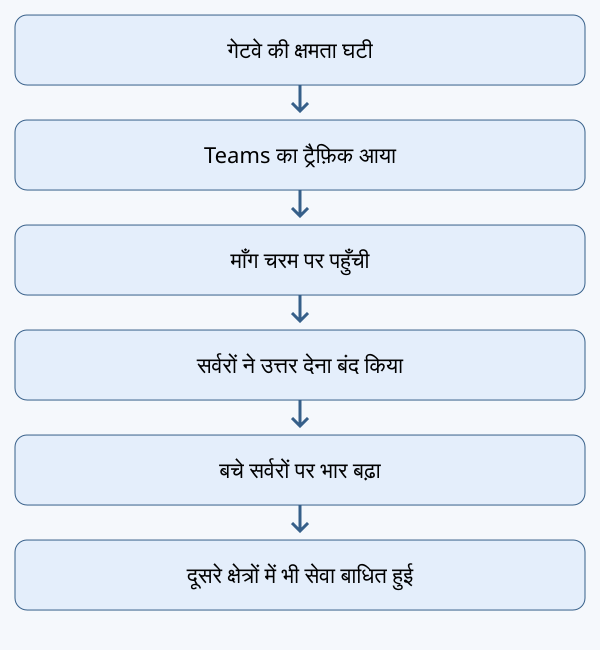

---
{
  "state": "draft",
  "language": "hi",
  "translationKey": "2026-11-25-microsoft-365-code-red",
  "title": "Microsoft 365 के ‘Code Red’ से सीख: ट्रैफ़िक दूसरी जगह भेजने से पहले क्या जाँचें?",
  "description": "Microsoft 365 की सेवा बाधित होने की घटना से समझें कि फ़ेलओवर क्षमता, बहाली के समय कनेक्शन का भार और निर्णयों का साझा रिकॉर्ड क्यों ज़रूरी हैं।",
  "sourcePath": "src/content/posts/en/2026-11-25-microsoft-365-code-red.md",
  "sourceSha256": "2df9b4039ebb04013f04e21b144e3cb3780236a74b97dd9dcd885df36569a389"
}
---

जब कोई सर्वर उत्तर देना बंद करता है तो अनुरोध स्वस्थ सर्वरों को भेजे जाते हैं। आम तौर पर इस वजह से कुछ सर्वर विफल होने पर भी उपयोगकर्ता को रुकावट महसूस नहीं होती। नवंबर 2026 में Microsoft 365 की सेवा बाधित हुई तो इसी व्यवस्था से समस्या दूसरे क्षेत्रों में भी फैल गई। वहाँ के सर्वरों में भी वही दोष था, जो भार बढ़ने पर सामने आया। [Microsoft की घटना-पश्चात रिपोर्ट की प्रति](https://www.365fanatic.com/wp-content/uploads/2026/11/postincidentreport-mo1550821.pdf)

गेटवे की कम क्षमता, Teams का स्थानांतरित ट्रैफ़िक और चरम माँग एक साथ आए। इसके बाद ट्रैफ़िक का रास्ता बदलने से उसी दोष वाले दूसरे सर्वरों पर भी भार पड़ा।

## जुलाई में आया दोष नवंबर में क्यों दिखा?

Microsoft की रिपोर्ट के अनुसार दोष Microsoft 365 के नेटवर्क गेटवे पर Windows अपडेट के साथ आया था। जुलाई से कई सप्ताह तक अपडेट लागू हुआ और तीन महीने से अधिक समय तक ग्राहकों पर कोई असर नहीं दिखा। अधिक कोर वाले नए सर्वर एक साथ अधिक कनेक्शन अनुरोध संसाधित कर सकते थे। इससे आंतरिक लॉक के लिए प्रतिस्पर्धा बढ़ी। लोड टेस्ट वाले सर्वरों में कोर कम थे और टेस्ट का ट्रैफ़िक भी घटना के समय के ट्रैफ़िक से अलग था। [Microsoft की घटना-पश्चात रिपोर्ट की प्रति](https://www.365fanatic.com/wp-content/uploads/2026/11/postincidentreport-mo1550821.pdf)

12 नवंबर को नियमित काम के कारण गेटवे की कुछ क्षमता ऑफ़लाइन थी। Teams का ट्रैफ़िक उन गेटवे पर आ गया जिन्हें Exchange Online भी इस्तेमाल करता था। कुछ समय सेवा सामान्य चली। उत्तर अमेरिका में उपयोग अपने सामान्य शिखर के पास पहुँचा तो सर्वर उत्तर देना बंद करने लगे। अनुरोध स्वतः दूसरे सर्वरों पर जाने से हर बचे सर्वर पर भार बढ़ा। दूसरे क्षेत्रों में भेजे गए अनुरोध भी उसी दोष वाले सर्वरों तक पहुँचे। रिपोर्ट के अनुसार **ग्राहकों पर प्रत्यक्ष असर लगभग 23 घंटे और 50 मिनट रहा**। इसके बाद भी देर से पहुँचे मेल का प्रसंस्करण और स्थिरता की निगरानी जारी रही। [Microsoft की घटना-पश्चात रिपोर्ट की प्रति](https://www.365fanatic.com/wp-content/uploads/2026/11/postincidentreport-mo1550821.pdf)

## फ़ेलओवर में ट्रैफ़िक लेने वाले क्षेत्र की सीमा भी तय करें

फ़ेलओवर तैयार करते समय जाँचें कि **जो क्षेत्र ट्रैफ़िक लेगा, वह अभी कितना अतिरिक्त काम सँभाल सकता है**। मसलन, क्षेत्र A को 1,000 अनुरोध भेजने हैं और उसी अवधि में क्षेत्र B के पास केवल 300 की अतिरिक्त क्षमता है। सब भेजने से दोनों क्षेत्र विफल हो सकते हैं। एक उपाय है कि अहम अनुरोध पहले लें और जिन कामों में देरी स्वीकार्य है उनके लिए सीमित कतार रखें या उन्हें अस्थायी रूप से अस्वीकार करें। अत्यधिक भार में जानबूझकर कम अनुरोध स्वीकार करना **लोड शेडिंग** कहलाता है। [Microsoft Learn की थ्रॉटलिंग गाइड](https://learn.microsoft.com/en-us/azure/well-architected/design-guides/throttling)

बहाली में भी यही सिद्धांत लागू होता है। इस घटना में सेवा में लौटते ही सर्वरों को दोबारा कनेक्ट होने के लिए जमा अनुरोध मिले और उन्होंने फिर जवाब देना बंद कर दिया। संचालन टीम कनेक्शन सफलता दर, विलंब और कतारें देखते हुए बहाल सर्वरों को धीरे-धीरे अनुरोध लौटा सकती है। प्रोडक्शन वाली ही पीढ़ी के सर्वरों पर **चरम ट्रैफ़िक, नियमित काम से घटी क्षमता, फ़ेलओवर और दोबारा कनेक्शन** को साथ रखकर लोड टेस्ट करें। अलग-अलग टेस्ट में वह समस्या छूट सकती है जो यहाँ की तरह सभी स्थितियाँ एक साथ आने पर दिखती है। [Microsoft की घटना-पश्चात रिपोर्ट की प्रति](https://www.365fanatic.com/wp-content/uploads/2026/11/postincidentreport-mo1550821.pdf)

## चैट अलग हों तो भी निर्णयों का साझा रिकॉर्ड रखें

Reuters ने जिन आंतरिक ज्ञापनों की समीक्षा की, उनके अनुसार प्रतिक्रिया दलों ने 11,000 से अधिक संदेश 11 Teams चैट रूम में भेजे। निदान की जानकारी अलग-अलग प्रणालियों में बिखरी थी। एक नज़र में पता लगाना मुश्किल था कि किन संभावित कारणों की जाँच जारी है और किसने क्या कार्रवाई तय की। बाद में Microsoft ने रोकथाम और बहाली सुधार को प्राथमिकता देते हुए “Code Red” घोषित किया। Reuters के अनुसार **एक घंटे के भीतर विश्वव्यापी बहाली** भविष्य की घटनाओं के लिए आंतरिक लक्ष्य है। [GeekNews का परिचय](https://news.hada.io/topic?id=37797) · [Reuters के लेख का पुनर्प्रकाशन](https://www.investing.com/news/stock-market-news/exclusivemicrosoft-declares-code-red-after-historic-outage-internal-memos-show-5048702)

जाँच के चैनल अलग हों तो भी दल घटना का एक साझा दस्तावेज़ रख सकते हैं। सबसे ऊपर **ग्राहकों पर मौजूदा असर, पुष्ट तथ्य, जाँचे जा रहे संभावित कारण और उनके ज़िम्मेदार लोग, पिछली कार्रवाई और उसका परिणाम, और अगले अपडेट का समय** रखें। केवल “सर्वर रीस्टार्ट पूरा” लिखने की जगह लिखें, “रीस्टार्ट के बाद कुछ देर कनेक्शन सफलता दर सुधरी, फिर दोबारा कनेक्ट होने के अनुरोध बढ़े और दर गिर गई।” इससे नई पाली का सदस्य तय कर सकता है कि तुरंत कार्रवाई दोहरानी है या पहले आने वाला ट्रैफ़िक नियंत्रित करना है। यह भी जाँचें कि घटना का दस्तावेज़ खोलने के लिए उसी सेवा की ज़रूरत तो नहीं जिसकी बहाली चल रही है। [साझा घटना दस्तावेज़ पर Google SRE](https://sre.google/sre-book/managing-incidents/#live-incident-state-document)

अगले घटना अभ्यास की शुरुआत इस स्थिति से करें: **चरम ट्रैफ़िक के दौरान एक क्षेत्र कम क्षमता पर चल रहा है**। तय करें कि बचा क्षेत्र कितने अनुरोध ले सकता है, कौन-सी सुविधाएँ पहले सीमित होंगी और बहाल सर्वरों को कितनी तेज़ी से अनुरोध लौटेंगे। अभ्यास पूरा मानने के लिए सर्वरों का चालू होना भर पर्याप्त नहीं है। उपयोगकर्ता मुख्य काम फिर कर सकें और लंबित काम घट रहा हो। इससे बहाली का लक्ष्य मापा जा सकता है।

संबंधित लेख · [Spring Boot 4.2 में RestClient से traceparent का प्रसार जाँचें](https://youdozi.github.io/hi/posts/2026-11-22-spring-boot-4-2-restclient-traceparent/)
