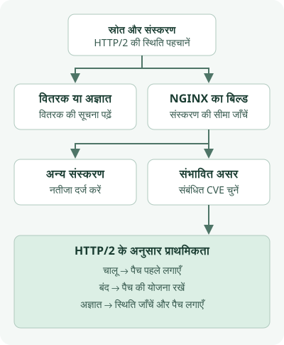

---
{
  "state": "draft",
  "language": "hi",
  "translationKey": "2026-11-21-nginx4shell-http2",
  "title": "Nginx4Shell के बाद HTTP/2 सेवाओं में पैच की प्राथमिकता कैसे तय करें",
  "description": "21 नवंबर 2026 के लेख के आधार पर अपनी NGINX शाखा, वितरण पैकेज और HTTP/2 लिसनर पहचानें। पैच के बाद हर प्रतिकृति और अपस्ट्रीम सेवा की स्थिति जाँचें।",
  "sourcePath": "src/content/posts/en/2026-11-21-nginx4shell-http2.md",
  "sourceSha256": "51daac7a022b582074f762f0ce0c07d617f4af8535152688b060235117af16c2"
}
---

पहले पहचानें कि आपके कौन-से NGINX लिसनर HTTP/2 स्वीकार करते हैं। 18 नवंबर 2026 को प्रकाशित CVE-2026-123007 और CVE-2026-123633 के अनुसार HTTP/2 संसाधन के दौरान मेमोरी को नुकसान पहुँच सकता था। वर्कर रुक सकता था या उसके अधिकारों के साथ बाहरी कोड चल सकता था। उस समय NGINX Open Source की स्थिर शाखा में **1.30.7** और मेनलाइन में **1.31.9** में सुधार आया था। वितरण पैकेज, NGINX Plus और Ingress के लिए उनके आपूर्तिकर्ता की सूचना देखें। यह हिंदी संस्करण बचाव और सेवा संचालन पर केंद्रित है। [NGINX सुरक्षा सूचनाएँ](https://nginx.org/en/security_advisories.html) · [F5 का 18 नवंबर का अपडेट](https://my.f5.com/s/article/K000164058)

## किन सेवाओं की जाँच करें?

**Nginx4Shell** इस लेख में दोनों सूचनाएँ ढूँढ़ने का नाम है। बदलाव के टिकट और संपत्ति सूची में दोनों CVE अलग दर्ज करें ताकि प्रत्येक उत्पाद का पैच उसकी अपनी सूचना से मिल सके।

| CVE | जाँच का दायरा | प्रभावित NGINX Open Source संस्करण |
| --- | --- | --- |
| CVE-2026-123007 | HTTP/2 स्वीकार करने वाले सर्वर देखें। केवल स्थिर सामग्री देने वाली सेवा भी HTTP/2 इस्तेमाल कर सकती है। | 1.9.5–1.30.6 और 1.31.0–1.31.8 |
| CVE-2026-123633 | अपस्ट्रीम को HTTP/2 अनुरोध भेजते समय वर्कर की मेमोरी प्रभावित हो सकती थी। पहले HTTP/2 रिवर्स प्रॉक्सी की समीक्षा करें। | 1.19.7–1.30.6 और 1.31.0–1.31.8 |

## चल रही सेवा और HTTP/2 कनेक्शन पहचानें

1. VM में सेवा की बाइनरी और पैकेज देखें। कंटेनर में चल रही इमेज का डाइजेस्ट जाँचें। उसी परिवेश में `nginx -V` संस्करण और बिल्ड विकल्प बताता है। Ubuntu 24.04 LTS जैसे वितरण पुराने संस्करण में सुधार जोड़ सकते हैं। Ubuntu ने इस रिलीज़ के लिए `1.24.0-2ubuntu7.20` को संशोधित पैकेज बताया था। [NGINX विकल्प](https://nginx.org/en/docs/switches.html) · [Ubuntu USN-9159-1](https://ubuntu.com/security/notices/USN-9159-1)
2. ब्राउज़र और CDN के बीच HTTP/2 का उपयोग मूल NGINX सर्वर तक उसी प्रोटोकॉल की पुष्टि नहीं करता। अधिकृत परिवेश में `nginx -T` से सक्रिय `http` और `server` ब्लॉक तथा शामिल फ़ाइलें जाँचें। पूरे आउटपुट में आंतरिक पते और गोपनीय मान हो सकते हैं। [NGINX HTTP/2 मॉड्यूल](https://nginx.org/en/docs/http/ngx_http_v2_module.html)
3. बाहर से अनुरोध स्वीकार करने वाली प्रभावित सेवाओं को प्राथमिकता दें। बदलाव से पहले कॉन्फ़िगरेशन की प्रति और बहाली का रास्ता जाँचें। पैच के बाद हर प्रतिकृति की बाइनरी या इमेज जाँचें। `nginx -t` से कॉन्फ़िगरेशन, फिर सामान्य अनुरोध, अपस्ट्रीम की स्थिति, त्रुटि दर और वर्कर रीस्टार्ट जाँचें। [CERT-EU की सूचना](https://cert.europa.eu/publications/security-advisories/2026-022)

यदि तुरंत पैच लगाना संभव न हो, तो प्रभावित लिसनर पर HTTP/2 अस्थायी रूप से बंद करने से जोखिम घट सकता है। मौजूदा सिंटैक्स में `http2 off;` लागू होता है। पुराने सिंटैक्स में `listen` से `http2` विकल्प हटाया जाता है। पहले HTTP/2 पर निर्भर gRPC जैसी सेवाएँ पहचानें। बदलाव के बाद वास्तविक कनेक्शन और सामान्य सेवा जाँचें, फिर पैच की योजना पूरी करें। [NGINX HTTP/2 कॉन्फ़िगरेशन](https://nginx.org/en/docs/http/ngx_http_v2_module.html) · [Red Hat की संचालन सूचना](https://access.redhat.com/security/vulnerabilities/RHSB-2026-019)

