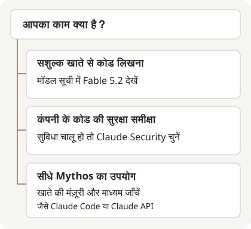

---
{
  "state": "draft",
  "language": "hi",
  "translationKey": "2026-11-22-claude-mythos-availability",
  "title": "Claude Mythos किसे उपलब्ध था और खाते की अनुमति कहाँ जाँचें?",
  "description": "22 नवंबर 2026 को दस्तावेज़ों में Fable 5.2, Enterprise की Claude Security सुविधा और Mythos 5.2 तक सीधी पहुँच के लिए अलग-अलग शर्तें थीं।",
  "sourcePath": "src/content/posts/en/2026-11-22-claude-mythos-availability.md",
  "sourceSha256": "03f809cd5ff47c9929524f940e1ebf683dc5e75760fb062cfdb425ffbf4ff424"
}
---

Claude Mythos 5.2 तक सीधी पहुँच के लिए Anthropic के सत्यापन कार्यक्रम की मंज़ूरी चाहिए थी। पात्र योजना वाले स्वीकृत व्यक्ति Cyber Verification Program (CVP) के माध्यम से Defense Access पा सकते थे। Enterprise में संगठन Claude Security चालू कर सकता था, जो कोड की समीक्षा में Mythos 5.2 इस्तेमाल करता था। सशुल्क Claude योजनाओं में Fable 5.2 उपलब्ध था, लेकिन उपयोग क्रेडिट की शर्त योजना और सीट पर निर्भर थी। यह बचाव-केंद्रित हिंदी संस्करण 22 नवंबर 2026 को उपलब्ध दस्तावेज़ों पर आधारित है। अपने खाते की मौजूदा पात्रता आधिकारिक सहायता में जाँचें। [Anthropic की 5.2 घोषणा](https://www.anthropic.com/claude-fable-and-mythos-5-2#availability) · [कार्यक्रम में शामिल मॉडल](https://support.claude.com/en/articles/15425695-covered-models) · [Cyber Verification Program](https://support.claude.com/en/articles/14604842-cyber-verification-program)

## अपने काम के लिए कहाँ देखें?

| काम | कहाँ देखें | उस समय की शर्त |
| --- | --- | --- |
| कोड या लेखन के लिए 5.2 मॉडल चुनना | वेब, डेस्कटॉप, मोबाइल या Claude Code की मॉडल सूची | सशुल्क योजना पर Fable 5.2 उपलब्ध था। क्रेडिट की ज़रूरत योजना और सीट पर निर्भर थी। |
| कंपनी के रिपॉज़िटरी की सुरक्षा समीक्षा | Claude के वेब संस्करण में Claude Security | Enterprise सार्वजनिक बीटा था। संगठन को सुविधा चालू करनी थी और उपयोगकर्ता की सीट में Claude Code शामिल होना चाहिए था। |
| Claude Code या Claude API में सीधे Mythos चुनना | खाते की मॉडल अनुमतियाँ या API का कार्यक्षेत्र | सत्यापन कार्यक्रम की मंज़ूरी ज़रूरी थी। पात्र व्यक्ति Defense Access के लिए आवेदन कर सकते थे। |

अप्रैल 2026 में **Mythos Preview** Project Glasswing के सहभागी संगठनों के लिए शोध पूर्वावलोकन था। **Mythos 5.2** की घोषणा 9 नवंबर को हुई। उपलब्धता से जुड़ी रिपोर्ट पढ़ते समय तारीख और मॉडल का पूरा नाम मिलाएँ। [Project Glasswing](https://www.anthropic.com/project/glasswing) · [Claude Mythos](https://www.anthropic.com/claude/mythos)

## Enterprise में Mythos कहाँ इस्तेमाल होता था?

Claude Security अपने रिपॉज़िटरी स्कैन में Mythos 5.2 का उपयोग करता था। उदाहरण के लिए, टीम किसी आंतरिक सेवा की अधिकार-जाँच पर आई रिपोर्ट में प्रमाण और प्रस्तावित सुधार पढ़ सकती थी। Enterprise ग्राहकों को इस सुविधा के लिए CVP में शामिल होना ज़रूरी नहीं था। उपयोगकर्ता की सीट में Claude Code होना चाहिए था। सीट-आधारित योजनाओं में उपयोग क्रेडिट भी चालू होने चाहिए थे। पात्र सीट वाला संगठन स्वामी `Organization settings → Claude Security` से सुविधा चालू कर सकता था। [Anthropic की घोषणा](https://www.anthropic.com/claude-fable-and-mythos-5-2) · [Claude Security की शर्तें](https://support.claude.com/en/articles/14661296-use-claude-security)

रिपोर्ट का सुधार Claude Code में खोला जा सकता था। स्कैन चलाने वाले मॉडल और सुधार करने वाले सत्र की अनुमतियाँ अलग थीं। इसीलिए Enterprise में रिपोर्ट मिल सकती थी, भले ही उपयोगकर्ता की सामान्य चैट सूची में Mythos न दिखे। [Claude Security](https://claude.com/product/claude-security) · [Claude Code की मॉडल सेटिंग](https://code.claude.com/docs/en/model-config)

## व्यक्तिगत योजना में Fable 5.2

Anthropic के अनुसार Fable 5.2 और Mythos 5.2 का आधार मॉडल एक था। Fable में साइबर सुरक्षा और जीवन विज्ञान के लिए अतिरिक्त सुरक्षा उपाय थे। व्यक्तिगत सशुल्क योजना पर Fable 5.2 से किसी रिपॉज़िटरी को समझने या रिफ़ैक्टर की योजना बनाने जैसे काम किए जा सकते थे। Pro और कुछ मानक सीटों में शुरुआत से ही उपयोग क्रेडिट लगते थे। [मॉडल की घोषणा](https://www.anthropic.com/claude-fable-and-mythos-5-2) · [योजना के अनुसार उपलब्धता](https://support.claude.com/en/articles/15424964-claude-fable-models-on-your-plan)

## सीधे Mythos की अनुमति

कार्यक्रम की सहायता के अनुसार पात्र Pro, Max और Ultra योजनाओं वाले स्वतंत्र सुरक्षा शोधकर्ता या ओपन-सोर्स अनुरक्षक **Defense Access** के लिए आवेदन कर सकते थे। स्वीकृत प्रतिभागियों के लिए इसमें Mythos 5.2 शामिल था। केवल सशुल्क सदस्यता लेने से यह अधिकार नहीं मिलता था। जीवन विज्ञान के लिए अलग सत्यापन कार्यक्रम था। [कार्यक्रम की शर्तें](https://support.claude.com/en/articles/14604842-cyber-verification-program) · [उपलब्धता की घोषणा](https://www.anthropic.com/claude-fable-and-mythos-5-2#availability)

API दस्तावेज़ में `claude-mythos-5-2` Mythos 5.2 की मॉडल आईडी थी। उपयोग खाते, संगठन और चुने गए माध्यम की अनुमति पर निर्भर था। Claude और Claude Console की पहुँच अलग-अलग प्रबंधित होती थी। Console में आवंटित कार्यक्षेत्र देखें। क्लाउड प्रदाता का उपयोग करने वाला संगठन जुड़े हुए खाते और प्रदाता के समर्थन की भी पुष्टि करे। [API मॉडल मार्गदर्शिका](https://platform.claude.com/docs/en/models/fable-5-2/migration-guide) · [खाते और कार्यक्षेत्र की सहायता](https://support.claude.com/en/articles/14604842-cyber-verification-program)
