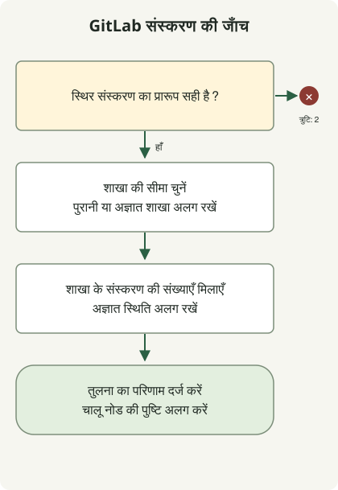

---
{
  "state": "draft",
  "language": "hi",
  "translationKey": "2026-10-30-gitlab2shell-cve-2026-110264",
  "title": "GitLab2Shell से बचाव: हर GitLab नोड पर पैच की पुष्टि कैसे करें",
  "description": "सुरक्षा और संचालन के इस संस्करण में GitLab CE/EE की पहली संशोधित रिलीज़ पहचानें, ज़रूरी अपग्रेड पड़ाव चुनें और चल रहे नोड व माइग्रेशन की जाँच करें।",
  "sourcePath": "src/content/posts/en/2026-10-30-gitlab2shell-cve-2026-110264.md",
  "sourceSha256": "e82e5c142578027e209b24cd05267e840b1988b27684891f646b8e25af5576a7"
}
---

GitLab2Shell से बचाव के लिए GitLab CE/EE सर्वर पर **CVE-2026-110264 का सुधार लगाएँ और हर चालू नोड पर उसकी पुष्टि करें**। 21 अक्टूबर की GitLab सूचना के अनुसार कुछ परिस्थितियों में बिना लॉगिन के दूर से कोड चल सकता था। केवल GitLab Shell या Runner को अपडेट करने से सर्वर का पैच पूरा नहीं होता।

## अपनी GitLab शाखा का पहला सुधार पहचानें

| GitLab CE/EE शाखा | इस खामी को सुधारने वाली पहली रिलीज़ |
| --- | --- |
| 18.11 | 18.11.13 |
| 19.0 | 19.0.10 |
| 19.1 | 19.1.9 |
| 19.2 | 19.2.9 |
| 19.3 | 19.3.6 |
| 19.4 | 19.4.3 |
| 19.5 | 19.5.1 |

सूचना में 7.0 से लेकर 18.11.13 से पहले तक के संस्करण और तालिका की प्रत्येक शाखा में पहले सुधार से पुराने संस्करण प्रभावित बताए गए थे। 30 अक्टूबर 2026 की तालिका से सुधार की शुरुआती सीमा पता चलती है। आज अपग्रेड की योजना बनाते समय अपनी समर्थित शाखा की मौजूदा रिलीज़ देखें। GitLab.com और GitLab Dedicated के लिए उसी सूचना में अलग विवरण है।

## संस्करण की तुलना से क्या पता चलता है?

पहले संस्करण का प्रारूप जाँचें, फिर उसकी शाखा की संख्या तालिका से मिलाएँ। पुरानी प्रभावित शाखा के लिए अपग्रेड का रास्ता तय करें। तालिका से बाहर की शाखा की स्थिति अज्ञात रखें। इस तुलना से पैकेज का स्रोत या किसी सर्वर का चालू संस्करण साबित नहीं होता।

## हर नोड पर चल रही रिलीज़ की पुष्टि करें

Linux पैकेज वाली स्थापना में `sudo gitlab-rake gitlab:env:info` और स्रोत से स्थापना में `bundle exec rake gitlab:env:info RAILS_ENV=production` GitLab, Ruby और घटकों की जानकारी देते हैं। कई नोड वाले परिवेश में Rails चलाने वाले नोड पर जाँचें। आउटपुट में आंतरिक पते और पथ हो सकते हैं, इसलिए इसे सीमित पहुँच वाले रिकॉर्ड में रखें। [GitLab रखरखाव दस्तावेज़](https://docs.gitlab.com/administration/raketasks/maintenance/)

हर वेब और बैकग्राउंड नोड के रिकॉर्ड से पैकेज का पूरा संशोधन या चालू इमेज का डाइजेस्ट मिलाएँ। एक HTTP बैनर या किसी एक नोड का आउटपुट पूरे डिप्लॉयमेंट की पुष्टि नहीं करता।

## अपग्रेड के हर पड़ाव पर माइग्रेशन पूरे करें

स्थापित संस्करण से [GitLab का अपग्रेड पथ](https://docs.gitlab.com/update/upgrade_paths/) चुनें। हर अनिवार्य पड़ाव पर बैकग्राउंड माइग्रेशन पूरा होने दें। पहले बैकअप से बहाली, एक्सटेंशन की संगतता, सेवा बंद रहने का समय और नोड बदलने का क्रम तय करें।

अपग्रेड के बाद चालू संस्करण, माइग्रेशन, लॉगिन, रिपॉज़िटरी तक पहुँच और जॉब चलने की जाँच करें। Onigmo वर्कर का बार-बार बंद होना या Org-mode रेंडरिंग त्रुटियों का अचानक बढ़ना जाँच के संकेत हैं। संदेह होने पर लॉग, प्रक्रिया और डिप्लॉयमेंट रिकॉर्ड सुरक्षित रखकर घटना की अलग जाँच करें।
