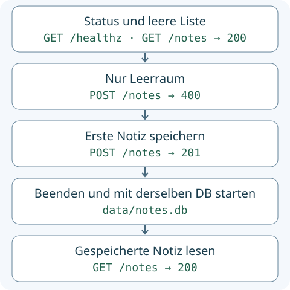

---
{
  "state": "draft",
  "language": "de",
  "translationKey": "2026-11-28-self-hosting-ai-notes",
  "title": "Eine KI-generierte App selbst hosten: die ersten Schritte mit einer Notiz-API",
  "description": "Eine KI schreibt eine Notiz-API. Nach einem Neustart lässt sich prüfen, ob die erste Notiz noch in derselben SQLite-Datei steht.",
  "sourcePath": "src/content/posts/en/2026-11-28-self-hosting-ai-notes.md",
  "sourceSha256": "005a0679c6742c842941ba2d57b180427e876b2615a48d4c7bb23d42503f8597"
}
---

Die von der KI erstellte Notiz-App hat die erste Notiz gespeichert. Beenden Sie die App und starten Sie sie erneut. Ist die Notiz noch da? Beim Selfhosting lohnt es sich, gleich am Anfang auszuprobieren, ob die App antwortet und ob ihre Daten einen Neustart überstehen. Dazu lassen wir uns von einer KI eine kleine Notiz-App samt Startanleitung schreiben und testen sie auf dem eigenen Rechner. Das Beispiel verwendet nur Python und SQLite.

## Funktionen und Betriebsbedingungen gemeinsam vorgeben

Bei der Bitte „Schreib mir eine Notiz-App“ entscheidet das Modell womöglich selbst über Speicherort und Zugriff. Legen Sie vorab fest, wo die Daten liegen sollen, wer zugreifen darf und woran Sie erkennen, dass die App funktioniert.

> Schreibe eine persönliche Notiz-API mit der Python-Standardbibliothek und SQLite. Binde sie ausschließlich an `127.0.0.1` und speichere Notizen in `data/notes.db`. `GET /healthz` soll den Status zurückgeben, `GET /notes` die Notizen auflisten. `POST /notes` soll `{"text":"첫 메모"}` annehmen und Eingaben, die nur aus Leerraum bestehen, mit `400` zurückweisen. Liefere `app.py`, Befehle zum Starten und Beenden sowie Prüfbeispiele mit curl. Prüfe in dieser Reihenfolge: Status abrufen → Notiz speichern → Prozess beenden → mit derselben DB neu starten → Notiz lesen. Nenne die Adresse, an der die App lauscht, und die Datei, die sie anlegt.

## Vor dem Start Adresse und Speicherpfad prüfen

Prüfen Sie, ob der Server an `127.0.0.1` gebunden ist und SQLite die Datei `data/notes.db` auf dem Datenträger öffnet. Ein relativer Pfad kann auf eine andere Datenbank zeigen, wenn Sie das Arbeitsverzeichnis wechseln. Das Beispiel bestimmt den Pfad aus dem Speicherort der App-Datei. Pythons `http.server` dient hier dem lokalen Lernen. [http.server](https://docs.python.org/3/library/http.server.html) · [sqlite3](https://docs.python.org/3/library/sqlite3.html)

Speichern Sie den folgenden Code als `app.py` in einem leeren Übungsverzeichnis.

```python
import json
import sqlite3
from http.server import BaseHTTPRequestHandler, HTTPServer
from pathlib import Path

db_path = Path(__file__).resolve().parent / "data" / "notes.db"


class Notes(BaseHTTPRequestHandler):
    def reply(self, status, value):
        body = json.dumps(value, ensure_ascii=False).encode("utf-8")
        self.send_response(status)
        self.send_header("Content-Type", "application/json; charset=utf-8")
        self.send_header("Content-Length", str(len(body)))
        self.end_headers()
        self.wfile.write(body)

    def do_GET(self):
        if self.path == "/healthz":
            self.reply(200, {"status": "ok"})
        elif self.path == "/notes":
            rows = db.execute("SELECT text FROM notes ORDER BY id")
            self.reply(200, [{"text": text} for (text,) in rows])
        else:
            self.reply(404, {"error": "unknown path"})

    def do_POST(self):
        if self.path != "/notes":
            self.reply(404, {"error": "unknown path"})
            return
        try:
            size = int(self.headers.get("Content-Length", "0"))
            if not 0 < size <= 8192:
                raise ValueError
            data = json.loads(self.rfile.read(size))
            if not isinstance(data, dict):
                raise ValueError
            text = data.get("text")
            if not isinstance(text, str) or not text.strip():
                raise ValueError
        except ValueError:
            self.reply(400, {"error": "invalid note"})
            return
        with db:
            db.execute("INSERT INTO notes (text) VALUES (?)", (text,))
        self.reply(201, {"text": text})


if __name__ == "__main__":
    db_path.parent.mkdir(exist_ok=True)
    db = sqlite3.connect(db_path)
    try:
        db.execute("CREATE TABLE IF NOT EXISTS notes (id INTEGER PRIMARY KEY, text TEXT NOT NULL)")
        with HTTPServer(("127.0.0.1", 0), Notes) as server:
            print(f"http://127.0.0.1:{server.server_port}", db_path, sep="\n", flush=True)
            server.serve_forever()
    except KeyboardInterrupt:
        pass
    finally:
        db.close()
```

## Die Anleitung mit echten Anfragen testen



Ob die Notiz auf dem Datenträger liegt, prüfen Sie, indem Sie den schreibenden Prozess beenden und die Notiz in einem neuen Prozess lesen.

Führen Sie `python3 app.py` im App-Verzeichnis aus. Die erste Zeile enthält die Adresse mit temporärem Port, die nächste den Datenbankpfad. Führen Sie die folgenden Befehle in einem zweiten Terminal aus. Sobald `read` auf Ihre Eingabe wartet, fügen Sie die Adresse aus der ersten Zeile ein.

```sh
read -r base
```

```sh
curl -i "$base/healthz"
curl -i "$base/notes"
curl -i -H 'Content-Type: application/json' -d '{"text":"   "}' "$base/notes"
curl -i -H 'Content-Type: application/json' -d '{"text":"첫 메모"}' "$base/notes"
```

Drücken Sie im App-Terminal `Ctrl+C`. Sobald die Eingabeaufforderung zurückkehrt, führen Sie `python3 app.py` erneut aus. Vergleichen Sie den Datenbankpfad und geben Sie die neue Adresse im zweiten Terminal ein.

```sh
read -r base
```

```sh
curl -i "$base/notes"
```

Wir haben das Beispiel mit Python `3.13.0` in einer temporären lokalen Umgebung über die Loopback-Adresse und einen temporären Port getestet. Statusabfrage und anfangs leere Liste ergaben `200`, eine Eingabe aus reinem Leerraum `400` und das Speichern der ersten Notiz `201`. Nach dem bestätigten Prozessende und dem Neustart mit derselben Datenbank lieferte die Liste `200` und die gespeicherte Notiz. Falls die Liste leer erscheint, vergleichen Sie die tatsächlich angezeigten Datenbankpfade beider Starts. Geben Sie der KI die Startbefehle, die Datenbankpfade und die HTTP-Antworten.

## Für den weiteren Betrieb Sicherung und Wiederherstellung vorbereiten

„Wenn dieser Rechner ausfällt, kann ich meine Notizen woanders öffnen?“ Fragen Sie die KI nach dem Datenpfad und den Schritten, um eine Sicherung in einem neuen Verzeichnis wiederherzustellen und die Notizen dort zu lesen. Prüfen Sie beim Umzug auf einen Server, wie die App nach einem Neustart des Rechners startet und wer Zugriff hat. Dieser Versuch umfasste lokale Anfragen, das Speichern und das Lesen nach dem Neustart. Externer Zugriff und Wiederherstellung einer Sicherung wurden nicht erprobt. [Ein MacBook als persönlichen Server im privaten Netzwerk nutzen](https://youdozi.github.io/ko/posts/2026-11-23-macbook-personal-server/)
